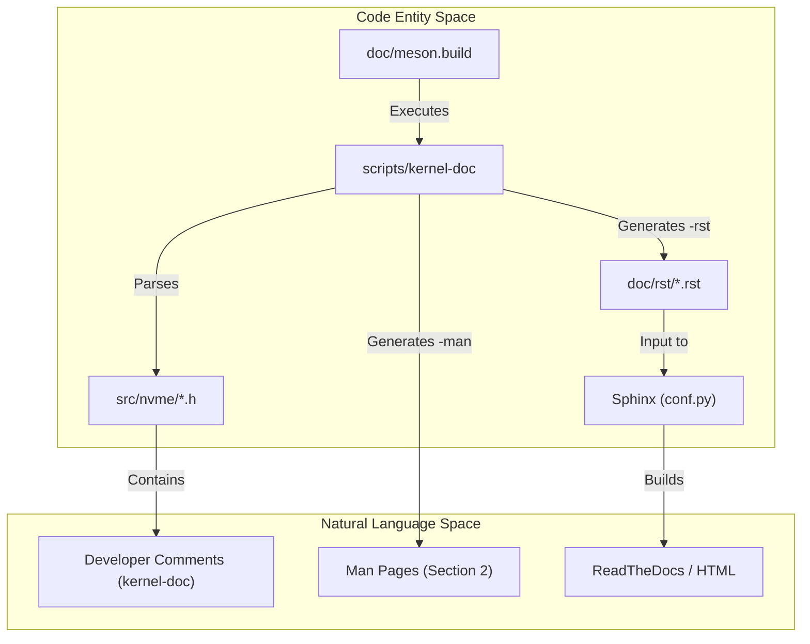
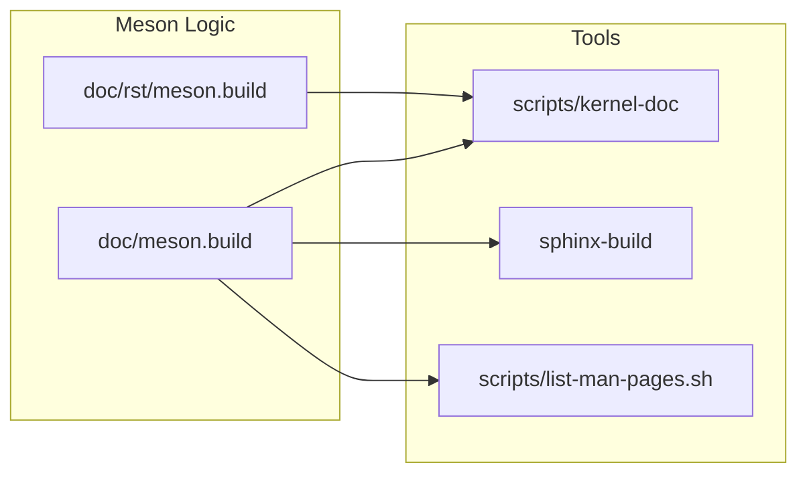

<!-- source: DeepWiki mcp.deepwiki.com · repo NVIDIA/libnvme · page 10.2 Documentation Generation · fetched 2026-10-26 -->

# Documentation Generation

Relevant source files

The following files were used as context for generating this wiki page:

- [doc/api.rst.in](doc/api.rst.in)
- [doc/conf.py](doc/conf.py)
- [doc/conf.py.in](doc/conf.py.in)
- [doc/config-schema.json.in](doc/config-schema.json.in)
- [doc/index.rst](doc/index.rst)
- [doc/index.rst.in](doc/index.rst.in)
- [doc/installation.rst.in](doc/installation.rst.in)
- [doc/meson.build](doc/meson.build)
- [doc/mi.rst.in](doc/mi.rst.in)
- [doc/quickstart.rst.in](doc/quickstart.rst.in)
- [doc/rst/filters.rst](doc/rst/filters.rst)
- [doc/rst/ioctl.rst](doc/rst/ioctl.rst)
- [doc/rst/linux.rst](doc/rst/linux.rst)
- [doc/rst/log.rst](doc/rst/log.rst)
- [doc/rst/meson.build](doc/rst/meson.build)
- [doc/rst/mi.rst](doc/rst/mi.rst)
- [doc/rst/tree.rst](doc/rst/tree.rst)
- [doc/rst/types.rst](doc/rst/types.rst)
- [doc/rst/util.rst](doc/rst/util.rst)
- [scripts/kernel-doc](scripts/kernel-doc)
- [scripts/kernel-doc-check](scripts/kernel-doc-check)
- [scripts/list-man-pages.sh](scripts/list-man-pages.sh)
- [scripts/list-pre-compiled.sh](scripts/list-pre-compiled.sh)
- [scripts/meson-vcs-tag.sh](scripts/meson-vcs-tag.sh)
- [scripts/release.sh](scripts/release.sh)
- [scripts/update-docs.sh](scripts/update-docs.sh)

The `libnvme` project utilizes a structured documentation pipeline to ensure that the API reference remains synchronized with the source code. This is achieved by extracting `kernel-doc` comments from C header files and transforming them into ReStructuredText (RST) for HTML/PDF output via Sphinx, and into man pages for terminal-based reference.

### Documentation Pipeline Overview

The data flow for documentation begins in the public header files located in `src/nvme/`. The process is orchestrated by Meson and utilizes the `kernel-doc` script (originally from the Linux kernel tree) to parse the source.

| Component | Role | Source Reference |
| :--- | :--- | :--- |
| **Header Files** | Source of truth containing `kernel-doc` formatted comments. | [doc/meson.build:11-22]() |
| **kernel-doc** | Perl script that parses C comments and outputs RST or Man formats. | [doc/meson.build:52-52]() |
| **Meson** | Orchestrates the build, dependency tracking, and installation. | [doc/meson.build:1-113]() |
| **Sphinx** | Processes RST files and static content into HTML documentation. | [doc/meson.build:94-105]() |

#### Data Flow Diagram: From Code to Manuals

The following diagram illustrates how a single function definition in a header file propagates through the system to become both a man page and an HTML entry.

"Documentation Generation Workflow"

Sources: [doc/meson.build:52-81](), [doc/rst/meson.build:15-31](), [doc/conf.py:1-24]()

---

### API Modules and Source Mapping

Documentation is organized by functional modules. Each module corresponds to a specific header file and a resulting RST/Man page set.

| Module | Header File | RST Output | Description |
| :--- | :--- | :--- | :--- |
| **Fabrics** | `fabrics.h` | `fabrics.rst` | NVMe-over-Fabrics connection management. |
| **IOCTL** | `ioctl.h` | `ioctl.rst` | Low-level passthrough and Linux ioctl structures. |
| **Tree** | `tree.h` | `tree.rst` | Topology discovery and sysfs object model. |
| **MI** | `mi.h` | `mi.rst` | Management Interface (NVMe-MI) functions. |
| **NBFT** | `nbft.h` | `nbft.rst` | NVMe Boot Firmware Table parsing. |
| **Util** | `util.h` | `util.rst` | Payload initialization and status helpers. |

Sources: [doc/meson.build:11-22](), [doc/rst/util.rst:1-10](), [doc/rst/ioctl.rst:1-10]()

---

### Implementation Details

#### Meson Build Logic
The `doc/meson.build` file defines the `api_files` list which includes the core headers [doc/meson.build:11-22](). It provides two primary options for the build:
1. `docs`: Controls which formats to generate (`man`, `html`, `rst`, or `all`) [doc/meson.build:50-50]().
2. `docs-build`: A boolean that determines if documentation should be regenerated from source or if pre-compiled versions should be used [doc/meson.build:51-51]().

#### Man Page Generation
For every function identified in the API headers, the script `scripts/list-man-pages.sh` is called to generate a list of target man pages [doc/meson.build:61-66](). Meson then creates a `custom_target` for each function, invoking `kernel-doc` with the `-man` flag [doc/meson.build:67-79](). These are installed into section 2 (System Calls/Library Functions) of the manual [doc/meson.build:60-60]().

#### RST and Sphinx Integration
The RST generation occurs in `doc/rst/meson.build`. The process involves:
1. Running `kernel-doc -rst` on the header files to produce module-level RST files [doc/rst/meson.build:21-30]().
2. Using `configure_file` to process `.in` templates for static pages like `index.rst`, `installation.rst`, and `mi.rst` [doc/meson.build:40-44]().
3. Invoking `sphinx-build` to aggregate these RST files into a cohesive HTML site [doc/meson.build:96-105]().

"Code Entity Mapping: Documentation Tools"

Sources: [doc/meson.build:52-94](), [doc/rst/meson.build:9-26]()

---

### Release and Maintenance

Documentation is updated during the release process via `scripts/update-docs.sh`. This script automates the regeneration of both man pages and RST files to ensure the `doc/` directory in the repository contains the latest documentation for the tagged version.

1. **Update Sequence**: The script sets up a temporary build directory, configures Meson with `-Ddocs-build=true`, and compiles the targets [scripts/update-docs.sh:11-16]().
2. **Artifact Collection**: It copies the generated `.2` man pages to `doc/man` and `.rst` files to `doc/rst` [scripts/update-docs.sh:21-39]().
3. **Release Integration**: The `scripts/release.sh` script calls `update-docs.sh` and commits the changes as part of the release commit [scripts/release.sh:112-119]().

#### ReadTheDocs Integration
The project is configured for ReadTheDocs (RTD) integration. Sphinx configuration is managed via `doc/conf.py`, which sets the project name, author (Keith Busch), and versioning information [doc/conf.py:10-15](). The `master_doc` is set to `index`, which serves as the entry point for the RTD build [doc/conf.py:13-13]().

Sources: [scripts/update-docs.sh:1-50](), [scripts/release.sh:112-119](), [doc/conf.py:1-33]()

---

