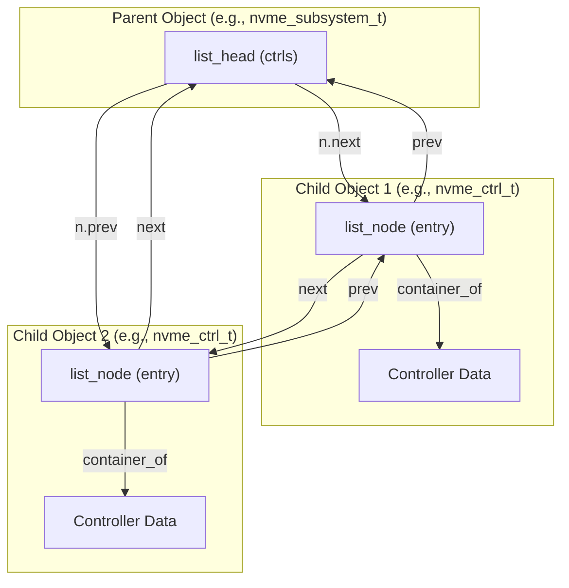
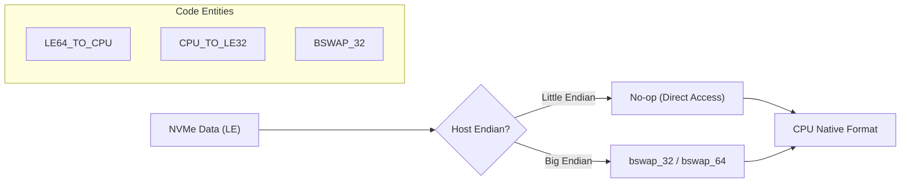

<!-- source: DeepWiki mcp.deepwiki.com · repo NVIDIA/libnvme · page 11.1 CCAN Utility Library · fetched 2026-10-26 -->

# CCAN Utility Library

Relevant source files

The following files were used as context for generating this wiki page:

- [ccan/ccan/container_of/container_of.h](ccan/ccan/container_of/container_of.h)
- [ccan/ccan/endian/endian.h](ccan/ccan/endian/endian.h)
- [ccan/ccan/list/list.c](ccan/ccan/list/list.c)
- [ccan/ccan/list/list.h](ccan/ccan/list/list.h)
- [ccan/ccan/str/str.h](ccan/ccan/str/str.h)
- [ccan/meson.build](ccan/meson.build)
- [internal/meson.build](internal/meson.build)
- [meson.build](meson.build)
- [src/meson.build](src/meson.build)

The `libnvme` codebase bundles a subset of the **C Code Archive Network (CCAN)**, a collection of reusable C components. These utilities provide fundamental data structures and macros that ensure memory safety, type checking, and portable byte-order manipulation across the library's topology tree and transport layers [ccan/meson.build:9-13]().

## Core Components Overview

The CCAN utilities are compiled into a static library `libccan`, which is then linked into both `libnvme.so` and `libnvme-mi.so` [src/meson.build:58,87]().

| Component | Purpose | Key Entities |
|:---|:---|:---|
| **ccan/list** | Circular doubly-linked lists | `struct list_head`, `struct list_node` |
| **ccan/str** | Safe string manipulation | `streq`, `strstarts`, `cisalnum` |
| **ccan/endian** | Byte-order conversion | `cpu_to_le32`, `be64_to_cpu` |
| **ccan/container_of** | Pointer arithmetic to find parent structs | `container_of`, `container_off` |
| **ccan/check_type** | Compile-time type validation | `check_types_match` |
| **ccan/build_assert** | Compile-time assertions | `BUILD_ASSERT` |

**Sources:** [ccan/meson.build:9-26](), [src/meson.build:49-59]()

---

## Circular Doubly-Linked Lists (ccan/list)

The `ccan/list` module is the backbone of the `libnvme` topology tree. It implements a circular doubly-linked list where the head and nodes are distinct structures, ensuring that the list is never "broken" even when empty (the head's `next` and `prev` simply point to itself) [ccan/ccan/list/list.h:143-146]().

### Data Structures and Relationship

The following diagram illustrates how `list_head` anchors a series of `list_node` elements embedded within larger topology objects (like `nvme_ctrl_t` or `nvme_ns_t`).

**Topology List Mapping**

### Key Functions
- `list_head_init`: Initializes a head to point to itself [ccan/ccan/list/list.h:143-146]().
- `list_add`: Inserts a node at the start of the list [ccan/ccan/list/list.h:203-209]().
- `list_add_tail`: Inserts a node at the end of the list [ccan/ccan/list/list.h:249-250]().
- `list_del`: Removes a node and re-links its neighbors [ccan/ccan/list/list.h:320-330]().
- `list_check`: Debugging utility to verify list integrity by traversing and checking `prev` pointers [ccan/ccan/list/list.c:38-43]().

**Sources:** [ccan/ccan/list/list.h:24-44](), [ccan/ccan/list/list.c:20-43]()

---

## Safe String Utilities (ccan/str)

The `ccan/str` module provides macros and inline functions that wrap standard `<string.h>` and `<ctype.h>` functions to make them more readable and type-safe.

### Function Mapping and Safety

| Macro/Function | Logic | Benefit |
|:---|:---|:---|
| `streq(a, b)` | `strcmp(a, b) == 0` | Avoids the confusing `!strcmp` syntax [ccan/ccan/str/str.h:21](). |
| `strstarts(s, p)` | `strncmp(s, p, strlen(p)) == 0` | Explicit prefix checking [ccan/ccan/str/str.h:32](). |
| `cisalnum(c)` | `isalnum((unsigned char)c)` | Forces cast to `unsigned char` to avoid undefined behavior with `char` [ccan/ccan/str/str.h:110-113](). |
| `stringify(e)` | `#e` | Double-indirection macro to stringify macro expansions [ccan/ccan/str/str.h:59-61](). |

**Sources:** [ccan/ccan/str/str.h:10-164]()

---

## Byte-Order Conversion (ccan/endian)

Since NVMe is a little-endian specification, but `libnvme` runs on various architectures (x86_64, s390x, ppc64le), the `ccan/endian` module provides portable conversion macros.

### Implementation Logic
The module detects host endianness during the build via Meson [meson.build:180-188](). It then defines conversion macros that either resolve to no-ops (on little-endian hosts) or call byte-swapping functions (on big-endian hosts).

**Endian Conversion Flow**

### Key Macros
- `LE32_TO_CPU(val)`: Converts a 32-bit little-endian value to host native format [ccan/ccan/endian/endian.h:174-176]().
- `CPU_TO_LE16(val)`: Converts a host native 16-bit value to little-endian [ccan/ccan/endian/endian.h:160-163]().
- `BSWAP_64(val)`: A constant-safe macro for reversing 64-bit integers [ccan/ccan/endian/endian.h:50-58]().

**Sources:** [ccan/ccan/endian/endian.h:50-58, 146-190](), [meson.build:160-188]()

---

## Structural Helpers

### container_of
This macro is used extensively to retrieve a pointer to a structure from a pointer to one of its members.
- **Syntax:** `container_of(ptr, type, member)` [ccan/ccan/container_of/container_of.h:33-37]().
- **Mechanism:** It subtracts the offset of `member` from `ptr` and performs a type-check to ensure `ptr` actually matches the member type [ccan/ccan/container_of/container_of.h:37]().

### check_type
Provides compile-time type checking.
- `check_types_match(expr1, expr2)`: Used within `container_of` to ensure that the pointer being converted matches the expected member type, preventing structural pointer errors [ccan/ccan/container_of/container_of.h:37]().

### build_assert
Implements compile-time assertions. Unlike standard `assert()`, `BUILD_ASSERT` causes the compilation to fail if the condition is not met, which is used for verifying structure sizes and alignments in NVMe command definitions.

**Sources:** [ccan/ccan/container_of/container_of.h:1-145](), [ccan/ccan/str/str.h:168-170]()

---

