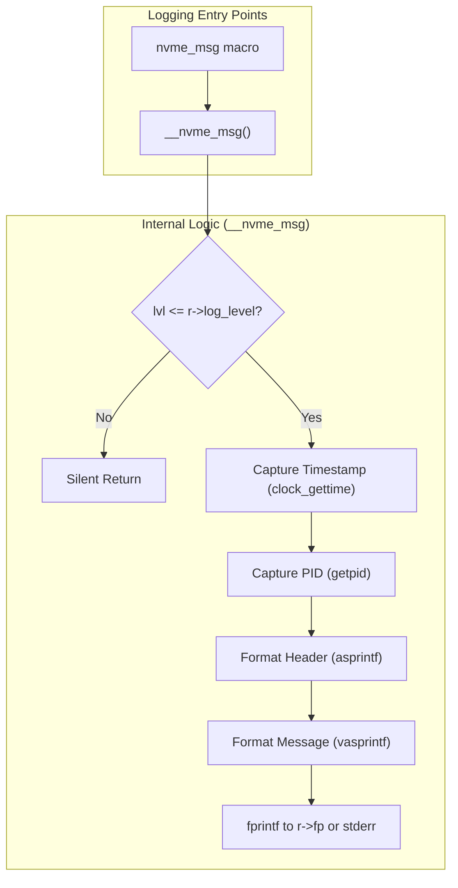
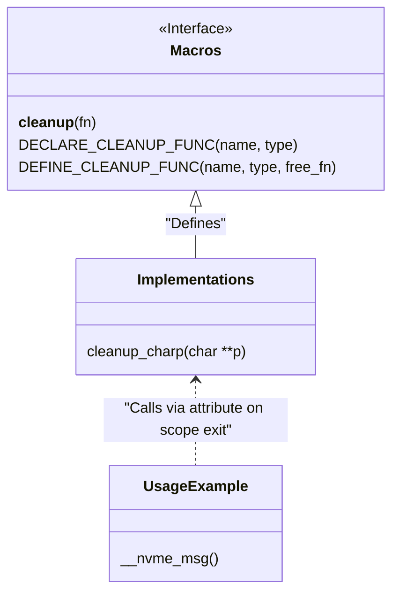

<!-- source: DeepWiki mcp.deepwiki.com · repo NVIDIA/libnvme · page 11.2 Logging, Cleanup, and No-JSON Stubs · fetched 2026-10-26 -->

# Logging, Cleanup, and No-JSON Stubs

Relevant source files

The following files were used as context for generating this wiki page:

- [libnvme/tests/create-ctrl-obj.py](libnvme/tests/create-ctrl-obj.py)
- [pyproject.toml](pyproject.toml)
- [src/nvme/cleanup.c](src/nvme/cleanup.c)
- [src/nvme/cleanup.h](src/nvme/cleanup.h)
- [src/nvme/log.c](src/nvme/log.c)
- [src/nvme/log.h](src/nvme/log.h)
- [src/nvme/no-json.c](src/nvme/no-json.c)

This section describes the internal utility mechanisms of `libnvme` that provide infrastructure for diagnostics, resource management, and build-time flexibility. These components ensure consistent message reporting, prevent memory leaks through RAII-style helpers, and allow the library to function in environments where `json-c` is unavailable.

## Logging Infrastructure

`libnvme` provides a centralized logging system managed via the `nvme_root_t` context. This system supports log level filtering, timestamping, and process identification.

### Logging Configuration and Initialization
Logging is initialized using `nvme_init_logging()`, which configures the logging behavior for a specific root object `[src/nvme/log.h:36-36]()`.

| Parameter | Role | Source |
|:---|:---|:---|
| `nvme_root_t r` | The context object containing log settings. | `[src/nvme/log.c:88-92]()` |
| `int lvl` | Sets `r->log_level`. Messages with higher priority values are ignored. | `[src/nvme/log.c:89-89]()` |
| `bool log_pid` | Enables inclusion of the Process ID in log headers. | `[src/nvme/log.c:90-90]()` |
| `bool log_tstamp` | Enables inclusion of monotonic timestamps in log headers. | `[src/nvme/log.c:91-91]()` |

The library defines default log levels:
* `DEFAULT_LOGLEVEL`: `LOG_NOTICE` `[src/nvme/log.h:18-18]()`
* `MAX_LOGLEVEL`: `LOG_DEBUG` `[src/nvme/log.h:15-15]()`

### Message Formatting and Output
The internal function `__nvme_msg` handles the construction of log lines `[src/nvme/log.c:30-32]()`. It uses a bitmask `idx` to select from a predefined array of format strings based on whether timestamps, PIDs, or function names are enabled `[src/nvme/log.c:37-49]()`.

**Logging Data Flow**

Sources: `[src/nvme/log.c:30-85]()`, `[src/nvme/log.h:28-36]()`

## Resource Cleanup (RAII Helpers)

To simplify memory management and reduce the risk of leaks in complex error paths, `libnvme` utilizes a set of macros in `cleanup.h` that wrap the GCC/Clang `__attribute__((cleanup))` functionality `[src/nvme/cleanup.h:5-5]()`.

### Cleanup Macros
* `__cleanup__(fn)`: Attaches a destructor function to a local variable. The function is called automatically when the variable goes out of scope `[src/nvme/cleanup.h:5-5]()`.
* `DEFINE_CLEANUP_FUNC(name, type, free_fn)`: A template macro that defines a wrapper function for a specific type and its corresponding free function `[src/nvme/cleanup.h:10-15]()`.

### Implementation Example
The library defines `cleanup_charp` for `char *` types using `free()` as the destructor:
* **Definition**: `DEFINE_CLEANUP_FUNC(cleanup_charp, char *, free);` `[src/nvme/cleanup.c:5-5]()`
* **Usage**: In `__nvme_msg`, both the `header` and `message` strings are declared with `__cleanup__(cleanup_charp)`. This ensures they are freed regardless of where the function returns `[src/nvme/log.c:47-48]()`.

**Cleanup Entity Mapping**

Sources: `[src/nvme/cleanup.h:1-20]()`, `[src/nvme/cleanup.c:1-5]()`, `[src/nvme/log.c:47-48]()`

## No-JSON Stub Module

`libnvme` optionally depends on `json-c` for features like reading and updating fabrics configurations. If the library is built without JSON support, the `no-json.c` module provides stub implementations to satisfy symbol requirements while returning error codes.

### Stubbed Functions
The following functions are implemented as stubs when JSON support is disabled, all returning `-ENOTSUP` (Operation not supported):

| Function Name | Purpose in Stub | Source |
|:---|:---|:---|
| `json_read_config` | Returns `-ENOTSUP` instead of parsing a config file. | `[src/nvme/no-json.c:13-16]()` |
| `json_update_config` | Returns `-ENOTSUP` instead of writing to a config file. | `[src/nvme/no-json.c:18-21]()` |
| `json_dump_tree` | Returns `-ENOTSUP` instead of serializing the topology tree. | `[src/nvme/no-json.c:23-26]()` |

This architecture allows the core library to remain linked against the same internal API regardless of build-time configuration.

Sources: `[src/nvme/no-json.c:1-27]()`

---

