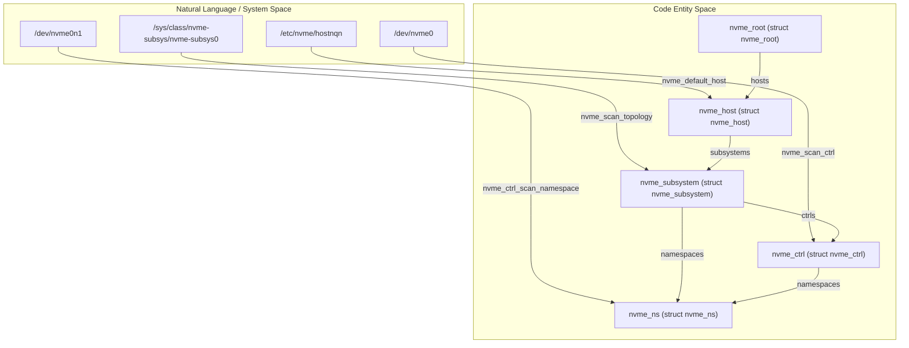
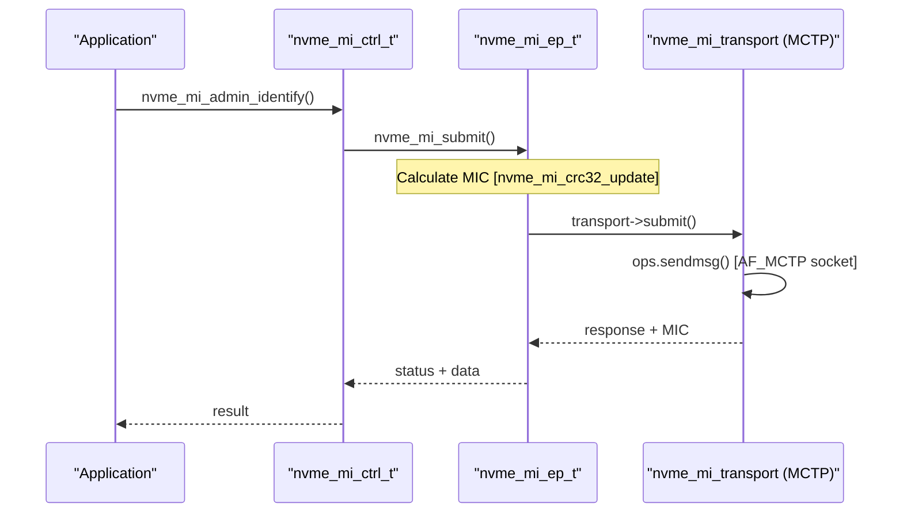

<!-- source: DeepWiki mcp.deepwiki.com · repo NVIDIA/libnvme · page 12 Glossary · fetched 2026-10-26 -->

# Glossary

Relevant source files

The following files were used as context for generating this wiki page:

- [examples/mi-mctp.c](examples/mi-mctp.c)
- [libnvme/meson.build](libnvme/meson.build)
- [libnvme/nvme.i](libnvme/nvme.i)
- [libnvme/tests/NBFT](libnvme/tests/NBFT)
- [libnvme/tests/gc.py](libnvme/tests/gc.py)
- [libnvme/tests/test-nbft.py](libnvme/tests/test-nbft.py)
- [src/libnvme-mi.h](src/libnvme-mi.h)
- [src/libnvme-mi.map](src/libnvme-mi.map)
- [src/nvme/fabrics.c](src/nvme/fabrics.c)
- [src/nvme/fabrics.h](src/nvme/fabrics.h)
- [src/nvme/ioctl.c](src/nvme/ioctl.c)
- [src/nvme/ioctl.h](src/nvme/ioctl.h)
- [src/nvme/mi-mctp.c](src/nvme/mi-mctp.c)
- [src/nvme/mi.c](src/nvme/mi.c)
- [src/nvme/mi.h](src/nvme/mi.h)
- [src/nvme/nbft.c](src/nvme/nbft.c)
- [src/nvme/nbft.h](src/nvme/nbft.h)
- [src/nvme/private.h](src/nvme/private.h)
- [src/nvme/tree.c](src/nvme/tree.c)
- [src/nvme/tree.h](src/nvme/tree.h)
- [src/nvme/types.h](src/nvme/types.h)
- [src/nvme/util.c](src/nvme/util.c)
- [src/nvme/util.h](src/nvme/util.h)
- [test/mi-mctp.c](test/mi-mctp.c)

This page provides definitions for codebase-specific terms, NVMe specification acronyms, and API objects used within `libnvme`. It serves as a technical reference for onboarding engineers to understand the mapping between the NVMe specification and the library implementation.

## Core Topology Objects

The library models the NVMe topology as a hierarchical tree of objects. These objects are primarily defined in `src/nvme/private.h` and exposed via opaque pointers in `src/nvme/tree.h`.

| Term | Code Entity | Definition |
|:---|:---|:---|
| **Root** | `nvme_root_t` | The top-level container for all discovered NVMe objects, logging configurations, and configuration file paths. |
| **Host** | `nvme_host_t` | Represents the local system (Host NQN and Host ID). Used to group subsystems. |
| **Subsystem** | `nvme_subsystem_t` | Represents an NVMe Subsystem, which may contain multiple controllers and namespaces. |
| **Controller** | `nvme_ctrl_t` | Represents an NVMe Controller (e.g., `/dev/nvme0`). Manages the connection and command submission. |
| **Namespace** | `nvme_ns_t` | Represents a block device or ZNS entity (e.g., `/dev/nvme0n1`). |
| **Path** | `nvme_path_t` | In multipath configurations, represents a specific route from a controller to a namespace. |

### Topology Data Flow
The following diagram illustrates how physical/sysfs entities map to internal code structures during a scan.

**Topology Mapping: Sysfs to Code Entities**

Sources: [src/nvme/tree.h:28-33](), [src/nvme/private.h:24-170](), [src/nvme/tree.c:109-159]()

---

## NVMe Management Interface (NVMe-MI) Terms

NVMe-MI provides out-of-band management, often over MCTP (Management Component Transport Protocol).

| Term | Code Entity | Definition |
|:---|:---|:---|
| **Endpoint (EP)** | `nvme_mi_ep_t` | The physical communication target (e.g., an EID in MCTP). Holds the transport abstraction. |
| **MI Controller** | `nvme_mi_ctrl_t` | A logical controller accessible via an Endpoint. Used to tunnel Admin commands. |
| **MIC** | `mic` (member) | Message Integrity Check. A CRC32 used to verify MI packets. |
| **MPR** | `NVME_MI_RESP_MPR` | More Processing Required. A status indicating the controller needs more time to complete a command. |
| **Quirk** | `NVME_QUIRK_...` | Workarounds for non-compliant hardware (e.g., inter-command delays). |

**NVMe-MI Command Submission Flow**

Sources: [src/nvme/mi.h:19-33](), [src/nvme/private.h:209-265](), [src/nvme/mi.c:124-194](), [src/nvme/mi-mctp.c:238-300]()

---

## Technical Jargon & Acronyms

### NVMe Specification Terms
*   **CSI (Command Set Indicator):** Defines the command set used by a namespace (e.g., NVM, ZNS, KV). [src/nvme/types.h:137-141]()
*   **NQN (NVMe Qualified Name):** A unique identifier for hosts and subsystems. [src/nvme/types.h:125]()
*   **NSID (Namespace Identifier):** A 32-bit identifier for a namespace. [src/nvme/types.h:100]()
*   **SCT/SC (Status Code Type / Status Code):** The two-part error reporting mechanism in NVMe. [src/nvme/util.c:177-188]()

### libnvme Internal Terms
*   **Passthrough:** Directly sending a command to the hardware via the kernel without the kernel's block layer processing it. Implementation: `nvme_passthru_cmd`. [src/nvme/ioctl.h:64-83]()
*   **Tree Scanning:** The process of traversing `/sys/class/nvme` to populate the `nvme_root_t` object model. [src/nvme/tree.c:109-159]()
*   **DH-HMAC-CHAP:** The protocol used for in-band authentication in NVMe-oF. [src/nvme/tree.h:123-135]()

---

## Status and Error Mapping

libnvme provides helpers to convert NVMe-specific status codes into standard Linux `errno` values.

| Function | Logic |
|:---|:---|
| `nvme_status_to_errno` | High-level entry point that checks `SCT` and branches to specific helpers. [src/nvme/util.c:168-188]() |
| `nvme_generic_status_to_errno` | Maps `NVME_SCT_GENERIC` codes (e.g., `NVME_SC_INVALID_OPCODE` -> `EINVAL`). [src/nvme/util.c:37-83]() |
| `nvme_fabrics_status_to_errno` | Maps Fabrics-specific errors (e.g., `NVME_SC_CONNECT_INVALID_HOST` -> `ECONNREFUSED`). [src/nvme/util.c:146-166]() |

Sources: [src/nvme/util.c:37-188]()

---

## Python Binding Entities

The Python bindings (generated via SWIG) map C structures to Python classes.

| C Entity | Python Class | Note |
|:---|:---|:---|
| `struct nvme_root` | `nvme.root` | Renamed for Pythonic access. [libnvme/nvme.i:16]() |
| `struct nvme_host` | `nvme.host` | Renamed for Pythonic access. [libnvme/nvme.i:17]() |
| `struct host_iter` | `nvme.host_iter` | Helper for iterating hosts in a root. [libnvme/nvme.i:61-64]() |
| `nvme_fabrics_config` | `dict` | Input configuration is passed as a Python dictionary and mapped via a SWIG typemap. [libnvme/nvme.i:143-204]() |

Sources: [libnvme/nvme.i:16-81]()