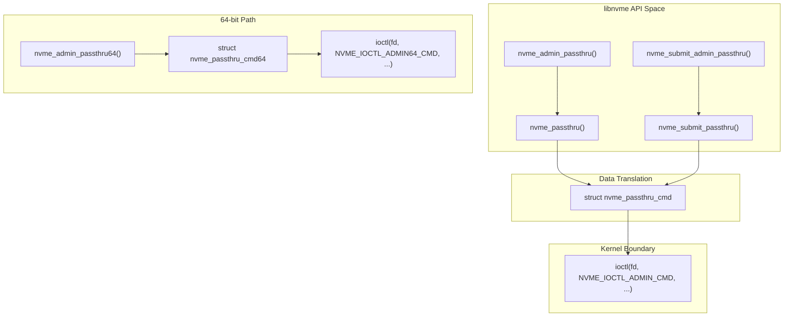
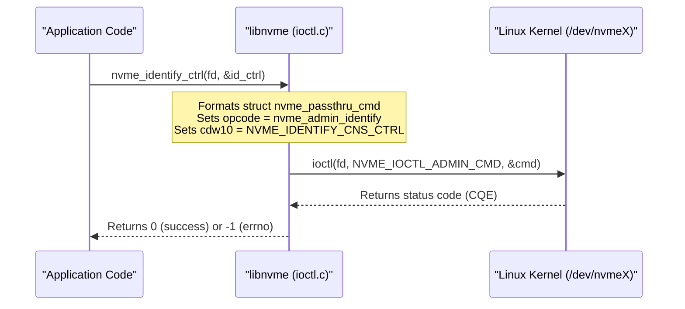

<!-- source: DeepWiki mcp.deepwiki.com · repo NVIDIA/libnvme · page 2 Core NVMe Command Interface · fetched 2026-10-26 -->

# Core NVMe Command Interface

Relevant source files

The following files were used as context for generating this wiki page:

- [src/nvme/ioctl.c](src/nvme/ioctl.c)
- [src/nvme/ioctl.h](src/nvme/ioctl.h)
- [src/nvme/linux.c](src/nvme/linux.c)
- [src/nvme/linux.h](src/nvme/linux.h)
- [src/nvme/types.h](src/nvme/types.h)

The Core NVMe Command Interface provides the primary mechanism for interacting with NVMe devices through the Linux kernel. It abstracts the complexities of the `ioctl` interface and provides support for both synchronous passthrough commands and asynchronous `io_uring` submissions. This layer is responsible for mapping high-level C structures into the Command Dwords (CDWs) required by the NVMe specification.

### Command Submission Flow

The library translates user-provided arguments into standardized passthrough structures. These structures are then passed to the kernel using specific `ioctl` request codes. For advanced use cases, 64-bit versions of these interfaces allow for larger result fields (CQE DWORD 0 and 1).

| Submission Type | Request Code | Primary Structure |
|:---|:---|:---|
| **Admin Command** | `NVME_IOCTL_ADMIN_CMD` | `struct nvme_passthru_cmd` |
| **I/O Command** | `NVME_IOCTL_IO_CMD` | `struct nvme_passthru_cmd` |
| **Admin 64-bit** | `NVME_IOCTL_ADMIN64_CMD` | `struct nvme_passthru_cmd64` |
| **I/O 64-bit** | `NVME_IOCTL_IO64_CMD` | `struct nvme_passthru_cmd64` |
| **io_uring** | `NVME_URING_CMD_IO` | `struct nvme_uring_cmd` |

**Sources:** [src/nvme/ioctl.h:64-169](), [src/nvme/ioctl.h:175-182]()

### Logic to Code Entity Mapping

The following diagram illustrates how high-level submission functions in `ioctl.c` map to the underlying Linux kernel UAPI structures and ioctl calls.

**NVMe Command Pipeline**

**Sources:** [src/nvme/ioctl.c:89-194](), [src/nvme/ioctl.h:203-220]()

---

### Component Overview

#### Admin and I/O Command Submission (ioctl layer)
This component handles the construction of NVMe commands by populating Command Dwords (CDW10-CDW15). It provides specific helpers for standard operations like Identify, Get Log Page, and Features. The `nvme_submit_admin_passthru` function serves as the entry point for most administrative tasks.

For details, see [Admin and I/O Command Submission (ioctl layer)](#2.1).

**Sources:** [src/nvme/ioctl.c:159-194](), [src/nvme/ioctl.h:43-83]()

#### Linux-Specific Helpers
Beyond raw command submission, libnvme includes Linux-specific utilities for device management. This includes `nvme_open` for standardizing device access, firmware download sequences that handle chunking, and integration with the Linux keyring for security operations like DH-HMAC-CHAP.

For details, see [Linux-Specific Helpers: Device Access, Telemetry, and Security Keys](#2.2).

**Sources:** [src/nvme/linux.c:59-123](), [src/nvme/linux.h:157-166]()

#### NVMe Type Definitions and Status Handling
The core interface relies on a comprehensive set of type definitions matching the NVMe specification. This includes structures for Controller and Namespace Identification, as well as macros like `NVME_GET` and `NVME_SET` for bitfield manipulation. It also provides the logic to convert NVMe status codes into standard Linux `errno` values.

For details, see [NVMe Type Definitions and Status Handling](#2.3).

**Sources:** [src/nvme/types.h:18-46](), [src/nvme/types.h:131-172]()

### System Interaction Overview

The core interface bridges the gap between the NVMe specification and the Linux kernel's character/block device drivers.

**Command Execution Architecture**

**Sources:** [src/nvme/ioctl.c:26-97](), [src/nvme/linux.c:43-95]()

---

