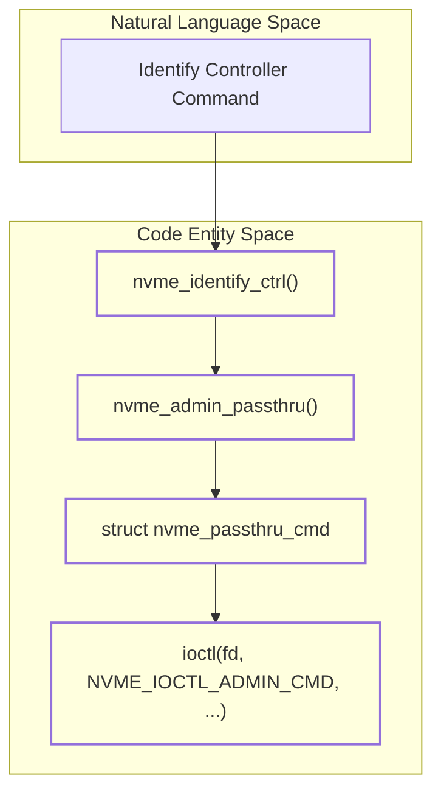
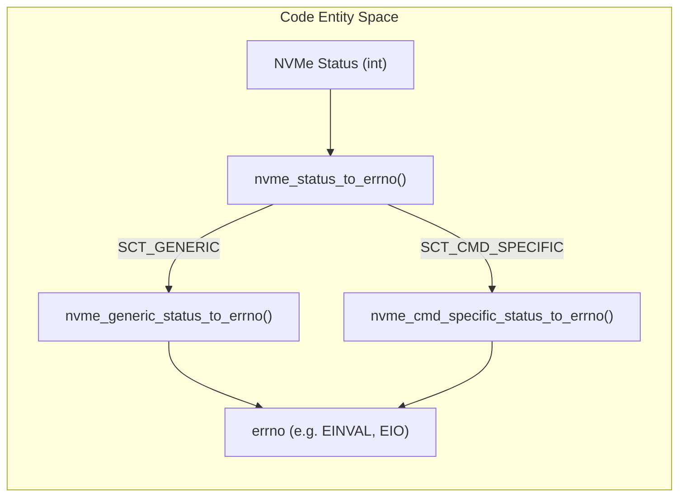

<!-- source: DeepWiki mcp.deepwiki.com · repo NVIDIA/libnvme · page 2.1 Admin and I/O Command Submission (ioctl layer) · fetched 2026-10-26 -->

# Admin and I/O Command Submission (ioctl layer)

Relevant source files

The following files were used as context for generating this wiki page:

- [src/nvme/ioctl.c](src/nvme/ioctl.c)
- [src/nvme/ioctl.h](src/nvme/ioctl.h)
- [src/nvme/types.h](src/nvme/types.h)
- [src/nvme/util.c](src/nvme/util.c)
- [src/nvme/util.h](src/nvme/util.h)

This page provides a technical deep-dive into the core command submission mechanism of `libnvme`. It covers the transition from high-level C arguments to the Linux kernel's passthrough `ioctl` interface, including the mapping of command dwords, buffer handling, and specialized command sets like ZNS and FDP.

## Command Submission Pipeline

The submission pipeline follows a tiered approach: high-level "helper" functions (e.g., `nvme_identify_ctrl`) wrap around "passthru" functions, which in turn populate the `nvme_passthru_cmd` or `nvme_passthru_cmd64` structures for the final `ioctl()` call.

### Command Construction Flow

1.  **Argument Structs**: High-level APIs use specific arguments that correspond to the NVMe specification.
2.  **CDW Mapping**: Logic in `src/nvme/ioctl.c` maps these arguments into Command Dwords (CDW10-CDW15).
3.  **Ioctl Request**: The library issues an `ioctl` to the character device file descriptor (`fd`).

### Data Flow: User Space to Kernel

The following diagram illustrates how a command like `Identify` travels from the API to the kernel.

**NVMe Command Pipeline**

**Sources:** [src/nvme/ioctl.c:183-194](), [src/nvme/ioctl.h:171-179]()

## Passthrough Structures

`libnvme` supports both standard (32-bit result) and 64-bit result passthrough commands. The 64-bit variants are required for certain commands that return more than a single DWORD in the completion queue entry (CQE).

| Structure | Ioctl Type | Purpose |
| :--- | :--- | :--- |
| `struct nvme_passthru_cmd` | `NVME_IOCTL_ADMIN_CMD` / `NVME_IOCTL_IO_CMD` | Standard NVMe commands. [src/nvme/ioctl.h:64-83]() |
| `struct nvme_passthru_cmd64` | `NVME_IOCTL_ADMIN64_CMD` / `NVME_IOCTL_IO64_CMD` | Commands requiring 64-bit results. [src/nvme/ioctl.h:107-127]() |
| `struct nvme_uring_cmd` | `NVME_URING_CMD_IO` | Used for io_uring based async submission. [src/nvme/ioctl.h:150-169]() |

### CDW Field Mapping
Internal macros and enums handle the bit-shifting required to pack fields into the `cdw10`-`cdw15` members of the passthru structures.

**Example: Log Page Mapping**
*   `LID` (Log Identifier): `cdw10` bits 0-7. [src/nvme/ioctl.c:232]()
*   `NUMDL` (Number of Dwords Lower): `cdw10` bits 16-31. [src/nvme/ioctl.c:235]()
*   `RAE` (Retain Asynchronous Event): `cdw10` bit 15. [src/nvme/ioctl.c:234]()

**Sources:** [src/nvme/ioctl.h:44-127](), [src/nvme/ioctl.c:196-240]()

## Key Submission Functions

### Admin Command Submission
Admin commands are sent to the controller's admin queue. Common operations include Identify, Get/Set Features, and Firmware Update.

*   `nvme_submit_admin_passthru`: Submits a pre-populated `nvme_passthru_cmd`. [src/nvme/ioctl.c:178-181]()
*   `nvme_admin_passthru`: Helper that accepts raw CDW values and constructs the struct internally. [src/nvme/ioctl.c:183-194]()

### I/O Command Submission
I/O commands are targeted at specific namespaces.

*   `nvme_submit_io_passthru`: Submits a pre-populated `nvme_passthru_cmd` to the I/O queue. [src/nvme/ioctl.c:250-253]()
*   `nvme_io_passthru`: High-level helper for I/O opcodes like Read, Write, and Flush. [src/nvme/ioctl.c:255-266]()

**Sources:** [src/nvme/ioctl.c:159-266]()

## Specialized Command Sets

### Zoned Namespace (ZNS)
ZNS commands manage zones within a namespace. These typically use `NVME_IOCTL_IO_CMD`.
*   **Management**: `nvme_zns_mgmt_send` and `nvme_zns_mgmt_recv` map to the ZNS Management Send/Receive opcodes.
*   **Mapping**: Arguments like `zslba` (Zone Starting LBA) are mapped to `cdw10` and `cdw11`.

### Flexible Data Placement (FDP)
FDP commands allow hosts to guide data placement to minimize Write Amplification.
*   **Log Pages**: `nvme_get_log_fdp_stats`, `nvme_get_log_fdp_events`.
*   **Management**: `nvme_fdp_mgmt_send` and `nvme_fdp_mgmt_recv`.

### Feature Management
Features are managed via `nvme_get_features` and `nvme_set_features`. The library uses `nvme_get_feature_length2` to determine the correct buffer size for feature-specific data (e.g., LBA Range Type).

**Sources:** [src/nvme/util.h:178-179](), [src/nvme/ioctl.c:196-240]()

## Status Handling and Errno Mapping

When an `ioctl` returns, `libnvme` provides utilities to translate the NVMe Status Code (SC) and Status Code Type (SCT) into standard Linux errnos.

**Status Translation Flow**

| NVMe Status Code | Linux Errno | Context |
| :--- | :--- | :--- |
| `NVME_SC_INVALID_OPCODE` | `EINVAL` | Generic error. [src/nvme/util.c:40-52]() |
| `NVME_SC_NS_NOT_READY` | `EACCES` | Generic error. [src/nvme/util.c:71-75]() |
| `NVME_SC_CQ_INVALID` | `EINVAL` | Command specific. [src/nvme/util.c:88-110]() |
| `NVME_SC_FEATURE_NOT_SAVEABLE` | `EPERM` | Command specific. [src/nvme/util.c:120-128]() |

**Sources:** [src/nvme/util.c:37-188](), [src/nvme/util.h:67-74]()

## Implementation Details

### Device Verification
Before submission, the library verifies that the file descriptor refers to an NVMe character device using `fstat` and `S_ISCHR`. If the check fails, it returns `ENOTBLK`.

**Sources:** [src/nvme/ioctl.c:26-39]()

### Buffer Alignment and Size
The library defines `NVME_LOG_PAGE_PDU_SIZE` (4096 bytes) as a safe transfer unit to avoid hitting Maximum Data Transfer Size (MDTS) limits during log page retrieval.

**Sources:** [src/nvme/ioctl.h:41]()

---

