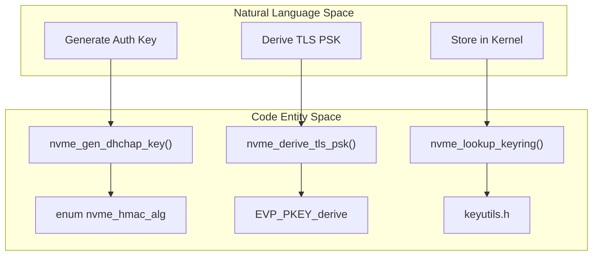
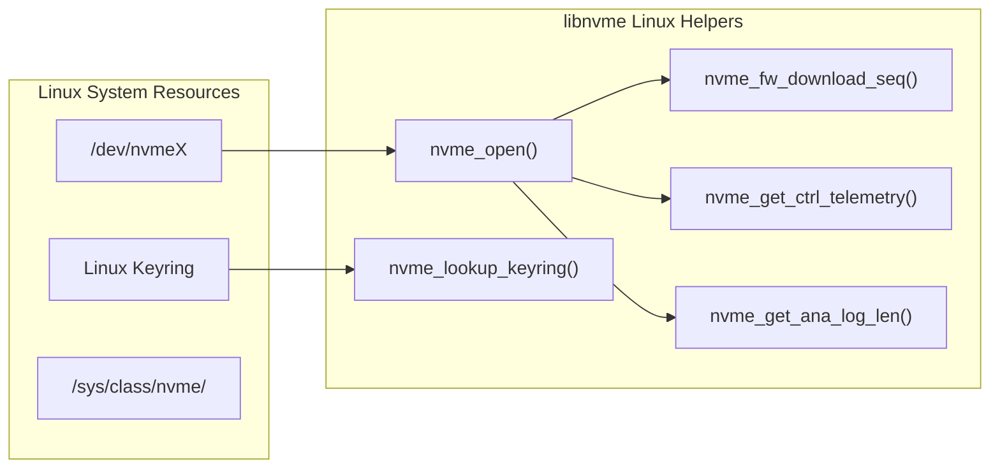

<!-- source: DeepWiki mcp.deepwiki.com · repo NVIDIA/libnvme · page 2.2 Linux-Specific Helpers: Device Access, Telemetry, and Security Keys · fetched 2026-10-26 -->

# Linux-Specific Helpers: Device Access, Telemetry, and Security Keys

Relevant source files

The following files were used as context for generating this wiki page:

- [src/nvme/linux.c](src/nvme/linux.c)
- [src/nvme/linux.h](src/nvme/linux.h)
- [src/nvme/util.c](src/nvme/util.c)
- [src/nvme/util.h](src/nvme/util.h)

This page covers the Linux-specific utility layer of `libnvme`. While the core library handles NVMe command construction, the Linux helper layer manages interaction with the kernel's device nodes, sysfs attributes, complex multi-stage command sequences (like firmware updates), and security integrations including TLS PSK derivation and the Linux keyring.

## Device Node Access and Validation

The library provides `nvme_open` as a primary entry point for obtaining file descriptors for NVMe controllers and namespaces. It enforces Linux naming conventions and validates file types (character devices for controllers, block devices for namespaces) [src/nvme/linux.c:59-95]().

### Data Flow: Opening a Device
1.  **Name Parsing**: The function uses `sscanf` to distinguish between controller handles (e.g., `nvme0`) and namespace handles (e.g., `nvme0n1`) [src/nvme/linux.c:65-70]().
2.  **Path Construction**: It builds the absolute path under `/dev/` [src/nvme/linux.c:48-52]().
3.  **Type Validation**: Using `fstat`, it ensures controllers are character devices (`S_ISCHR`) and namespaces are block devices (`S_ISBLK`) [src/nvme/linux.c:80-88]().

**Sources:** [src/nvme/linux.c:43-95](), [src/nvme/linux.h:157-166]()

## Firmware Download Sequences

Updating firmware requires sending an image in chunks. `nvme_fw_download_seq` automates this by iterating through a buffer and submitting partial `nvme_fw_download` commands [src/nvme/linux.c:97-123]().

### Firmware Download Logic
| Component | Role |
| :--- | :--- |
| `nvme_fw_download_args` | Structure containing the `fd`, `offset`, and chunk `data` [src/nvme/linux.c:101-109](). |
| `MIN(xfer, size)` | Calculates the size of the current chunk based on the maximum transfer limit [src/nvme/linux.c:112](). |
| Loop | Increments `args.offset` and `args.data` pointer after every successful ioctl [src/nvme/linux.c:117-119](). |

**Sources:** [src/nvme/linux.c:97-123](), [src/nvme/linux.h:24-35]()

## Telemetry Log Retrieval

Retrieving telemetry logs is a two-step process because the size of the log is determined by fields within the log header itself. `libnvme` handles this dynamically via `nvme_get_telemetry_log` [src/nvme/linux.c:125-229]().

### Telemetry Retrieval Process
1.  **Initial Fetch**: Fetches the first 512 bytes (`NVME_LOG_TELEM_BLOCK_SIZE`) to read the header [src/nvme/linux.c:152-167]().
2.  **Size Calculation**: Based on the requested Data Area (`da`), it reads `dalb1`, `dalb2`, `dalb3`, or `dalb4` from the header and converts them to a byte size [src/nvme/linux.c:179-208]().
3.  **Reallocation**: The buffer is resized to fit the full log [src/nvme/linux.c:210-216]().
4.  **Final Fetch**: A second call to `nvme_get_log_page` retrieves the complete dataset [src/nvme/linux.c:218-225]().

**Sources:** [src/nvme/linux.c:125-248](), [src/nvme/linux.h:38-98]()

## Security: DH-HMAC-CHAP and TLS PSK

`libnvme` integrates with OpenSSL and the Linux Keyring to support NVMe-oF security requirements. This includes generating DH-HMAC-CHAP keys and deriving TLS Pre-Shared Keys (PSK).

### Key Generation and Derivation
*   **DH-HMAC-CHAP**: `nvme_gen_dhchap_key` uses HMAC (SHA2-256, 384, or 512) to generate a key from a secret and the Host NQN [src/nvme/linux.h:183-195]().
*   **TLS PSK Derivation**: `nvme_derive_tls_psk` implements the HKDF-based derivation required for NVMe-over-TCP security [src/nvme/linux.h:215-227]().
*   **Keyring Integration**: `nvme_lookup_keyring` and `nvme_describe_key` provide wrappers for `keyutils` to store and retrieve security credentials from the kernel's security infrastructure [src/nvme/linux.h:198-213]().

### Security Code Entities

**Sources:** [src/nvme/linux.c:20-35](), [src/nvme/linux.h:169-227]()

## Implementation Mapping

The following diagram bridges high-level Linux operations to the specific functions implemented in `src/nvme/linux.c`.

### Linux Helper Mapping

**Sources:** [src/nvme/linux.c:43-248](), [src/nvme/linux.h:100-213]()

## Error Handling and Status Conversion

NVMe commands return a status field that includes a Status Code Type (SCT) and a Status Code (SC). `nvme_status_to_errno` maps these specific NVMe errors to standard Linux `errno` values to simplify application-level error handling [src/nvme/util.c:168-188]().

| NVMe Status Code | Linux Errno | Description |
| :--- | :--- | :--- |
| `NVME_SC_INVALID_OPCODE` | `EINVAL` | Invalid field or opcode [src/nvme/util.c:40-52](). |
| `NVME_SC_CMDID_CONFLICT` | `EADDRINUSE` | Command ID already in use [src/nvme/util.c:53-54](). |
| `NVME_SC_INTERNAL` | `EIO` | General I/O or internal error [src/nvme/util.c:56-58](). |
| `NVME_SC_NS_WRITE_PROTECTED` | `EACCES` | Permission or write protection error [src/nvme/util.c:70-75](). |
| `NVME_SC_CONNECT_CTRL_BUSY` | `EBUSY` | (Fabrics) Controller busy [src/nvme/util.c:153-154](). |

**Sources:** [src/nvme/util.c:37-188](), [src/nvme/util.h:66-74]()

---

