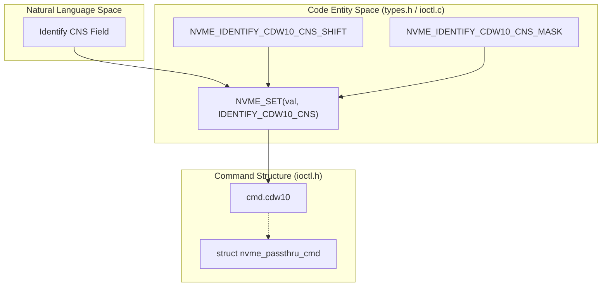
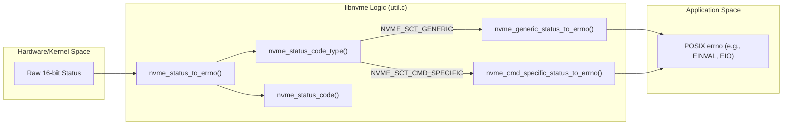

<!-- source: DeepWiki mcp.deepwiki.com · repo NVIDIA/libnvme · page 2.3 NVMe Type Definitions and Status Handling · fetched 2026-10-26 -->

# NVMe Type Definitions and Status Handling

Relevant source files

The following files were used as context for generating this wiki page:

- [doc/rst/filters.rst](doc/rst/filters.rst)
- [doc/rst/linux.rst](doc/rst/linux.rst)
- [doc/rst/log.rst](doc/rst/log.rst)
- [doc/rst/tree.rst](doc/rst/tree.rst)
- [doc/rst/types.rst](doc/rst/types.rst)
- [src/nvme/ioctl.c](src/nvme/ioctl.c)
- [src/nvme/ioctl.h](src/nvme/ioctl.h)
- [src/nvme/types.h](src/nvme/types.h)
- [src/nvme/util.c](src/nvme/util.c)
- [src/nvme/util.h](src/nvme/util.h)

This page serves as a technical reference for the NVMe specification structures, bitfield manipulation macros, and error handling mechanisms implemented in `libnvme`. It covers the foundational data types defined in `types.h`, the macro-based interface for accessing command dwords, and the logic used to map NVMe-specific status codes to standard Linux errnos.

## NVMe Standard Definitions and Constants

`libnvme` provides a comprehensive set of structures and enumerations that mirror the NVMe specification. These are primarily located in `src/nvme/types.h`.

### Key Structures
The library defines the binary layout for essential NVMe structures used in Identify commands and log pages:
*   `struct nvme_id_ctrl`: Controller Identification data [src/nvme/types.h:1030-1280]().
*   `struct nvme_id_ns`: Namespace Identification data [src/nvme/types.h:1344-1480]().
*   `struct nvme_lba_format`: Defines LBA size and metadata size [src/nvme/types.h:1330-1340]().
*   `struct nvme_psd`: Power State Descriptors [src/nvme/types.h:1010-1025]().

### Core Constants
The `enum nvme_constants` provides standard values for common NVMe parameters:
| Constant | Value | Description |
| :--- | :--- | :--- |
| `NVME_NSID_ALL` | `0xffffffff` | Broadcast value for all namespaces |
| `NVME_IDENTIFY_DATA_SIZE` | `4096` | Standard transfer size for Identify commands |
| `NVME_LOG_TELEM_BLOCK_SIZE` | `512` | Size of Telemetry Data Blocks |
| `NVME_NQN_LENGTH` | `256` | Max length for NVMe Qualified Names |

**Sources:** [src/nvme/types.h:99-129](), [src/nvme/types.h:1030-1480]()

## Bitfield Manipulation Macros

To handle the complex bitfield layouts within NVMe command Dwords (CDWs) and register values, `libnvme` utilizes a standardized naming convention combined with two primary macros: `NVME_GET` and `NVME_SET`.

### Implementation Logic
The library defines pairs of `_SHIFT` and `_MASK` constants for every field.
*   **NVME_GET(value, name)**: Isolates a sub-field by shifting the value right and applying the mask [src/nvme/types.h:35-36]().
*   **NVME_SET(value, name)**: Prepares a sub-field for insertion by masking it and shifting it left into position [src/nvme/types.h:45-46]().

### Command Dword Mapping
These macros are extensively used in the ioctl layer to populate `struct nvme_passthru_cmd` fields. For example, the Identify command CNS (Controller or Namespace Structure) field is handled via:
*   `NVME_IDENTIFY_CDW10_CNS_SHIFT`
*   `NVME_IDENTIFY_CDW10_CNS_MASK`

**Sources:** [src/nvme/types.h:25-47](), [src/nvme/ioctl.c:196-245]()

## Status Code Handling

NVMe commands return a 16-bit status field in the Completion Queue Entry (CQE). `libnvme` breaks this down into the Status Code Type (SCT) and the Status Code (SC).

### Status Breakdown Logic
The status is processed using internal helpers to extract the relevant error information:
*   `nvme_status_code_type(status)`: Extracts the SCT (Generic, Command Specific, Media/Data Error, etc.) [src/nvme/types.h:680-690]().
*   `nvme_status_code(status)`: Extracts the specific SC within that type [src/nvme/types.h:695-705]().

### NVMe Status to Errno Mapping
The function `nvme_status_to_errno` is the primary interface for converting NVMe errors into standard C library `errno` values, allowing applications to use standard error handling logic.

**Mapping Flow: NVMe Status to POSIX Errno**
| SCT | Example SC | Resulting Errno |
| :--- | :--- | :--- |
| `NVME_SCT_GENERIC` | `NVME_SC_INVALID_OPCODE` | `EINVAL` |
| `NVME_SCT_GENERIC` | `NVME_SC_INTERNAL` | `EIO` |
| `NVME_SCT_CMD_SPECIFIC` | `NVME_SC_NS_NOT_ATTACHED` | `ENOSPC` |
| `NVME_SCT_FABRICS` | `NVME_SC_CONNECT_CTRL_BUSY` | `EBUSY` |

**Sources:** [src/nvme/util.c:168-188](), [src/nvme/util.c:37-83](), [src/nvme/util.c:85-144]()

## Data Flow and Implementation Diagrams

### NVMe Command Field Encoding
This diagram shows how natural language field names (e.g., "CNS") are translated into code entities and eventually into the raw command Dwords.

**Diagram: Field Encoding Pipeline**

**Sources:** [src/nvme/types.h:35-47](), [src/nvme/ioctl.h:64-83](), [src/nvme/ioctl.c:241-242]()

### Status Conversion Logic
This diagram bridges the gap between the raw status returned by the hardware/kernel and the standard error codes used by application developers.

**Diagram: Status Translation Flow**

**Sources:** [src/nvme/util.c:168-188](), [src/nvme/util.h:67-74]()

## Summary of Reference Tables

### Common Register Offsets
These offsets are used when accessing controller registers (BAR0/1 for PCIe or Properties for Fabrics).
| Register | Offset | Description |
| :--- | :--- | :--- |
| `NVME_REG_CAP` | `0x0000` | Controller Capabilities |
| `NVME_REG_VS` | `0x0008` | Version |
| `NVME_REG_CC` | `0x0014` | Controller Configuration |
| `NVME_REG_CSTS` | `0x001c` | Controller Status |

**Sources:** [src/nvme/types.h:173-195]()

---

