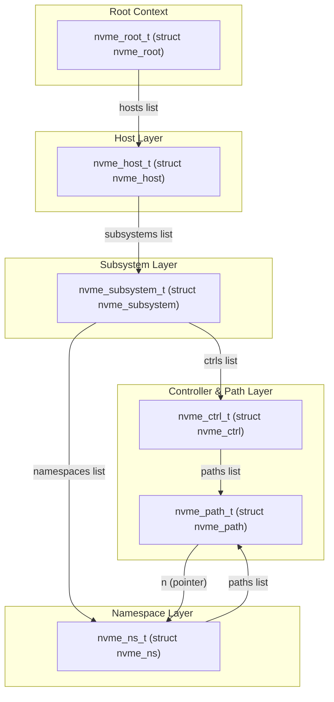
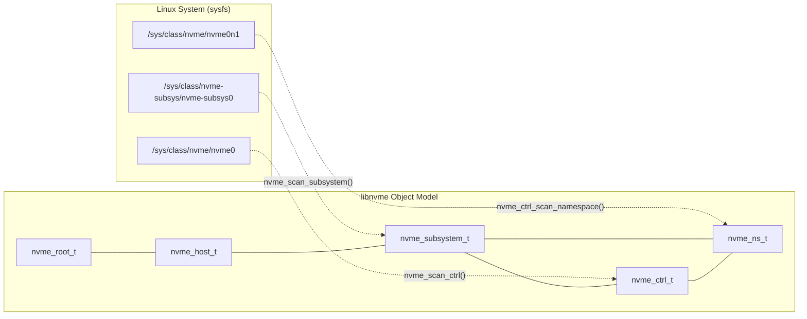

<!-- source: DeepWiki mcp.deepwiki.com · repo NVIDIA/libnvme · page 3 NVMe Topology Tree · fetched 2026-10-26 -->

# NVMe Topology Tree

Relevant source files

The following files were used as context for generating this wiki page:

- [src/nvme/private.h](src/nvme/private.h)
- [src/nvme/tree.c](src/nvme/tree.c)
- [src/nvme/tree.h](src/nvme/tree.h)

The NVMe Topology Tree provides a high-level, hierarchical object model that mirrors the logical structure of NVMe devices as presented by the Linux kernel. It abstracts the complexities of `sysfs` traversal, providing a unified interface for discovering and managing hosts, subsystems, controllers, namespaces, and multipath routes.

## Object Hierarchy

The topology is organized as a multi-level tree. Each node in the tree is represented by a specific C structure and a corresponding `typedef` ending in `_t`. These objects are linked using circular doubly-linked lists from the `ccan/list` library.

### Tree Structure Diagram
This diagram maps the logical hierarchy to the internal `struct` definitions used in the codebase.

**Sources:** [src/nvme/tree.h:28-33](), [src/nvme/private.h:24-124](), [src/nvme/tree.c:161-176]()

### Core Entity Summary

| Object Type | Code Entity | Description |
|:---|:---|:---|
| **Root** | `nvme_root_t` | The top-level context for logging, configuration, and entry point to the tree [src/nvme/private.h:158-170](). |
| **Host** | `nvme_host_t` | Represents the local system, identified by a Host NQN and Host ID [src/nvme/private.h:112-124](). |
| **Subsystem** | `nvme_subsystem_t` | Represents an NVMe Subsystem which may contain multiple controllers and namespaces [src/nvme/private.h:95-110](). |
| **Controller** | `nvme_ctrl_t` | Represents an individual NVMe controller (e.g., `/dev/nvme0`) [src/nvme/private.h:62-93](). |
| **Namespace** | `nvme_ns_t` | Represents a block device (e.g., `/dev/nvme0n1`) [src/nvme/private.h:37-60](). |
| **Path** | `nvme_path_t` | Represents a specific route from a controller to a namespace in multipath configurations [src/nvme/private.h:24-35](). |

## Lifecycle Management

The tree lifecycle begins with the creation of a root object via `nvme_create_root` [src/nvme/tree.c:161-176](). Once initialized, the tree can be populated by scanning the system `sysfs` or by reading a JSON configuration file.

### Scanning and Discovery
The primary entry point for populating the tree is `nvme_scan_topology` [src/nvme/tree.c:109-159](). This function performs the following:
1.  Scans `/sys/class/nvme` to identify controllers [src/nvme/tree.c:117]().
2.  Scans `/sys/class/nvme-subsys` to identify subsystems [src/nvme/tree.c:140]().
3.  Allocates and links objects into the hierarchy using a "lookup-or-create" pattern [src/nvme/tree.c:98]().

For details on the scanning process and `sysfs` interaction, see [Topology Discovery and Scanning (#3.1)]().

### Resource Cleanup
To prevent resource leaks, the tree must be explicitly freed using `nvme_free_tree` [src/nvme/tree.c:514-523](), which recursively destroys all child objects. Additionally, because controllers and namespaces cache file descriptors for `ioctl` operations, `nvme_root_release_fds` [src/nvme/tree.c:489-503]() can be used to close all open descriptors without destroying the tree structure.

## Iteration and Filtering

Navigating the tree is performed using a "first/next" iterator pattern. Each object type has corresponding functions to retrieve its children.

| Parent | Iterator Start | Next Item |
|:---|:---|:---|
| **Root** | `nvme_first_host` | `nvme_next_host` |
| **Host** | `nvme_first_subsystem` | `nvme_next_subsystem` |
| **Subsystem** | `nvme_subsystem_first_ctrl` | `nvme_subsystem_next_ctrl` |
| **Controller** | `nvme_ctrl_first_ns` | `nvme_ctrl_next_ns` |

**Sources:** [src/nvme/tree.h:89-98](), [src/nvme/tree.h:171-185](), [src/nvme/tree.h:220-233]()

The library also provides a callback mechanism via `nvme_scan_filter_t` [src/nvme/tree.h:35-36](). This allows users to include or exclude specific objects during the scanning process based on custom logic.

For details on navigation and filtering, see [Filters and Iterators (#3.2)]().

## Multipath Support

In environments with multiple paths to the same storage, the tree uses `nvme_path_t` objects to link controllers to namespaces. When the Linux kernel's native multipath is enabled, a single `nvme_ns_t` (the "head" or generic namespace) will have multiple `nvme_path_t` entries in its `paths` list [src/nvme/private.h:39](), each pointing back to a different `nvme_ctrl_t`.

For details on ANA states and path management, see [Multipath and ANA Support (#3.3)]().

## Mapping System State to Code

The following diagram illustrates how physical system components found in `sysfs` map to the internal C structures of `libnvme`.

**Sources:** [src/nvme/tree.c:109-159](), [src/nvme/tree.c:47-51](), [src/nvme/private.h:20-22]()

---

