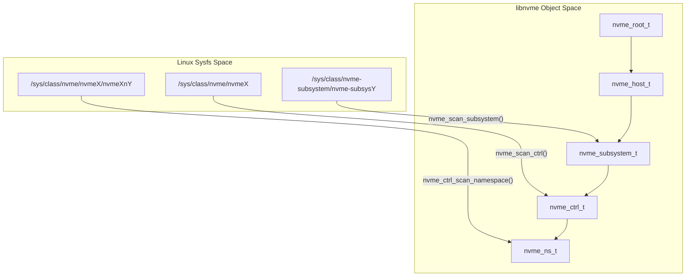
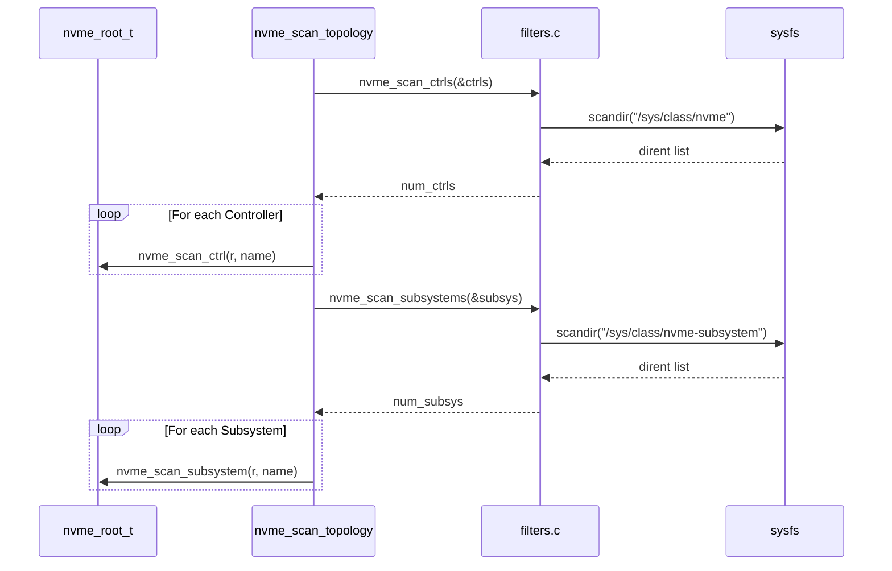

<!-- source: DeepWiki mcp.deepwiki.com · repo NVIDIA/libnvme · page 3.1 Topology Discovery and Scanning · fetched 2026-10-26 -->

# Topology Discovery and Scanning

<details>
<summary>Relevant source files</summary>

The following files were used as context for generating this wiki page:

- [doc/man/nvme_scan_ctrls.2](doc/man/nvme_scan_ctrls.2)
- [doc/man/nvme_scan_subsystem_namespaces.2](doc/man/nvme_scan_subsystem_namespaces.2)
- [doc/man/nvme_scan_subsystems.2](doc/man/nvme_scan_subsystems.2)
- [src/nvme/filters.c](src/nvme/filters.c)
- [src/nvme/filters.h](src/nvme/filters.h)
- [src/nvme/tree.c](src/nvme/tree.c)
- [src/nvme/tree.h](src/nvme/tree.h)

</details>


Topology discovery in `libnvme` is the process of traversing the Linux kernel's sysfs representation of NVMe devices to build an in-memory object graph (`nvme_root_t` tree). This process bridges the gap between the kernel's physical/logical device layout and the library's hierarchical object model.

## Overview of `nvme_scan_topology`

The primary entry point for discovery is `nvme_scan_topology`. This function orchestrates the scanning of two main sysfs directories to populate the tree:
1.  `/sys/class/nvme`: Contains individual NVMe controller entries [src/nvme/filters.c:25]().
2.  `/sys/class/nvme-subsystem`: Contains NVMe subsystem entries, which are critical for multipath topology [src/nvme/filters.c:27]().

The function follows a two-phase approach: it first identifies all controllers and then identifies all subsystems, linking namespaces and paths discovered along the way [src/nvme/tree.c:117-156]().

### Discovery Data Flow

The following diagram illustrates how sysfs entities are mapped to `libnvme` tree objects during a scan.

**Sysfs to Code Entity Mapping**

Sources: [src/nvme/tree.c:110-159](), [src/nvme/filters.c:25-27]()

## The Lookup-or-Allocate Pattern

`libnvme` employs a "lookup-or-allocate" strategy to ensure that duplicate objects are not created when the same physical entity is encountered via different sysfs paths (e.g., discovering a controller via `/sys/class/nvme` and later seeing it linked under a subsystem).

Key functions implementing this pattern include:
*   `nvme_lookup_host`: Searches the root's host list for a matching Host NQN and Host ID; creates a new `nvme_host_t` if no match exists [src/nvme/tree.h:109-120]().
*   `nvme_lookup_subsystem`: Searches a host's subsystem list; creates a new `nvme_subsystem_t` if required [src/nvme/tree.h:188-200]().
*   `nvme_lookup_ctrl`: Searches a subsystem's controller list based on the device name (e.g., "nvme0") [src/nvme/tree.h:320-333]().

Sources: [src/nvme/tree.c:88-107](), [src/nvme/tree.h:109-200]()

## Scanning Implementation Details

The scanning logic relies on `scandir` and specific filter functions to identify relevant sysfs entries.

### Filter Mechanism
Filters defined in `filters.c` use `sscanf` patterns to validate directory names:
*   **Controllers**: Matches `nvme%d` but excludes namespace patterns like `nvme%dn%d` [src/nvme/filters.c:57-74]().
*   **Subsystems**: Matches `nvme-subsys%d` [src/nvme/filters.c:76-88]().
*   **Namespaces**: Matches `nvme%dn%d` [src/nvme/filters.c:29-41]().
*   **Paths**: Matches `nvme%dc%dn%d` (used in multipath configurations) [src/nvme/filters.c:43-55]().

### Scanning Execution Flow

Sources: [src/nvme/tree.c:110-159](), [src/nvme/filters.c:90-118]()

## File Descriptor Management

`libnvme` uses **lazy file descriptor management**. Controller (`nvme_ctrl_t`) and Namespace (`nvme_ns_t`) objects do not open their corresponding `/dev/nvmeX` or `/dev/nvmeXnY` nodes until an operation (like an ioctl) requires it.

*   **Caching**: Once opened, the file descriptor is cached within the object to improve performance for subsequent commands.
*   **Cleanup**: `nvme_root_release_fds(nvme_root_t r)` traverses the entire tree and closes all cached file descriptors [src/nvme/tree.h:65-73](). This is useful in long-running processes that want to ensure they aren't holding handles to devices that might be removed or reset.

Sources: [src/nvme/tree.h:65-73](), [src/nvme/tree.c:514-533]()

## Filter Callbacks (`nvme_scan_filter_t`)

The `nvme_scan_topology` function accepts an optional `nvme_scan_filter_t` callback [src/nvme/tree.h:35-36](). This allows applications to prune the tree during the discovery process.

```c
typedef bool (*nvme_scan_filter_t)(nvme_subsystem_t s, nvme_ctrl_t c, nvme_ns_t n, void *f_args);
```

If the callback returns `false` for a specific object, `libnvme` will stop scanning that branch and free the associated memory [src/nvme/tree.c:131-135](). This is highly efficient for applications that only care about a specific subset of the topology (e.g., only NVMe-over-Fabrics controllers or specific namespaces).

Sources: [src/nvme/tree.c:110-159](), [src/nvme/tree.h:35-36]()

---

