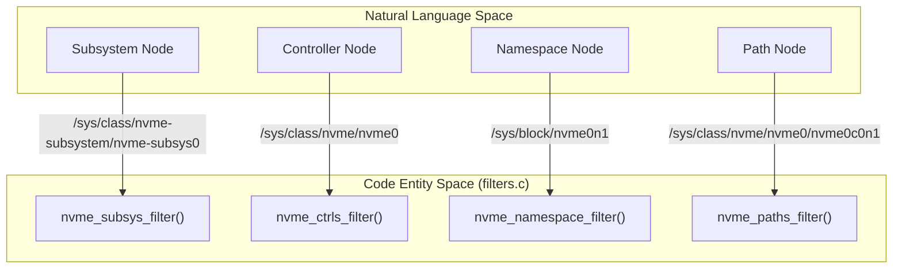
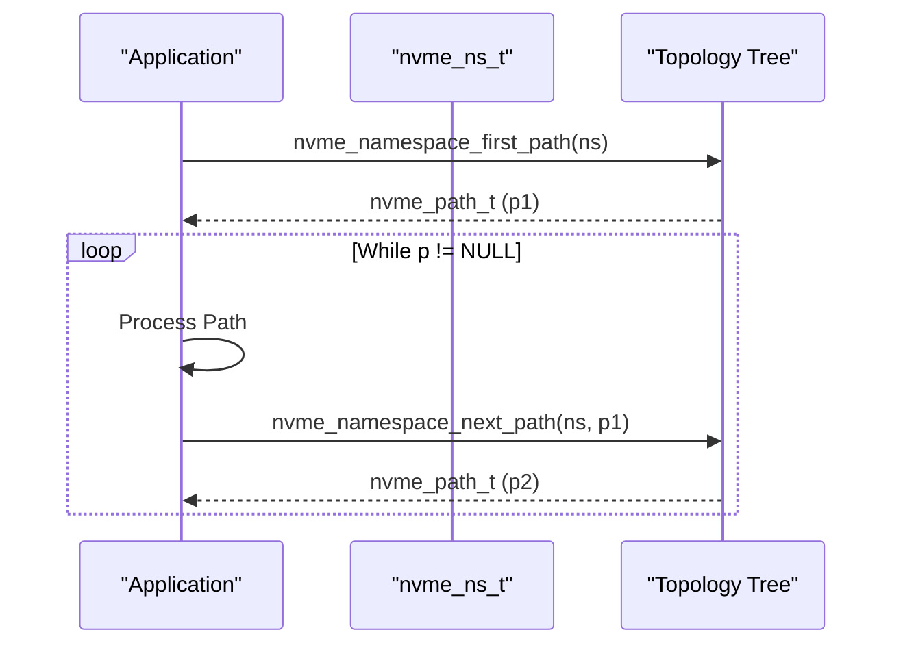

<!-- source: DeepWiki mcp.deepwiki.com · repo NVIDIA/libnvme · page 3.2 Filters and Iterators · fetched 2026-10-26 -->

# Filters and Iterators

Relevant source files

The following files were used as context for generating this wiki page:

- [doc/man/nvme_csi.2](doc/man/nvme_csi.2)
- [doc/man/nvme_ctrls_filter.2](doc/man/nvme_ctrls_filter.2)
- [doc/man/nvme_namespace_filter.2](doc/man/nvme_namespace_filter.2)
- [doc/man/nvme_namespace_first_path.2](doc/man/nvme_namespace_first_path.2)
- [doc/man/nvme_namespace_for_each_path.2](doc/man/nvme_namespace_for_each_path.2)
- [doc/man/nvme_namespace_for_each_path_safe.2](doc/man/nvme_namespace_for_each_path_safe.2)
- [doc/man/nvme_namespace_next_path.2](doc/man/nvme_namespace_next_path.2)
- [doc/man/nvme_paths_filter.2](doc/man/nvme_paths_filter.2)
- [doc/man/nvme_scan_topology.2](doc/man/nvme_scan_topology.2)
- [src/nvme/filters.c](src/nvme/filters.c)
- [src/nvme/filters.h](src/nvme/filters.h)

This page describes the mechanisms used by `libnvme` to identify, filter, and traverse NVMe topology elements within the Linux sysfs hierarchy. It covers the `dirent`-based filtering logic, the scanning helpers for subsystems and controllers, and the first/next iterator pattern used to navigate the object tree.

## Sysfs Filtering Logic

`libnvme` identifies NVMe devices by scanning specific sysfs directories and applying naming pattern filters to the directory entries (`struct dirent`). These filters ensure that only valid NVMe-related nodes are processed during topology discovery.

### Filter Functions

The library provides four primary filter functions defined in `src/nvme/filters.c`. These functions return `1` if a directory entry matches the expected naming convention and `0` otherwise [src/nvme/filters.h:22-51]().

| Filter Function | Target Object | Expected Pattern | Example |
|:---|:---|:---|:---|
| `nvme_subsys_filter` | Subsystems | `nvme-subsys%d` | `nvme-subsys0` |
| `nvme_ctrls_filter` | Controllers | `nvme%d` | `nvme0` |
| `nvme_namespace_filter` | Namespaces | `nvme%dn%d` | `nvme0n1` |
| `nvme_paths_filter` | Multipath Paths | `nvme%dc%dn%d` | `nvme0c0n1` |

### Implementation Details
The filters use `sscanf` to validate the structure of the filename. For instance, `nvme_ctrls_filter` specifically excludes names that match namespace or path patterns (which also start with "nvme") to ensure it only selects base controller nodes [src/nvme/filters.c:57-74]().

**Diagram: Sysfs Name to Filter Mapping**

**Sources:** [src/nvme/filters.c:29-88](), [src/nvme/filters.h:22-51]()

---

## Scan Helpers

Scan helpers automate the process of calling `scandir` on standard Linux sysfs locations using the predefined filters. These functions return an allocated array of `dirent` pointers which must be freed by the caller.

### Subsystem and Controller Scanning
*   `nvme_scan_subsystems`: Scans `/sys/class/nvme-subsystem` [src/nvme/filters.c:90-94]().
*   `nvme_scan_ctrls`: Scans `/sys/class/nvme` [src/nvme/filters.c:102-106]().

### Contextual Scanning
Some helpers require an existing topology object to determine the base path:
*   `nvme_scan_subsystem_namespaces`: Uses `nvme_subsystem_get_sysfs_dir(s)` to find namespaces belonging to a specific subsystem [src/nvme/filters.c:96-100]().
*   `nvme_scan_ctrl_namespaces`: Scans the controller's sysfs directory for namespaces [src/nvme/filters.c:114-118]().
*   `nvme_scan_ctrl_namespace_paths`: Scans the controller's sysfs directory for path entries (used in multipath environments) [src/nvme/filters.c:108-112]().

**Sources:** [src/nvme/filters.c:90-118](), [src/nvme/filters.h:54-95]()

---

## Iterator Patterns

Once the topology has been scanned and objects (subsystems, controllers, namespaces) have been instantiated, `libnvme` provides a standard "First/Next" iterator pattern for traversing the tree.

### Traversal Flow
The iterators allow applications to walk the linked lists maintained within the topology objects without exposing the internal `ccan/list` structures.

**Diagram: Iterator Data Flow**

### Key Iterator Functions
The library defines iterators for every level of the hierarchy. For example, path iteration within a namespace:

*   `nvme_namespace_first_path`: Returns the first path associated with a namespace [doc/man/nvme_namespace_first_path.2:1-15]().
*   `nvme_namespace_next_path`: Returns the subsequent path given the current one [doc/man/nvme_namespace_next_path.2:1-15]().

### Helper Macros
For convenience, `libnvme` provides macros to wrap these iterators into standard C loops:
*   `nvme_namespace_for_each_path(n, p)`: Standard traversal [doc/man/nvme_namespace_for_each_path.2:1-13]().
*   `nvme_namespace_for_each_path_safe(n, p, _p)`: Safe traversal that allows for the removal of elements during iteration by using temporary storage `_p` [doc/man/nvme_namespace_for_each_path_safe.2:1-16]().

**Sources:** [doc/man/nvme_namespace_first_path.2:1-15](), [doc/man/nvme_namespace_next_path.2:1-15](), [doc/man/nvme_namespace_for_each_path.2:1-13](), [doc/man/nvme_namespace_for_each_path_safe.2:1-16]()

---

## Topology Scanning with Filters

The high-level function `nvme_scan_topology` bridges the gap between raw sysfs scanning and the object tree. It accepts a `nvme_scan_filter_t` callback, allowing users to prune the tree during the discovery phase.

### `nvme_scan_topology`
This function traverses the system's NVMe topology and applies the user-provided filter to each element found. Elements that do not pass the filter are not added to the `nvme_root_t` object tree.

| Parameter | Type | Description |
|:---|:---|:---|
| `r` | `nvme_root_t` | The root object of the topology tree |
| `f` | `nvme_scan_filter_t` | User-defined callback function |
| `f_args` | `void *` | Context arguments passed to the callback |

**Sources:** [doc/man/nvme_scan_topology.2:1-21]()

---

