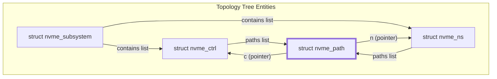
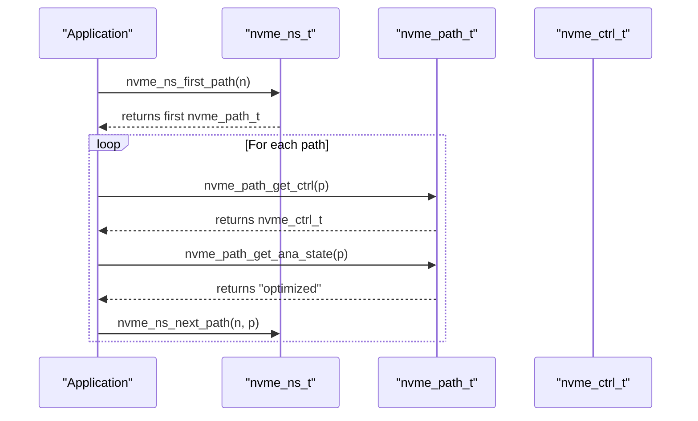

<!-- source: DeepWiki mcp.deepwiki.com · repo NVIDIA/libnvme · page 3.3 Multipath and ANA Support · fetched 2026-10-26 -->

# Multipath and ANA Support

Relevant source files

The following files were used as context for generating this wiki page:

- [doc/man/nvme_scan_ctrl_namespace_paths.2](doc/man/nvme_scan_ctrl_namespace_paths.2)
- [src/nvme/private.h](src/nvme/private.h)
- [src/nvme/tree.c](src/nvme/tree.c)
- [src/nvme/tree.h](src/nvme/tree.h)

Multipath support in `libnvme` allows the library to represent and manage multiple physical routes (paths) to a single logical NVMe namespace. This is critical for high-availability configurations where a host may be connected to a subsystem via multiple controllers or fabrics. The library tracks Asymmetric Namespace Access (ANA) states to inform the host about the optimal path for I/O operations.

## Path Representation and Data Model

The core entity for multipathing is the `nvme_path_t` (defined as `struct nvme_path`). It serves as a link between a specific controller (`nvme_ctrl_t`) and a specific namespace (`nvme_ns_t`).

### Code Entity Association: Path Structure
The following diagram illustrates how the `nvme_path` structure bridges the controller and namespace entities within the topology tree.

**Sources:** [src/nvme/private.h:24-35](), [src/nvme/private.h:37-60](), [src/nvme/private.h:62-93]()

### Path Attributes
Each `nvme_path_t` object captures specific attributes from sysfs that define the route's characteristics:
*   **ANA State**: Represented by the `ana_state` string (e.g., "optimized", "non-optimized", "inaccessible"). [src/nvme/private.h:33]()
*   **ANA Group ID**: Stored in `grpid`, identifying which ANA group the namespace belongs to on this path. [src/nvme/private.h:34]()
*   **Names**: The path identifies itself via a sysfs name (e.g., `nvme0n1`) and maintains a reference to its parent controller's sysfs directory. [src/nvme/private.h:31-32]()

## ANA (Asymmetric Namespace Access) Tracking

ANA support allows the library to understand the internal state of the storage target's ports. `libnvme` parses these states from the Linux kernel's sysfs representation of NVMe multipath.

| Attribute | Code Entity | Description |
| :--- | :--- | :--- |
| **ANA State** | `nvme_path_get_ana_state` | Returns the current state (e.g., `optimized`, `non-optimized`, `inaccessible`, `persistent-loss`). |
| **Group ID** | `nvme_path_get_ana_grpid` | Returns the ANA Group Identifier for the path. |

**Sources:** [src/nvme/tree.c:846-854](), [src/nvme/tree.c:856-864]()

### Implementation of ANA Retrieval
The ANA state is read during the scanning process or on-demand by accessing the `ana_state` file in the namespace's sysfs directory under a specific controller.

## Multipath Traversal APIs

`libnvme` provides iterators to navigate the relationships between namespaces and their various paths.

### Traversal Flow: Subsystem to Paths
When a subsystem is scanned, `libnvme` identifies "generic" namespaces (e.g., `/dev/nvme-subsys0n1`) and links them to the individual paths provided by different controllers.

**Sources:** [src/nvme/tree.h:236-250](), [src/nvme/tree.c:821-834]()

### Key Functions
*   **`nvme_ns_first_path` / `nvme_ns_next_path`**: Used to iterate through all physical routes that lead to a specific logical namespace. [src/nvme/tree.c:821-834]()
*   **`nvme_ctrl_first_path` / `nvme_ctrl_next_path`**: Used to iterate through all namespaces reachable through a specific controller. [src/nvme/tree.c:793-806]()
*   **`nvme_path_get_ns`**: Retrieves the parent namespace object for a given path. [src/nvme/tree.c:836-844]()
*   **`nvme_path_get_ctrl`**: Retrieves the controller object that provides this specific path. [src/nvme/tree.c:811-819]()

## Subsystem Path Linking

The function `nvme_subsystem_set_path_ns` (internal) and the scanning logic ensure that namespaces are correctly aggregated. In a multipath setup, multiple `nvme_path` objects will point to the same `nvme_ns` object if they represent the same underlying storage (identified by UUID/NGUID/EUI64).

### Scanning and Linking Logic
1.  **Controller Scan**: During `nvme_scan_topology`, controllers are identified. [src/nvme/tree.c:117-136]()
2.  **Namespace Discovery**: For each controller, the library scans for namespaces. [src/nvme/tree.c:49-50]()
3.  **Path Association**: If a namespace is part of a multipath-enabled subsystem, `libnvme` creates an `nvme_path_t` and links it to the subsystem-wide `nvme_ns_t`. [src/nvme/private.h:39]()

**Sources:** [src/nvme/tree.c:109-159](), [src/nvme/private.h:37-43]()

---

