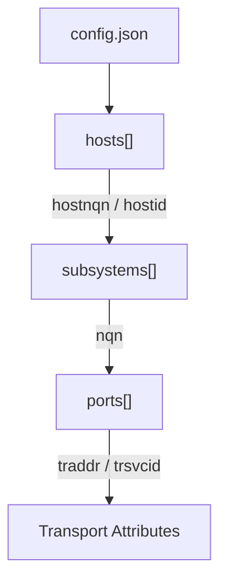

<!-- source: DeepWiki mcp.deepwiki.com · repo NVIDIA/libnvme · page 4 NVMe-over-Fabrics (NVMe-oF) · fetched 2026-10-26 -->

# NVMe-over-Fabrics (NVMe-oF)

<details>
<summary>Relevant source files</summary>

The following files were used as context for generating this wiki page:

- [.readthedocs.yaml](.readthedocs.yaml)
- [doc/config-schema.json](doc/config-schema.json)
- [doc/rst/fabrics.rst](doc/rst/fabrics.rst)
- [src/nvme/fabrics.c](src/nvme/fabrics.c)
- [src/nvme/fabrics.h](src/nvme/fabrics.h)
- [src/nvme/json.c](src/nvme/json.c)

</details>


The NVMe-over-Fabrics (NVMe-oF) subsystem in `libnvme` provides the necessary abstractions and tools to connect to remote NVMe targets over various network transports. It handles the complexities of the Fabrics protocol, including discovery of available subsystems, management of transport-specific parameters, and persistent configuration storage via JSON.

## Fabrics Architecture Overview

The Fabrics subsystem acts as a bridge between the high-level topology tree and the Linux kernel's fabrics interface located at `/dev/nvme-fabrics` [src/nvme/fabrics.c:47](). It supports multiple transport types including RDMA, Fibre Channel (FC), TCP, and a local loopback transport [src/nvme/fabrics.c:74-79]().

### Code Entity Relationship
The following diagram illustrates how the Fabrics configuration structures relate to the core topology objects and the kernel interface.

**Diagram: Fabrics Configuration to Kernel Interface**
```mermaid
graph TD
    subgraph "libnvme Logic Space"
        ROOT["nvme_root_t"]
        CTRL["nvme_ctrl_t"]
        CFG["struct nvme_fabrics_config"]
        OPTS["struct nvme_fabric_options"]
    end

    subgraph "Linux Kernel Space"
        DEV_FABRICS["/dev/nvme-fabrics"]
        SYS_CLASS["/sys/class/nvme/"]
    end

    ROOT -->|owns| CTRL
    CTRL -->|holds| CFG
    CFG -->|validated by| OPTS
    CTRL -->|nvmf_add_ctrl()| DEV_FABRICS
    DEV_FABRICS -->|creates| SYS_CLASS
```
**Sources:** [src/nvme/fabrics.h:46-66](), [src/nvme/fabrics.c:47-48](), [src/nvme/fabrics.c:197-198]()

---

## Controller Connection and Transport Management
Connecting to a remote target requires building a specific option string that is written to the fabrics character device. `libnvme` manages this through the `nvme_fabrics_config` structure, which contains parameters like `reconnect_delay`, `ctrl_loss_tmo`, and transport-specific flags like `hdr_digest` for TCP [src/nvme/fabrics.h:46-66]().

The library handles the negotiation of supported options with the kernel to ensure compatibility before attempting a connection.
* For details, see [Controller Connection and Transport Management](#4.1).

**Sources:** [src/nvme/fabrics.h:26-66](), [src/nvme/fabrics.c:230-235]()

---

## Discovery Controllers and Log Pages
Discovery is the process of identifying available NVMe subsystems on a fabric. `libnvme` provides functions to interact with Discovery Controllers (DC), which serve Discovery Log Pages (DLP). These logs contain entries for each available subsystem, including their NQN (Name), transport address, and service ID.

The library supports both standard Discovery Controllers and the newer Centralized Discovery Controllers (CDC) used in large-scale fabrics.
* For details, see [Discovery Controllers and Log Pages](#4.2).

**Sources:** [src/nvme/fabrics.h:201-214](), [src/nvme/fabrics.c:99-103]()

---

## JSON Configuration and Persistence
To support persistent configurations across reboots or application restarts, `libnvme` implements a JSON-based configuration schema. This allows users to define a hierarchy of hosts, subsystems, and ports with their associated transport parameters and security keys (e.g., DH-HMAC-CHAP keys or TLS PSKs).

The configuration is typically stored in `/etc/nvme/config.json` and is managed via `json_read_config()` and `json_update_config()` [src/nvme/json.c:232]().

**Diagram: JSON Configuration Hierarchy**

**Sources:** [doc/config-schema.json:1-176](), [src/nvme/json.c:158-190]()

* For details, see [JSON Configuration and Persistence](#4.3).

---

## Supported Transports and Address Families
The library decodes various specification-defined constants into human-readable strings for logging and UI display.

| Category | Supported Values (Examples) |
| :--- | :--- |
| **Transport Types** | `rdma`, `fc`, `tcp`, `loop` [src/nvme/fabrics.c:74-79]() |
| **Address Families** | `ipv4`, `ipv6`, `infiniband`, `fibre-channel` [src/nvme/fabrics.c:86-92]() |
| **TCP Security** | `none`, `tls`, `tls13` [src/nvme/fabrics.c:156-160]() |

**Sources:** [src/nvme/fabrics.c:74-197](), [src/nvme/fabrics.h:69-165]()

---

