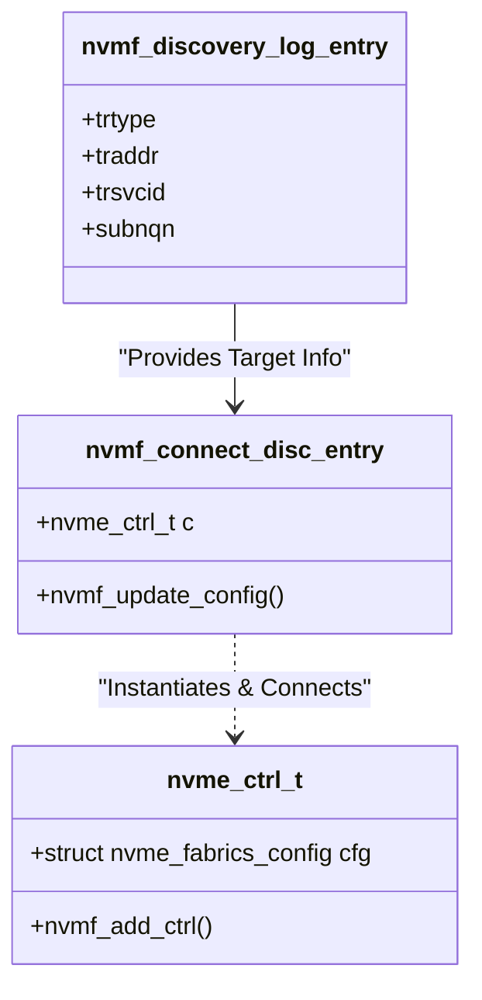

<!-- source: DeepWiki mcp.deepwiki.com · repo NVIDIA/libnvme · page 4.1 Controller Connection and Transport Management · fetched 2026-10-26 -->

# Controller Connection and Transport Management

<details>
<summary>Relevant source files</summary>

The following files were used as context for generating this wiki page:

- [src/nvme/fabrics.c](src/nvme/fabrics.c)
- [src/nvme/fabrics.h](src/nvme/fabrics.h)
- [src/nvme/util.c](src/nvme/util.c)
- [src/nvme/util.h](src/nvme/util.h)

</details>


This section describes the mechanisms used by `libnvme` to establish and manage connections to NVMe-over-Fabrics (NVMe-oF) targets. It covers the interaction with the Linux kernel's fabrics interface, the construction of connection parameters, and transport-specific configurations for TCP, RDMA, FC, and Loop.

## Connection Lifecycle and /dev/nvme-fabrics

The primary interface for establishing NVMe-oF connections in Linux is the character device `/dev/nvme-fabrics`. `libnvme` manages this through `nvmf_add_ctrl`, which serializes controller options into a comma-separated string and writes it to this device.

### The Connection Flow

The following diagram illustrates the data flow from a topology controller object to the kernel fabrics driver.

**Diagram: Controller Connection Pipeline**
```mermaid
graph TD
    subgraph "libnvme User Space"
        [nvme_ctrl_t] --> |"nvmf_update_config()"| [nvme_fabrics_config]
        [nvme_fabrics_config] --> |"nvmf_add_ctrl()"| [Option_String_Builder]
        [Option_String_Builder] --> |"write()"| [dev_nvme_fabrics["/dev/nvme-fabrics"]]
    end

    subgraph "Linux Kernel"
        [dev_nvme_fabrics] --> [nvme_fabrics_driver]
        [nvme_fabrics_driver] --> [Transport_Modules["nvme-tcp / nvme-rdma / nvme-fc"]]
    end
```
Sources: [src/nvme/fabrics.c:47-47](), [src/nvme/fabrics.c:647-700]()

### Option String Construction
The kernel expects a specific string format (e.g., `traddr=192.168.1.1,trtype=tcp,nqn=subsystem1`). `libnvme` builds this string by:
1.  **Probing Supported Options**: It checks `/dev/nvme-fabrics` to see which options the current kernel supports [src/nvme/fabrics.c:514-550]().
2.  **Formatting Arguments**: It iterates through the `nvme_fabrics_config` and `nvme_ctrl_t` attributes, appending valid keys and values [src/nvme/fabrics.c:552-645]().

## Configuration Management

`libnvme` uses a layered approach to configuration, allowing for global defaults that can be overridden by specific controller instances.

### Default and Updated Configurations
*   **`nvmf_default_config`**: Initializes a `nvme_fabrics_config` struct with standard values, such as a default `ctrl_loss_tmo` of 600 seconds [src/nvme/fabrics.c:230-235]().
*   **`nvmf_update_config`**: Merges a new configuration into an existing controller's configuration. Non-default values in the new `cfg` overwrite the controller's current settings [src/nvme/fabrics.c:286-311]().

| Option | Description | Default |
| :--- | :--- | :--- |
| `ctrl_loss_tmo` | Seconds to attempt reconnect before failing | 600 |
| `tos` | Type of Service for network packets | -1 (Unset) |
| `reconnect_delay` | Seconds between reconnect attempts | 0 (Kernel default) |

Sources: [src/nvme/fabrics.h:23-23](), [src/nvme/fabrics.c:230-235](), [src/nvme/fabrics.c:286-311]()

## Transport-Specific Logic

Different transports require specialized handling of addresses and security parameters.

### TCP Transport and Security
For TCP connections, `libnvme` supports advanced features like Header/Data digests and TLS security:
*   **Digests**: Controlled via `hdr_digest` and `data_digest` booleans in the config [src/nvme/fabrics.h:63-64]().
*   **TLS**: Supports `sectype` definitions for TLS 1.2 and 1.3. It manages TLS PSK (Pre-Shared Keys) via the `tls_key` and `keyring` options [src/nvme/fabrics.c:156-165](), [src/nvme/fabrics.h:58-59]().

### IPv6 Scoping
When using IPv6, `libnvme` handles Link-Local addresses by parsing and appending the scope ID (interface index) to the transport address if a `host_iface` is provided [src/nvme/fabrics.c:445-484]().

### RDMA and Fibre Channel
*   **RDMA**: Supports specific provider types (`roce`, `iwarp`, `infiniband`) and connection management services (`rdma-cm`) [src/nvme/fabrics.c:167-197]().
*   **FC**: Manages Fibre Channel specific addressing via World Wide Name (WWN) strings [src/nvme/fabrics.c:91-91]().

Sources: [src/nvme/fabrics.c:156-197](), [src/nvme/fabrics.c:445-484](), [src/nvme/fabrics.h:46-66]()

## Connection Helpers

### `nvmf_connect_disc_entry`
This is a high-level helper used during discovery. It takes a discovery log entry (which contains the target's address and NQN) and a host object to automatically create and connect a new controller instance.

**Entity Mapping: Discovery to Connection**


### Key Functions
| Function | Purpose |
| :--- | :--- |
| `nvmf_add_ctrl` | The core function that performs the `write()` to `/dev/nvme-fabrics` [src/nvme/fabrics.c:647](). |
| `nvmf_connect_disc_entry` | Connects to a target based on a discovery log page entry [src/nvme/fabrics.c:736](). |
| `nvmf_supported_options` | Probes the kernel for supported fabrics options [src/nvme/fabrics.c:514](). |

Sources: [src/nvme/fabrics.c:514-550](), [src/nvme/fabrics.c:647-700](), [src/nvme/fabrics.c:736-764]()

---

