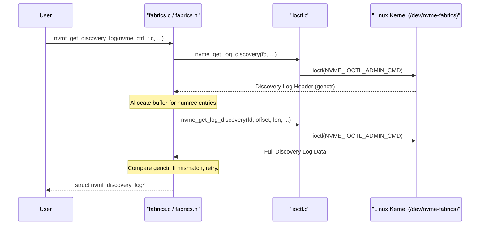
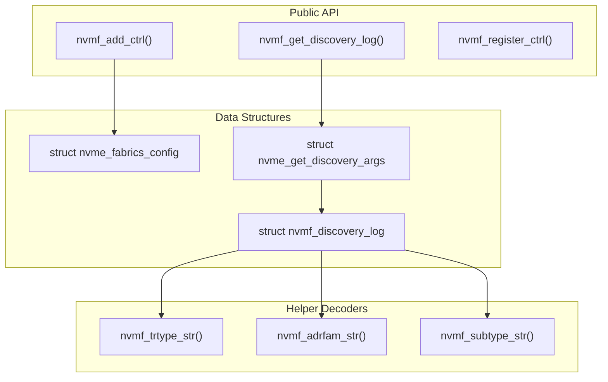

<!-- source: DeepWiki mcp.deepwiki.com · repo NVIDIA/libnvme · page 4.2 Discovery Controllers and Log Pages · fetched 2026-10-26 -->

# Discovery Controllers and Log Pages

Relevant source files

The following files were used as context for generating this wiki page:

- [src/nvme/fabrics.c](src/nvme/fabrics.c)
- [src/nvme/fabrics.h](src/nvme/fabrics.h)
- [src/nvme/linux.c](src/nvme/linux.c)
- [src/nvme/linux.h](src/nvme/linux.h)

This section details how `libnvme` interacts with NVMe-over-Fabrics (NVMe-oF) Discovery Controllers to retrieve and process discovery log pages. It covers the mechanisms for atomic log retrieval, the distinction between Centralized and Direct Discovery Controllers, and the registration of Discovery Information Management (DIM) data.

## Discovery Log Retrieval and Atomicity

Retrieving the discovery log from a Discovery Controller (DC) requires handling potential updates to the log during the read process. `libnvme` implements a retry mechanism to ensure the integrity of the data using the generation counter provided by the controller.

### Atomic Retrieval Flow
The primary function `nvmf_get_discovery_log` [src/nvme/fabrics.c:213-214]() manages the lifecycle of log retrieval:
1. **Initial Header Fetch**: The library first fetches the discovery log header to determine the current `genctr` (Generation Counter) and the number of records (`numrec`).
2. **Buffer Allocation**: It allocates a buffer large enough to hold the entire log based on the `numrec` reported in the header.
3. **Full Log Fetch**: It performs a second read to fetch the complete log.
4. **Validation**: After the full fetch, it compares the `genctr` in the retrieved log against the initial `genctr`. If they do not match, the log was updated during the transfer, and the process retries (up to `max_retries`).

### Extensible Arguments
For more granular control, `nvmf_get_discovery_wargs` [src/nvme/fabrics.c:235-236]() uses the `struct nvme_get_discovery_args` [src/nvme/fabrics.h:225-232]() structure. This allows specifying:
*   **LSP (Log Specific Field)**: Used to filter or specify the type of discovery information [src/nvme/fabrics.h:231]().
*   **Timeout**: Custom IOCTL timeouts [src/nvme/fabrics.h:230]().

**Sources:** [src/nvme/fabrics.c:213-243](), [src/nvme/fabrics.h:201-232]()

## DDC vs CDC Types

NVMe-oF defines different types of Discovery Controllers that `libnvme` distinguishes via the `subtype` and `eflags` fields in the discovery log entries.

| Controller Type | Description | Code Identifier |
| :--- | :--- | :--- |
| **DDC** (Direct) | Direct connection to a subsystem. | `NVME_NQN_NVME` [src/nvme/fabrics.c:101]() |
| **CDC** (Centralized) | A centralized entity providing referrals to other subsystems. | `NVME_NQN_DISC` [src/nvme/fabrics.c:100]() |

The library provides string decoding helpers like `nvmf_subtype_str` [src/nvme/fabrics.c:105-108]() and `nvmf_eflags_str` [src/nvme/fabrics.c:151-154]() to translate these protocol-level values into human-readable formats. For instance, `NVMF_DISC_EFLAGS_NCC` indicates "no cdc connectivity" [src/nvme/fabrics.c:137]().

**Sources:** [src/nvme/fabrics.c:99-154](), [src/nvme/fabrics.h:90-121]()

## DIM Registration via nvmf_register_ctrl

Discovery Information Management (DIM) allows a host to register its information with a Discovery Controller. This is typically performed using the `nvmf_register_ctrl` function.

### DIM Data Flow
The registration process involves:
1.  **Controller Setup**: An established connection to a Discovery Controller.
2.  **Task Command**: Issuing a registration command (often a `set_features` or a specific discovery log write depending on the fabric version).
3.  **Host Information**: Passing the Host NQN and Host ID to the controller so the DC can track which hosts are connected to which subsystems.

**Sources:** [src/nvme/fabrics.h:197-198](), [src/nvme/fabrics.c:42-45]()

## Host NQN and ID Generation

For fabrics operations, every host must have a unique identifier. `libnvme` manages these via system configuration files.

*   **Host NQN**: Read from `/etc/nvme/hostnqn` [src/nvme/fabrics.c:44](). If missing, the library provides utilities to generate a unique NQN based on system UUIDs.
*   **Host ID**: Read from `/etc/nvme/hostid` [src/nvme/fabrics.c:45](). This is a 128-bit unique identifier (stored as a string in the file).

### Implementation Mapping: Discovery Logic
The following diagram maps the logical discovery process to the specific functions and structures in the codebase.

Title: Discovery Log Retrieval Sequence

**Sources:** [src/nvme/fabrics.c:213-243](), [src/nvme/ioctl.c:140-160]() (implied by log retrieval flow)

## Technical Reference: Data Structures

### nvme_fabrics_config
This structure holds the initiator-side configuration used when adding new controllers via discovery.

| Field | Purpose |
| :--- | :--- |
| `host_traddr` | Local transport address [src/nvme/fabrics.h:47]() |
| `keep_alive_tmo` | Keep-alive timeout in seconds [src/nvme/fabrics.h:54]() |
| `tls` | Boolean to enable TLS on TCP transports [src/nvme/fabrics.h:65]() |

### Code Entity Association
This diagram bridges the system concepts (Discovery, Transport) to the C entities.

Title: Fabrics Discovery Code Entities

**Sources:** [src/nvme/fabrics.h:46-232](), [src/nvme/fabrics.c:74-108]()

---

