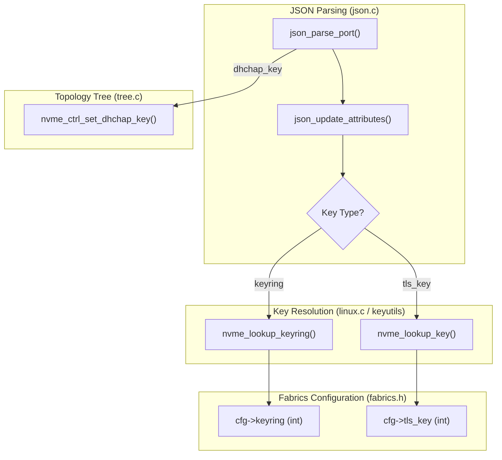

<!-- source: DeepWiki mcp.deepwiki.com · repo NVIDIA/libnvme · page 4.3 JSON Configuration and Persistence · fetched 2026-10-26 -->

# JSON Configuration and Persistence

Relevant source files

The following files were used as context for generating this wiki page:

- [.readthedocs.yaml](.readthedocs.yaml)
- [doc/conf.py.in](doc/conf.py.in)
- [doc/config-schema.json](doc/config-schema.json)
- [doc/config-schema.json.in](doc/config-schema.json.in)
- [doc/index.rst.in](doc/index.rst.in)
- [doc/mi.rst.in](doc/mi.rst.in)
- [doc/rst/fabrics.rst](doc/rst/fabrics.rst)
- [src/nvme/fabrics.c](src/nvme/fabrics.c)
- [src/nvme/fabrics.h](src/nvme/fabrics.h)
- [src/nvme/json.c](src/nvme/json.c)

The `libnvme` library provides a robust mechanism for persisting NVMe-over-Fabrics (NVMe-oF) configurations using JSON. This infrastructure allows for the serialization of host, subsystem, and controller properties, enabling applications to reload complex topologies and security credentials (such as DH-HMAC-CHAP keys and TLS PSK) across sessions.

### JSON Configuration Schema

The configuration is structured hierarchically, mirroring the physical and logical NVMe topology: **Hosts** contain **Subsystems**, which contain **Ports** (representing potential or active connections).

#### Schema Hierarchy
- **Hosts**: Identified by `hostnqn` and `hostid`. Stores host-wide security keys (`dhchap_key`) and symbolic names [doc/config-schema.json:15-47]().
- **Subsystems**: Identified by `nqn`. Associates specific subsystems with an `application` string [doc/config-schema.json:48-68]().
- **Ports**: Defines connection parameters for a specific transport (e.g., `tcp`, `rdma`). This level contains the bulk of the fabrics configuration, including timeouts, queue counts, and security settings [doc/config-schema.json:69-175]().

#### Natural Language to Code Entity Mapping: JSON Schema
The following diagram maps the JSON schema definitions to the internal `libnvme` tree objects.

| Natural Language Concept | JSON Key (config-schema.json) | Code Entity (tree.h) |
|:---|:---|:---|
| Root Configuration | `object` | `nvme_root_t` |
| NVMe Host | `hosts` | `nvme_host_t` |
| NVMe Subsystem | `subsystems` | `nvme_subsystem_t` |
| Controller/Connection | `ports` | `nvme_ctrl_t` |
| Fabrics Options | `port` properties | `struct nvme_fabrics_config` |

Sources: [doc/config-schema.json:1-177](), [src/nvme/fabrics.h:46-66]()

### Configuration Management Workflow

The library manages configuration through a "lookup-or-create" merge workflow. When a configuration file is read, the library traverses the JSON objects and attempts to find matching existing objects in the current `nvme_root_t` tree. If no match is found, new objects are allocated.

#### Data Flow: Reading and Updating Configuration
The entry point for loading configuration is `json_read_config`, which parses the file and populates the internal topology tree [src/nvme/json.c:232-261]().

1.  **Parse**: `parse_json` uses `json-c` to transform the file into a `json_object` [src/nvme/json.c:192-231]().
2.  **Lookup Host**: `json_parse_host` calls `nvme_lookup_host`. If the host exists, its attributes (like `dhchap_key`) are updated [src/nvme/json.c:158-190]().
3.  **Lookup Subsystem**: `json_parse_subsys` calls `nvme_lookup_subsystem` for each entry in the `subsystems` array [src/nvme/json.c:128-156]().
4.  **Lookup/Update Controller**: `json_parse_port` uses `nvme_lookup_ctrl` to find the controller matching the transport and address. It then calls `json_update_attributes` to apply settings to the `nvme_fabrics_config` associated with that controller [src/nvme/json.c:92-126]().

#### Implementation: `json_update_attributes`
This function iterates through the JSON "port" object and updates the `nvme_fabrics_config` structure using helper macros like `JSON_UPDATE_INT_OPTION` and `JSON_UPDATE_BOOL_OPTION` [src/nvme/json.c:22-26](), [src/nvme/json.c:27-90]().

Sources: [src/nvme/json.c:22-261](), [src/nvme/fabrics.h:182-183]()

### Security Key Serialization and Persistence

A critical role of the JSON configuration is the persistence of security credentials for authenticated connections.

#### DH-HMAC-CHAP and TLS Keys
- **DH-HMAC-CHAP**: Keys are stored as strings in the JSON (`dhchap_key` and `dhchap_ctrl_key`) and applied to the objects via `nvme_host_set_dhchap_key` and `nvme_ctrl_set_dhchap_key` [src/nvme/json.c:120-125](), [src/nvme/json.c:173-175]().
- **TLS PSK**: The configuration stores the `tls_key` and a `keyring` description.
- **Keyring Integration**: The function `nvme_lookup_keyring` converts a string description from JSON into a Linux keyring serial number, which is then stored in `cfg->keyring` [src/nvme/json.c:72-80]().
- **PSK Lookup**: `nvme_lookup_key` is used to resolve the PSK identity into a key serial number stored in `cfg->tls_key` [src/nvme/json.c:81-88]().

#### Persistence Logic: Code Entity Space
The following diagram illustrates how the JSON parsing logic interacts with the fabrics configuration and security subsystems.

Title: JSON Security Key Resolution Flow

Sources: [src/nvme/json.c:72-89](), [src/nvme/json.c:120-126](), [src/nvme/fabrics.h:58-59]()

### Configuration Export and Update

While `json_read_config` handles input, `json_update_config` allows the library to serialize the current in-memory topology back to a JSON file [src/nvme/json.c:427-449]().

- **Workflow**: The function iterates through the `nvme_root_t` tree. For each host, subsystem, and controller, it creates corresponding `json_object` instances [src/nvme/json.c:385-425]().
- **Persistence Flag**: Only controllers marked as persistent (via `nvme_ctrl_set_persistent`) or those identified as discovery controllers are typically exported to the configuration file [src/nvme/json.c:62-67]().
- **Merging**: `nvmf_update_config` is used to merge new fabrics configuration values into an existing controller, ensuring that non-default values from the config file overwrite the current operational state [src/nvme/fabrics.c:256-271]().

### Summary of Key Functions

| Function | File | Description |
|:---|:---|:---|
| `json_read_config` | [src/nvme/json.c:232]() | Entry point to load topology and config from a file. |
| `json_update_config` | [src/nvme/json.c:427]() | Entry point to save current tree state to a JSON file. |
| `json_parse_port` | [src/nvme/json.c:92]() | Parses transport-specific settings and security keys. |
| `json_update_attributes` | [src/nvme/json.c:27]() | Maps JSON keys to `struct nvme_fabrics_config` fields. |
| `nvmf_default_config` | [src/nvme/fabrics.c:230]() | Initializes fabrics config with spec-defined defaults. |

Sources: [src/nvme/json.c:22-449](), [src/nvme/fabrics.c:230-271]()

---

