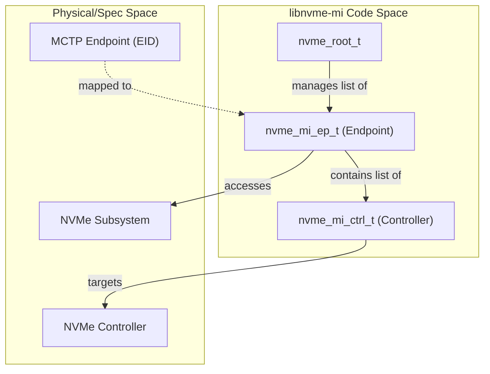
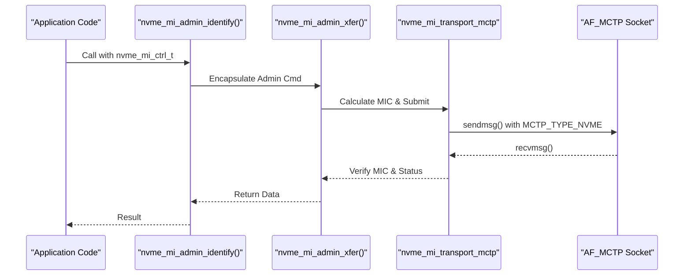

<!-- source: DeepWiki mcp.deepwiki.com · repo NVIDIA/libnvme · page 5 NVMe Management Interface (NVMe-MI) · fetched 2026-10-26 -->

# NVMe Management Interface (NVMe-MI)

Relevant source files

The following files were used as context for generating this wiki page:

- [examples/mi-mctp.c](examples/mi-mctp.c)
- [src/libnvme-mi.h](src/libnvme-mi.h)
- [src/libnvme-mi.map](src/libnvme-mi.map)
- [src/nvme/mi-mctp.c](src/nvme/mi-mctp.c)
- [src/nvme/mi.c](src/nvme/mi.c)
- [src/nvme/mi.h](src/nvme/mi.h)
- [test/mi-mctp.c](test/mi-mctp.c)

The NVMe Management Interface (NVMe-MI) defines an out-of-band communication mechanism for managing NVMe subsystems. Unlike the standard in-band interface (which uses PCIe/NVMe-oF and ioctls), NVMe-MI allows a Management Controller (MC) to monitor health, configure settings, and inventory hardware via sideband transports like MCTP over I2C or PCIe Vendor Defined Messages (VDM).

The `libnvme-mi` library provides a high-level abstraction for these operations, mapping the specification's endpoint/controller hierarchy into a C object model.

### Object Model and Hierarchy

The library organizes MI communication into a tree structure rooted in an `nvme_root_t` [src/nvme/mi.c:42-57]().

*   **Endpoint (`nvme_mi_ep_t`)**: Represents a physical MI management port (e.g., an MCTP EID). It is the primary communication channel [src/nvme/mi.h:19-24]().
*   **Controller (`nvme_mi_ctrl_t`)**: Represents a specific NVMe controller behind an endpoint. While MI commands can target the subsystem or port, Admin commands must be tunneled to a specific controller [src/nvme/mi.h:28-33]().

The following diagram maps the NVMe-MI architectural components to their corresponding `libnvme-mi` code entities:

**NVMe-MI Entity Mapping**

**Sources:** [src/nvme/mi.h:16-33](), [src/nvme/mi.c:243-261](), [src/nvme/mi.c:291-305]()

---

### Command Types and Messaging

`libnvme-mi` distinguishes between two primary categories of messages:

1.  **MI Commands**: Native management commands defined in the NVMe-MI spec (e.g., `Configuration Get`, `Health Status Poll`). These functions typically use the `nvme_mi_mi_` prefix [src/nvme/mi.h:40-44]().
2.  **Admin Commands**: Standard NVMe Admin commands (e.g., `Identify`, `Get Log Page`) encapsulated within MI messages. These use the `nvme_mi_admin_` prefix [src/nvme/mi.h:40-44]().

Every message includes a Message Integrity Check (MIC) [src/nvme/mi.h:94-100](). The library handles MIC calculation and verification automatically during transmission [src/nvme/mi-mctp.c:227-229]().

For details on command submission, delay quirks, and tunneling, see **[NVMe-MI Command API (#5.1)](#)**.

---

### Transport Layer: MCTP

The primary transport for NVMe-MI in `libnvme-mi` is the **Management Component Transport Protocol (MCTP)**. The library supports two primary MCTP interfaces:
*   **Linux Kernel AF_MCTP**: Using standard sockets for systems with modern kernel support [src/nvme/mi-mctp.c:43-45]().
*   **libmctp**: A user-space implementation for systems without native kernel MCTP support [src/nvme/mi-mctp.c:237-245]().

**MCTP Transport Flow**

**Sources:** [src/nvme/mi-mctp.c:237-296](), [src/nvme/mi.h:188-193](), [examples/mi-mctp.c:223-228]()

The transport layer also handles complex MI behaviors such as **More Processing Required (MPR)**, where a device requests more time before providing a response [src/nvme/mi-mctp.c:198-235]().

For details on socket initialization, D-Bus scanning, and tag allocation, see **[MCTP Transport Layer (#5.2)](#)**.

---

### Summary of Key Functions

| Category | Key Functions | Description |
| :--- | :--- | :--- |
| **Lifecycle** | `nvme_mi_create_root`, `nvme_mi_close` | Initialize and teardown the MI context. |
| **Discovery** | `nvme_mi_scan_mctp`, `nvme_mi_init_ctrl` | Discover endpoints via D-Bus/MCTP and initialize controller objects. |
| **MI Commands** | `nvme_mi_mi_read_mi_data_subsys`, `nvme_mi_mi_config_get` | Perform native MI management tasks. |
| **Admin Tunnel** | `nvme_mi_admin_identify`, `nvme_mi_admin_get_log` | Tunnel standard NVMe commands over the MI link. |

**Sources:** [src/libnvme-mi.map:32-63](), [src/nvme/mi.c:42-67](), [examples/mi-mctp.c:92-119]()

---

