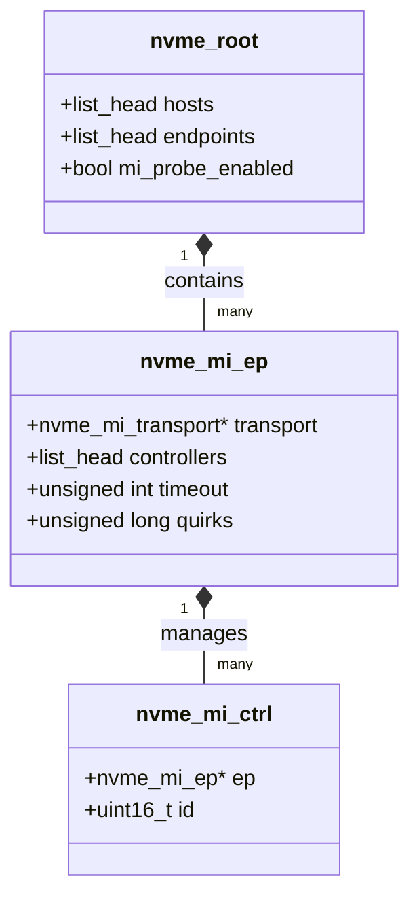
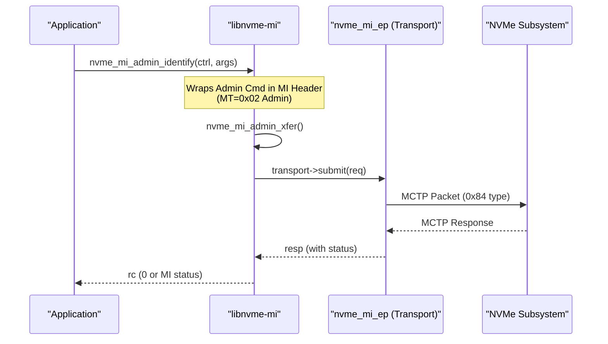

<!-- source: DeepWiki mcp.deepwiki.com · repo NVIDIA/libnvme · page 5.1 NVMe-MI Command API · fetched 2026-10-26 -->

# NVMe-MI Command API

Relevant source files

The following files were used as context for generating this wiki page:

- [src/libnvme-mi.map](src/libnvme-mi.map)
- [src/nvme/api-types.h](src/nvme/api-types.h)
- [src/nvme/mi.c](src/nvme/mi.c)
- [src/nvme/mi.h](src/nvme/mi.h)
- [src/nvme/private.h](src/nvme/private.h)
- [test/mi.c](test/mi.c)
- [test/utils.c](test/utils.c)
- [test/utils.h](test/utils.h)

The NVMe Management Interface (NVMe-MI) Command API provides a high-level abstraction for out-of-band communication with NVMe subsystems and controllers. It is implemented in `libnvme-mi.so` and supports both native MI commands and tunneled Admin commands over MCTP transports.

## Object Model

The API uses a hierarchical object model that mirrors the physical topology of an NVMe-MI management link.

### Endpoint (`nvme_mi_ep_t`)
An endpoint represents a communication target, typically identified by an MCTP Endpoint ID (EID). It is the primary handle for MI-specific commands (e.g., Subsystem Health Status).
*   **Initialization**: Created via transport-specific openers like `nvme_mi_open_mctp`.
*   **Lifecycle**: Managed within an `nvme_root_t` object, which tracks all active endpoints in a `list_head` named `endpoints` [src/nvme/private.h:162]().

### Controller (`nvme_mi_ctrl_t`)
A controller represents a specific NVMe controller within the subsystem accessed via an endpoint. It is used for standard NVMe Admin commands tunneled through MI.
*   **Association**: Every `nvme_mi_ctrl_t` belongs to exactly one `nvme_mi_ep_t` [src/nvme/private.h:262]().
*   **Identification**: Distinguished by a 16-bit Controller ID (`id`) [src/nvme/private.h:263]().

### Relationship Diagram

Relationship between Root, Endpoints, and Controllers.

Sources: [src/nvme/private.h:158-170](), [src/nvme/private.h:244-259](), [src/nvme/private.h:261-265]()

---

## MI Command Functions

MI commands are defined by the NVMe-MI specification and are executed directly against an endpoint.

| Function | Purpose |
| :--- | :--- |
| `nvme_mi_mi_read_mi_data_subsys` | Retrieves NVM Subsystem information [src/nvme/mi.c:249]() |
| `nvme_mi_mi_subsystem_health_status_poll` | Polls the subsystem for health status and alerts [src/nvme/mi.h:45]() |
| `nvme_mi_mi_config_get` | Reads MI configuration variables [src/nvme/mi.h:39]() |
| `nvme_mi_mi_config_set` | Updates MI configuration variables [src/nvme/mi.h:40]() |

### Implementation Flow
MI commands follow a request/response pattern where the library constructs an `nvme_mi_req`, calculates the Message Integrity Check (MIC), and submits it via the endpoint's transport [src/nvme/private.h:228-230]().

Sources: [src/nvme/mi.c:249](), [src/nvme/mi.h:39-45](), [src/nvme/private.h:209-234]()

---

## Admin Command Tunneling

One of the primary features of NVMe-MI is the ability to tunnel standard NVMe Admin commands (defined in the NVMe Base Spec) to controllers.

### Core Transfer: `nvme_mi_admin_xfer`
All Admin commands eventually call `nvme_mi_admin_xfer`. This function encapsulates the NVMe Admin SQE into an MI message with the type `NVME_MI_MT_ADMIN` [src/nvme/mi.h:108]().

### Key Admin Helpers
*   **Identify**: `nvme_mi_admin_identify_partial` allows fetching controller/namespace identification data [src/nvme/mi.c:160]().
*   **Log Pages**: `nvme_mi_admin_get_log_page` retrieves telemetry, error, or SMART logs [src/libnvme-mi.map:8]().
*   **Firmware**: `nvme_mi_admin_fw_download` and `nvme_mi_admin_fw_commit` facilitate out-of-band firmware updates [src/libnvme-mi.map:27-28]().

### Data Flow: Admin over MI

Sources: [src/nvme/mi.h:105-119](), [src/nvme/mi.c:160](), [src/nvme/private.h:225-234]()

---

## Quirk Engine and Inter-Command Delays

Certain hardware implementations have timing constraints where they cannot process commands sent immediately after a previous response.

### Quirk: `NVME_QUIRK_MIN_INTER_COMMAND_TIME`
If an endpoint is flagged with this quirk, the library tracks the `last_resp_time` using `clock_gettime(CLOCK_MONOTONIC)` [src/nvme/mi.c:78-80]().

### Implementation: `nvme_mi_insert_delay`
Before submitting a new request, the library calls `nvme_mi_insert_delay` [src/nvme/mi.c:213]().
1.  Calculates the earliest allowed time for the next command based on `inter_command_us` [src/nvme/mi.c:222]().
2.  Compares the current time to the calculated next time [src/nvme/mi.c:235]().
3.  If necessary, calls `nanosleep()` to stall the thread until the hardware is ready [src/nvme/mi.c:240]().

### Automatic Probing
During `nvme_mi_ep_probe`, the library identifies specific hardware (e.g., Samsung MZUL2512) by checking the Vendor ID and Model Number, automatically applying the 1.2ms inter-command delay quirk [src/nvme/mi.c:172-176]().

Sources: [src/nvme/mi.c:74-80](), [src/nvme/mi.c:172-181](), [src/nvme/mi.c:213-241](), [src/nvme/private.h:242]()

---

## Log Chunking and Transfers

Because MI transports (like MCTP over I2C) often have small Maximum Transmission Units (MTUs), large data transfers like Log Pages or Identify structures are handled through offsets.

*   **Partial Identify**: `nvme_mi_admin_identify_partial` uses the `offsetof` and length parameters to fetch only required segments of the 4096-byte `nvme_id_ctrl` structure [src/nvme/mi.c:160-161]().
*   **Log Offsets**: The `nvme_get_log_args` structure includes `lpo` (Log Page Offset) to allow the library or application to iterate through large log pages in chunks compatible with the MI Management Endpoint Buffer (MEB) constraints [src/nvme/api-types.h:78]().

Sources: [src/nvme/mi.c:160-161](), [src/nvme/api-types.h:77-93]()

---

