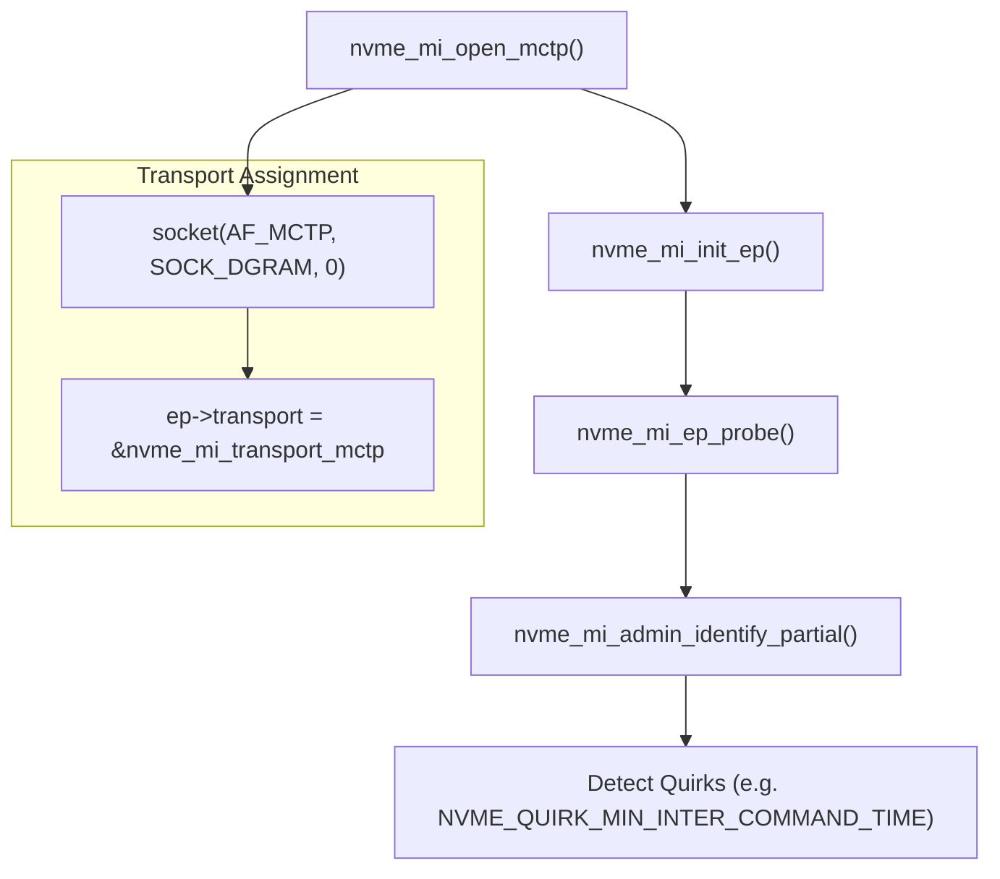
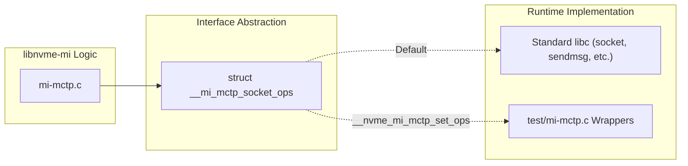

<!-- source: DeepWiki mcp.deepwiki.com · repo NVIDIA/libnvme · page 5.2 MCTP Transport Layer · fetched 2026-10-26 -->

# MCTP Transport Layer

Relevant source files

The following files were used as context for generating this wiki page:

- [examples/mi-mctp.c](examples/mi-mctp.c)
- [src/libnvme-mi.h](src/libnvme-mi.h)
- [src/libnvme-mi.map](src/libnvme-mi.map)
- [src/nvme/mi-mctp.c](src/nvme/mi-mctp.c)
- [src/nvme/mi.c](src/nvme/mi.c)
- [src/nvme/mi.h](src/nvme/mi.h)
- [test/mi-mctp.c](test/mi-mctp.c)

The MCTP (Management Component Transport Protocol) transport layer in `libnvme-mi` provides the communication backbone for NVMe Management Interface (NVMe-MI) messages. It supports two primary modes of operation: using the Linux kernel's native `AF_MCTP` socket interface or using a userspace implementation via `libmctp`.

## MCTP Endpoint Initialization

Endpoints are the logical targets for MI communication. `libnvme-mi` provides two primary entry points for opening an MCTP-based endpoint depending on the underlying transport implementation.

### Native MCTP (AF_MCTP)
The function `nvme_mi_open_mctp` initializes an endpoint using the Linux kernel `AF_MCTP` network stack [src/nvme/mi-mctp.c:1162-1180](). It creates a socket of type `AF_MCTP` and binds it to the specified network ID and Endpoint ID (EID) [src/nvme/mi-mctp.c:1083-1120]().

### Userspace MCTP (libmctp)
For systems without native kernel MCTP support, `nvme_mi_open_libmctp` provides an interface to use the `libmctp` userspace library [src/nvme/mi-mctp.c:1182-1200](). This utilizes a specific `nvme_mi_libmctp_submit` routine to handle message framing and transmission [src/nvme/mi-mctp.c:238-340]().

### Initialization Data Flow
The following diagram illustrates the initialization path for an MCTP endpoint.

**Diagram: MCTP Endpoint Initialization Flow**

Sources: [src/nvme/mi-mctp.c:1162-1180](), [src/nvme/mi.c:124-194](), [src/nvme/mi.c:243-261]()

## AF_MCTP Socket Abstraction

The MCTP transport uses a standard `msghdr` structure to send and receive messages. 

- **Message Type**: NVMe-MI messages over MCTP must use the MCTP message type `0x04` [src/nvme/mi-mctp.c:82]().
- **Integrity**: The Message Integrity Check (MIC) bit is often set (forming `0x84`) to indicate that the message contains a CRC32 trailing field [src/nvme/mi.h:94-100]().
- **Addressing**: Addressing is handled via `struct sockaddr_mctp`, which includes the `smctp_network` and `smctp_addr.s_addr` (the EID) [src/nvme/mi-mctp.c:62-70]().

### Tag Allocation and SIOCMCTPALLOCTAG
To support asynchronous responses and "More Processing Required" (MPR) states, `libnvme-mi` manages MCTP tags. 

1. **Allocation**: `nvme_mi_mctp_tag_alloc` attempts to pre-allocate a tag using the `SIOCMCTPALLOCTAG` ioctl [src/nvme/mi-mctp.c:123-148]().
2. **Usage**: The allocated tag is passed in `smctp_tag` with the `MCTP_TAG_OWNER` bit set to ensure the kernel maintains the association for the duration of the request/response cycle [src/nvme/mi-mctp.c:78]().
3. **Release**: Once the transaction is complete, the tag is dropped via `SIOCMCTPDROPTAG` [src/nvme/mi-mctp.c:150-164]().

Sources: [src/nvme/mi-mctp.c:43-80](), [src/nvme/mi-mctp.c:123-164]()

## Response Handling and MPR

The MCTP transport must handle the NVMe-MI "More Processing Required" (MPR) status. When a controller returns `NVME_MI_RESP_MPR` [src/nvme/mi.h:153-156](), the transport layer performs the following:

- **Detection**: `nvme_mi_mctp_resp_is_mpr` checks the response status byte and validates the MIC [src/nvme/mi-mctp.c:198-235]().
- **Retry Logic**: If MPR is detected, the transport extracts the `mprt` (More Processing Required Time) and waits for the specified duration before retrying the command [src/nvme/mi-mctp.c:232]().
- **MIC Calculation**: Integrity is verified using `nvme_mi_crc32_update` on the message body [src/nvme/mi-mctp.c:227]().

Sources: [src/nvme/mi-mctp.c:198-235](), [src/nvme/mi.h:153-176]()

## D-Bus Scanner (nvme_mi_scan_mctp)

On systems using OpenBMC or similar management stacks, MCTP endpoints are often exposed via D-Bus. `nvme_mi_scan_mctp` automates the discovery of these endpoints [src/nvme/mi-mctp.c:1202-1300]().

- **Interface**: It looks for objects implementing `xyz.openbmc_project.MCTP.Endpoint` [src/nvme/mi-mctp.c:35]().
- **Properties**: It extracts the `EID` and `NetworkId` from the D-Bus properties and automatically calls `nvme_mi_open_mctp` for each discovered device [src/nvme/mi-mctp.c:1270-1285]().

Sources: [src/nvme/mi-mctp.c:30-36](), [src/nvme/mi-mctp.c:1202-1300]()

## Testing and Mocking

To facilitate unit testing without requiring a physical MCTP-capable device, `libnvme-mi` utilizes a `socket_ops` mock interface.

### The `__mi_mctp_socket_ops` Structure
This structure abstracts the standard system calls used by the MCTP transport [src/nvme/mi-mctp.c:108-114]():
- `socket`
- `sendmsg`
- `recvmsg`
- `poll`
- `ioctl_tag`

### Mock Implementation
In test environments (e.g., `test/mi-mctp.c`), the `__nvme_mi_mctp_set_ops` function is used to inject wrapper functions [src/nvme/mi-mctp.c:116-119](). These wrappers (like `__wrap_sendmsg`) interact with a `static struct test_peer` to simulate controller behavior, including MIC generation and MPR status injection [test/mi-mctp.c:53-77](), [test/mi-mctp.c:113-137]().

**Diagram: Transport Mocking Architecture**

Sources: [src/nvme/mi-mctp.c:108-119](), [test/mi-mctp.c:53-77](), [test/mi-mctp.c:113-137]()

---

