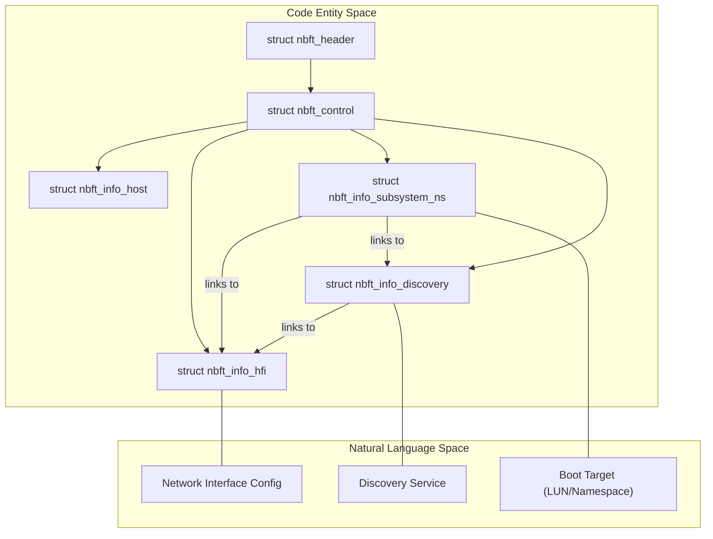
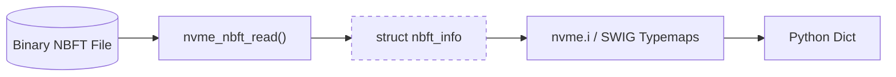

<!-- source: DeepWiki mcp.deepwiki.com · repo NVIDIA/libnvme · page 6 NVMe Boot Firmware Table (NBFT) · fetched 2026-10-26 -->

# NVMe Boot Firmware Table (NBFT)

<details>
<summary>Relevant source files</summary>

The following files were used as context for generating this wiki page:

- [libnvme/meson.build](libnvme/meson.build)
- [libnvme/nvme.i](libnvme/nvme.i)
- [libnvme/tests/NBFT](libnvme/tests/NBFT)
- [libnvme/tests/gc.py](libnvme/tests/gc.py)
- [libnvme/tests/test-nbft.py](libnvme/tests/test-nbft.py)
- [src/nvme/nbft.c](src/nvme/nbft.c)
- [src/nvme/nbft.h](src/nvme/nbft.h)

</details>


The NVMe Boot Firmware Table (NBFT) is an ACPI table used to pass NVMe-over-Fabrics (NVMe-oF) boot configuration from the system firmware to the Operating System. It allows the OS to discover and connect to the remote NVMe subsystems required to mount the root filesystem. `libnvme` provides a comprehensive parser to read these binary tables and convert them into structured C and Python objects.

### Purpose and Scope
The NBFT implementation in `libnvme` focuses on:
*   **Parsing**: Reading the binary ACPI table from `/sys/firmware/acpi/tables/NBFT` or a file.
*   **Validation**: Verifying checksums and descriptor integrity.
*   **Object Mapping**: Resolving heap-based strings and associations between Host Fabric Interfaces (HFI), Subsystem Namespaces (SSNS), and Discovery Controllers.
*   **Language Bindings**: Exposing parsed NBFT data to Python for high-level orchestration.

For detailed implementation of the parsing logic and data structures, see **[NBFT Parser and Data Structures](#6.1)**.

---

### High-Level Architecture

The NBFT is organized as a header followed by a series of descriptors. `libnvme` maps these descriptors into a usable `struct nbft_info` object.

| Component | Description | Code Entity |
| :--- | :--- | :--- |
| **Header** | ACPI signature ("NBFT") and heap pointers. | `struct nbft_header` |
| **Control** | Indices and counts for all other descriptors. | `struct nbft_control` |
| **Host** | Host-specific NQN and ID. | `struct nbft_info_host` |
| **HFI** | Host Fabric Interface (e.g., IP, MAC, VLAN). | `struct nbft_info_hfi` |
| **SSNS** | Subsystem Namespace (Target NQN, IP, Port). | `struct nbft_info_subsystem_ns` |

#### NBFT Logical Relationships
The following diagram illustrates how the firmware table structures are linked during parsing.


**Sources:** [src/nvme/nbft.h:40-51](), [src/nvme/nbft.h:117-132](), [src/nvme/nbft.h:135-175]()

---

### Python Integration

`libnvme` provides Python bindings for NBFT via SWIG, allowing users to retrieve boot configuration as a native Python dictionary. This is primarily handled by the `nvme.nbft_get()` function.

```python
from libnvme import nvme

# Read NBFT from the default system path or a specific binary file
nbft_data = nvme.nbft_get("/sys/firmware/acpi/tables/NBFT")

# Accessing host information
print(f"Host NQN: {nbft_data['host']['nqn']}")

# Iterating through boot subsystems
for ss in nbft_data['subsystem']:
    print(f"Connect to {ss['traddr']} via {ss['trtype']}")
```

#### Python Binding Flow
This diagram shows the transition from the binary file to the Python dictionary representation.


**Sources:** [libnvme/nvme.i:31](), [libnvme/tests/test-nbft.py:78-81](), [libnvme/meson.build:75]()

---

### Key Data Structures

The library distinguishes between the raw ACPI descriptors (packed structures matching the spec) and the "Info" structures (human-readable, resolved pointers).

| Spec Structure | Info Structure | Role |
| :--- | :--- | :--- |
| `struct nbft_ssns` | `struct nbft_info_subsystem_ns` | Defines a bootable NVMe-oF subsystem. |
| `struct nbft_hfi` | `struct nbft_info_hfi` | Defines the local network interface used for boot. |
| `struct nbft_discovery` | `struct nbft_info_discovery` | Defines the Discovery Controller for finding namespaces. |

**Sources:** [src/nvme/nbft.h:194-247](), [src/nvme/nbft.h:352-404](), [src/nvme/nbft.c:184-247]()

---

### Child Pages
*   **[NBFT Parser and Data Structures](#6.1)**: Details on `nvme_nbft_read`, `get_heap_obj` logic, and the transition from raw descriptors to the `nbft_info` tree.

---

