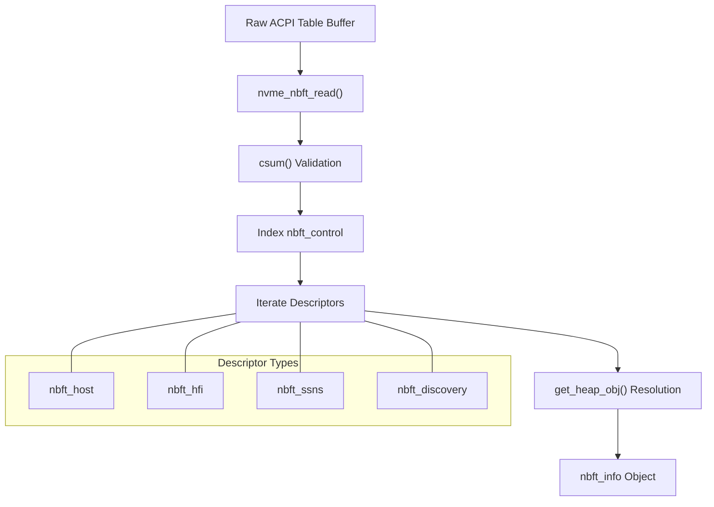
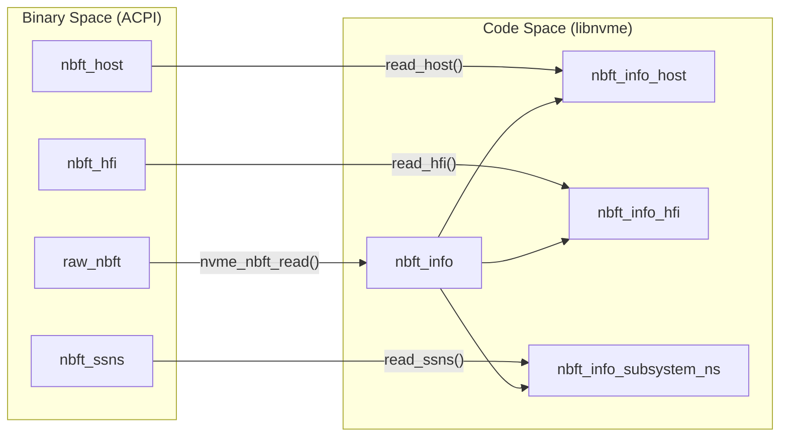
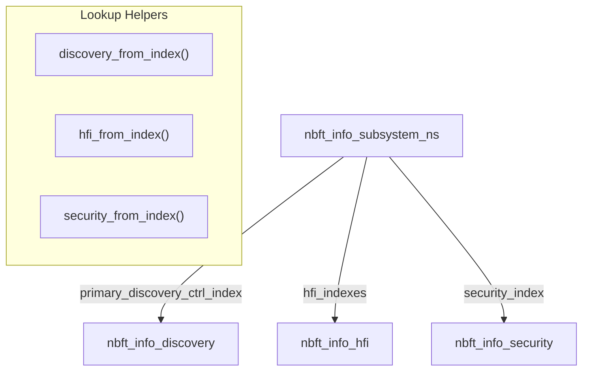

<!-- source: DeepWiki mcp.deepwiki.com · repo NVIDIA/libnvme · page 6.1 NBFT Parser and Data Structures · fetched 2026-10-26 -->

# NBFT Parser and Data Structures

Relevant source files

The following files were used as context for generating this wiki page:

- [src/nvme/nbft.c](src/nvme/nbft.c)
- [src/nvme/nbft.h](src/nvme/nbft.h)
- [test/nbft/README](test/nbft/README)
- [test/nbft/diffs/NBFT-auto-ipv6](test/nbft/diffs/NBFT-auto-ipv6)
- [test/nbft/diffs/NBFT-dhcp-ipv4](test/nbft/diffs/NBFT-dhcp-ipv4)
- [test/nbft/diffs/NBFT-dhcp-ipv6](test/nbft/diffs/NBFT-dhcp-ipv6)
- [test/nbft/diffs/NBFT-static-ipv4-discovery](test/nbft/diffs/NBFT-static-ipv4-discovery)
- [test/nbft/diffs/NBFT-static-ipv6](test/nbft/diffs/NBFT-static-ipv6)
- [test/nbft/gen-nbft-diffs.sh.in](test/nbft/gen-nbft-diffs.sh.in)
- [test/nbft/meson.build](test/nbft/meson.build)

The NVMe Boot Firmware Table (NBFT) is an ACPI table defined by the NVMe Boot Specification to communicate NVMe-over-Fabrics (NVMe-oF) configuration from firmware to the operating system. This information allows the OS to establish connections to boot targets using parameters defined during the pre-boot environment.

## Overview of NBFT Parsing

The core of the NBFT implementation in `libnvme` is the `nvme_nbft_read()` function, which transforms a raw binary ACPI table into a structured `nbft_info` object. The parser performs validation, resolves internal heap references, and links related descriptors (e.g., associating a Subsystem Namespace with its corresponding Host Fabric Interface).

### Data Flow and Logic

The parsing process follows a strict sequence to ensure data integrity:
1.  **Validation**: Verifies the "NBFT" signature and performs a checksum of the entire table [src/nvme/nbft.c:24-32]().
2.  **Control Descriptor Indexing**: Locates the `nbft_control` descriptor to determine the offsets and counts for all other descriptor types [src/nvme/nbft.h:135-168]().
3.  **Heap Resolution**: Resolves `nbft_heap_obj` references. Strings and variable-length data are stored in a heap area at the end of the table; the parser validates that these offsets fall within the declared heap boundaries [src/nvme/nbft.c:47-60]().
4.  **Descriptor Iteration**: Iterates through Host, HFI, SSNS, Discovery, and Security descriptors to populate the `nbft_info` structure.

**Table Parser Data Flow**

Sources: [src/nvme/nbft.c:24-60](), [src/nvme/nbft.h:40-51]()

## Key Data Structures

The parser interacts with two sets of structures: the **Binary Layout** (matching the ACPI spec) and the **Information Model** (the internal `nbft_info` used by the library).

### Binary Layout (ACPI)
These structures are marked `__attribute__((packed))` to match the memory layout of the ACPI table.

| Structure | Description |
| :--- | :--- |
| `nbft_header` | The standard ACPI header with NBFT-specific heap offsets [src/nvme/nbft.h:117-132](). |
| `nbft_control` | The "map" of the table, containing counts and offsets for all lists [src/nvme/nbft.h:135-180](). |
| `nbft_heap_obj` | A pointer-like structure containing an offset and length for data in the heap [src/nvme/nbft.h:69-72](). |

### Information Model (libnvme)
The parser populates an `nbft_info` structure, which provides a usable C interface for the OS.

| Code Entity | Role |
| :--- | :--- |
| `struct nbft_info` | The root container for a parsed NBFT table. |
| `struct nbft_info_host` | Contains Host NQN and ID [src/nvme/nbft.h:425-436](). |
| `struct nbft_info_hfi` | Fabric interface details, including TCP/IP configuration [src/nvme/nbft.h:465-485](). |
| `struct nbft_info_subsystem_ns` | Subsystem and Namespace details for boot [src/nvme/nbft.h:558-592](). |

**Code Entity Mapping: Binary to Info**

Sources: [src/nvme/nbft.h:425-592](), [src/nvme/nbft.c:184-204]()

## Implementation Details

### Heap Object Resolution
The `get_heap_obj` macro and `__get_heap_obj` function are used to safely extract strings and binary blobs from the NBFT heap [src/nvme/nbft.c:121-125](). This includes bounds checking against the `header->heap_offset` and `header->heap_length` [src/nvme/nbft.c:47-59]().

### TCP Transport Extraction
NBFT currently focuses on the TCP transport (`NBFT_TRTYPE_TCP`). The parser extracts:
*   **IP Addresses**: Handled by `format_ip_addr`, which supports both IPv4-mapped IPv6 and standard IPv6 addresses [src/nvme/nbft.c:34-45]().
*   **TCP Flags**: Extracts PDU Header Digest and Data Digest requirements from the `trflags` field [src/nvme/nbft.c:212-217]().
*   **HFI Info**: Resolves PCI SBDF (Segment/Bus/Device/Function) and MAC addresses for the network interface [test/nbft/diffs/NBFT-auto-ipv6:9-10]().

### Index Resolution
Descriptors in the NBFT refer to each other by index rather than memory address. The parser includes helper functions to resolve these links:
*   `discovery_from_index()`: Finds a discovery descriptor by its index [src/nvme/nbft.c:127-136]().
*   `hfi_from_index()`: Links a Subsystem Namespace to its specific Fabric Interface [src/nvme/nbft.c:138-147]().
*   `security_from_index()`: Retrieves security parameters (e.g., AUTH/TLS) for a connection [src/nvme/nbft.c:149-158]().

**Relationship Resolution**

Sources: [src/nvme/nbft.c:127-158](), [src/nvme/nbft.c:220-222]()

## Error Handling and Validation
The parser uses a `verify` macro to validate structure IDs and versions during iteration [src/nvme/nbft.c:75-82](). If a descriptor contains an invalid ID (e.g., `raw_ssns->structure_id != NBFT_DESC_SSNS`), the parser logs a debug message via `nvme_msg` and returns `-EINVAL` [src/nvme/nbft.c:197-199]().

Sources: [src/nvme/nbft.c:1-250](), [src/nvme/nbft.h:1-200]()

---

