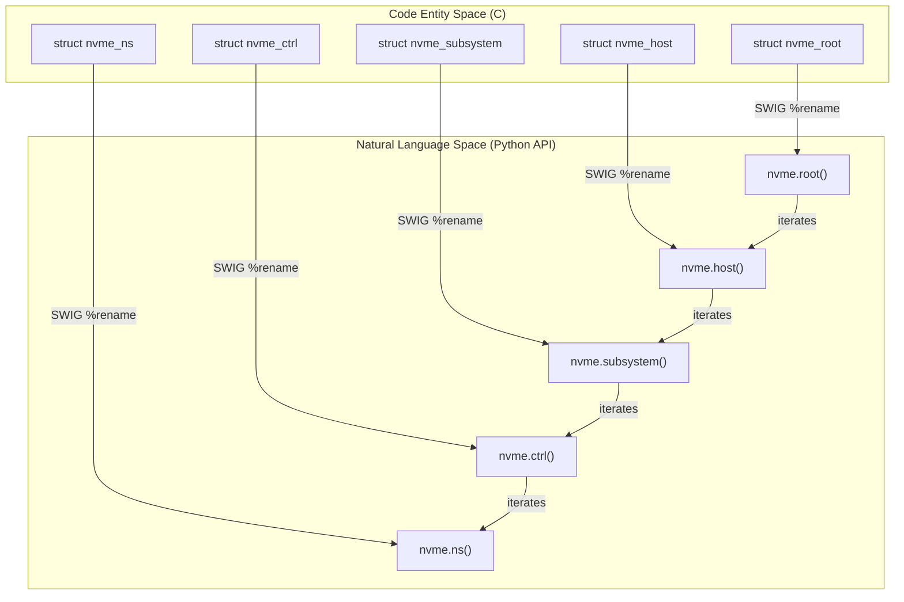
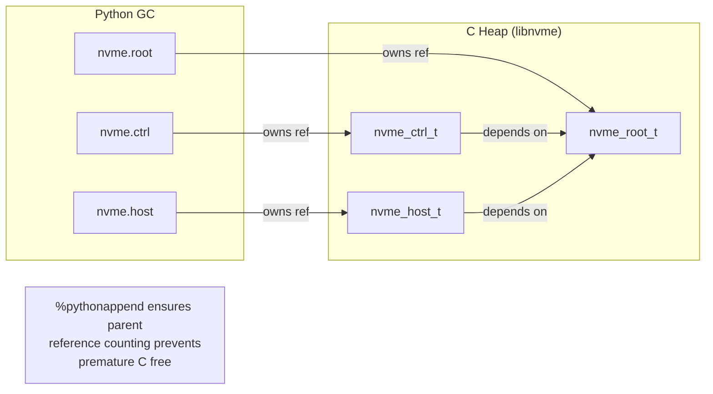

<!-- source: DeepWiki mcp.deepwiki.com · repo NVIDIA/libnvme · page 7.1 Python API Reference and Usage · fetched 2026-10-26 -->

# Python API Reference and Usage

Relevant source files

The following files were used as context for generating this wiki page:

- [examples/discover-loop.py](examples/discover-loop.py)
- [libnvme/.gitignore](libnvme/.gitignore)
- [libnvme/README.md](libnvme/README.md)
- [libnvme/__init__.py](libnvme/__init__.py)
- [libnvme/meson.build](libnvme/meson.build)
- [libnvme/nvme.i](libnvme/nvme.i)
- [libnvme/tests/NBFT](libnvme/tests/NBFT)
- [libnvme/tests/create-ctrl-obj.py](libnvme/tests/create-ctrl-obj.py)
- [libnvme/tests/gc.py](libnvme/tests/gc.py)
- [libnvme/tests/test-nbft.py](libnvme/tests/test-nbft.py)
- [pyproject.toml](pyproject.toml)
- [src/nvme/cleanup.c](src/nvme/cleanup.c)
- [src/nvme/cleanup.h](src/nvme/cleanup.h)

The `nvme` Python module provides high-level, object-oriented bindings for `libnvme`, generated using SWIG. It allows developers to interact with NVMe devices, manage topologies, and perform NVMe-over-Fabrics (NVMe-of) operations like discovery and connection directly from Python. The bindings wrap the underlying C structures into Python classes, manage memory through garbage collection, and handle GIL (Global Interpreter Lock) management for blocking operations.

## Architecture and Class Hierarchy

The Python module maps the `libnvme` topology tree into a set of Python classes. Most classes are renamed from their C counterparts for a more idiomatic Python interface.

### Core Classes
| C Structure | Python Class | Role |
| :--- | :--- | :--- |
| `struct nvme_root` | `nvme.root` | The singleton root object for the library session. [libnvme/nvme.i:16]() |
| `struct nvme_host` | `nvme.host` | Represents a local host entity. [libnvme/nvme.i:17]() |
| `struct nvme_subsystem` | `nvme.subsystem` | Represents an NVMe subsystem. [libnvme/nvme.i:19]() |
| `struct nvme_ctrl` | `nvme.ctrl` | Represents an NVMe controller (local or remote). [libnvme/nvme.i:18]() |
| `struct nvme_ns` | `nvme.ns` | Represents an NVMe namespace. [libnvme/nvme.i:20]() |

### Data Flow: Topology Object Mapping
This diagram shows how C structures are surfaced as Python objects and the iterators used to traverse them.

**Topology Class Association**

**Sources:** [libnvme/nvme.i:16-20](), [libnvme/nvme.i:61-81]()

## Fabrics Workflows: Connect and Discover

The Python API simplifies NVMe-oF workflows by providing methods on the `nvme.ctrl` object.

### Connect Workflow
To connect to a remote target, a user instantiates a `ctrl` object with the target details and calls `.connect()`.
1. **Instantiation**: `nvme.ctrl(root, subsysnqn, transport, traddr, ...)` [libnvme/README.md:30]()
2. **Connection**: `ctrl.connect(host, config_dict)` [libnvme/README.md:37]()

The `connect` method includes a SWIG exception handler that converts C `errno` values into Python `RuntimeError` or `AttributeError` exceptions. [libnvme/nvme.i:119-133]()

### Discovery Workflow
Discovery controllers are handled via the `.discover()` method, which returns a list of discovery log entries.
- **Log Retrieval**: `ctrl.discover(lsp=...)` [examples/discover-loop.py:53]()
- **Data Conversion**: The SWIG typemap automatically converts the C `struct nvmf_discovery_log` into a Python list of dictionaries. [libnvme/nvme.i:218-278]()

**Sources:** [libnvme/nvme.i:119-133](), [libnvme/nvme.i:218-278](), [examples/discover-loop.py:32-65]()

## SWIG Typemaps and Implementation

### Configuration Dictionaries
The API uses a specialized `in` typemap for `struct nvme_fabrics_config`. This allows Python users to pass a standard dictionary to functions like `connect()`.
- **Supported Keys**: `host_traddr`, `host_iface`, `nr_io_queues`, `reconnect_delay`, `ctrl_loss_tmo`, `keep_alive_tmo`, `hdr_digest`, `data_digest`, etc. [libnvme/nvme.i:143-204]()

### Discovery Log Lists
The `out` typemap for `struct nvmf_discovery_log *` iterates through the C log entries and builds a Python list of dictionaries, mapping C enums (like `trtype` and `adrfam`) to human-readable strings like `"tcp"`, `"rdma"`, or `"ipv4"`. [libnvme/nvme.i:218-278]()

### NBFT Parsing
The function `nvme_nbft_get` (aliased as `nvme.nbft_get`) parses the NVMe Boot Firmware Table. It returns a complex nested dictionary containing `host`, `hfi` (Interface), `discovery`, and `subsystem` information. [libnvme/tests/test-nbft.py:80]()

**Sources:** [libnvme/nvme.i:143-204](), [libnvme/nvme.i:218-278](), [libnvme/tests/test-nbft.py:11-76]()

## Memory Management and GC

### Garbage Collection Ordering
A critical aspect of the Python bindings is the lifecycle management of topology objects. Since `libnvme` objects (like `nvme_ctrl`) often depend on their parents (like `nvme_root`), the Python bindings ensure that parent objects are not prematurely freed by the garbage collector while children still exist.

The test `tests/gc.py` specifically validates that deleting a `root` or `host` object while `ctrl` objects are still in scope does not trigger a segmentation fault. [libnvme/tests/gc.py:31-42]()

### GIL Management
SWIG is configured to manage the Global Interpreter Lock (GIL) for potentially blocking calls. This ensures that Python's multi-threading capabilities are not hindered when one thread is waiting on a slow I/O operation (like a fabrics connection timeout).

**Object Lifecycle Diagram**

**Sources:** [libnvme/nvme.i:16-20](), [libnvme/tests/gc.py:31-42]()

## Build and Integration

The Python bindings are built using `meson` and `swig`.

1. **Detection**: Meson searches for `python3`, `swig`, and `Python.h`. [libnvme/meson.build:13-17]()
2. **Generation**: SWIG processes `nvme.i` to produce `nvme_wrap.c` and `nvme.py`. [libnvme/meson.build:29-36]()
3. **Compilation**: The wrapper is compiled into a shared object `_nvme` and linked against `libnvme` and `libccan`. [libnvme/meson.build:38-46]()
4. **Package Structure**: The files are installed into a `libnvme` Python package directory with an `__init__.py`. [libnvme/meson.build:55-60]()

**Sources:** [libnvme/meson.build:8-60](), [pyproject.toml:1-4]()

---

