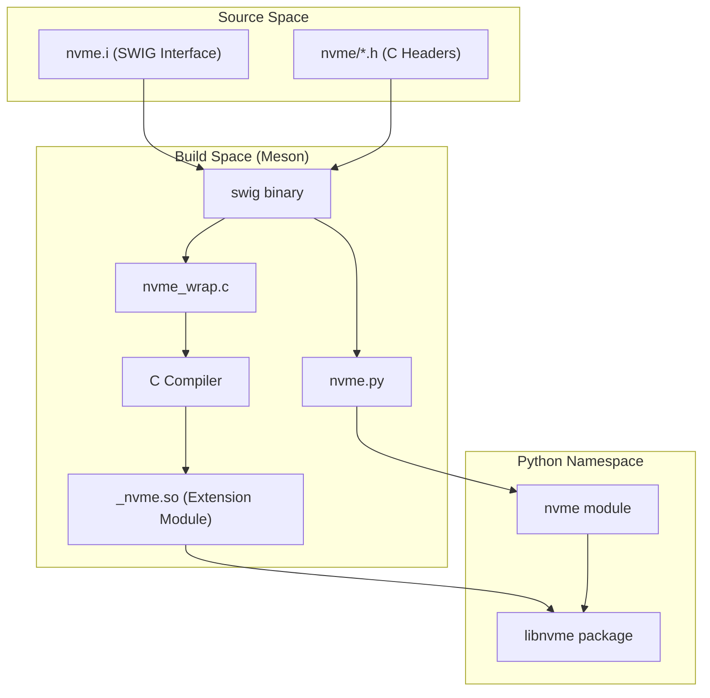
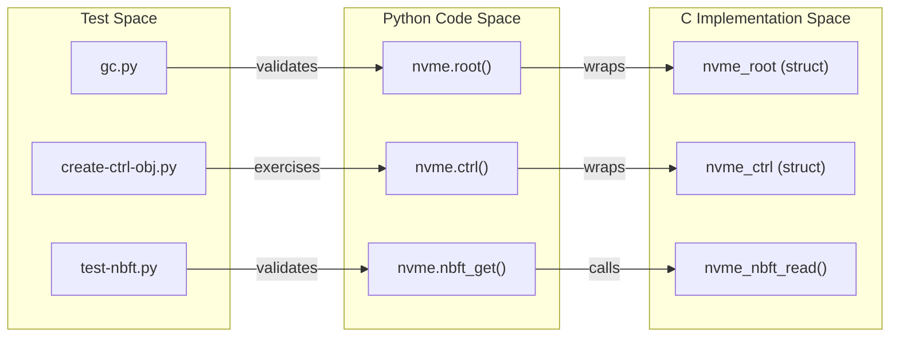

<!-- source: DeepWiki mcp.deepwiki.com · repo NVIDIA/libnvme · page 7.2 Python Build and Testing · fetched 2026-10-26 -->

# Python Build and Testing

Relevant source files

The following files were used as context for generating this wiki page:

- [ccan/meson.build](ccan/meson.build)
- [internal/meson.build](internal/meson.build)
- [libnvme/meson.build](libnvme/meson.build)
- [libnvme/nvme.i](libnvme/nvme.i)
- [libnvme/tests/NBFT](libnvme/tests/NBFT)
- [libnvme/tests/create-ctrl-obj.py](libnvme/tests/create-ctrl-obj.py)
- [libnvme/tests/gc.py](libnvme/tests/gc.py)
- [libnvme/tests/test-nbft.py](libnvme/tests/test-nbft.py)
- [meson.build](meson.build)
- [pyproject.toml](pyproject.toml)
- [src/meson.build](src/meson.build)
- [src/nvme/cleanup.c](src/nvme/cleanup.c)
- [src/nvme/cleanup.h](src/nvme/cleanup.h)

The `libnvme` project provides high-level Python bindings generated via SWIG (Simplified Wrapper and Interface Generator). These bindings allow developers to interact with NVMe topology, fabrics, and NBFT (NVMe Boot Firmware Table) structures using native Python objects. The build process is integrated into the Meson build system, ensuring that the C library and its Python interface remain synchronized.

## Python Build System and SWIG Generation

The Python bindings are compiled as an extension module named `_nvme` and a supporting Python module `nvme.py` [libnvme/meson.build:38-46](). The generation process relies on SWIG to parse the interface definition file `nvme.i` [libnvme/meson.build:31-32]().

### Build Configuration and Versioning
The `libnvme/meson.build` script detects the Python environment and SWIG availability. It handles specific version requirements for SWIG to ensure compatibility with Python 3:
*   **SWIG Version Detection**: The script checks the SWIG version [libnvme/meson.build:21-22]().
*   **Version-Specific Flags**: For SWIG versions older than 4.1.0, the `-py3` flag is explicitly added to the command line [libnvme/meson.build:23-24](). Newer versions default to Python 3 and omit this flag [libnvme/meson.build:26]().
*   **Dependencies**: The build requires `Python.h` and the Python 3 development dependency [libnvme/meson.build:14-17]().

### Extension Module Compilation
The C-to-Python bridge is built in two parts:
1.  **`nvme_wrap.c`**: Generated by SWIG from `nvme.i` [libnvme/meson.build:32-33]().
2.  **`_nvme` (Extension Module)**: A shared object compiled from the wrapper code, linked against `libnvme_dep` and `libccan` [libnvme/meson.build:38-46]().

### SWIG Interface Implementation
The `nvme.i` file defines how C structures and functions are exposed to Python. It includes:
*   **Renaming**: C types like `struct nvme_root` are renamed to Pythonic names like `root` [libnvme/nvme.i:16-20]().
*   **Typemaps**: Custom typemaps convert complex C structures (e.g., `nvme_fabrics_config`) from Python dictionaries [libnvme/nvme.i:143-204]().
*   **Exception Handling**: C error codes and `errno` are converted into Python exceptions (e.g., `StopIteration` for iterators or `RuntimeError` for connection failures) [libnvme/nvme.i:83-141]().

### Build Data Flow
The following diagram illustrates the transformation from C source and SWIG interface to the final Python package.

**Python Binding Build Pipeline**

Sources: [libnvme/meson.build:20-47](), [libnvme/nvme.i:9-31]()

---

## Python Test Suite

The project includes a Python-specific test suite located in `libnvme/tests/`. These tests validate object lifecycle management, data parsing, and basic instantiation.

### Test Environment Setup
To run tests directly from the build directory without installing the library, Meson configures a specific `test_env`:
*   **PYTHONPATH**: Set to the parent of the current build directory to allow `import libnvme` to find the generated files [libnvme/meson.build:66]().
*   **Initialization**: A `__init__.py` file is copied into the build directory's `libnvme` folder to satisfy Python's package requirements [libnvme/meson.build:55-60]().

### Key Test Cases

| Test Script | Purpose | Key Entities Tested |
| :--- | :--- | :--- |
| `gc.py` | Validates Garbage Collection (GC) and object deletion order to prevent SIGSEGV [libnvme/tests/gc.py:31-33](). | `nvme.root`, `nvme.host`, `nvme.ctrl` |
| `test-nbft.py` | Verifies NBFT binary table parsing against expected JSON-like structures [libnvme/tests/test-nbft.py:78-81](). | `nvme.nbft_get` |
| `create-ctrl-obj.py` | Ensures basic object instantiation and attribute setting works [libnvme/tests/create-ctrl-obj.py:10-15](). | `nvme.ctrl`, `nvme.host` |

### Garbage Collection and Lifecycle
The `gc.py` test is critical because Python objects hold references to underlying C structures in the `libnvme` topology tree.
*   **Mechanism**: It instantiates a hierarchy (root -> host -> subsystem -> controller) and then nullifies the `root` and `host` references before the children [libnvme/tests/gc.py:34-42]().
*   **Implementation**: SWIG `%pythonappend` directives in `nvme.i` ensure that child objects maintain a reference to their parents, preventing the C structures from being freed prematurely [libnvme/tests/gc.py:31-33]().

### NBFT Parsing Validation
The `test-nbft.py` script uses a binary fixture `libnvme/tests/NBFT` and calls `nvme.nbft_get(filename)` [libnvme/tests/test-nbft.py:80](). It validates:
*   **Host Info**: NQN and ID configuration [libnvme/tests/test-nbft.py:37-43]().
*   **HFI (Host Fabric Interface)**: IP addresses, MAC addresses, and VLANs [libnvme/tests/test-nbft.py:19-36]().
*   **Subsystems**: Target NQNs, transport addresses (`traddr`), and transport service IDs (`trsvcid`) [libnvme/tests/test-nbft.py:44-75]().

**Python Entity to Code Mapping**

Sources: [libnvme/tests/gc.py:8-25](), [libnvme/tests/test-nbft.py:9-81](), [libnvme/tests/create-ctrl-obj.py:7-15]()

---

## Integration and Installation

The Python bindings are integrated into the standard installation path.
*   **Installation Directory**: Files are placed in the Python site-packages directory under the `libnvme` subdirectory [libnvme/meson.build:35, 45, 59]().
*   **PEP 517 Support**: The `pyproject.toml` file specifies `mesonpep517` as the build backend, allowing the bindings to be built and packaged as a Python wheel [pyproject.toml:2-4]().
*   **Dependencies**: The Python module depends on the main `libnvme` library and the `ccan` static library [libnvme/meson.build:41-43]().

Sources: [libnvme/meson.build:34-46](), [pyproject.toml:1-25](), [src/meson.build:49-59]()

---

