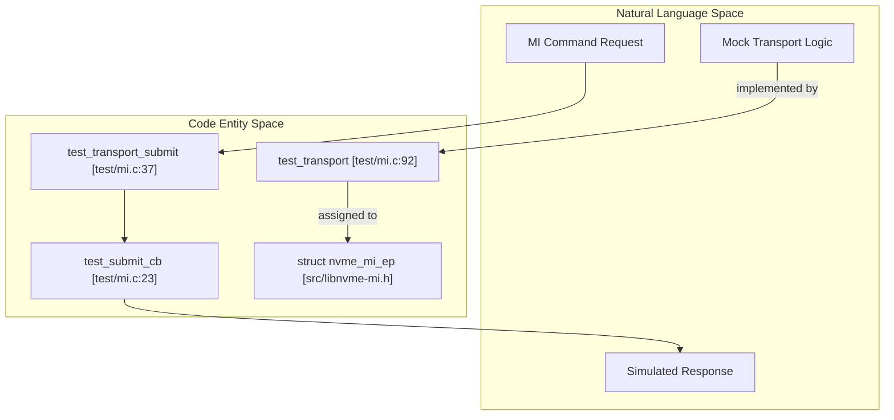
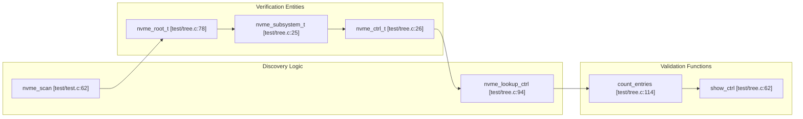

<!-- source: DeepWiki mcp.deepwiki.com · repo NVIDIA/libnvme · page 8 Testing Infrastructure · fetched 2026-10-26 -->

# Testing Infrastructure

<details>
<summary>Relevant source files</summary>

The following files were used as context for generating this wiki page:

- [examples/discover-loop.c](examples/discover-loop.c)
- [src/nvme/api-types.h](src/nvme/api-types.h)
- [test/meson.build](test/meson.build)
- [test/mi.c](test/mi.c)
- [test/register.c](test/register.c)
- [test/test-util.c](test/test-util.c)
- [test/test.c](test/test.c)
- [test/tree.c](test/tree.c)
- [test/utils.c](test/utils.c)
- [test/utils.h](test/utils.h)
- [test/zns.c](test/zns.c)

</details>


The `libnvme` testing infrastructure provides a comprehensive suite of unit and integration tests designed to validate NVMe command submission, topology management, and NVMe-MI (Management Interface) transport protocols. The suite is integrated with the Meson build system, allowing for automated verification across different architectures and configurations.

The infrastructure is divided into two primary categories: standard C-based tests for core library functionality and a specialized fixture-based framework for the NVMe Boot Firmware Table (NBFT).

### Test Suite Overview

The test suite is organized within the `test/` directory. While some tests act as unit tests, others serve as integration tests that require specific environment setups or hardware.

| Test Component | Purpose | Key Files |
|:---|:---|:---|
| **Core C Tests** | Validates `libnvme` logic, topology, and ioctl passthrough. | [test/test.c:18-22](), [test/tree.c:7-13]() |
| **NVMe-MI Tests** | Mocks MI endpoints and MCTP transports to test MI messaging. | [test/mi.c:16-21](), [test/mi-mctp.c:1-5]() |
| **NBFT Validation** | Validates ACPI table parsing against binary fixtures. | [test/nbft/meson.build:1-5]() |
| **Utility Helpers** | Common logging and setup routines for test execution. | [test/utils.c:1-14]() |

**Sources:** [test/meson.build:1-87](), [test/utils.h:1-19]()

### C Unit and Integration Tests

The C-based tests verify the fundamental layers of the library. This includes testing the topology tree creation via `nvme_scan` [test/test.c:62](), command submission through `ioctl` [test/test.c:71](), and the specialized NVMe-MI transport mocks [test/mi.c:37-56]().

*   **Topology Testing:** Validates that the library correctly identifies and links hosts, subsystems, and controllers [test/tree.c:78-112]().
*   **MI Mocking:** Uses a custom `nvme_mi_transport` structure to simulate NVMe-MI hardware, allowing for command validation without physical MI-over-MCTP devices [test/mi.c:92-98]().
*   **Register Access:** Provides tools to verify MMIO register mapping for PCI devices [test/register.c:46-72]().

For details, see [C Unit and Integration Tests](#8.1).

### NBFT Test Fixtures and Validation

The NBFT (NVMe Boot Firmware Table) testing framework uses a "golden file" approach. It processes various binary NBFT images—representing different network configurations like Static IPv4 or DHCP IPv6—and compares the parsed output against expected values.

*   **Binary Fixtures:** A collection of valid and "bad" (malformed) NBFT tables.
*   **Validation:** Automated scripts use the `nbft-dump` utility to ensure the parser correctly extracts Host, HFI, and SSNS descriptors [test/meson.build:87]().

For details, see [NBFT Test Fixtures and Validation](#8.2).

### Testing Code Map

The following diagrams illustrate how the testing infrastructure bridges the gap between high-level test requirements and the internal code entities.

#### NVMe-MI Test Transport Mapping
This diagram shows how `test/mi.c` implements a mock transport to test the MI layer.


**Sources:** [test/mi.c:23-128]()

#### Topology Tree Verification Flow
This diagram maps the process of validating the discovery tree in `test/tree.c`.


**Sources:** [test/tree.c:62-130]()

### Running Tests

Tests are managed via Meson and can be executed using the `meson test` command.

```bash
# Build the project including tests
meson setup build
meson compile -C build

# Run all non-hardware-dependent tests
meson test -C build

# Run a specific test (e.g., MI tests)
meson test -C build mi
```

**Note:** Certain tests, such as `main-test` [test/test.c](), require a real NVMe device and are not run by default in the standard unit-test suite [test/meson.build:8-11]().

**Sources:** [test/meson.build:1-17]()

---

