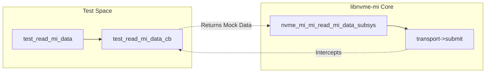
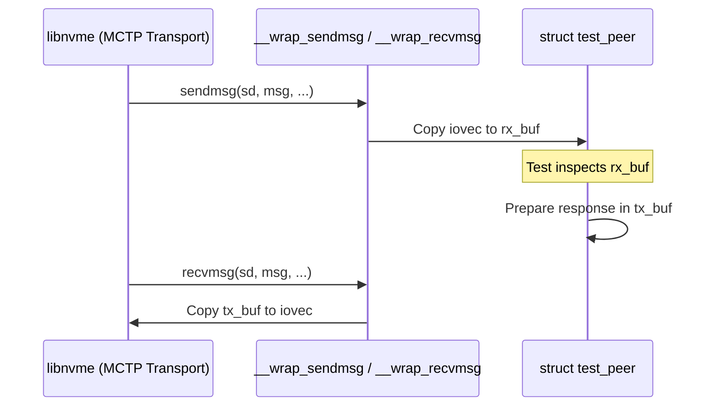

<!-- source: DeepWiki mcp.deepwiki.com · repo NVIDIA/libnvme · page 8.1 C Unit and Integration Tests · fetched 2026-10-26 -->

# C Unit and Integration Tests

Relevant source files

The following files were used as context for generating this wiki page:

- [examples/discover-loop.c](examples/discover-loop.c)
- [examples/mi-mctp.c](examples/mi-mctp.c)
- [src/libnvme-mi.h](src/libnvme-mi.h)
- [src/nvme/api-types.h](src/nvme/api-types.h)
- [src/nvme/mi-mctp.c](src/nvme/mi-mctp.c)
- [test/meson.build](test/meson.build)
- [test/mi-mctp.c](test/mi-mctp.c)
- [test/mi.c](test/mi.c)
- [test/register.c](test/register.c)
- [test/test-util.c](test/test-util.c)
- [test/test.c](test/test.c)
- [test/tree.c](test/tree.c)
- [test/utils.c](test/utils.c)
- [test/utils.h](test/utils.h)
- [test/uuid.c](test/uuid.c)
- [test/zns.c](test/zns.c)

The libnvme test suite provides comprehensive coverage for both the core `libnvme` (ioctl-based) and `libnvme-mi` (management interface) libraries. The tests are categorized into hardware-dependent integration tests and mock-based unit tests.

## Test Infrastructure Overview

The test programs are written in C and managed via the Meson build system. While some tests require physical hardware, others use a "mock" transport layer to simulate NVMe devices and MCTP endpoints.

| Test Program | Target Area | Type | Key Files |
|:---|:---|:---|:---|
| `main-test` | Admin/IO Commands | Integration (Hardware) | [test/test.c:12-17]() |
| `test-mi` | NVMe-MI Protocol | Unit (Mock Transport) | [test/mi.c:23-33]() |
| `test-mi-mctp` | MCTP Transport | Unit (Mock Sockets) | [test/mi-mctp.c:53-77]() |
| `test-register` | Controller Registers | Integration (MMIO) | [test/register.c:9-12]() |
| `tree` | Topology Tree | Unit (In-memory) | [test/tree.c:14-28]() |
| `test-util` | Internal Utilities | Unit | [test/test-util.c:10-15]() |

Sources: [test/meson.build:8-85](), [test/test.c:9-17](), [test/mi.c:1-5]()

---

## NVMe-MI Mock Testing (mi.c)

The `test-mi` program validates the NVMe-MI protocol without requiring physical hardware by implementing a custom `struct nvme_mi_transport`.

### Mock Transport Implementation
The test defines `test_transport` [test/mi.c:92-98](), which overrides the `submit` operation. This allows the test suite to intercept MI requests and provide deterministic responses.

### Key Functions
- `nvme_mi_open_test()`: Initializes an endpoint using the mock transport [test/mi.c:110-128]().
- `test_set_transport_callback()`: Allows individual test cases to register a specific callback to handle the next MI request [test/mi.c:100-108]().
- `test_transport_resp_calc_mic()`: Internal helper to calculate the Message Integrity Check (MIC) for mock responses [test/mi.c:81-90]().

Sources: [test/mi.c:37-56](), [test/mi.c:92-128]()

---

## MCTP Socket Mocking (mi-mctp.c)

The `test-mi-mctp` program tests the MCTP transport layer by intercepting system calls. It uses a `struct test_peer` to simulate a remote MCTP endpoint.

### System Call Interception
The test suite wraps standard socket operations to redirect traffic to the `test_peer` buffers:
- `__wrap_socket()`: Returns a file descriptor pointing to `/dev/null` [test/mi-mctp.c:105-110]().
- `__wrap_sendmsg()`: Captures data sent by libnvme into `test_peer.rx_buf` [test/mi-mctp.c:113-137]().
- `__wrap_recvmsg()`: Populates libnvme buffers with data from `test_peer.tx_buf` [test/mi-mctp.c:140-176]().

### Data Flow for MCTP Mock

Sources: [test/mi-mctp.c:53-77](), [test/mi-mctp.c:105-237]()

---

## Topology Tree Validation (tree.c)

The `tree` test validates the logic used to look up and manage the hierarchical object model (Root → Host → Subsystem → Controller).

### Implementation Details
- **Test Data**: Uses a static array of `struct test_data` containing various transport configurations (TCP, RDMA, FC) [test/tree.c:33-48]().
- **Lookup Logic**: Validates `nvme_lookup_ctrl` [test/tree.c:147-191]() and ensures that duplicate lookups return the same object pointer [test/tree.c:230-250]().
- **Tree Traversal**: Uses `nvme_for_each_host` and `nvme_subsystem_for_each_ctrl` to verify the structure [test/tree.c:121-127]().

Sources: [test/tree.c:14-48](), [test/tree.c:92-108](), [test/tree.c:114-130]()

---

## Hardware Integration Tests

### test.c (Ioctl Passthrough)
This program performs a "smoke test" on a live NVMe device. It iterates through controllers and namespaces, executing:
- **Identify**: `nvme_ctrl_identify` [test/test.c:62-69]().
- **Log Pages**: SMART [test/test.c:71-78](), Error [test/test.c:179-183](), and Command Effects [test/test.c:164-168]().
- **Features**: Arbitration, Power Management, and Temperature Threshold [test/test.c:185-199]().

### zns.c (Zoned Namespaces)
Specifically targets ZNS-capable devices.
- **Identify ZNS**: Uses `nvme_zns_identify_ns` and `nvme_zns_identify_ctrl` [test/zns.c:32-47]().
- **Zone Reporting**: Validates `nvme_zns_report_zones` [test/zns.c:49-57]().

### register.c (MMIO Access)
Tests controller register access via memory-mapped I/O. It reads and prints fields from the Controller Capabilities (`CAP`), Version (`VS`), and Controller Configuration (`CC`) registers [test/register.c:48-103]().

Sources: [test/test.c:36-60](), [test/zns.c:21-61](), [test/register.c:46-72]()

---

## Utility Tests (test-util.c)

The `test-util` program performs unit testing on internal helper functions by directly including the source files (e.g., `src/nvme/util.c`) [test/test-util.c:23-25]().

### Tested Functionality
- **Version Strings**: Validates `nvme_get_version` against project and git versions [test/test-util.c:31-35]().
- **IP Address Comparison**: Tests `nvme_ipaddrs_eq` with various IPv4, IPv6 (including mapped addresses), and null inputs [test/test-util.c:37-91]().

Sources: [test/test-util.c:10-25](), [test/test-util.c:37-59]()

---

