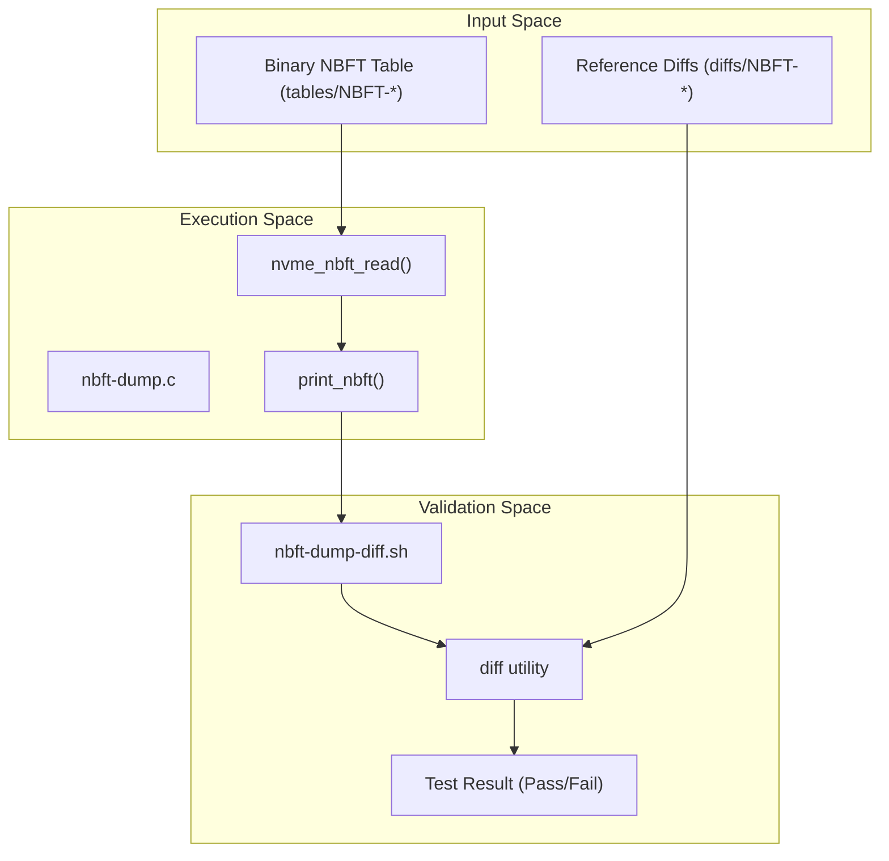
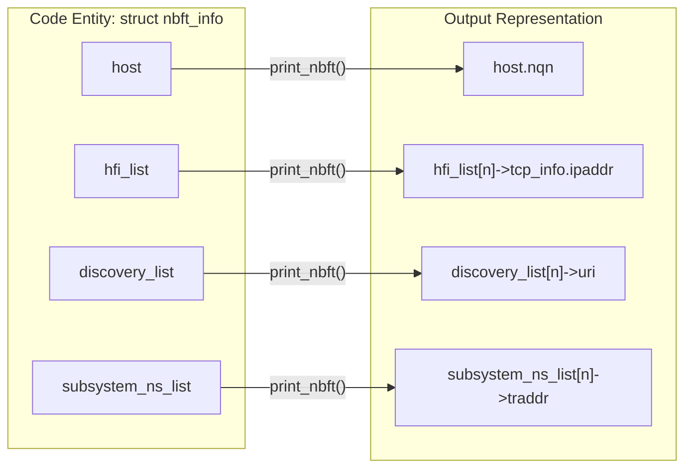

<!-- source: DeepWiki mcp.deepwiki.com · repo NVIDIA/libnvme · page 8.2 NBFT Test Fixtures and Validation · fetched 2026-10-26 -->

# NBFT Test Fixtures and Validation

<details>
<summary>Relevant source files</summary>

The following files were used as context for generating this wiki page:

- [test/nbft/README](test/nbft/README)
- [test/nbft/diffs/NBFT-auto-ipv6](test/nbft/diffs/NBFT-auto-ipv6)
- [test/nbft/diffs/NBFT-dhcp-ipv4](test/nbft/diffs/NBFT-dhcp-ipv4)
- [test/nbft/diffs/NBFT-dhcp-ipv6](test/nbft/diffs/NBFT-dhcp-ipv6)
- [test/nbft/diffs/NBFT-static-ipv4-discovery](test/nbft/diffs/NBFT-static-ipv4-discovery)
- [test/nbft/diffs/NBFT-static-ipv6](test/nbft/diffs/NBFT-static-ipv6)
- [test/nbft/gen-nbft-diffs.sh.in](test/nbft/gen-nbft-diffs.sh.in)
- [test/nbft/meson.build](test/nbft/meson.build)
- [test/nbft/nbft-dump-diff.sh.in](test/nbft/nbft-dump-diff.sh.in)
- [test/nbft/nbft-dump.c](test/nbft/nbft-dump.c)
- [test/nbft/tables/NBFT-auto-ipv6](test/nbft/tables/NBFT-auto-ipv6)

</details>


The NVMe Boot Firmware Table (NBFT) test framework is designed to verify the integrity and correctness of the NBFT parser within `libnvme`. It utilizes binary ACPI table fixtures extracted from real firmware environments and compares the parsed output against known-good reference data using a diff-based validation approach.

### Framework Architecture

The framework consists of three primary components:
1.  **Binary Fixtures**: Raw ACPI tables (valid and malformed).
2.  **`nbft-dump` Utility**: A specialized tool that parses a binary NBFT and prints a standardized text representation of the `nbft_info` structure [test/nbft/nbft-dump.c:4-121]().
3.  **Validation Scripts**: Meson-integrated shell scripts that automate the comparison between current parser output and stored reference "diffs" [test/nbft/meson.build:41-83]().

#### NBFT Test Data Flow

The following diagram illustrates how a binary NBFT table is processed through the test suite to validate the parser.

**NBFT Validation Pipeline**

Sources: [test/nbft/nbft-dump.c:102-121](), [test/nbft/nbft-dump-diff.sh.in:1-9](), [test/nbft/README:1-18]()

### Test Fixtures

The framework categorizes fixtures into two directories based on their purpose:

| Directory | Purpose | Contents |
|:---|:---|:---|
| `tables/` | Valid parser input | Static IPv4, DHCP IPv6, Auto IPv6, RHPOC, etc. [test/nbft/meson.build:14-21]() |
| `tables_bad/` | Error handling | Malformed data, old spec revisions, random noise [test/nbft/meson.build:23-26]() |

#### Valid Table Scenarios
The reference files in `test/nbft/diffs/` provide insight into the specific network and NVMe-oF configurations being tested:
*   **Static IPv4**: Manual IP assignment with explicit gateway and subnet [test/nbft/diffs/NBFT-static-ipv4-discovery:12-15]().
*   **DHCP IPv4/IPv6**: Configuration where `ip_origin` is set to 3 (DHCP) and may include `dhcp_server_ipaddr` [test/nbft/diffs/NBFT-dhcp-ipv4:12-19]().
*   **Auto IPv6**: Stateless address autoconfiguration (SLAAC) or similar mechanisms [test/nbft/diffs/NBFT-auto-ipv6:12-13]().
*   **Discovery**: Tables containing Discovery Descriptors (`discovery_list`) that point to Discovery Controllers [test/nbft/diffs/NBFT-static-ipv4-discovery:23-26]().

Sources: [test/nbft/README:7-9](), [test/nbft/meson.build:10-26]()

### The nbft-dump Utility

The `nbft-dump` tool is the bridge between the raw binary data and human-readable (and diff-able) text. It calls `nvme_nbft_read()` to populate a `struct nbft_info` and then iterates through its members [test/nbft/nbft-dump.c:111-117]().

**Entity Mapping: nbft_info to Output**

Sources: [test/nbft/nbft-dump.c:22-100](), [test/nbft/diffs/NBFT-dhcp-ipv4:1-45]()

### Validation and Diffing

Validation is performed by `nbft-dump-diff.sh`. This script executes `nbft-dump` on a table and pipes the output directly into `diff` against the reference file [test/nbft/nbft-dump-diff.sh.in:8]().

For "bad" tables, the test runner expects `nbft-dump` to return a non-zero exit code, indicating that `nvme_nbft_read()` successfully detected the corruption or spec violation [test/nbft/meson.build:76-83]().

### Adding New Test Cases

To add a new NBFT test case, follow these steps:

1.  **Obtain Table**: Copy the binary ACPI table to `test/nbft/tables/` (e.g., from `/sys/firmware/acpi/tables/NBFT` on a boot-from-SAN system).
2.  **Update Meson**: Add the filename to the `tables` list in `test/nbft/meson.build` [test/nbft/meson.build:14-21]().
3.  **Generate Reference**: Run the following command to generate the initial reference output:
    ```bash
    ninja -C .build nbft-diffs
    ```
    This triggers `gen-nbft-diffs.sh`, which runs `nbft-dump` on all files in the tables directory and saves the output to the `diffs/` directory [test/nbft/gen-nbft-diffs.sh.in:3-5]().
4.  **Verify**: Manually inspect the generated diff file to ensure the parser correctly interpreted the table fields.

Sources: [test/nbft/README:11-15](), [test/nbft/meson.build:54-58]()

---

