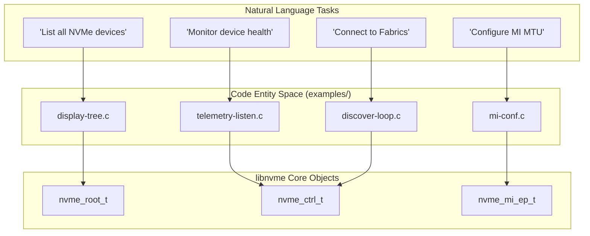
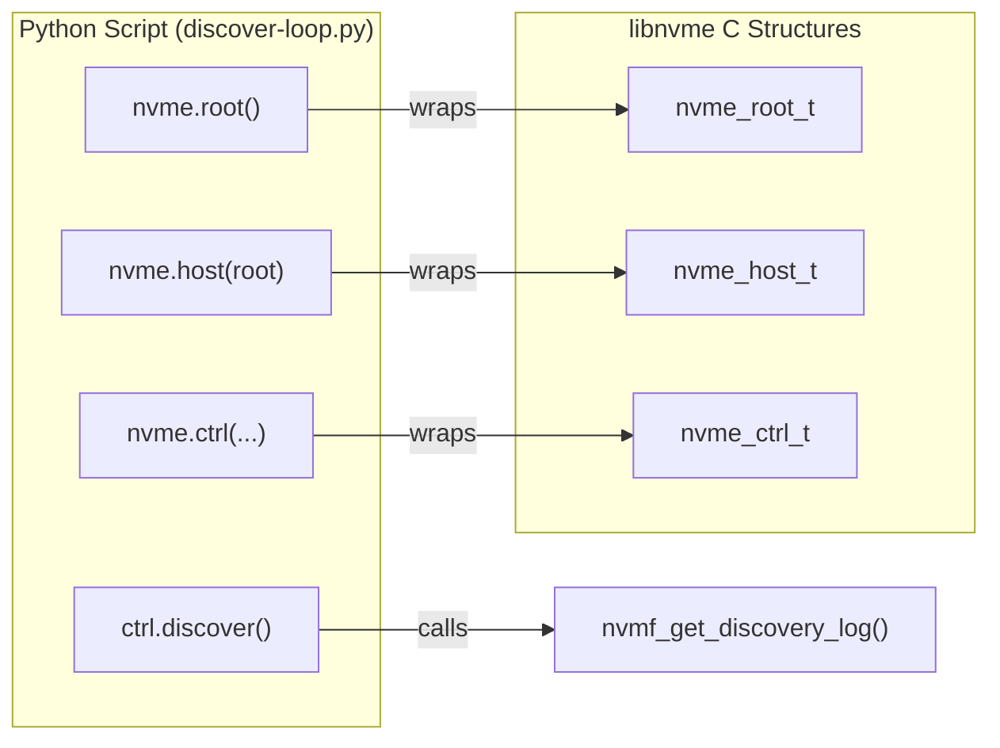

<!-- source: DeepWiki mcp.deepwiki.com · repo NVIDIA/libnvme · page 9 Examples and Developer Utilities · fetched 2026-10-26 -->

# Examples and Developer Utilities

Relevant source files

The following files were used as context for generating this wiki page:

- [examples/discover-loop.py](examples/discover-loop.py)
- [examples/display-columnar.c](examples/display-columnar.c)
- [examples/display-tree.c](examples/display-tree.c)
- [examples/meson.build](examples/meson.build)
- [examples/mi-conf.c](examples/mi-conf.c)
- [examples/telemetry-listen.c](examples/telemetry-listen.c)
- [libnvme/.gitignore](libnvme/.gitignore)
- [libnvme/README.md](libnvme/README.md)
- [libnvme/__init__.py](libnvme/__init__.py)
- [test/cpp.cc](test/cpp.cc)

This page provides an overview of the example programs and scripts included in the `libnvme` repository. These utilities serve as both functional tools for developers and reference implementations for the library's various APIs, including the core topology tree, NVMe-over-Fabrics (NVMe-oF) discovery, and NVMe Management Interface (NVMe-MI) over MCTP.

### Overview of Examples
The `libnvme` project maintains a set of examples in the `examples/` directory, which are compiled during the build process if the necessary dependencies are met [examples/meson.build:1-52](). These examples demonstrate:
- **Topology Exploration**: Traversing the NVMe device hierarchy using the tree API.
- **Fabrics Management**: Connecting to and discovering remote targets.
- **Asynchronous Events**: Listening for kernel `uevents` and responding to telemetry notices.
- **Out-of-Band Management**: Using `libnvme-mi` to configure devices via MCTP.

#### Bridge: Application to Code Entities (C Examples)
The following diagram maps high-level developer tasks to the specific example programs and the `libnvme` objects they manipulate.

**C Example Mapping**

**Sources:** [examples/display-tree.c:17-26](), [examples/telemetry-listen.c:124-135](), [examples/mi-conf.c:137-167](), [examples/meson.build:8-52]()

---

### C Example Programs
The C examples provide the most direct representation of the library's performance and low-level capabilities. 

- **Topology Display**: `display-tree.c` and `display-columnar.c` use `nvme_scan()` to build a representation of the system's NVMe hierarchy [examples/display-tree.c:26](). They demonstrate the use of iterators like `nvme_for_each_host` and `nvme_subsystem_for_each_ctrl` to print device details [examples/display-columnar.c:35-48]().
- **Telemetry Monitoring**: `telemetry-listen.c` shows how to open `uevent` file descriptors for controllers and use `select()` to wait for `NVME_AER_NOTICE_TELEMETRY` events [examples/telemetry-listen.c:30-36, 98-100]().
- **Management Interface**: `mi-mctp.c` and `mi-conf.c` demonstrate out-of-band management. `mi-conf.c` specifically illustrates a complex workflow involving both `libnvme-mi` and D-Bus to synchronize MCTP Maximum Transmission Unit (MTU) settings between the OS and the NVMe device [examples/mi-conf.c:178-213]().

For details, see [C Example Programs](#9.1).

**Sources:** [examples/display-tree.c:1-73](), [examples/display-columnar.c:1-122](), [examples/telemetry-listen.c:1-169](), [examples/mi-conf.c:1-224]()

---

### Python Example Scripts
`libnvme` provides Python bindings generated via SWIG, allowing for rapid prototyping of NVMe management scripts.

- **Discovery and Connection**: The `discover-loop.py` script demonstrates how to instantiate a `nvme.root()`, create a controller object, and perform a fabrics connection [examples/discover-loop.py:32-38]().
- **Log Page Parsing**: Examples show how to retrieve and parse the Discovery Log Page, including checking for extended support bits like `NVMF_LOG_DISC_LID_EXTDLPES` [examples/discover-loop.py:24-30]().

#### Bridge: Python Logic to libnvme Bindings
This diagram illustrates how the Pythonic object-oriented interface maps to the underlying library structures.

**Python Binding Workflow**

**Sources:** [examples/discover-loop.py:32-53](), [libnvme/README.md:21-30]()

For details, see [Python Example Scripts](#9.2).

**Sources:** [examples/discover-loop.py:1-66](), [libnvme/README.md:1-67]()

---

### Summary Table of Utilities

| Utility | Language | Primary API Used | Purpose |
| :--- | :--- | :--- | :--- |
| `display-tree` | C | Tree (`libnvme`) | Visualizes the local NVMe topology as an ASCII tree. |
| `display-columnar` | C | Tree (`libnvme`) | Lists controllers and namespaces in a table format. |
| `telemetry-listen` | C | Linux/Ioctl | Captures asynchronous telemetry logs upon kernel events. |
| `mi-mctp` | C | MI (`libnvme-mi`) | CLI tool for NVMe-MI operations over MCTP. |
| `mi-conf` | C | MI / D-Bus | Configures MCTP MTU for endpoints. |
| `discover-loop.py` | Python | Fabrics / Bindings | Demonstrates NVMe-oF discovery using Python objects. |

**Sources:** [examples/meson.build:8-51](), [examples/telemetry-listen.c:9-13](), [examples/mi-conf.c:9-13](), [examples/display-tree.c:9-12]()

---

