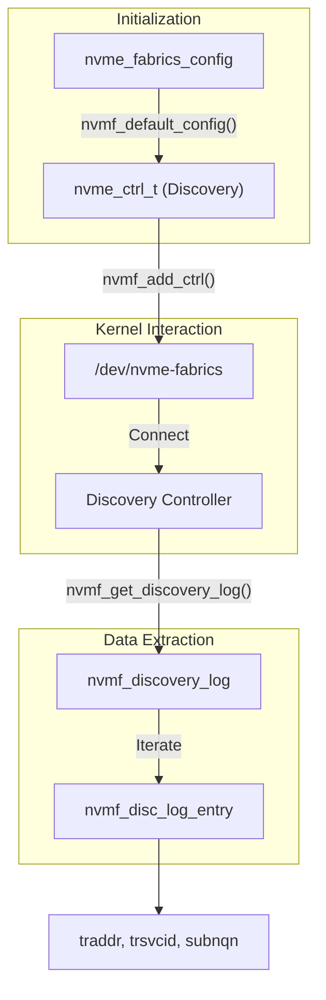
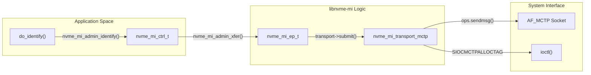

<!-- source: DeepWiki mcp.deepwiki.com · repo NVIDIA/libnvme · page 9.1 C Example Programs · fetched 2026-10-26 -->

# C Example Programs

Relevant source files

The following files were used as context for generating this wiki page:

- [examples/discover-loop.c](examples/discover-loop.c)
- [examples/display-columnar.c](examples/display-columnar.c)
- [examples/display-tree.c](examples/display-tree.c)
- [examples/meson.build](examples/meson.build)
- [examples/mi-conf.c](examples/mi-conf.c)
- [examples/mi-mctp.c](examples/mi-mctp.c)
- [examples/telemetry-listen.c](examples/telemetry-listen.c)
- [src/libnvme-mi.h](src/libnvme-mi.h)
- [src/nvme/mi-mctp.c](src/nvme/mi-mctp.c)
- [test/cpp.cc](test/cpp.cc)
- [test/mi-mctp.c](test/mi-mctp.c)
- [test/register.c](test/register.c)
- [test/test.c](test/test.c)
- [test/zns.c](test/zns.c)

The `libnvme` repository provides a collection of C example programs that demonstrate how to use the library's various layers, including topology discovery, NVMe-over-Fabrics (NVMe-oF) connection management, asynchronous event handling, and out-of-band management via NVMe-MI.

## Fabrics Discovery: discover-loop.c

The `discover-loop.c` example demonstrates how to perform fabrics discovery using the "loop" transport. This transport is often used for testing where the host and target reside on the same machine.

### Implementation Details
The program follows a standard fabrics connection and discovery workflow:
1. **Configuration Initialization**: Calls `nvmf_default_config` to populate default fabrics parameters [examples/discover-loop.c:60-60]().
2. **Topology Setup**: Initializes a `nvme_root_t` via `nvme_scan` and retrieves the default host [examples/discover-loop.c:62-63]().
3. **Controller Creation**: Creates a local controller object for the discovery subsystem using `nvme_create_ctrl` with the transport type set to `"loop"` [examples/discover-loop.c:68-69]().
4. **Connection**: Submits the connection request to the kernel via `nvmf_add_ctrl`, which writes to `/dev/nvme-fabrics` [examples/discover-loop.c:74-74]().
5. **Log Retrieval**: Retrieves the discovery log page using `nvmf_get_discovery_log` [examples/discover-loop.c:80-80]().

### Data Flow: Discovery Log Retrieval
The following diagram shows the relationship between the fabrics configuration and the resulting discovery log entries.

**Fabrics Discovery Data Flow**

**Sources:** [examples/discover-loop.c:51-92]()

---

## Topology Display: display-tree.c and display-columnar.c

These examples demonstrate the usage of the topology tree API to scan the system and iterate through the hierarchy of NVMe objects.

### display-tree.c
This program prints an ASCII tree representation of the system. It uses the "safe" iterator macros (e.g., `nvme_for_each_subsystem_safe`) which allow for safe traversal even if objects are modified during iteration [examples/display-tree.c:32-32]().
* **Hierarchy**: Root → Host → Subsystem → Controller → Namespace/Path [examples/display-tree.c:31-68]().
* **Attributes**: Displays transport type (`nvme_ctrl_get_transport`), address (`nvme_ctrl_get_address`), and ANA state (`nvme_path_get_ana_state`) [examples/display-tree.c:49-66]().

### display-columnar.c
This program uses the same scanning mechanism (`nvme_scan`) but formats the output into fixed-width columns. It highlights the ability to retrieve device metadata like Serial Number (`nvme_ctrl_get_serial`) and Model Number (`nvme_ctrl_get_model`) [examples/display-columnar.c:63-64]().

**Sources:** [examples/display-tree.c:17-73](), [examples/display-columnar.c:18-121]()

---

## Asynchronous Telemetry: telemetry-listen.c

`telemetry-listen.c` demonstrates how to react to Asynchronous Event Notifications (AEN) from the kernel to capture telemetry data.

### Implementation
1. **Uevent Monitoring**: The program opens the `uevent` file in sysfs for every detected controller [telemetry-listen.c:30-36]().
2. **Event Loop**: Uses `select()` to wait for data on the uevent file descriptors [telemetry-listen.c:112-112]().
3. **AEN Parsing**: When a uevent is triggered, it parses the `NVME_AEN` string to extract the event type and Log Identifier (LID) [telemetry-listen.c:89-94]().
4. **Log Capture**: If the event is a `NVME_AER_NOTICE_TELEMETRY`, it calls `nvme_get_ctrl_telemetry` to fetch the Data Area 3 (DA3) log and writes it to `/var/log/` [telemetry-listen.c:47-71]().

**Sources:** [examples/telemetry-listen.c:14-169]()

---

## NVMe-MI Examples: mi-mctp.c and mi-conf.c

These programs demonstrate the `libnvme-mi` library for out-of-band management over MCTP (Management Component Transport Protocol).

### mi-mctp.c: CLI Management Tool
This tool provides several sub-commands to interact with an MI endpoint:
* **info**: Retrieves subsystem information using `nvme_mi_mi_read_mi_data_subsys` and health status via `nvme_mi_mi_subsystem_health_status_poll` [examples/mi-mctp.c:92-107]().
* **controllers**: Lists controllers using `nvme_mi_mi_read_mi_data_ctrl_list` [examples/mi-mctp.c:154-154]().
* **identify**: Demonstrates tunneling Admin commands over MI. It supports both full identify (`nvme_mi_admin_identify`) and partial identify (`nvme_mi_admin_identify_partial`) to minimize bandwidth [examples/mi-mctp.c:223-227]().

### mi-conf.c: MI Configuration
This example demonstrates a complex workflow involving both NVMe-MI and system D-Bus calls to synchronize MTU settings:
1. **Endpoint Discovery**: Queries the device for its maximum supported MCTP MTU via `nvme_mi_mi_read_mi_data_port` [examples/mi-conf.c:60-60]().
2. **MI Configuration**: Sets the MTU on the device using `nvme_mi_mi_config_set_mctp_mtu` [examples/mi-conf.c:195-195]().
3. **System Configuration**: Communicates with a local MCTP daemon (`mctpd`) via D-Bus to update the local route MTU [examples/mi-conf.c:105-121]().

### Code Entity Mapping: MI over MCTP
The following diagram maps the high-level MI operations to the internal transport abstractions.

**MI Transport and Command Mapping**

**Sources:** [src/nvme/mi-mctp.c:85-114](), [examples/mi-mctp.c:179-242](), [examples/mi-conf.c:137-224]()

---

## Summary of Example Functions

| File | Key Function | Purpose |
| :--- | :--- | :--- |
| `discover-loop.c` | `nvmf_get_discovery_log` | Fetch fabrics discovery records |
| `display-tree.c` | `nvme_scan` | Traverse the sysfs topology tree |
| `telemetry-listen.c` | `nvme_get_ctrl_telemetry` | Capture async telemetry logs on AEN |
| `mi-mctp.c` | `nvme_mi_admin_identify` | Tunnel Admin commands over MI |
| `mi-conf.c` | `nvme_mi_mi_config_set_mctp_mtu` | Configure MI endpoint parameters |

**Sources:** [examples/discover-loop.c:80](), [examples/display-tree.c:26](), [examples/telemetry-listen.c:47](), [examples/mi-mctp.c:226](), [examples/mi-conf.c:195]()

---

