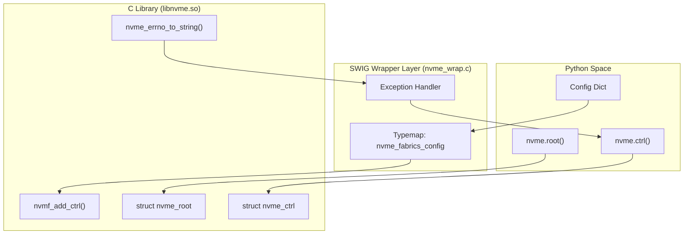
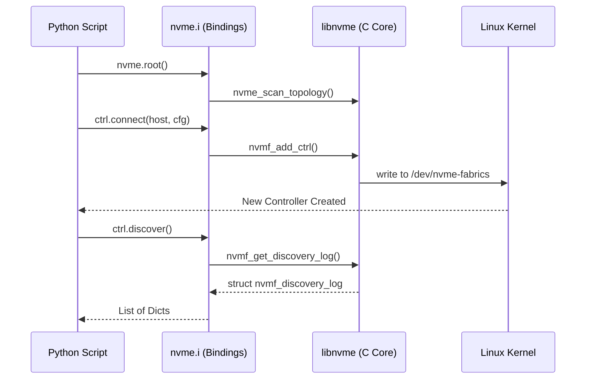

<!-- source: DeepWiki mcp.deepwiki.com · repo NVIDIA/libnvme · page 9.2 Python Example Scripts · fetched 2026-10-26 -->

# Python Example Scripts

<details>
<summary>Relevant source files</summary>

The following files were used as context for generating this wiki page:

- [examples/discover-loop.py](examples/discover-loop.py)
- [libnvme/.gitignore](libnvme/.gitignore)
- [libnvme/README.md](libnvme/README.md)
- [libnvme/__init__.py](libnvme/__init__.py)
- [libnvme/meson.build](libnvme/meson.build)
- [libnvme/nvme.i](libnvme/nvme.i)
- [libnvme/tests/NBFT](libnvme/tests/NBFT)
- [libnvme/tests/gc.py](libnvme/tests/gc.py)
- [libnvme/tests/test-nbft.py](libnvme/tests/test-nbft.py)

</details>


The `libnvme` project provides Python bindings generated via SWIG, allowing developers to interact with NVMe topology, fabrics, and management interfaces using native Python objects. This page details the implementation of these bindings and provides examples of common usage patterns, such as fabrics discovery and NBFT parsing.

## Overview of Python Bindings

The Python bindings are defined in `libnvme/nvme.i` and compiled into a module named `nvme` within the `libnvme` package. The bindings wrap the C structures into Python classes and provide idiomatic access to NVMe-over-Fabrics (NVMe-oF) operations.

### Key Classes and Mappings

The SWIG interface renames internal C structures to more Pythonic class names:
*   `nvme_root` → `nvme.root` [libnvme/nvme.i:16]()
*   `nvme_host` → `nvme.host` [libnvme/nvme.i:17]()
*   `nvme_ctrl` → `nvme.ctrl` [libnvme/nvme.i:18]()
*   `nvme_subsystem` → `nvme.subsystem` [libnvme/nvme.i:19]()
*   `nvme_ns` → `nvme.ns` [libnvme/nvme.i:20]()

### Data Flow: C to Python Typemaps

The bindings use SWIG typemaps to convert complex C structures (like discovery logs and configuration dictionaries) into Python-native types.

| C Type | Python Representation | Purpose |
| :--- | :--- | :--- |
| `struct nvme_fabrics_config *` | `dict` | Maps Python dictionary keys (e.g., `hdr_digest`, `nr_io_queues`) to the C config struct. [libnvme/nvme.i:143-204]() |
| `struct nvmf_discovery_log *` | `list` of `dict` | Converts the binary discovery log into a list of dictionaries containing transport details. [libnvme/nvme.i:218-247]() |
| `uint8_t [16]` | `bytes` | Converts UUIDs or similar fixed-length arrays to Python bytes. [libnvme/nvme.i:210-212]() |

### Binding Architecture Diagram

This diagram shows how the Python `nvme` module interfaces with the underlying C library components.

**Entity Mapping: Python Module to C Library**

Sources: [libnvme/nvme.i:9-20](), [libnvme/nvme.i:119-133](), [libnvme/nvme.i:143-149]()

## Discovery and Connection Example

The `discover-loop.py` script demonstrates how to connect to a Discovery Controller and retrieve the discovery log.

### Implementation Logic

1.  **Initialize Topology**: Create a `root` and a `host` object. [examples/discover-loop.py:32-33]()
2.  **Define Controller**: Instantiate a `ctrl` object targeting the discovery subsystem (`NVME_DISC_SUBSYS_NAME`) using the `loop` transport. [examples/discover-loop.py:34]()
3.  **Establish Connection**: Call `c.connect(h)`. This triggers the fabrics connection logic in the kernel. [examples/discover-loop.py:36]()
4.  **Check Capabilities**: Retrieve supported log pages to determine if the controller supports extended discovery features. [examples/discover-loop.py:42-49]()
5.  **Retrieve Discovery Log**: Execute `c.discover()`, which returns a list of dictionaries representing available NVMe targets. [examples/discover-loop.py:53]()

### Connection Flow Diagram

**Code Flow: discover-loop.py**

Sources: [examples/discover-loop.py:32-53](), [libnvme/nvme.i:119-141](), [libnvme/nvme.i:218-247]()

## NBFT (NVMe Boot Firmware Table) Parsing

The Python bindings include support for parsing ACPI NBFT tables, which are used to communicate boot-time NVMe configurations to the OS.

### Usage Pattern
The function `nvme.nbft_get(filename)` reads a binary NBFT file and returns a structured Python dictionary containing:
*   **Host Info**: NQN and ID. [libnvme/tests/test-nbft.py:37-43]()
*   **HFI (Host Fabric Interface)**: IP addresses, MACs, and VLAN info. [libnvme/tests/test-nbft.py:19-36]()
*   **Subsystems**: Target NQNs, transport addresses, and ports. [libnvme/tests/test-nbft.py:44-75]()
*   **Discovery**: URIs for discovery controllers. [libnvme/tests/test-nbft.py:12-18]()

Sources: [libnvme/tests/test-nbft.py:78-81](), [libnvme/nvme.i:31]()

## Lifecycle and Garbage Collection

The Python bindings manage the underlying C object lifecycles. Because `libnvme` topology objects (root, host, ctrl) are hierarchically linked, the bindings include specific logic to prevent segmentation faults during garbage collection.

### Safe Deletion
The test script `gc.py` validates that objects can be deleted in any order (e.g., deleting `root` before `ctrl`) without causing memory errors. This is handled via `%pythonappend` directives in the SWIG interface that manage internal reference counting.

```python
root = nvme.root()
host = nvme.host(root)
ctrl = nvme.ctrl(root, subsysnqn='...', transport='loop')

# Safe to clear in any order
root = None
host = None
ctrl = None
```
Sources: [libnvme/tests/gc.py:31-42](), [libnvme/meson.build:74]()

## Build and Test Integration

The Python bindings are built using Meson and SWIG.

*   **Meson Configuration**: The `meson.build` file detects the Python installation and SWIG version. [libnvme/meson.build:8-27]()
*   **Module Installation**: The C extension `_nvme` and the Python wrapper `nvme.py` are installed into the `libnvme` subdirectory of the Python site-packages. [libnvme/meson.build:35-45]()
*   **Testing**: Tests are run with a modified `PYTHONPATH` to ensure the freshly built module can be imported. [libnvme/meson.build:62-70]()

Sources: [libnvme/meson.build:29-46](), [libnvme/meson.build:72-81]()

---

