# Page: libnvme Overview

# libnvme Overview

<details>
<summary>Relevant source files</summary>

The following files were used as context for generating this wiki page:

- [COPYING](COPYING)
- [README.md](README.md)
- [meson_options.txt](meson_options.txt)
- [src/libnvme.h](src/libnvme.h)
- [src/libnvme.map](src/libnvme.map)

</details>


`libnvme` is the standard development C library for NVM Express (NVMe) on Linux. It provides the essential building blocks for interacting with NVMe devices, ranging from low-level command submission to high-level system topology discovery and out-of-band management.

The library serves as a user-space abstraction for the NVMe specification, providing type definitions for structures, enumerations, and bitfields [README.md:11-15](). It enables developers to construct, dispatch, and decode NVMe commands while managing local and remote NVMe resources.

### Key Capabilities

*   **Command Submission**: Helper functions for Admin and I/O command dispatch via Linux ioctl or io_uring [README.md:13-14]().
*   **Topology Management**: A hierarchical object model to scan and represent NVMe hosts, controllers, and namespaces [src/libnvme.h:23]().
*   **NVMe-over-Fabrics (NVMe-oF)**: Utilities for connecting to remote targets over TCP, RDMA, and Fibre Channel [src/libnvme.h:21]().
*   **Management Interface (NVMe-MI)**: Support for out-of-band management via MCTP [meson_options.txt:15]().
*   **NBFT Parsing**: Support for the NVMe Boot Firmware Table to handle boot-stage configuration [src/libnvme.h:20]().

---

### Library Architecture

`libnvme` is organized into two primary shared libraries, each targeting a specific communication domain.

| Library | Primary Purpose | Key Headers |
| :--- | :--- | :--- |
| `libnvme.so` | In-band NVMe communication, Fabrics, and Topology. | `nvme/ioctl.h`, `nvme/tree.h`, `nvme/fabrics.h` |
| `libnvme-mi.so` | Out-of-band Management Interface (NVMe-MI). | `nvme/mi.h` |

The architecture follows a layered design where high-level topology objects (e.g., `nvme_ctrl_t`) utilize lower-level ioctl wrappers (e.g., `nvme_admin_passthru`) to communicate with the kernel [src/libnvme.map:65-72]().

#### Conceptual Architecture Diagram
This diagram bridges the functional components of the library to the specific header files and symbols defined in the codebase.

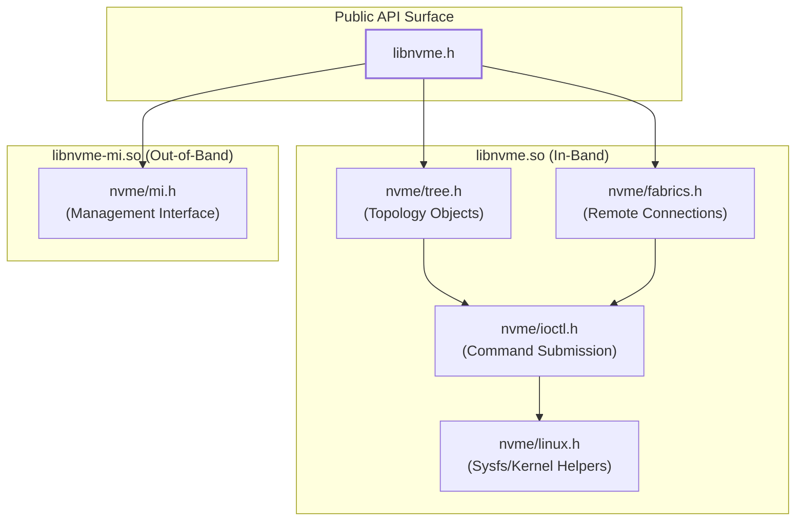
**Sources:** [src/libnvme.h:17-26](), [src/libnvme.map:1-100]()

For a deep dive into the library layers and symbol versioning, see [Library Architecture and Public API Surface](#1.2).

---

### Building and Dependencies

`libnvme` uses the Meson build system [README.md:51](). While the core library has minimal requirements (GCC, Ninja, Meson), several advanced features depend on external libraries.

*   **JSON Support**: Required for `/etc/nvme/config.json` parsing via `json-c` [README.md:59-60]().
*   **Security**: `openssl` and `keyutils` are required for TLS and DH-HMAC-CHAP authentication [README.md:62-64]().
*   **MI Discovery**: `libdbus` and `libmctp` are used for endpoint discovery in the NVMe-MI stack [README.md:66-67](), [meson_options.txt:15]().

#### Build Flow Diagram
This diagram maps the build options to the resulting library capabilities.

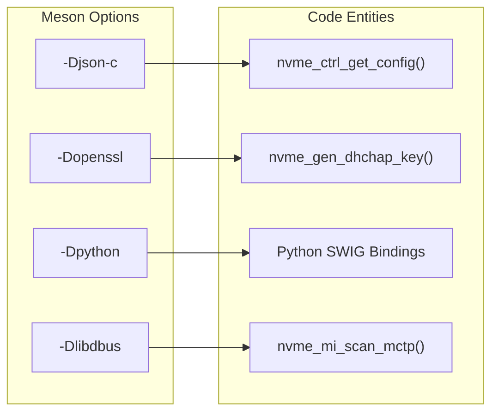
**Sources:** [meson_options.txt:10-15](), [README.md:140-152]()

For step-by-step instructions on compilation and environment setup, see [Getting Started: Build, Install, and Configuration](#1.1).

---

### Documentation Roadmap

This wiki is structured to guide you from initial setup to advanced development:

*   **[Getting Started: Build, Install, and Configuration](#1.1)**: Covers the build pipeline, optional dependencies, and cross-compilation for embedded systems.
*   **[Library Architecture and Public API Surface](#1.2)**: Explains the relationship between `libnvme` and `libnvme-mi`, header organization, and the versioned export maps.
*   **Core NVMe Command Interface**: Detailed look at submitting commands via ioctl and io_uring.
*   **NVMe Topology Tree**: How the library models the system's NVMe hierarchy and scans sysfs.
*   **NVMe-over-Fabrics (NVMe-oF)**: Management of remote controller connections and discovery services.
*   **NVMe Management Interface (NVMe-MI)**: Out-of-band management over MCTP and Admin command tunneling.
*   **Python Bindings**: Using the SWIG-generated interface for rapid scripting and automation.

---

# Page: Getting Started: Build, Install, and Configuration

# Getting Started: Build, Install, and Configuration

<details>
<summary>Relevant source files</summary>

The following files were used as context for generating this wiki page:

- [.github/cross/ubuntu-cross-armhf.txt](.github/cross/ubuntu-cross-armhf.txt)
- [.github/cross/ubuntu-cross-ppc64le.txt](.github/cross/ubuntu-cross-ppc64le.txt)
- [.github/cross/ubuntu-cross-s390x.txt](.github/cross/ubuntu-cross-s390x.txt)
- [.github/workflows/build.yml](.github/workflows/build.yml)
- [.readthedocs.yaml](.readthedocs.yaml)
- [README.md](README.md)
- [ccan/meson.build](ccan/meson.build)
- [doc/config-schema.json](doc/config-schema.json)
- [doc/rst/fabrics.rst](doc/rst/fabrics.rst)
- [internal/meson.build](internal/meson.build)
- [meson.build](meson.build)
- [meson_options.txt](meson_options.txt)
- [scripts/build.sh](scripts/build.sh)
- [src/meson.build](src/meson.build)
- [src/nvme/json.c](src/nvme/json.c)
- [subprojects/dbus.wrap](subprojects/dbus.wrap)
- [subprojects/json-c.wrap](subprojects/json-c.wrap)
- [subprojects/openssl.wrap](subprojects/openssl.wrap)

</details>


This page provides a technical guide for building `libnvme` from source, managing its optional dependencies, and understanding the system configuration via JSON. `libnvme` uses the Meson build system to manage a complex dependency graph and provide cross-compilation support for various architectures.

## Build System Overview

`libnvme` utilizes **Meson** (version >= 0.50.0) as its primary build generator and **Ninja** as the backend executor [meson.build:8-11](). The build process is designed to be out-of-tree, ensuring that source directories remain clean of build artifacts [README.md:98-101]().

### Core Build Workflow

The standard compilation sequence involves three main stages: setup, compile, and install.

| Step | Command | Description |
|:---|:---|:---|
| **Setup** | `meson setup .build` | Generates the build directory and probes dependencies [README.md:89](). |
| **Compile** | `meson compile -C .build` | Executes the compiler (gcc/clang) and links the binaries [README.md:109](). |
| **Install** | `meson install -C .build` | Installs headers and `.so` files to the system [README.md:117](). |

### Build Artifacts
The build produces two primary shared libraries:
1.  `libnvme.so`: The core library for NVMe command submission and topology [src/meson.build:49-51]().
2.  `libnvme-mi.so`: The Management Interface library for out-of-band management [src/meson.build:78-80]().

**Sources:** [meson.build:8-21](), [src/meson.build:49-80](), [README.md:88-119]()

---

## Optional Dependencies and Features

`libnvme` is modular; many features are only enabled if the corresponding development libraries are found during the `meson setup` phase.

| Feature | Dependency | Build Option | Impact if Missing |
|:---|:---|:---|:---|
| **JSON Config** | `json-c` (>=0.13) | `-Djson-c` | Cannot parse `/etc/nvme/config.json` [meson.build:58-66](). |
| **Auth/TLS** | `openssl` (>=1.1.0) | `-Dopenssl` | No DH-HMAC-CHAP or TLS PSK support [meson.build:68-103](). |
| **Keyring** | `libkeyutils` | `-Dkeyutils` | Cannot store/retrieve keys from Linux keyring [meson.build:105-112](). |
| **MCTP Scan** | `dbus-1` | `-Dlibdbus` | No D-Bus based MCTP endpoint discovery [meson.build:114-132](). |
| **MI Transport** | `libmctp` | `-Dlibmctp` | Disables MCTP transport for MI commands [meson_options.txt:15](). |

### Dependency Resolution Logic
Meson uses `dependency()` calls with fallback mechanisms. If a library is not found on the system, Meson can use `.wrap` files in the `subprojects/` directory to download and build the dependency from source [meson.build:64,74]().

**Sources:** [meson.build:58-132](), [meson_options.txt:10-15](), [subprojects/json-c.wrap:1-13](), [subprojects/openssl.wrap:1-16]()

---

## Cross-Compilation and Embedded Builds

For environments where Python/Meson cannot run (e.g., small embedded targets), `libnvme` supports **muon** (a C99 implementation of Meson) and **samurai** (a C implementation of Ninja) [README.md:73-82]().

### Cross-Compilation Strategy
The project provides cross-files for `armhf`, `s390x`, and `ppc64le` [scripts/build.sh:14]().

**Entity Mapping: Build Script Logic**
The `scripts/build.sh` utility automates different build configurations used in CI.

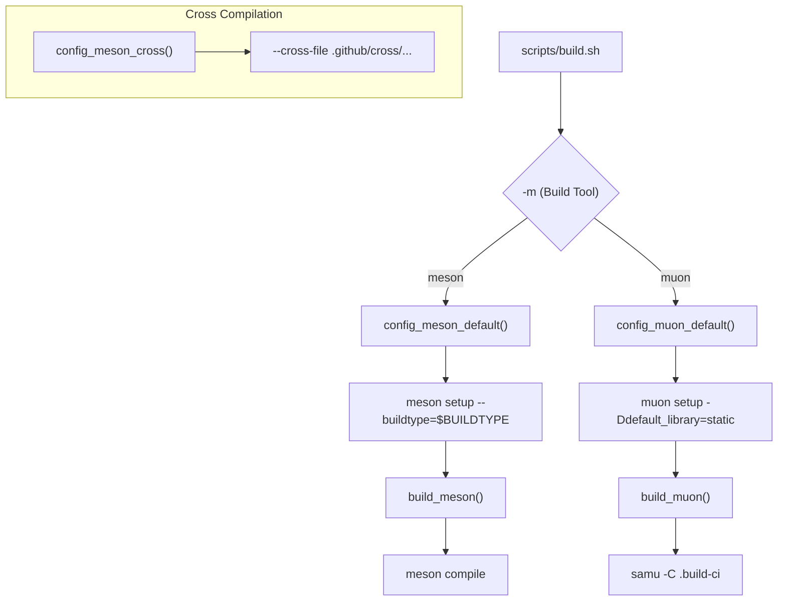

**Sources:** [scripts/build.sh:1-183](), [.github/workflows/build.yml:37-77](), [README.md:73-82]()

---

## Configuration: config.json

`libnvme` supports a persistent configuration file, typically located at `/etc/nvme/config.json` [meson.build:53](). This file allows users to define hosts, subsystems, and specific controller connection parameters.

### Data Flow: JSON Parsing to Topology Objects
The parsing logic in `src/nvme/json.c` maps JSON keys to the internal C structures used by the fabrics layer.

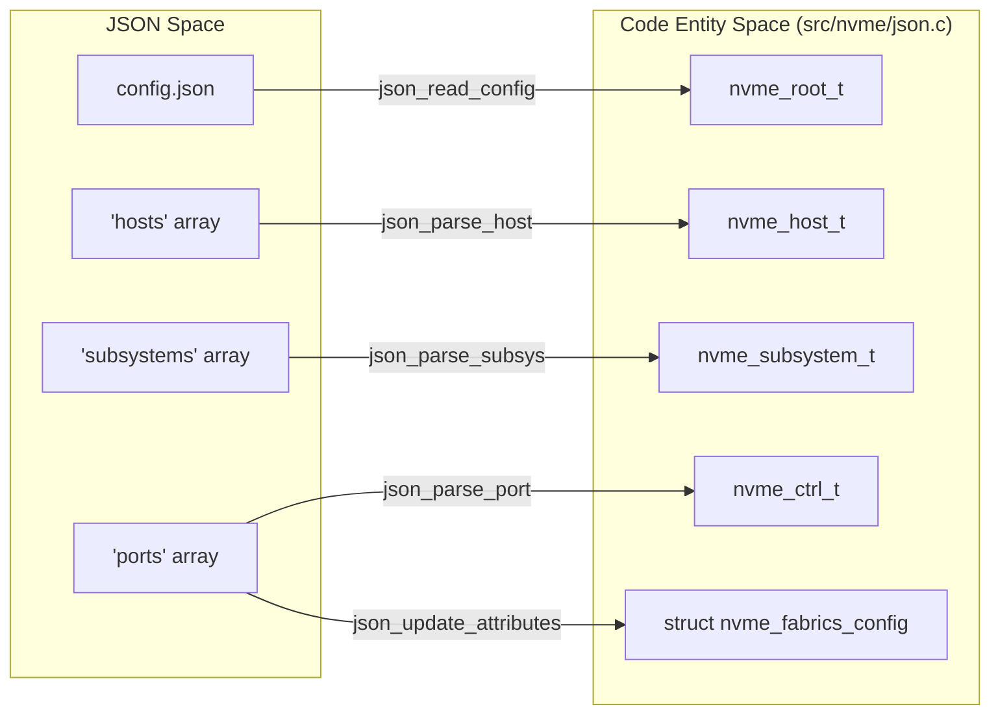

### Key Configuration Parameters
The JSON schema defines how the `nvme_fabrics_config` structure is populated [doc/rst/fabrics.rst:18-37]().

| JSON Key | C Struct Member | Description |
|:---|:---|:---|
| `nr_io_queues` | `cfg->nr_io_queues` | Number of I/O queues to establish [src/nvme/json.c:33-34](). |
| `keep_alive_tmo`| `cfg->keep_alive_tmo` | Keep-alive timeout in seconds [src/nvme/json.c:41-42](). |
| `tls` | `cfg->tls` | Enable TLS encryption (TCP) [src/nvme/json.c:60-61](). |
| `dhchap_key` | `nvme_ctrl_set_dhchap_host_key` | Host DH-HMAC-CHAP key [src/nvme/json.c:121-122](). |
| `keyring` | `cfg->keyring` | Name of the keyring to use [src/nvme/json.c:72-80](). |

### Implementation Detail: The Lookup-or-Create Pattern
When `json_read_config` is called, it does not just create a flat list. It uses `nvme_lookup_host`, `nvme_lookup_subsystem`, and `nvme_lookup_ctrl` to find existing objects in the `nvme_root_t` tree or create them if they are missing [src/nvme/json.c:139, 172, 115](). This ensures that the configuration is merged into the current topology state.

**Sources:** [src/nvme/json.c:27-190](), [doc/config-schema.json:1-176](), [doc/rst/fabrics.rst:10-94]()

---

# Page: Library Architecture and Public API Surface

# Library Architecture and Public API Surface

<details>
<summary>Relevant source files</summary>

The following files were used as context for generating this wiki page:

- [ccan/meson.build](ccan/meson.build)
- [internal/meson.build](internal/meson.build)
- [meson.build](meson.build)
- [src/libnvme.h](src/libnvme.h)
- [src/libnvme.map](src/libnvme.map)
- [src/meson.build](src/meson.build)
- [src/nvme/private.h](src/nvme/private.h)

</details>


This page provides a technical overview of the `libnvme` architecture, detailing the division between its two primary shared libraries, the versioned symbol management, and the internal layered design that facilitates NVMe command submission and topology management.

## Dual-Library Architecture

The `libnvme` project produces two distinct shared libraries, each serving a specific management domain. Both libraries link against a common internal static utility library, `libccan` [src/meson.build:58-87](), to provide robust data structures like circular doubly-linked lists [ccan/meson.build:9-13]().

| Library | Binary Name | Primary Responsibility | Key Dependencies |
|:---|:---|:---|:---|
| **Core Library** | `libnvme.so` | Local device access (ioctl), topology scanning, Fabrics (TCP/RDMA/FC), and NBFT parsing. | `json-c`, `openssl`, `keyutils` [src/meson.build:33-37]() |
| **Management Interface** | `libnvme-mi.so` | Out-of-band management via NVMe-MI (Management Interface) over MCTP. | `libdbus` [src/meson.build:39-41]() |

### Symbol Versioning and API Stability
Both libraries use linker version scripts (`.map` files) to manage symbol visibility and ensure ABI stability [src/meson.build:53-82]().
- **libnvme.map**: Defines version nodes such as `LIBNVME_1_0` through `LIBNVME_1_6`, categorizing functions by the release they were introduced [src/libnvme.map:2-100]().
- **Internal Symbols**: Symbols not explicitly exported in the map files remain private to the library, preventing accidental ABI breakages.

### Library Dependency Graph
The following diagram illustrates the relationship between the public libraries and their internal/external dependencies.

**Library Dependency and Build Flow**
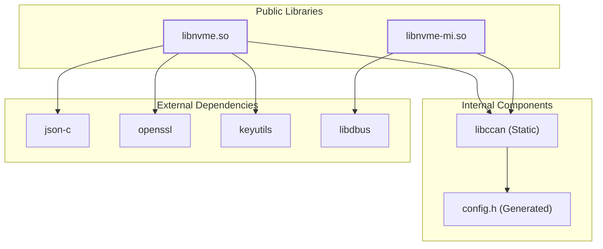
Sources: [src/meson.build:49-117](), [ccan/meson.build:20-26](), [internal/meson.build:12-21]()

---

## Internal Layered Design

The core library (`libnvme.so`) is organized into functional layers that abstract the complexity of NVMe communication from the user.

### 1. The Command Layer (ioctl)
At the lowest level, `nvme/ioctl.c` handles the construction and submission of `passthru` commands to the Linux kernel [src/meson.build:13](). It provides functions like `nvme_admin_passthru` and `nvme_io_passthru` [src/libnvme.map:65-242]().

### 2. The Topology Tree Layer
This layer maintains an in-memory representation of the NVMe hierarchy. It uses `ccan/list` to link objects together [src/nvme/private.h:12-112]().
- **`nvme_root_t`**: The base container [src/nvme/private.h:158]().
- **`nvme_host_t`**: Represents a local or remote host [src/nvme/private.h:112]().
- **`nvme_subsystem_t`**: Represents an NVMe subsystem [src/nvme/private.h:95]().
- **`nvme_ctrl_t`**: Represents an individual controller [src/nvme/private.h:62]().
- **`nvme_ns_t`**: Represents a namespace [src/nvme/private.h:37]().

### 3. The Fabrics Layer
The `nvme/fabrics.c` module extends the topology to remote targets, handling the `/dev/nvme-fabrics` interface for connecting and disconnecting controllers [src/meson.build:11]().

**Command Submission Data Flow**
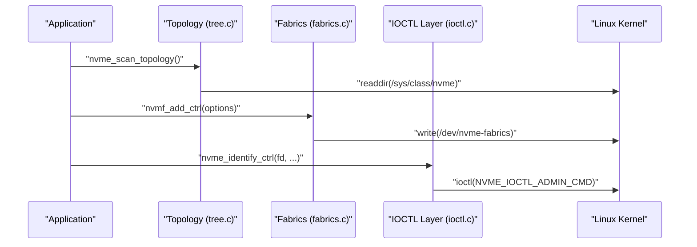
Sources: [src/meson.build:8-18](), [src/nvme/private.h:24-110](), [src/libnvme.map:65-101]()

---

## Public API Surface and Header Organization

The public API is accessible through a flat include structure. While `libnvme.h` and `libnvme-mi.h` are the primary entry points, they include specific sub-headers for granular access.

### Header Map
| Header | Contents |
|:---|:---|
| `nvme/types.h` | NVMe specification structures (Identify, Log Pages) [src/meson.build:131](). |
| `nvme/ioctl.h` | Low-level command submission functions [src/meson.build:126](). |
| `nvme/tree.h` | Topology object accessors and iterators [src/meson.build:130](). |
| `nvme/fabrics.h` | Fabrics connection management and options [src/meson.build:124](). |
| `nvme/mi.h` | Management Interface endpoint and controller APIs [src/meson.build:133](). |
| `nvme/nbft.h` | NVMe Boot Firmware Table parser [src/meson.build:129](). |

### Object Association Diagram
This diagram bridges the conceptual "Tree" with the actual C structures defined in `src/nvme/private.h`.

**Code Entity Mapping: Topology Tree**
```mermaid
classDiagram
    class "nvme_root" {
        +char* config_file
        +struct list_head hosts
        +struct list_head endpoints
    }
    class "nvme_host" {
        +char* hostnqn
        +char* hostid
        +struct list_head subsystems
    }
    class "nvme_subsystem" {
        +char* subsysnqn
        +struct list_head ctrls
        +struct list_head namespaces
    }
    class "nvme_ctrl" {
        +int fd
        +char* transport
        +char* traddr
    }
    class "nvme_ns" {
        +uint32_t nsid
        +struct list_head paths
    }

    "nvme_root" *-- "nvme_host" : "hosts"
    "nvme_host" *-- "nvme_subsystem" : "subsystems"
    "nvme_subsystem" *-- "nvme_ctrl" : "ctrls"
    "nvme_subsystem" *-- "nvme_ns" : "namespaces"
```
Sources: [src/nvme/private.h:37-170]()

---

## Build System Integration

The library uses the Meson build system to manage optional features. If certain dependencies are missing, the library provides fallback behaviors. For example, if `json-c` is unavailable, `src/nvme/no-json.c` is compiled instead of `src/nvme/json.c`, providing stub implementations for configuration parsing [src/meson.build:27-31]().

**Key Build Options and Impacts:**
- `json-c`: Enables JSON configuration persistence [meson.build:58-66]().
- `openssl`: Enables DH-HMAC-CHAP and TLS key derivation [meson.build:68-103]().
- `libmctp`: Enables the MCTP transport for NVMe-MI [meson.build:55]().

Sources: [meson.build:1-220](), [src/meson.build:1-138]()

---

# Page: Core NVMe Command Interface

# Core NVMe Command Interface

<details>
<summary>Relevant source files</summary>

The following files were used as context for generating this wiki page:

- [src/nvme/ioctl.c](src/nvme/ioctl.c)
- [src/nvme/ioctl.h](src/nvme/ioctl.h)
- [src/nvme/linux.c](src/nvme/linux.c)
- [src/nvme/linux.h](src/nvme/linux.h)
- [src/nvme/types.h](src/nvme/types.h)

</details>


The Core NVMe Command Interface provides the primary mechanism for interacting with NVMe devices through the Linux kernel. It abstracts the complexities of the `ioctl` interface and provides support for both synchronous passthrough commands and asynchronous `io_uring` submissions. This layer is responsible for mapping high-level C structures into the Command Dwords (CDWs) required by the NVMe specification.

### Command Submission Flow

The library translates user-provided arguments into standardized passthrough structures. These structures are then passed to the kernel using specific `ioctl` request codes. For advanced use cases, 64-bit versions of these interfaces allow for larger result fields (CQE DWORD 0 and 1).

| Submission Type | Request Code | Primary Structure |
|:---|:---|:---|
| **Admin Command** | `NVME_IOCTL_ADMIN_CMD` | `struct nvme_passthru_cmd` |
| **I/O Command** | `NVME_IOCTL_IO_CMD` | `struct nvme_passthru_cmd` |
| **Admin 64-bit** | `NVME_IOCTL_ADMIN64_CMD` | `struct nvme_passthru_cmd64` |
| **I/O 64-bit** | `NVME_IOCTL_IO64_CMD` | `struct nvme_passthru_cmd64` |
| **io_uring** | `NVME_URING_CMD_IO` | `struct nvme_uring_cmd` |

**Sources:** [src/nvme/ioctl.h:64-169](), [src/nvme/ioctl.h:175-182]()

### Logic to Code Entity Mapping

The following diagram illustrates how high-level submission functions in `ioctl.c` map to the underlying Linux kernel UAPI structures and ioctl calls.

**NVMe Command Pipeline**
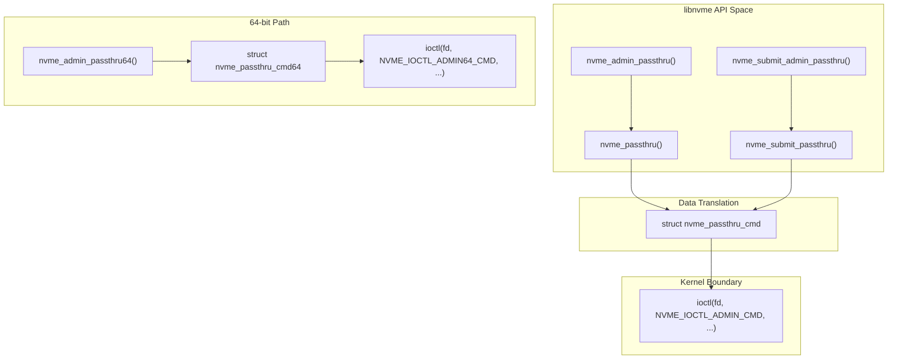
**Sources:** [src/nvme/ioctl.c:89-194](), [src/nvme/ioctl.h:203-220]()

---

### Component Overview

#### Admin and I/O Command Submission (ioctl layer)
This component handles the construction of NVMe commands by populating Command Dwords (CDW10-CDW15). It provides specific helpers for standard operations like Identify, Get Log Page, and Features. The `nvme_submit_admin_passthru` function serves as the entry point for most administrative tasks.

For details, see [Admin and I/O Command Submission (ioctl layer)](#2.1).

**Sources:** [src/nvme/ioctl.c:159-194](), [src/nvme/ioctl.h:43-83]()

#### Linux-Specific Helpers
Beyond raw command submission, libnvme includes Linux-specific utilities for device management. This includes `nvme_open` for standardizing device access, firmware download sequences that handle chunking, and integration with the Linux keyring for security operations like DH-HMAC-CHAP.

For details, see [Linux-Specific Helpers: Device Access, Telemetry, and Security Keys](#2.2).

**Sources:** [src/nvme/linux.c:59-123](), [src/nvme/linux.h:157-166]()

#### NVMe Type Definitions and Status Handling
The core interface relies on a comprehensive set of type definitions matching the NVMe specification. This includes structures for Controller and Namespace Identification, as well as macros like `NVME_GET` and `NVME_SET` for bitfield manipulation. It also provides the logic to convert NVMe status codes into standard Linux `errno` values.

For details, see [NVMe Type Definitions and Status Handling](#2.3).

**Sources:** [src/nvme/types.h:18-46](), [src/nvme/types.h:131-172]()

### System Interaction Overview

The core interface bridges the gap between the NVMe specification and the Linux kernel's character/block device drivers.

**Command Execution Architecture**
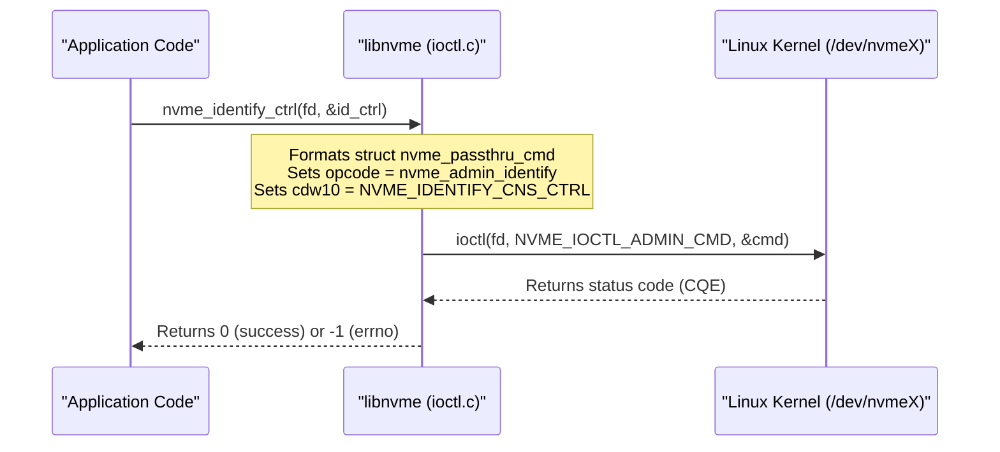
**Sources:** [src/nvme/ioctl.c:26-97](), [src/nvme/linux.c:43-95]()

---

# Page: Admin and I/O Command Submission (ioctl layer)

# Admin and I/O Command Submission (ioctl layer)

<details>
<summary>Relevant source files</summary>

The following files were used as context for generating this wiki page:

- [src/nvme/ioctl.c](src/nvme/ioctl.c)
- [src/nvme/ioctl.h](src/nvme/ioctl.h)
- [src/nvme/types.h](src/nvme/types.h)
- [src/nvme/util.c](src/nvme/util.c)
- [src/nvme/util.h](src/nvme/util.h)

</details>


This page provides a technical deep-dive into the core command submission mechanism of `libnvme`. It covers the transition from high-level C arguments to the Linux kernel's passthrough `ioctl` interface, including the mapping of command dwords, buffer handling, and specialized command sets like ZNS and FDP.

## Command Submission Pipeline

The submission pipeline follows a tiered approach: high-level "helper" functions (e.g., `nvme_identify_ctrl`) wrap around "passthru" functions, which in turn populate the `nvme_passthru_cmd` or `nvme_passthru_cmd64` structures for the final `ioctl()` call.

### Command Construction Flow

1.  **Argument Structs**: High-level APIs use specific arguments that correspond to the NVMe specification.
2.  **CDW Mapping**: Logic in `src/nvme/ioctl.c` maps these arguments into Command Dwords (CDW10-CDW15).
3.  **Ioctl Request**: The library issues an `ioctl` to the character device file descriptor (`fd`).

### Data Flow: User Space to Kernel

The following diagram illustrates how a command like `Identify` travels from the API to the kernel.

**NVMe Command Pipeline**
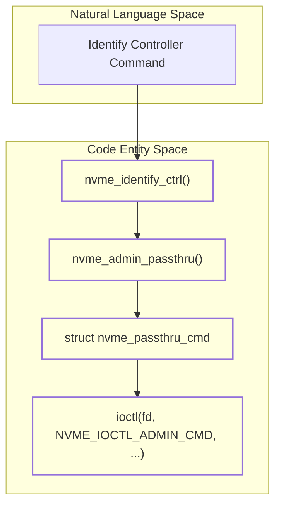
**Sources:** [src/nvme/ioctl.c:183-194](), [src/nvme/ioctl.h:171-179]()

## Passthrough Structures

`libnvme` supports both standard (32-bit result) and 64-bit result passthrough commands. The 64-bit variants are required for certain commands that return more than a single DWORD in the completion queue entry (CQE).

| Structure | Ioctl Type | Purpose |
| :--- | :--- | :--- |
| `struct nvme_passthru_cmd` | `NVME_IOCTL_ADMIN_CMD` / `NVME_IOCTL_IO_CMD` | Standard NVMe commands. [src/nvme/ioctl.h:64-83]() |
| `struct nvme_passthru_cmd64` | `NVME_IOCTL_ADMIN64_CMD` / `NVME_IOCTL_IO64_CMD` | Commands requiring 64-bit results. [src/nvme/ioctl.h:107-127]() |
| `struct nvme_uring_cmd` | `NVME_URING_CMD_IO` | Used for io_uring based async submission. [src/nvme/ioctl.h:150-169]() |

### CDW Field Mapping
Internal macros and enums handle the bit-shifting required to pack fields into the `cdw10`-`cdw15` members of the passthru structures.

**Example: Log Page Mapping**
*   `LID` (Log Identifier): `cdw10` bits 0-7. [src/nvme/ioctl.c:232]()
*   `NUMDL` (Number of Dwords Lower): `cdw10` bits 16-31. [src/nvme/ioctl.c:235]()
*   `RAE` (Retain Asynchronous Event): `cdw10` bit 15. [src/nvme/ioctl.c:234]()

**Sources:** [src/nvme/ioctl.h:44-127](), [src/nvme/ioctl.c:196-240]()

## Key Submission Functions

### Admin Command Submission
Admin commands are sent to the controller's admin queue. Common operations include Identify, Get/Set Features, and Firmware Update.

*   `nvme_submit_admin_passthru`: Submits a pre-populated `nvme_passthru_cmd`. [src/nvme/ioctl.c:178-181]()
*   `nvme_admin_passthru`: Helper that accepts raw CDW values and constructs the struct internally. [src/nvme/ioctl.c:183-194]()

### I/O Command Submission
I/O commands are targeted at specific namespaces.

*   `nvme_submit_io_passthru`: Submits a pre-populated `nvme_passthru_cmd` to the I/O queue. [src/nvme/ioctl.c:250-253]()
*   `nvme_io_passthru`: High-level helper for I/O opcodes like Read, Write, and Flush. [src/nvme/ioctl.c:255-266]()

**Sources:** [src/nvme/ioctl.c:159-266]()

## Specialized Command Sets

### Zoned Namespace (ZNS)
ZNS commands manage zones within a namespace. These typically use `NVME_IOCTL_IO_CMD`.
*   **Management**: `nvme_zns_mgmt_send` and `nvme_zns_mgmt_recv` map to the ZNS Management Send/Receive opcodes.
*   **Mapping**: Arguments like `zslba` (Zone Starting LBA) are mapped to `cdw10` and `cdw11`.

### Flexible Data Placement (FDP)
FDP commands allow hosts to guide data placement to minimize Write Amplification.
*   **Log Pages**: `nvme_get_log_fdp_stats`, `nvme_get_log_fdp_events`.
*   **Management**: `nvme_fdp_mgmt_send` and `nvme_fdp_mgmt_recv`.

### Feature Management
Features are managed via `nvme_get_features` and `nvme_set_features`. The library uses `nvme_get_feature_length2` to determine the correct buffer size for feature-specific data (e.g., LBA Range Type).

**Sources:** [src/nvme/util.h:178-179](), [src/nvme/ioctl.c:196-240]()

## Status Handling and Errno Mapping

When an `ioctl` returns, `libnvme` provides utilities to translate the NVMe Status Code (SC) and Status Code Type (SCT) into standard Linux errnos.

**Status Translation Flow**
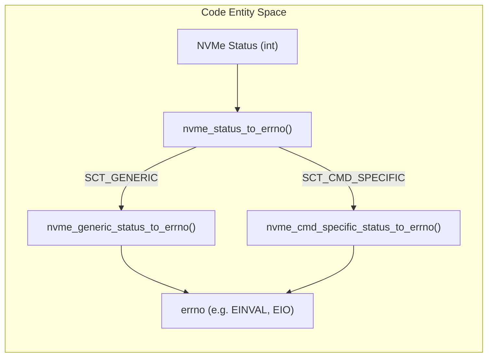

| NVMe Status Code | Linux Errno | Context |
| :--- | :--- | :--- |
| `NVME_SC_INVALID_OPCODE` | `EINVAL` | Generic error. [src/nvme/util.c:40-52]() |
| `NVME_SC_NS_NOT_READY` | `EACCES` | Generic error. [src/nvme/util.c:71-75]() |
| `NVME_SC_CQ_INVALID` | `EINVAL` | Command specific. [src/nvme/util.c:88-110]() |
| `NVME_SC_FEATURE_NOT_SAVEABLE` | `EPERM` | Command specific. [src/nvme/util.c:120-128]() |

**Sources:** [src/nvme/util.c:37-188](), [src/nvme/util.h:67-74]()

## Implementation Details

### Device Verification
Before submission, the library verifies that the file descriptor refers to an NVMe character device using `fstat` and `S_ISCHR`. If the check fails, it returns `ENOTBLK`.

**Sources:** [src/nvme/ioctl.c:26-39]()

### Buffer Alignment and Size
The library defines `NVME_LOG_PAGE_PDU_SIZE` (4096 bytes) as a safe transfer unit to avoid hitting Maximum Data Transfer Size (MDTS) limits during log page retrieval.

**Sources:** [src/nvme/ioctl.h:41]()

---

# Page: Linux-Specific Helpers: Device Access, Telemetry, and Security Keys

# Linux-Specific Helpers: Device Access, Telemetry, and Security Keys

<details>
<summary>Relevant source files</summary>

The following files were used as context for generating this wiki page:

- [src/nvme/linux.c](src/nvme/linux.c)
- [src/nvme/linux.h](src/nvme/linux.h)
- [src/nvme/util.c](src/nvme/util.c)
- [src/nvme/util.h](src/nvme/util.h)

</details>


This page covers the Linux-specific utility layer of `libnvme`. While the core library handles NVMe command construction, the Linux helper layer manages interaction with the kernel's device nodes, sysfs attributes, complex multi-stage command sequences (like firmware updates), and security integrations including TLS PSK derivation and the Linux keyring.

## Device Node Access and Validation

The library provides `nvme_open` as a primary entry point for obtaining file descriptors for NVMe controllers and namespaces. It enforces Linux naming conventions and validates file types (character devices for controllers, block devices for namespaces) [src/nvme/linux.c:59-95]().

### Data Flow: Opening a Device
1.  **Name Parsing**: The function uses `sscanf` to distinguish between controller handles (e.g., `nvme0`) and namespace handles (e.g., `nvme0n1`) [src/nvme/linux.c:65-70]().
2.  **Path Construction**: It builds the absolute path under `/dev/` [src/nvme/linux.c:48-52]().
3.  **Type Validation**: Using `fstat`, it ensures controllers are character devices (`S_ISCHR`) and namespaces are block devices (`S_ISBLK`) [src/nvme/linux.c:80-88]().

**Sources:** [src/nvme/linux.c:43-95](), [src/nvme/linux.h:157-166]()

## Firmware Download Sequences

Updating firmware requires sending an image in chunks. `nvme_fw_download_seq` automates this by iterating through a buffer and submitting partial `nvme_fw_download` commands [src/nvme/linux.c:97-123]().

### Firmware Download Logic
| Component | Role |
| :--- | :--- |
| `nvme_fw_download_args` | Structure containing the `fd`, `offset`, and chunk `data` [src/nvme/linux.c:101-109](). |
| `MIN(xfer, size)` | Calculates the size of the current chunk based on the maximum transfer limit [src/nvme/linux.c:112](). |
| Loop | Increments `args.offset` and `args.data` pointer after every successful ioctl [src/nvme/linux.c:117-119](). |

**Sources:** [src/nvme/linux.c:97-123](), [src/nvme/linux.h:24-35]()

## Telemetry Log Retrieval

Retrieving telemetry logs is a two-step process because the size of the log is determined by fields within the log header itself. `libnvme` handles this dynamically via `nvme_get_telemetry_log` [src/nvme/linux.c:125-229]().

### Telemetry Retrieval Process
1.  **Initial Fetch**: Fetches the first 512 bytes (`NVME_LOG_TELEM_BLOCK_SIZE`) to read the header [src/nvme/linux.c:152-167]().
2.  **Size Calculation**: Based on the requested Data Area (`da`), it reads `dalb1`, `dalb2`, `dalb3`, or `dalb4` from the header and converts them to a byte size [src/nvme/linux.c:179-208]().
3.  **Reallocation**: The buffer is resized to fit the full log [src/nvme/linux.c:210-216]().
4.  **Final Fetch**: A second call to `nvme_get_log_page` retrieves the complete dataset [src/nvme/linux.c:218-225]().

**Sources:** [src/nvme/linux.c:125-248](), [src/nvme/linux.h:38-98]()

## Security: DH-HMAC-CHAP and TLS PSK

`libnvme` integrates with OpenSSL and the Linux Keyring to support NVMe-oF security requirements. This includes generating DH-HMAC-CHAP keys and deriving TLS Pre-Shared Keys (PSK).

### Key Generation and Derivation
*   **DH-HMAC-CHAP**: `nvme_gen_dhchap_key` uses HMAC (SHA2-256, 384, or 512) to generate a key from a secret and the Host NQN [src/nvme/linux.h:183-195]().
*   **TLS PSK Derivation**: `nvme_derive_tls_psk` implements the HKDF-based derivation required for NVMe-over-TCP security [src/nvme/linux.h:215-227]().
*   **Keyring Integration**: `nvme_lookup_keyring` and `nvme_describe_key` provide wrappers for `keyutils` to store and retrieve security credentials from the kernel's security infrastructure [src/nvme/linux.h:198-213]().

### Security Code Entities
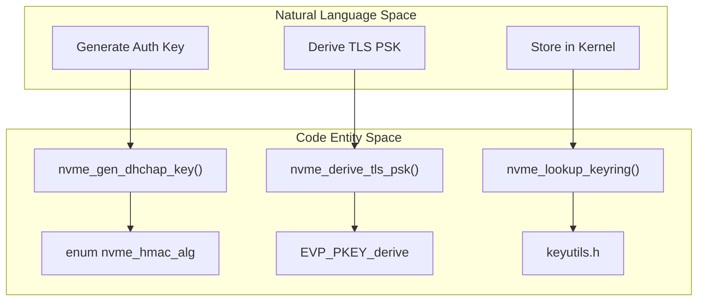
**Sources:** [src/nvme/linux.c:20-35](), [src/nvme/linux.h:169-227]()

## Implementation Mapping

The following diagram bridges high-level Linux operations to the specific functions implemented in `src/nvme/linux.c`.

### Linux Helper Mapping
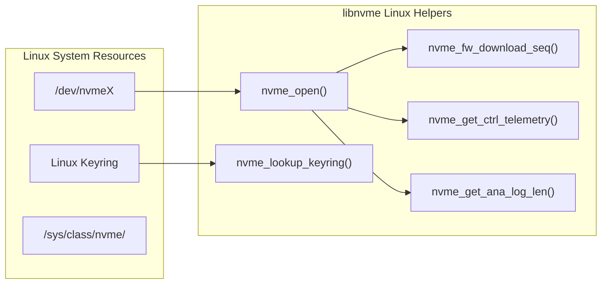
**Sources:** [src/nvme/linux.c:43-248](), [src/nvme/linux.h:100-213]()

## Error Handling and Status Conversion

NVMe commands return a status field that includes a Status Code Type (SCT) and a Status Code (SC). `nvme_status_to_errno` maps these specific NVMe errors to standard Linux `errno` values to simplify application-level error handling [src/nvme/util.c:168-188]().

| NVMe Status Code | Linux Errno | Description |
| :--- | :--- | :--- |
| `NVME_SC_INVALID_OPCODE` | `EINVAL` | Invalid field or opcode [src/nvme/util.c:40-52](). |
| `NVME_SC_CMDID_CONFLICT` | `EADDRINUSE` | Command ID already in use [src/nvme/util.c:53-54](). |
| `NVME_SC_INTERNAL` | `EIO` | General I/O or internal error [src/nvme/util.c:56-58](). |
| `NVME_SC_NS_WRITE_PROTECTED` | `EACCES` | Permission or write protection error [src/nvme/util.c:70-75](). |
| `NVME_SC_CONNECT_CTRL_BUSY` | `EBUSY` | (Fabrics) Controller busy [src/nvme/util.c:153-154](). |

**Sources:** [src/nvme/util.c:37-188](), [src/nvme/util.h:66-74]()

---

# Page: NVMe Type Definitions and Status Handling

# NVMe Type Definitions and Status Handling

<details>
<summary>Relevant source files</summary>

The following files were used as context for generating this wiki page:

- [doc/rst/filters.rst](doc/rst/filters.rst)
- [doc/rst/linux.rst](doc/rst/linux.rst)
- [doc/rst/log.rst](doc/rst/log.rst)
- [doc/rst/tree.rst](doc/rst/tree.rst)
- [doc/rst/types.rst](doc/rst/types.rst)
- [src/nvme/ioctl.c](src/nvme/ioctl.c)
- [src/nvme/ioctl.h](src/nvme/ioctl.h)
- [src/nvme/types.h](src/nvme/types.h)
- [src/nvme/util.c](src/nvme/util.c)
- [src/nvme/util.h](src/nvme/util.h)

</details>


This page serves as a technical reference for the NVMe specification structures, bitfield manipulation macros, and error handling mechanisms implemented in `libnvme`. It covers the foundational data types defined in `types.h`, the macro-based interface for accessing command dwords, and the logic used to map NVMe-specific status codes to standard Linux errnos.

## NVMe Standard Definitions and Constants

`libnvme` provides a comprehensive set of structures and enumerations that mirror the NVMe specification. These are primarily located in `src/nvme/types.h`.

### Key Structures
The library defines the binary layout for essential NVMe structures used in Identify commands and log pages:
*   `struct nvme_id_ctrl`: Controller Identification data [src/nvme/types.h:1030-1280]().
*   `struct nvme_id_ns`: Namespace Identification data [src/nvme/types.h:1344-1480]().
*   `struct nvme_lba_format`: Defines LBA size and metadata size [src/nvme/types.h:1330-1340]().
*   `struct nvme_psd`: Power State Descriptors [src/nvme/types.h:1010-1025]().

### Core Constants
The `enum nvme_constants` provides standard values for common NVMe parameters:
| Constant | Value | Description |
| :--- | :--- | :--- |
| `NVME_NSID_ALL` | `0xffffffff` | Broadcast value for all namespaces |
| `NVME_IDENTIFY_DATA_SIZE` | `4096` | Standard transfer size for Identify commands |
| `NVME_LOG_TELEM_BLOCK_SIZE` | `512` | Size of Telemetry Data Blocks |
| `NVME_NQN_LENGTH` | `256` | Max length for NVMe Qualified Names |

**Sources:** [src/nvme/types.h:99-129](), [src/nvme/types.h:1030-1480]()

## Bitfield Manipulation Macros

To handle the complex bitfield layouts within NVMe command Dwords (CDWs) and register values, `libnvme` utilizes a standardized naming convention combined with two primary macros: `NVME_GET` and `NVME_SET`.

### Implementation Logic
The library defines pairs of `_SHIFT` and `_MASK` constants for every field.
*   **NVME_GET(value, name)**: Isolates a sub-field by shifting the value right and applying the mask [src/nvme/types.h:35-36]().
*   **NVME_SET(value, name)**: Prepares a sub-field for insertion by masking it and shifting it left into position [src/nvme/types.h:45-46]().

### Command Dword Mapping
These macros are extensively used in the ioctl layer to populate `struct nvme_passthru_cmd` fields. For example, the Identify command CNS (Controller or Namespace Structure) field is handled via:
*   `NVME_IDENTIFY_CDW10_CNS_SHIFT`
*   `NVME_IDENTIFY_CDW10_CNS_MASK`

**Sources:** [src/nvme/types.h:25-47](), [src/nvme/ioctl.c:196-245]()

## Status Code Handling

NVMe commands return a 16-bit status field in the Completion Queue Entry (CQE). `libnvme` breaks this down into the Status Code Type (SCT) and the Status Code (SC).

### Status Breakdown Logic
The status is processed using internal helpers to extract the relevant error information:
*   `nvme_status_code_type(status)`: Extracts the SCT (Generic, Command Specific, Media/Data Error, etc.) [src/nvme/types.h:680-690]().
*   `nvme_status_code(status)`: Extracts the specific SC within that type [src/nvme/types.h:695-705]().

### NVMe Status to Errno Mapping
The function `nvme_status_to_errno` is the primary interface for converting NVMe errors into standard C library `errno` values, allowing applications to use standard error handling logic.

**Mapping Flow: NVMe Status to POSIX Errno**
| SCT | Example SC | Resulting Errno |
| :--- | :--- | :--- |
| `NVME_SCT_GENERIC` | `NVME_SC_INVALID_OPCODE` | `EINVAL` |
| `NVME_SCT_GENERIC` | `NVME_SC_INTERNAL` | `EIO` |
| `NVME_SCT_CMD_SPECIFIC` | `NVME_SC_NS_NOT_ATTACHED` | `ENOSPC` |
| `NVME_SCT_FABRICS` | `NVME_SC_CONNECT_CTRL_BUSY` | `EBUSY` |

**Sources:** [src/nvme/util.c:168-188](), [src/nvme/util.c:37-83](), [src/nvme/util.c:85-144]()

## Data Flow and Implementation Diagrams

### NVMe Command Field Encoding
This diagram shows how natural language field names (e.g., "CNS") are translated into code entities and eventually into the raw command Dwords.

**Diagram: Field Encoding Pipeline**
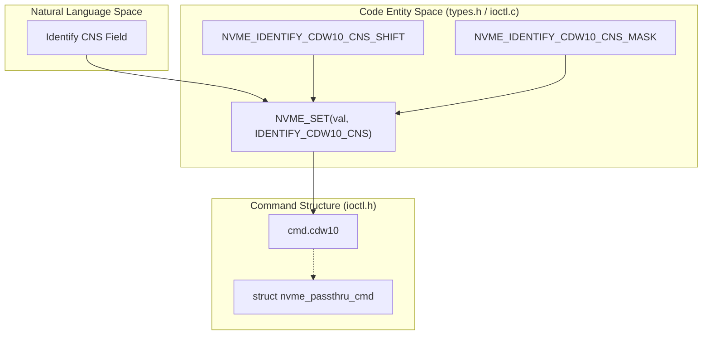
**Sources:** [src/nvme/types.h:35-47](), [src/nvme/ioctl.h:64-83](), [src/nvme/ioctl.c:241-242]()

### Status Conversion Logic
This diagram bridges the gap between the raw status returned by the hardware/kernel and the standard error codes used by application developers.

**Diagram: Status Translation Flow**
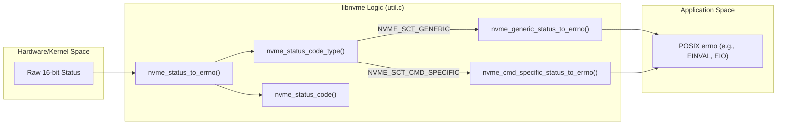
**Sources:** [src/nvme/util.c:168-188](), [src/nvme/util.h:67-74]()

## Summary of Reference Tables

### Common Register Offsets
These offsets are used when accessing controller registers (BAR0/1 for PCIe or Properties for Fabrics).
| Register | Offset | Description |
| :--- | :--- | :--- |
| `NVME_REG_CAP` | `0x0000` | Controller Capabilities |
| `NVME_REG_VS` | `0x0008` | Version |
| `NVME_REG_CC` | `0x0014` | Controller Configuration |
| `NVME_REG_CSTS` | `0x001c` | Controller Status |

**Sources:** [src/nvme/types.h:173-195]()

---

# Page: NVMe Topology Tree

# NVMe Topology Tree

<details>
<summary>Relevant source files</summary>

The following files were used as context for generating this wiki page:

- [src/nvme/private.h](src/nvme/private.h)
- [src/nvme/tree.c](src/nvme/tree.c)
- [src/nvme/tree.h](src/nvme/tree.h)

</details>


The NVMe Topology Tree provides a high-level, hierarchical object model that mirrors the logical structure of NVMe devices as presented by the Linux kernel. It abstracts the complexities of `sysfs` traversal, providing a unified interface for discovering and managing hosts, subsystems, controllers, namespaces, and multipath routes.

## Object Hierarchy

The topology is organized as a multi-level tree. Each node in the tree is represented by a specific C structure and a corresponding `typedef` ending in `_t`. These objects are linked using circular doubly-linked lists from the `ccan/list` library.

### Tree Structure Diagram
This diagram maps the logical hierarchy to the internal `struct` definitions used in the codebase.

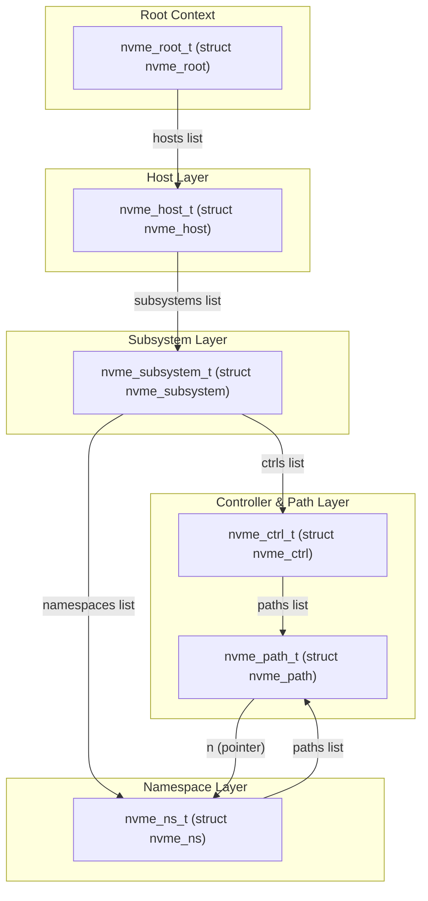
**Sources:** [src/nvme/tree.h:28-33](), [src/nvme/private.h:24-124](), [src/nvme/tree.c:161-176]()

### Core Entity Summary

| Object Type | Code Entity | Description |
|:---|:---|:---|
| **Root** | `nvme_root_t` | The top-level context for logging, configuration, and entry point to the tree [src/nvme/private.h:158-170](). |
| **Host** | `nvme_host_t` | Represents the local system, identified by a Host NQN and Host ID [src/nvme/private.h:112-124](). |
| **Subsystem** | `nvme_subsystem_t` | Represents an NVMe Subsystem which may contain multiple controllers and namespaces [src/nvme/private.h:95-110](). |
| **Controller** | `nvme_ctrl_t` | Represents an individual NVMe controller (e.g., `/dev/nvme0`) [src/nvme/private.h:62-93](). |
| **Namespace** | `nvme_ns_t` | Represents a block device (e.g., `/dev/nvme0n1`) [src/nvme/private.h:37-60](). |
| **Path** | `nvme_path_t` | Represents a specific route from a controller to a namespace in multipath configurations [src/nvme/private.h:24-35](). |

## Lifecycle Management

The tree lifecycle begins with the creation of a root object via `nvme_create_root` [src/nvme/tree.c:161-176](). Once initialized, the tree can be populated by scanning the system `sysfs` or by reading a JSON configuration file.

### Scanning and Discovery
The primary entry point for populating the tree is `nvme_scan_topology` [src/nvme/tree.c:109-159](). This function performs the following:
1.  Scans `/sys/class/nvme` to identify controllers [src/nvme/tree.c:117]().
2.  Scans `/sys/class/nvme-subsys` to identify subsystems [src/nvme/tree.c:140]().
3.  Allocates and links objects into the hierarchy using a "lookup-or-create" pattern [src/nvme/tree.c:98]().

For details on the scanning process and `sysfs` interaction, see [Topology Discovery and Scanning (#3.1)]().

### Resource Cleanup
To prevent resource leaks, the tree must be explicitly freed using `nvme_free_tree` [src/nvme/tree.c:514-523](), which recursively destroys all child objects. Additionally, because controllers and namespaces cache file descriptors for `ioctl` operations, `nvme_root_release_fds` [src/nvme/tree.c:489-503]() can be used to close all open descriptors without destroying the tree structure.

## Iteration and Filtering

Navigating the tree is performed using a "first/next" iterator pattern. Each object type has corresponding functions to retrieve its children.

| Parent | Iterator Start | Next Item |
|:---|:---|:---|
| **Root** | `nvme_first_host` | `nvme_next_host` |
| **Host** | `nvme_first_subsystem` | `nvme_next_subsystem` |
| **Subsystem** | `nvme_subsystem_first_ctrl` | `nvme_subsystem_next_ctrl` |
| **Controller** | `nvme_ctrl_first_ns` | `nvme_ctrl_next_ns` |

**Sources:** [src/nvme/tree.h:89-98](), [src/nvme/tree.h:171-185](), [src/nvme/tree.h:220-233]()

The library also provides a callback mechanism via `nvme_scan_filter_t` [src/nvme/tree.h:35-36](). This allows users to include or exclude specific objects during the scanning process based on custom logic.

For details on navigation and filtering, see [Filters and Iterators (#3.2)]().

## Multipath Support

In environments with multiple paths to the same storage, the tree uses `nvme_path_t` objects to link controllers to namespaces. When the Linux kernel's native multipath is enabled, a single `nvme_ns_t` (the "head" or generic namespace) will have multiple `nvme_path_t` entries in its `paths` list [src/nvme/private.h:39](), each pointing back to a different `nvme_ctrl_t`.

For details on ANA states and path management, see [Multipath and ANA Support (#3.3)]().

## Mapping System State to Code

The following diagram illustrates how physical system components found in `sysfs` map to the internal C structures of `libnvme`.

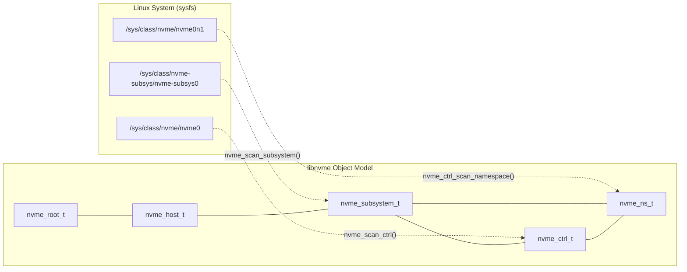
**Sources:** [src/nvme/tree.c:109-159](), [src/nvme/tree.c:47-51](), [src/nvme/private.h:20-22]()

---

# Page: Topology Discovery and Scanning

# Topology Discovery and Scanning

<details>
<summary>Relevant source files</summary>

The following files were used as context for generating this wiki page:

- [doc/man/nvme_scan_ctrls.2](doc/man/nvme_scan_ctrls.2)
- [doc/man/nvme_scan_subsystem_namespaces.2](doc/man/nvme_scan_subsystem_namespaces.2)
- [doc/man/nvme_scan_subsystems.2](doc/man/nvme_scan_subsystems.2)
- [src/nvme/filters.c](src/nvme/filters.c)
- [src/nvme/filters.h](src/nvme/filters.h)
- [src/nvme/tree.c](src/nvme/tree.c)
- [src/nvme/tree.h](src/nvme/tree.h)

</details>


Topology discovery in `libnvme` is the process of traversing the Linux kernel's sysfs representation of NVMe devices to build an in-memory object graph (`nvme_root_t` tree). This process bridges the gap between the kernel's physical/logical device layout and the library's hierarchical object model.

## Overview of `nvme_scan_topology`

The primary entry point for discovery is `nvme_scan_topology`. This function orchestrates the scanning of two main sysfs directories to populate the tree:
1.  `/sys/class/nvme`: Contains individual NVMe controller entries [src/nvme/filters.c:25]().
2.  `/sys/class/nvme-subsystem`: Contains NVMe subsystem entries, which are critical for multipath topology [src/nvme/filters.c:27]().

The function follows a two-phase approach: it first identifies all controllers and then identifies all subsystems, linking namespaces and paths discovered along the way [src/nvme/tree.c:117-156]().

### Discovery Data Flow

The following diagram illustrates how sysfs entities are mapped to `libnvme` tree objects during a scan.

**Sysfs to Code Entity Mapping**
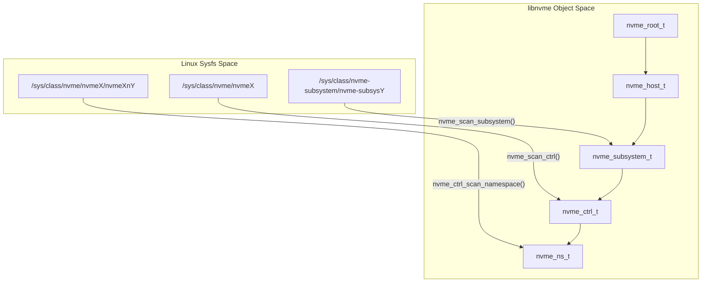
Sources: [src/nvme/tree.c:110-159](), [src/nvme/filters.c:25-27]()

## The Lookup-or-Allocate Pattern

`libnvme` employs a "lookup-or-allocate" strategy to ensure that duplicate objects are not created when the same physical entity is encountered via different sysfs paths (e.g., discovering a controller via `/sys/class/nvme` and later seeing it linked under a subsystem).

Key functions implementing this pattern include:
*   `nvme_lookup_host`: Searches the root's host list for a matching Host NQN and Host ID; creates a new `nvme_host_t` if no match exists [src/nvme/tree.h:109-120]().
*   `nvme_lookup_subsystem`: Searches a host's subsystem list; creates a new `nvme_subsystem_t` if required [src/nvme/tree.h:188-200]().
*   `nvme_lookup_ctrl`: Searches a subsystem's controller list based on the device name (e.g., "nvme0") [src/nvme/tree.h:320-333]().

Sources: [src/nvme/tree.c:88-107](), [src/nvme/tree.h:109-200]()

## Scanning Implementation Details

The scanning logic relies on `scandir` and specific filter functions to identify relevant sysfs entries.

### Filter Mechanism
Filters defined in `filters.c` use `sscanf` patterns to validate directory names:
*   **Controllers**: Matches `nvme%d` but excludes namespace patterns like `nvme%dn%d` [src/nvme/filters.c:57-74]().
*   **Subsystems**: Matches `nvme-subsys%d` [src/nvme/filters.c:76-88]().
*   **Namespaces**: Matches `nvme%dn%d` [src/nvme/filters.c:29-41]().
*   **Paths**: Matches `nvme%dc%dn%d` (used in multipath configurations) [src/nvme/filters.c:43-55]().

### Scanning Execution Flow
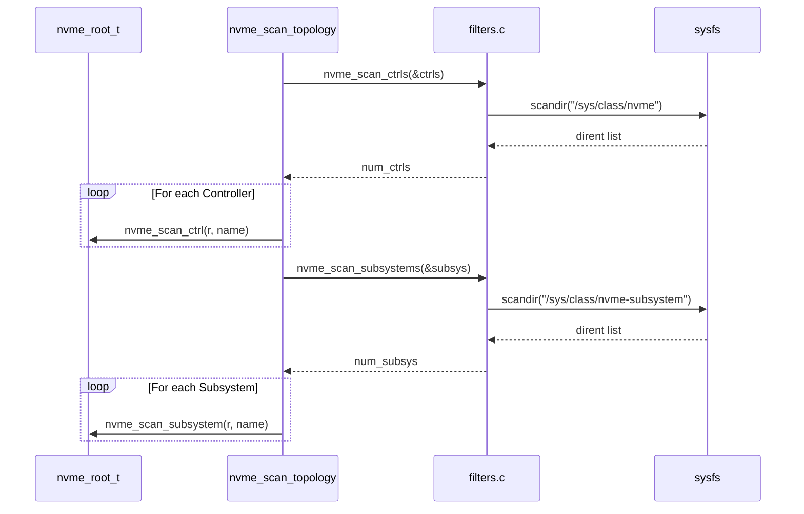
Sources: [src/nvme/tree.c:110-159](), [src/nvme/filters.c:90-118]()

## File Descriptor Management

`libnvme` uses **lazy file descriptor management**. Controller (`nvme_ctrl_t`) and Namespace (`nvme_ns_t`) objects do not open their corresponding `/dev/nvmeX` or `/dev/nvmeXnY` nodes until an operation (like an ioctl) requires it.

*   **Caching**: Once opened, the file descriptor is cached within the object to improve performance for subsequent commands.
*   **Cleanup**: `nvme_root_release_fds(nvme_root_t r)` traverses the entire tree and closes all cached file descriptors [src/nvme/tree.h:65-73](). This is useful in long-running processes that want to ensure they aren't holding handles to devices that might be removed or reset.

Sources: [src/nvme/tree.h:65-73](), [src/nvme/tree.c:514-533]()

## Filter Callbacks (`nvme_scan_filter_t`)

The `nvme_scan_topology` function accepts an optional `nvme_scan_filter_t` callback [src/nvme/tree.h:35-36](). This allows applications to prune the tree during the discovery process.

```c
typedef bool (*nvme_scan_filter_t)(nvme_subsystem_t s, nvme_ctrl_t c, nvme_ns_t n, void *f_args);
```

If the callback returns `false` for a specific object, `libnvme` will stop scanning that branch and free the associated memory [src/nvme/tree.c:131-135](). This is highly efficient for applications that only care about a specific subset of the topology (e.g., only NVMe-over-Fabrics controllers or specific namespaces).

Sources: [src/nvme/tree.c:110-159](), [src/nvme/tree.h:35-36]()

---

# Page: Filters and Iterators

# Filters and Iterators

<details>
<summary>Relevant source files</summary>

The following files were used as context for generating this wiki page:

- [doc/man/nvme_csi.2](doc/man/nvme_csi.2)
- [doc/man/nvme_ctrls_filter.2](doc/man/nvme_ctrls_filter.2)
- [doc/man/nvme_namespace_filter.2](doc/man/nvme_namespace_filter.2)
- [doc/man/nvme_namespace_first_path.2](doc/man/nvme_namespace_first_path.2)
- [doc/man/nvme_namespace_for_each_path.2](doc/man/nvme_namespace_for_each_path.2)
- [doc/man/nvme_namespace_for_each_path_safe.2](doc/man/nvme_namespace_for_each_path_safe.2)
- [doc/man/nvme_namespace_next_path.2](doc/man/nvme_namespace_next_path.2)
- [doc/man/nvme_paths_filter.2](doc/man/nvme_paths_filter.2)
- [doc/man/nvme_scan_topology.2](doc/man/nvme_scan_topology.2)
- [src/nvme/filters.c](src/nvme/filters.c)
- [src/nvme/filters.h](src/nvme/filters.h)

</details>


This page describes the mechanisms used by `libnvme` to identify, filter, and traverse NVMe topology elements within the Linux sysfs hierarchy. It covers the `dirent`-based filtering logic, the scanning helpers for subsystems and controllers, and the first/next iterator pattern used to navigate the object tree.

## Sysfs Filtering Logic

`libnvme` identifies NVMe devices by scanning specific sysfs directories and applying naming pattern filters to the directory entries (`struct dirent`). These filters ensure that only valid NVMe-related nodes are processed during topology discovery.

### Filter Functions

The library provides four primary filter functions defined in `src/nvme/filters.c`. These functions return `1` if a directory entry matches the expected naming convention and `0` otherwise [src/nvme/filters.h:22-51]().

| Filter Function | Target Object | Expected Pattern | Example |
|:---|:---|:---|:---|
| `nvme_subsys_filter` | Subsystems | `nvme-subsys%d` | `nvme-subsys0` |
| `nvme_ctrls_filter` | Controllers | `nvme%d` | `nvme0` |
| `nvme_namespace_filter` | Namespaces | `nvme%dn%d` | `nvme0n1` |
| `nvme_paths_filter` | Multipath Paths | `nvme%dc%dn%d` | `nvme0c0n1` |

### Implementation Details
The filters use `sscanf` to validate the structure of the filename. For instance, `nvme_ctrls_filter` specifically excludes names that match namespace or path patterns (which also start with "nvme") to ensure it only selects base controller nodes [src/nvme/filters.c:57-74]().

**Diagram: Sysfs Name to Filter Mapping**
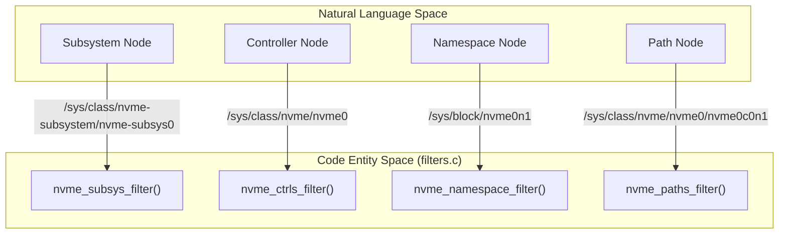

**Sources:** [src/nvme/filters.c:29-88](), [src/nvme/filters.h:22-51]()

---

## Scan Helpers

Scan helpers automate the process of calling `scandir` on standard Linux sysfs locations using the predefined filters. These functions return an allocated array of `dirent` pointers which must be freed by the caller.

### Subsystem and Controller Scanning
*   `nvme_scan_subsystems`: Scans `/sys/class/nvme-subsystem` [src/nvme/filters.c:90-94]().
*   `nvme_scan_ctrls`: Scans `/sys/class/nvme` [src/nvme/filters.c:102-106]().

### Contextual Scanning
Some helpers require an existing topology object to determine the base path:
*   `nvme_scan_subsystem_namespaces`: Uses `nvme_subsystem_get_sysfs_dir(s)` to find namespaces belonging to a specific subsystem [src/nvme/filters.c:96-100]().
*   `nvme_scan_ctrl_namespaces`: Scans the controller's sysfs directory for namespaces [src/nvme/filters.c:114-118]().
*   `nvme_scan_ctrl_namespace_paths`: Scans the controller's sysfs directory for path entries (used in multipath environments) [src/nvme/filters.c:108-112]().

**Sources:** [src/nvme/filters.c:90-118](), [src/nvme/filters.h:54-95]()

---

## Iterator Patterns

Once the topology has been scanned and objects (subsystems, controllers, namespaces) have been instantiated, `libnvme` provides a standard "First/Next" iterator pattern for traversing the tree.

### Traversal Flow
The iterators allow applications to walk the linked lists maintained within the topology objects without exposing the internal `ccan/list` structures.

**Diagram: Iterator Data Flow**
```mermaid
sequenceDiagram
    participant App as "Application"
    participant NS as "nvme_ns_t"
    participant Tree as "Topology Tree"

    App->>Tree: nvme_namespace_first_path(ns)
    Tree-->>App: nvme_path_t (p1)
    
    loop While p != NULL
        App->>App: Process Path
        App->>Tree: nvme_namespace_next_path(ns, p1)
        Tree-->>App: nvme_path_t (p2)
    end
```

### Key Iterator Functions
The library defines iterators for every level of the hierarchy. For example, path iteration within a namespace:

*   `nvme_namespace_first_path`: Returns the first path associated with a namespace [doc/man/nvme_namespace_first_path.2:1-15]().
*   `nvme_namespace_next_path`: Returns the subsequent path given the current one [doc/man/nvme_namespace_next_path.2:1-15]().

### Helper Macros
For convenience, `libnvme` provides macros to wrap these iterators into standard C loops:
*   `nvme_namespace_for_each_path(n, p)`: Standard traversal [doc/man/nvme_namespace_for_each_path.2:1-13]().
*   `nvme_namespace_for_each_path_safe(n, p, _p)`: Safe traversal that allows for the removal of elements during iteration by using temporary storage `_p` [doc/man/nvme_namespace_for_each_path_safe.2:1-16]().

**Sources:** [doc/man/nvme_namespace_first_path.2:1-15](), [doc/man/nvme_namespace_next_path.2:1-15](), [doc/man/nvme_namespace_for_each_path.2:1-13](), [doc/man/nvme_namespace_for_each_path_safe.2:1-16]()

---

## Topology Scanning with Filters

The high-level function `nvme_scan_topology` bridges the gap between raw sysfs scanning and the object tree. It accepts a `nvme_scan_filter_t` callback, allowing users to prune the tree during the discovery phase.

### `nvme_scan_topology`
This function traverses the system's NVMe topology and applies the user-provided filter to each element found. Elements that do not pass the filter are not added to the `nvme_root_t` object tree.

| Parameter | Type | Description |
|:---|:---|:---|
| `r` | `nvme_root_t` | The root object of the topology tree |
| `f` | `nvme_scan_filter_t` | User-defined callback function |
| `f_args` | `void *` | Context arguments passed to the callback |

**Sources:** [doc/man/nvme_scan_topology.2:1-21]()

---

# Page: Multipath and ANA Support

# Multipath and ANA Support

<details>
<summary>Relevant source files</summary>

The following files were used as context for generating this wiki page:

- [doc/man/nvme_scan_ctrl_namespace_paths.2](doc/man/nvme_scan_ctrl_namespace_paths.2)
- [src/nvme/private.h](src/nvme/private.h)
- [src/nvme/tree.c](src/nvme/tree.c)
- [src/nvme/tree.h](src/nvme/tree.h)

</details>


Multipath support in `libnvme` allows the library to represent and manage multiple physical routes (paths) to a single logical NVMe namespace. This is critical for high-availability configurations where a host may be connected to a subsystem via multiple controllers or fabrics. The library tracks Asymmetric Namespace Access (ANA) states to inform the host about the optimal path for I/O operations.

## Path Representation and Data Model

The core entity for multipathing is the `nvme_path_t` (defined as `struct nvme_path`). It serves as a link between a specific controller (`nvme_ctrl_t`) and a specific namespace (`nvme_ns_t`).

### Code Entity Association: Path Structure
The following diagram illustrates how the `nvme_path` structure bridges the controller and namespace entities within the topology tree.

```mermaid
graph TD
    subgraph "Topology Tree Entities"
        SUBSYS["struct nvme_subsystem"]
        CTRL["struct nvme_ctrl"]
        NS["struct nvme_ns"]
        PATH["struct nvme_path"]
    end

    SUBSYS -- "contains list" --> CTRL
    SUBSYS -- "contains list" --> NS
    CTRL -- "paths list" --> PATH
    NS -- "paths list" --> PATH
    
    PATH -- "c (pointer)" --> CTRL
    PATH -- "n (pointer)" --> NS

    style PATH stroke-width:4px
```
**Sources:** [src/nvme/private.h:24-35](), [src/nvme/private.h:37-60](), [src/nvme/private.h:62-93]()

### Path Attributes
Each `nvme_path_t` object captures specific attributes from sysfs that define the route's characteristics:
*   **ANA State**: Represented by the `ana_state` string (e.g., "optimized", "non-optimized", "inaccessible"). [src/nvme/private.h:33]()
*   **ANA Group ID**: Stored in `grpid`, identifying which ANA group the namespace belongs to on this path. [src/nvme/private.h:34]()
*   **Names**: The path identifies itself via a sysfs name (e.g., `nvme0n1`) and maintains a reference to its parent controller's sysfs directory. [src/nvme/private.h:31-32]()

## ANA (Asymmetric Namespace Access) Tracking

ANA support allows the library to understand the internal state of the storage target's ports. `libnvme` parses these states from the Linux kernel's sysfs representation of NVMe multipath.

| Attribute | Code Entity | Description |
| :--- | :--- | :--- |
| **ANA State** | `nvme_path_get_ana_state` | Returns the current state (e.g., `optimized`, `non-optimized`, `inaccessible`, `persistent-loss`). |
| **Group ID** | `nvme_path_get_ana_grpid` | Returns the ANA Group Identifier for the path. |

**Sources:** [src/nvme/tree.c:846-854](), [src/nvme/tree.c:856-864]()

### Implementation of ANA Retrieval
The ANA state is read during the scanning process or on-demand by accessing the `ana_state` file in the namespace's sysfs directory under a specific controller.

## Multipath Traversal APIs

`libnvme` provides iterators to navigate the relationships between namespaces and their various paths.

### Traversal Flow: Subsystem to Paths
When a subsystem is scanned, `libnvme` identifies "generic" namespaces (e.g., `/dev/nvme-subsys0n1`) and links them to the individual paths provided by different controllers.

```mermaid
sequenceDiagram
    participant App as "Application"
    participant NS as "nvme_ns_t"
    participant PATH as "nvme_path_t"
    participant CTRL as "nvme_ctrl_t"

    App->>NS: nvme_ns_first_path(n)
    NS-->>App: returns first nvme_path_t
    loop For each path
        App->>PATH: nvme_path_get_ctrl(p)
        PATH-->>App: returns nvme_ctrl_t
        App->>PATH: nvme_path_get_ana_state(p)
        PATH-->>App: returns "optimized"
        App->>NS: nvme_ns_next_path(n, p)
    end
```
**Sources:** [src/nvme/tree.h:236-250](), [src/nvme/tree.c:821-834]()

### Key Functions
*   **`nvme_ns_first_path` / `nvme_ns_next_path`**: Used to iterate through all physical routes that lead to a specific logical namespace. [src/nvme/tree.c:821-834]()
*   **`nvme_ctrl_first_path` / `nvme_ctrl_next_path`**: Used to iterate through all namespaces reachable through a specific controller. [src/nvme/tree.c:793-806]()
*   **`nvme_path_get_ns`**: Retrieves the parent namespace object for a given path. [src/nvme/tree.c:836-844]()
*   **`nvme_path_get_ctrl`**: Retrieves the controller object that provides this specific path. [src/nvme/tree.c:811-819]()

## Subsystem Path Linking

The function `nvme_subsystem_set_path_ns` (internal) and the scanning logic ensure that namespaces are correctly aggregated. In a multipath setup, multiple `nvme_path` objects will point to the same `nvme_ns` object if they represent the same underlying storage (identified by UUID/NGUID/EUI64).

### Scanning and Linking Logic
1.  **Controller Scan**: During `nvme_scan_topology`, controllers are identified. [src/nvme/tree.c:117-136]()
2.  **Namespace Discovery**: For each controller, the library scans for namespaces. [src/nvme/tree.c:49-50]()
3.  **Path Association**: If a namespace is part of a multipath-enabled subsystem, `libnvme` creates an `nvme_path_t` and links it to the subsystem-wide `nvme_ns_t`. [src/nvme/private.h:39]()

**Sources:** [src/nvme/tree.c:109-159](), [src/nvme/private.h:37-43]()

---

# Page: NVMe-over-Fabrics (NVMe-oF)

# NVMe-over-Fabrics (NVMe-oF)

<details>
<summary>Relevant source files</summary>

The following files were used as context for generating this wiki page:

- [.readthedocs.yaml](.readthedocs.yaml)
- [doc/config-schema.json](doc/config-schema.json)
- [doc/rst/fabrics.rst](doc/rst/fabrics.rst)
- [src/nvme/fabrics.c](src/nvme/fabrics.c)
- [src/nvme/fabrics.h](src/nvme/fabrics.h)
- [src/nvme/json.c](src/nvme/json.c)

</details>


The NVMe-over-Fabrics (NVMe-oF) subsystem in `libnvme` provides the necessary abstractions and tools to connect to remote NVMe targets over various network transports. It handles the complexities of the Fabrics protocol, including discovery of available subsystems, management of transport-specific parameters, and persistent configuration storage via JSON.

## Fabrics Architecture Overview

The Fabrics subsystem acts as a bridge between the high-level topology tree and the Linux kernel's fabrics interface located at `/dev/nvme-fabrics` [src/nvme/fabrics.c:47](). It supports multiple transport types including RDMA, Fibre Channel (FC), TCP, and a local loopback transport [src/nvme/fabrics.c:74-79]().

### Code Entity Relationship
The following diagram illustrates how the Fabrics configuration structures relate to the core topology objects and the kernel interface.

**Diagram: Fabrics Configuration to Kernel Interface**
```mermaid
graph TD
    subgraph "libnvme Logic Space"
        ROOT["nvme_root_t"]
        CTRL["nvme_ctrl_t"]
        CFG["struct nvme_fabrics_config"]
        OPTS["struct nvme_fabric_options"]
    end

    subgraph "Linux Kernel Space"
        DEV_FABRICS["/dev/nvme-fabrics"]
        SYS_CLASS["/sys/class/nvme/"]
    end

    ROOT -->|owns| CTRL
    CTRL -->|holds| CFG
    CFG -->|validated by| OPTS
    CTRL -->|nvmf_add_ctrl()| DEV_FABRICS
    DEV_FABRICS -->|creates| SYS_CLASS
```
**Sources:** [src/nvme/fabrics.h:46-66](), [src/nvme/fabrics.c:47-48](), [src/nvme/fabrics.c:197-198]()

---

## Controller Connection and Transport Management
Connecting to a remote target requires building a specific option string that is written to the fabrics character device. `libnvme` manages this through the `nvme_fabrics_config` structure, which contains parameters like `reconnect_delay`, `ctrl_loss_tmo`, and transport-specific flags like `hdr_digest` for TCP [src/nvme/fabrics.h:46-66]().

The library handles the negotiation of supported options with the kernel to ensure compatibility before attempting a connection.
* For details, see [Controller Connection and Transport Management](#4.1).

**Sources:** [src/nvme/fabrics.h:26-66](), [src/nvme/fabrics.c:230-235]()

---

## Discovery Controllers and Log Pages
Discovery is the process of identifying available NVMe subsystems on a fabric. `libnvme` provides functions to interact with Discovery Controllers (DC), which serve Discovery Log Pages (DLP). These logs contain entries for each available subsystem, including their NQN (Name), transport address, and service ID.

The library supports both standard Discovery Controllers and the newer Centralized Discovery Controllers (CDC) used in large-scale fabrics.
* For details, see [Discovery Controllers and Log Pages](#4.2).

**Sources:** [src/nvme/fabrics.h:201-214](), [src/nvme/fabrics.c:99-103]()

---

## JSON Configuration and Persistence
To support persistent configurations across reboots or application restarts, `libnvme` implements a JSON-based configuration schema. This allows users to define a hierarchy of hosts, subsystems, and ports with their associated transport parameters and security keys (e.g., DH-HMAC-CHAP keys or TLS PSKs).

The configuration is typically stored in `/etc/nvme/config.json` and is managed via `json_read_config()` and `json_update_config()` [src/nvme/json.c:232]().

**Diagram: JSON Configuration Hierarchy**
```mermaid
graph TD
    JSON["config.json"]
    HOSTS["hosts[]"]
    SUBSYSTEMS["subsystems[]"]
    PORTS["ports[]"]
    ATTRS["Transport Attributes"]

    JSON --> HOSTS
    HOSTS -->|hostnqn / hostid| SUBSYSTEMS
    SUBSYSTEMS -->|nqn| PORTS
    PORTS -->|traddr / trsvcid| ATTRS
```
**Sources:** [doc/config-schema.json:1-176](), [src/nvme/json.c:158-190]()

* For details, see [JSON Configuration and Persistence](#4.3).

---

## Supported Transports and Address Families
The library decodes various specification-defined constants into human-readable strings for logging and UI display.

| Category | Supported Values (Examples) |
| :--- | :--- |
| **Transport Types** | `rdma`, `fc`, `tcp`, `loop` [src/nvme/fabrics.c:74-79]() |
| **Address Families** | `ipv4`, `ipv6`, `infiniband`, `fibre-channel` [src/nvme/fabrics.c:86-92]() |
| **TCP Security** | `none`, `tls`, `tls13` [src/nvme/fabrics.c:156-160]() |

**Sources:** [src/nvme/fabrics.c:74-197](), [src/nvme/fabrics.h:69-165]()

---

# Page: Controller Connection and Transport Management

# Controller Connection and Transport Management

<details>
<summary>Relevant source files</summary>

The following files were used as context for generating this wiki page:

- [src/nvme/fabrics.c](src/nvme/fabrics.c)
- [src/nvme/fabrics.h](src/nvme/fabrics.h)
- [src/nvme/util.c](src/nvme/util.c)
- [src/nvme/util.h](src/nvme/util.h)

</details>


This section describes the mechanisms used by `libnvme` to establish and manage connections to NVMe-over-Fabrics (NVMe-oF) targets. It covers the interaction with the Linux kernel's fabrics interface, the construction of connection parameters, and transport-specific configurations for TCP, RDMA, FC, and Loop.

## Connection Lifecycle and /dev/nvme-fabrics

The primary interface for establishing NVMe-oF connections in Linux is the character device `/dev/nvme-fabrics`. `libnvme` manages this through `nvmf_add_ctrl`, which serializes controller options into a comma-separated string and writes it to this device.

### The Connection Flow

The following diagram illustrates the data flow from a topology controller object to the kernel fabrics driver.

**Diagram: Controller Connection Pipeline**
```mermaid
graph TD
    subgraph "libnvme User Space"
        [nvme_ctrl_t] --> |"nvmf_update_config()"| [nvme_fabrics_config]
        [nvme_fabrics_config] --> |"nvmf_add_ctrl()"| [Option_String_Builder]
        [Option_String_Builder] --> |"write()"| [dev_nvme_fabrics["/dev/nvme-fabrics"]]
    end

    subgraph "Linux Kernel"
        [dev_nvme_fabrics] --> [nvme_fabrics_driver]
        [nvme_fabrics_driver] --> [Transport_Modules["nvme-tcp / nvme-rdma / nvme-fc"]]
    end
```
Sources: [src/nvme/fabrics.c:47-47](), [src/nvme/fabrics.c:647-700]()

### Option String Construction
The kernel expects a specific string format (e.g., `traddr=192.168.1.1,trtype=tcp,nqn=subsystem1`). `libnvme` builds this string by:
1.  **Probing Supported Options**: It checks `/dev/nvme-fabrics` to see which options the current kernel supports [src/nvme/fabrics.c:514-550]().
2.  **Formatting Arguments**: It iterates through the `nvme_fabrics_config` and `nvme_ctrl_t` attributes, appending valid keys and values [src/nvme/fabrics.c:552-645]().

## Configuration Management

`libnvme` uses a layered approach to configuration, allowing for global defaults that can be overridden by specific controller instances.

### Default and Updated Configurations
*   **`nvmf_default_config`**: Initializes a `nvme_fabrics_config` struct with standard values, such as a default `ctrl_loss_tmo` of 600 seconds [src/nvme/fabrics.c:230-235]().
*   **`nvmf_update_config`**: Merges a new configuration into an existing controller's configuration. Non-default values in the new `cfg` overwrite the controller's current settings [src/nvme/fabrics.c:286-311]().

| Option | Description | Default |
| :--- | :--- | :--- |
| `ctrl_loss_tmo` | Seconds to attempt reconnect before failing | 600 |
| `tos` | Type of Service for network packets | -1 (Unset) |
| `reconnect_delay` | Seconds between reconnect attempts | 0 (Kernel default) |

Sources: [src/nvme/fabrics.h:23-23](), [src/nvme/fabrics.c:230-235](), [src/nvme/fabrics.c:286-311]()

## Transport-Specific Logic

Different transports require specialized handling of addresses and security parameters.

### TCP Transport and Security
For TCP connections, `libnvme` supports advanced features like Header/Data digests and TLS security:
*   **Digests**: Controlled via `hdr_digest` and `data_digest` booleans in the config [src/nvme/fabrics.h:63-64]().
*   **TLS**: Supports `sectype` definitions for TLS 1.2 and 1.3. It manages TLS PSK (Pre-Shared Keys) via the `tls_key` and `keyring` options [src/nvme/fabrics.c:156-165](), [src/nvme/fabrics.h:58-59]().

### IPv6 Scoping
When using IPv6, `libnvme` handles Link-Local addresses by parsing and appending the scope ID (interface index) to the transport address if a `host_iface` is provided [src/nvme/fabrics.c:445-484]().

### RDMA and Fibre Channel
*   **RDMA**: Supports specific provider types (`roce`, `iwarp`, `infiniband`) and connection management services (`rdma-cm`) [src/nvme/fabrics.c:167-197]().
*   **FC**: Manages Fibre Channel specific addressing via World Wide Name (WWN) strings [src/nvme/fabrics.c:91-91]().

Sources: [src/nvme/fabrics.c:156-197](), [src/nvme/fabrics.c:445-484](), [src/nvme/fabrics.h:46-66]()

## Connection Helpers

### `nvmf_connect_disc_entry`
This is a high-level helper used during discovery. It takes a discovery log entry (which contains the target's address and NQN) and a host object to automatically create and connect a new controller instance.

**Entity Mapping: Discovery to Connection**
```mermaid
classDiagram
    class nvmf_discovery_log_entry {
        +trtype
        +traddr
        +trsvcid
        +subnqn
    }
    class nvme_ctrl_t {
        +struct nvme_fabrics_config cfg
        +nvmf_add_ctrl()
    }
    class nvmf_connect_disc_entry {
        +nvme_ctrl_t c
        +nvmf_update_config()
    }

    nvmf_discovery_log_entry --> nvmf_connect_disc_entry : "Provides Target Info"
    nvmf_connect_disc_entry ..> nvme_ctrl_t : "Instantiates & Connects"
```

### Key Functions
| Function | Purpose |
| :--- | :--- |
| `nvmf_add_ctrl` | The core function that performs the `write()` to `/dev/nvme-fabrics` [src/nvme/fabrics.c:647](). |
| `nvmf_connect_disc_entry` | Connects to a target based on a discovery log page entry [src/nvme/fabrics.c:736](). |
| `nvmf_supported_options` | Probes the kernel for supported fabrics options [src/nvme/fabrics.c:514](). |

Sources: [src/nvme/fabrics.c:514-550](), [src/nvme/fabrics.c:647-700](), [src/nvme/fabrics.c:736-764]()

---

# Page: Discovery Controllers and Log Pages

# Discovery Controllers and Log Pages

<details>
<summary>Relevant source files</summary>

The following files were used as context for generating this wiki page:

- [src/nvme/fabrics.c](src/nvme/fabrics.c)
- [src/nvme/fabrics.h](src/nvme/fabrics.h)
- [src/nvme/linux.c](src/nvme/linux.c)
- [src/nvme/linux.h](src/nvme/linux.h)

</details>


This section details how `libnvme` interacts with NVMe-over-Fabrics (NVMe-oF) Discovery Controllers to retrieve and process discovery log pages. It covers the mechanisms for atomic log retrieval, the distinction between Centralized and Direct Discovery Controllers, and the registration of Discovery Information Management (DIM) data.

## Discovery Log Retrieval and Atomicity

Retrieving the discovery log from a Discovery Controller (DC) requires handling potential updates to the log during the read process. `libnvme` implements a retry mechanism to ensure the integrity of the data using the generation counter provided by the controller.

### Atomic Retrieval Flow
The primary function `nvmf_get_discovery_log` [src/nvme/fabrics.c:213-214]() manages the lifecycle of log retrieval:
1. **Initial Header Fetch**: The library first fetches the discovery log header to determine the current `genctr` (Generation Counter) and the number of records (`numrec`).
2. **Buffer Allocation**: It allocates a buffer large enough to hold the entire log based on the `numrec` reported in the header.
3. **Full Log Fetch**: It performs a second read to fetch the complete log.
4. **Validation**: After the full fetch, it compares the `genctr` in the retrieved log against the initial `genctr`. If they do not match, the log was updated during the transfer, and the process retries (up to `max_retries`).

### Extensible Arguments
For more granular control, `nvmf_get_discovery_wargs` [src/nvme/fabrics.c:235-236]() uses the `struct nvme_get_discovery_args` [src/nvme/fabrics.h:225-232]() structure. This allows specifying:
*   **LSP (Log Specific Field)**: Used to filter or specify the type of discovery information [src/nvme/fabrics.h:231]().
*   **Timeout**: Custom IOCTL timeouts [src/nvme/fabrics.h:230]().

**Sources:** [src/nvme/fabrics.c:213-243](), [src/nvme/fabrics.h:201-232]()

## DDC vs CDC Types

NVMe-oF defines different types of Discovery Controllers that `libnvme` distinguishes via the `subtype` and `eflags` fields in the discovery log entries.

| Controller Type | Description | Code Identifier |
| :--- | :--- | :--- |
| **DDC** (Direct) | Direct connection to a subsystem. | `NVME_NQN_NVME` [src/nvme/fabrics.c:101]() |
| **CDC** (Centralized) | A centralized entity providing referrals to other subsystems. | `NVME_NQN_DISC` [src/nvme/fabrics.c:100]() |

The library provides string decoding helpers like `nvmf_subtype_str` [src/nvme/fabrics.c:105-108]() and `nvmf_eflags_str` [src/nvme/fabrics.c:151-154]() to translate these protocol-level values into human-readable formats. For instance, `NVMF_DISC_EFLAGS_NCC` indicates "no cdc connectivity" [src/nvme/fabrics.c:137]().

**Sources:** [src/nvme/fabrics.c:99-154](), [src/nvme/fabrics.h:90-121]()

## DIM Registration via nvmf_register_ctrl

Discovery Information Management (DIM) allows a host to register its information with a Discovery Controller. This is typically performed using the `nvmf_register_ctrl` function.

### DIM Data Flow
The registration process involves:
1.  **Controller Setup**: An established connection to a Discovery Controller.
2.  **Task Command**: Issuing a registration command (often a `set_features` or a specific discovery log write depending on the fabric version).
3.  **Host Information**: Passing the Host NQN and Host ID to the controller so the DC can track which hosts are connected to which subsystems.

**Sources:** [src/nvme/fabrics.h:197-198](), [src/nvme/fabrics.c:42-45]()

## Host NQN and ID Generation

For fabrics operations, every host must have a unique identifier. `libnvme` manages these via system configuration files.

*   **Host NQN**: Read from `/etc/nvme/hostnqn` [src/nvme/fabrics.c:44](). If missing, the library provides utilities to generate a unique NQN based on system UUIDs.
*   **Host ID**: Read from `/etc/nvme/hostid` [src/nvme/fabrics.c:45](). This is a 128-bit unique identifier (stored as a string in the file).

### Implementation Mapping: Discovery Logic
The following diagram maps the logical discovery process to the specific functions and structures in the codebase.

Title: Discovery Log Retrieval Sequence
```mermaid
sequenceDiagram
    participant User
    participant FabricsAPI as "fabrics.c / fabrics.h"
    participant LinuxIOCTL as "ioctl.c"
    participant Kernel as "Linux Kernel (/dev/nvme-fabrics)"

    User->>FabricsAPI: nvmf_get_discovery_log(nvme_ctrl_t c, ...)
    FabricsAPI->>LinuxIOCTL: nvme_get_log_discovery(fd, ...)
    LinuxIOCTL->>Kernel: ioctl(NVME_IOCTL_ADMIN_CMD)
    Kernel-->>FabricsAPI: Discovery Log Header (genctr)
    
    Note over FabricsAPI: Allocate buffer for numrec entries
    
    FabricsAPI->>LinuxIOCTL: nvme_get_log_discovery(fd, offset, len, ...)
    LinuxIOCTL->>Kernel: ioctl(NVME_IOCTL_ADMIN_CMD)
    Kernel-->>FabricsAPI: Full Discovery Log Data
    
    Note over FabricsAPI: Compare genctr. If mismatch, retry.
    
    FabricsAPI-->>User: struct nvmf_discovery_log*
```
**Sources:** [src/nvme/fabrics.c:213-243](), [src/nvme/ioctl.c:140-160]() (implied by log retrieval flow)

## Technical Reference: Data Structures

### nvme_fabrics_config
This structure holds the initiator-side configuration used when adding new controllers via discovery.

| Field | Purpose |
| :--- | :--- |
| `host_traddr` | Local transport address [src/nvme/fabrics.h:47]() |
| `keep_alive_tmo` | Keep-alive timeout in seconds [src/nvme/fabrics.h:54]() |
| `tls` | Boolean to enable TLS on TCP transports [src/nvme/fabrics.h:65]() |

### Code Entity Association
This diagram bridges the system concepts (Discovery, Transport) to the C entities.

Title: Fabrics Discovery Code Entities
```mermaid
graph TD
    subgraph "Public API"
        FN1["nvmf_get_discovery_log()"]
        FN2["nvmf_add_ctrl()"]
        FN3["nvmf_register_ctrl()"]
    end

    subgraph "Data Structures"
        DS1["struct nvmf_discovery_log"]
        DS2["struct nvme_fabrics_config"]
        DS3["struct nvme_get_discovery_args"]
    end

    subgraph "Helper Decoders"
        H1["nvmf_trtype_str()"]
        H2["nvmf_adrfam_str()"]
        H3["nvmf_subtype_str()"]
    end

    FN1 --> DS3
    DS3 --> DS1
    FN2 --> DS2
    DS1 --> H1
    DS1 --> H2
    DS1 --> H3
```
**Sources:** [src/nvme/fabrics.h:46-232](), [src/nvme/fabrics.c:74-108]()

---

# Page: JSON Configuration and Persistence

# JSON Configuration and Persistence

<details>
<summary>Relevant source files</summary>

The following files were used as context for generating this wiki page:

- [.readthedocs.yaml](.readthedocs.yaml)
- [doc/conf.py.in](doc/conf.py.in)
- [doc/config-schema.json](doc/config-schema.json)
- [doc/config-schema.json.in](doc/config-schema.json.in)
- [doc/index.rst.in](doc/index.rst.in)
- [doc/mi.rst.in](doc/mi.rst.in)
- [doc/rst/fabrics.rst](doc/rst/fabrics.rst)
- [src/nvme/fabrics.c](src/nvme/fabrics.c)
- [src/nvme/fabrics.h](src/nvme/fabrics.h)
- [src/nvme/json.c](src/nvme/json.c)

</details>


The `libnvme` library provides a robust mechanism for persisting NVMe-over-Fabrics (NVMe-oF) configurations using JSON. This infrastructure allows for the serialization of host, subsystem, and controller properties, enabling applications to reload complex topologies and security credentials (such as DH-HMAC-CHAP keys and TLS PSK) across sessions.

### JSON Configuration Schema

The configuration is structured hierarchically, mirroring the physical and logical NVMe topology: **Hosts** contain **Subsystems**, which contain **Ports** (representing potential or active connections).

#### Schema Hierarchy
- **Hosts**: Identified by `hostnqn` and `hostid`. Stores host-wide security keys (`dhchap_key`) and symbolic names [doc/config-schema.json:15-47]().
- **Subsystems**: Identified by `nqn`. Associates specific subsystems with an `application` string [doc/config-schema.json:48-68]().
- **Ports**: Defines connection parameters for a specific transport (e.g., `tcp`, `rdma`). This level contains the bulk of the fabrics configuration, including timeouts, queue counts, and security settings [doc/config-schema.json:69-175]().

#### Natural Language to Code Entity Mapping: JSON Schema
The following diagram maps the JSON schema definitions to the internal `libnvme` tree objects.

| Natural Language Concept | JSON Key (config-schema.json) | Code Entity (tree.h) |
|:---|:---|:---|
| Root Configuration | `object` | `nvme_root_t` |
| NVMe Host | `hosts` | `nvme_host_t` |
| NVMe Subsystem | `subsystems` | `nvme_subsystem_t` |
| Controller/Connection | `ports` | `nvme_ctrl_t` |
| Fabrics Options | `port` properties | `struct nvme_fabrics_config` |

Sources: [doc/config-schema.json:1-177](), [src/nvme/fabrics.h:46-66]()

### Configuration Management Workflow

The library manages configuration through a "lookup-or-create" merge workflow. When a configuration file is read, the library traverses the JSON objects and attempts to find matching existing objects in the current `nvme_root_t` tree. If no match is found, new objects are allocated.

#### Data Flow: Reading and Updating Configuration
The entry point for loading configuration is `json_read_config`, which parses the file and populates the internal topology tree [src/nvme/json.c:232-261]().

1.  **Parse**: `parse_json` uses `json-c` to transform the file into a `json_object` [src/nvme/json.c:192-231]().
2.  **Lookup Host**: `json_parse_host` calls `nvme_lookup_host`. If the host exists, its attributes (like `dhchap_key`) are updated [src/nvme/json.c:158-190]().
3.  **Lookup Subsystem**: `json_parse_subsys` calls `nvme_lookup_subsystem` for each entry in the `subsystems` array [src/nvme/json.c:128-156]().
4.  **Lookup/Update Controller**: `json_parse_port` uses `nvme_lookup_ctrl` to find the controller matching the transport and address. It then calls `json_update_attributes` to apply settings to the `nvme_fabrics_config` associated with that controller [src/nvme/json.c:92-126]().

#### Implementation: `json_update_attributes`
This function iterates through the JSON "port" object and updates the `nvme_fabrics_config` structure using helper macros like `JSON_UPDATE_INT_OPTION` and `JSON_UPDATE_BOOL_OPTION` [src/nvme/json.c:22-26](), [src/nvme/json.c:27-90]().

Sources: [src/nvme/json.c:22-261](), [src/nvme/fabrics.h:182-183]()

### Security Key Serialization and Persistence

A critical role of the JSON configuration is the persistence of security credentials for authenticated connections.

#### DH-HMAC-CHAP and TLS Keys
- **DH-HMAC-CHAP**: Keys are stored as strings in the JSON (`dhchap_key` and `dhchap_ctrl_key`) and applied to the objects via `nvme_host_set_dhchap_key` and `nvme_ctrl_set_dhchap_key` [src/nvme/json.c:120-125](), [src/nvme/json.c:173-175]().
- **TLS PSK**: The configuration stores the `tls_key` and a `keyring` description.
- **Keyring Integration**: The function `nvme_lookup_keyring` converts a string description from JSON into a Linux keyring serial number, which is then stored in `cfg->keyring` [src/nvme/json.c:72-80]().
- **PSK Lookup**: `nvme_lookup_key` is used to resolve the PSK identity into a key serial number stored in `cfg->tls_key` [src/nvme/json.c:81-88]().

#### Persistence Logic: Code Entity Space
The following diagram illustrates how the JSON parsing logic interacts with the fabrics configuration and security subsystems.

Title: JSON Security Key Resolution Flow
```mermaid
graph TD
    subgraph "JSON Parsing (json.c)"
        A["json_parse_port()"] --> B["json_update_attributes()"]
        B --> C{Key Type?}
    end

    subgraph "Key Resolution (linux.c / keyutils)"
        C -- "keyring" --> D["nvme_lookup_keyring()"]
        C -- "tls_key" --> E["nvme_lookup_key()"]
    end

    subgraph "Fabrics Configuration (fabrics.h)"
        D --> F["cfg->keyring (int)"]
        E --> G["cfg->tls_key (int)"]
    end

    subgraph "Topology Tree (tree.c)"
        A -- "dhchap_key" --> H["nvme_ctrl_set_dhchap_key()"]
    end
```
Sources: [src/nvme/json.c:72-89](), [src/nvme/json.c:120-126](), [src/nvme/fabrics.h:58-59]()

### Configuration Export and Update

While `json_read_config` handles input, `json_update_config` allows the library to serialize the current in-memory topology back to a JSON file [src/nvme/json.c:427-449]().

- **Workflow**: The function iterates through the `nvme_root_t` tree. For each host, subsystem, and controller, it creates corresponding `json_object` instances [src/nvme/json.c:385-425]().
- **Persistence Flag**: Only controllers marked as persistent (via `nvme_ctrl_set_persistent`) or those identified as discovery controllers are typically exported to the configuration file [src/nvme/json.c:62-67]().
- **Merging**: `nvmf_update_config` is used to merge new fabrics configuration values into an existing controller, ensuring that non-default values from the config file overwrite the current operational state [src/nvme/fabrics.c:256-271]().

### Summary of Key Functions

| Function | File | Description |
|:---|:---|:---|
| `json_read_config` | [src/nvme/json.c:232]() | Entry point to load topology and config from a file. |
| `json_update_config` | [src/nvme/json.c:427]() | Entry point to save current tree state to a JSON file. |
| `json_parse_port` | [src/nvme/json.c:92]() | Parses transport-specific settings and security keys. |
| `json_update_attributes` | [src/nvme/json.c:27]() | Maps JSON keys to `struct nvme_fabrics_config` fields. |
| `nvmf_default_config` | [src/nvme/fabrics.c:230]() | Initializes fabrics config with spec-defined defaults. |

Sources: [src/nvme/json.c:22-449](), [src/nvme/fabrics.c:230-271]()

---

# Page: NVMe Management Interface (NVMe-MI)

# NVMe Management Interface (NVMe-MI)

<details>
<summary>Relevant source files</summary>

The following files were used as context for generating this wiki page:

- [examples/mi-mctp.c](examples/mi-mctp.c)
- [src/libnvme-mi.h](src/libnvme-mi.h)
- [src/libnvme-mi.map](src/libnvme-mi.map)
- [src/nvme/mi-mctp.c](src/nvme/mi-mctp.c)
- [src/nvme/mi.c](src/nvme/mi.c)
- [src/nvme/mi.h](src/nvme/mi.h)
- [test/mi-mctp.c](test/mi-mctp.c)

</details>


The NVMe Management Interface (NVMe-MI) defines an out-of-band communication mechanism for managing NVMe subsystems. Unlike the standard in-band interface (which uses PCIe/NVMe-oF and ioctls), NVMe-MI allows a Management Controller (MC) to monitor health, configure settings, and inventory hardware via sideband transports like MCTP over I2C or PCIe Vendor Defined Messages (VDM).

The `libnvme-mi` library provides a high-level abstraction for these operations, mapping the specification's endpoint/controller hierarchy into a C object model.

### Object Model and Hierarchy

The library organizes MI communication into a tree structure rooted in an `nvme_root_t` [src/nvme/mi.c:42-57]().

*   **Endpoint (`nvme_mi_ep_t`)**: Represents a physical MI management port (e.g., an MCTP EID). It is the primary communication channel [src/nvme/mi.h:19-24]().
*   **Controller (`nvme_mi_ctrl_t`)**: Represents a specific NVMe controller behind an endpoint. While MI commands can target the subsystem or port, Admin commands must be tunneled to a specific controller [src/nvme/mi.h:28-33]().

The following diagram maps the NVMe-MI architectural components to their corresponding `libnvme-mi` code entities:

**NVMe-MI Entity Mapping**
```mermaid
graph TD
    subgraph "libnvme-mi Code Space"
        ROOT["nvme_root_t"]
        EP["nvme_mi_ep_t (Endpoint)"]
        CTRL["nvme_mi_ctrl_t (Controller)"]
    end

    subgraph "Physical/Spec Space"
        SUBSYS["NVMe Subsystem"]
        MCTP_EP["MCTP Endpoint (EID)"]
        NVME_C["NVMe Controller"]
    end

    ROOT -->|"manages list of"| EP
    EP -->|"accesses"| SUBSYS
    EP -->|"contains list of"| CTRL
    CTRL -->|"targets"| NVME_C
    MCTP_EP -.->|"mapped to"| EP
```
**Sources:** [src/nvme/mi.h:16-33](), [src/nvme/mi.c:243-261](), [src/nvme/mi.c:291-305]()

---

### Command Types and Messaging

`libnvme-mi` distinguishes between two primary categories of messages:

1.  **MI Commands**: Native management commands defined in the NVMe-MI spec (e.g., `Configuration Get`, `Health Status Poll`). These functions typically use the `nvme_mi_mi_` prefix [src/nvme/mi.h:40-44]().
2.  **Admin Commands**: Standard NVMe Admin commands (e.g., `Identify`, `Get Log Page`) encapsulated within MI messages. These use the `nvme_mi_admin_` prefix [src/nvme/mi.h:40-44]().

Every message includes a Message Integrity Check (MIC) [src/nvme/mi.h:94-100](). The library handles MIC calculation and verification automatically during transmission [src/nvme/mi-mctp.c:227-229]().

For details on command submission, delay quirks, and tunneling, see **[NVMe-MI Command API (#5.1)](#)**.

---

### Transport Layer: MCTP

The primary transport for NVMe-MI in `libnvme-mi` is the **Management Component Transport Protocol (MCTP)**. The library supports two primary MCTP interfaces:
*   **Linux Kernel AF_MCTP**: Using standard sockets for systems with modern kernel support [src/nvme/mi-mctp.c:43-45]().
*   **libmctp**: A user-space implementation for systems without native kernel MCTP support [src/nvme/mi-mctp.c:237-245]().

**MCTP Transport Flow**
```mermaid
sequenceDiagram
    participant App as "Application Code"
    participant API as "nvme_mi_admin_identify()"
    participant Xfer as "nvme_mi_admin_xfer()"
    participant MCTP as "nvme_mi_transport_mctp"
    participant Sock as "AF_MCTP Socket"

    App->>API: Call with nvme_mi_ctrl_t
    API->>Xfer: Encapsulate Admin Cmd
    Xfer->>MCTP: Calculate MIC & Submit
    MCTP->>Sock: sendmsg() with MCTP_TYPE_NVME
    Sock-->>MCTP: recvmsg()
    MCTP-->>Xfer: Verify MIC & Status
    Xfer-->>API: Return Data
    API-->>App: Result
```
**Sources:** [src/nvme/mi-mctp.c:237-296](), [src/nvme/mi.h:188-193](), [examples/mi-mctp.c:223-228]()

The transport layer also handles complex MI behaviors such as **More Processing Required (MPR)**, where a device requests more time before providing a response [src/nvme/mi-mctp.c:198-235]().

For details on socket initialization, D-Bus scanning, and tag allocation, see **[MCTP Transport Layer (#5.2)](#)**.

---

### Summary of Key Functions

| Category | Key Functions | Description |
| :--- | :--- | :--- |
| **Lifecycle** | `nvme_mi_create_root`, `nvme_mi_close` | Initialize and teardown the MI context. |
| **Discovery** | `nvme_mi_scan_mctp`, `nvme_mi_init_ctrl` | Discover endpoints via D-Bus/MCTP and initialize controller objects. |
| **MI Commands** | `nvme_mi_mi_read_mi_data_subsys`, `nvme_mi_mi_config_get` | Perform native MI management tasks. |
| **Admin Tunnel** | `nvme_mi_admin_identify`, `nvme_mi_admin_get_log` | Tunnel standard NVMe commands over the MI link. |

**Sources:** [src/libnvme-mi.map:32-63](), [src/nvme/mi.c:42-67](), [examples/mi-mctp.c:92-119]()

---

# Page: NVMe-MI Command API

# NVMe-MI Command API

<details>
<summary>Relevant source files</summary>

The following files were used as context for generating this wiki page:

- [src/libnvme-mi.map](src/libnvme-mi.map)
- [src/nvme/api-types.h](src/nvme/api-types.h)
- [src/nvme/mi.c](src/nvme/mi.c)
- [src/nvme/mi.h](src/nvme/mi.h)
- [src/nvme/private.h](src/nvme/private.h)
- [test/mi.c](test/mi.c)
- [test/utils.c](test/utils.c)
- [test/utils.h](test/utils.h)

</details>


The NVMe Management Interface (NVMe-MI) Command API provides a high-level abstraction for out-of-band communication with NVMe subsystems and controllers. It is implemented in `libnvme-mi.so` and supports both native MI commands and tunneled Admin commands over MCTP transports.

## Object Model

The API uses a hierarchical object model that mirrors the physical topology of an NVMe-MI management link.

### Endpoint (`nvme_mi_ep_t`)
An endpoint represents a communication target, typically identified by an MCTP Endpoint ID (EID). It is the primary handle for MI-specific commands (e.g., Subsystem Health Status).
*   **Initialization**: Created via transport-specific openers like `nvme_mi_open_mctp`.
*   **Lifecycle**: Managed within an `nvme_root_t` object, which tracks all active endpoints in a `list_head` named `endpoints` [src/nvme/private.h:162]().

### Controller (`nvme_mi_ctrl_t`)
A controller represents a specific NVMe controller within the subsystem accessed via an endpoint. It is used for standard NVMe Admin commands tunneled through MI.
*   **Association**: Every `nvme_mi_ctrl_t` belongs to exactly one `nvme_mi_ep_t` [src/nvme/private.h:262]().
*   **Identification**: Distinguished by a 16-bit Controller ID (`id`) [src/nvme/private.h:263]().

### Relationship Diagram

Relationship between Root, Endpoints, and Controllers.

```mermaid
classDiagram
    class nvme_root {
        +list_head hosts
        +list_head endpoints
        +bool mi_probe_enabled
    }
    class nvme_mi_ep {
        +nvme_mi_transport* transport
        +list_head controllers
        +unsigned int timeout
        +unsigned long quirks
    }
    class nvme_mi_ctrl {
        +nvme_mi_ep* ep
        +uint16_t id
    }
    nvme_root "1" *-- "many" nvme_mi_ep : contains
    nvme_mi_ep "1" *-- "many" nvme_mi_ctrl : manages
```
Sources: [src/nvme/private.h:158-170](), [src/nvme/private.h:244-259](), [src/nvme/private.h:261-265]()

---

## MI Command Functions

MI commands are defined by the NVMe-MI specification and are executed directly against an endpoint.

| Function | Purpose |
| :--- | :--- |
| `nvme_mi_mi_read_mi_data_subsys` | Retrieves NVM Subsystem information [src/nvme/mi.c:249]() |
| `nvme_mi_mi_subsystem_health_status_poll` | Polls the subsystem for health status and alerts [src/nvme/mi.h:45]() |
| `nvme_mi_mi_config_get` | Reads MI configuration variables [src/nvme/mi.h:39]() |
| `nvme_mi_mi_config_set` | Updates MI configuration variables [src/nvme/mi.h:40]() |

### Implementation Flow
MI commands follow a request/response pattern where the library constructs an `nvme_mi_req`, calculates the Message Integrity Check (MIC), and submits it via the endpoint's transport [src/nvme/private.h:228-230]().

Sources: [src/nvme/mi.c:249](), [src/nvme/mi.h:39-45](), [src/nvme/private.h:209-234]()

---

## Admin Command Tunneling

One of the primary features of NVMe-MI is the ability to tunnel standard NVMe Admin commands (defined in the NVMe Base Spec) to controllers.

### Core Transfer: `nvme_mi_admin_xfer`
All Admin commands eventually call `nvme_mi_admin_xfer`. This function encapsulates the NVMe Admin SQE into an MI message with the type `NVME_MI_MT_ADMIN` [src/nvme/mi.h:108]().

### Key Admin Helpers
*   **Identify**: `nvme_mi_admin_identify_partial` allows fetching controller/namespace identification data [src/nvme/mi.c:160]().
*   **Log Pages**: `nvme_mi_admin_get_log_page` retrieves telemetry, error, or SMART logs [src/libnvme-mi.map:8]().
*   **Firmware**: `nvme_mi_admin_fw_download` and `nvme_mi_admin_fw_commit` facilitate out-of-band firmware updates [src/libnvme-mi.map:27-28]().

### Data Flow: Admin over MI

```mermaid
sequenceDiagram
    participant App as "Application"
    participant Lib as "libnvme-mi"
    participant EP as "nvme_mi_ep (Transport)"
    participant HW as "NVMe Subsystem"

    App->>Lib: nvme_mi_admin_identify(ctrl, args)
    Note over Lib: Wraps Admin Cmd in MI Header<br/>(MT=0x02 Admin)
    Lib->>Lib: nvme_mi_admin_xfer()
    Lib->>EP: transport->submit(req)
    EP->>HW: MCTP Packet (0x84 type)
    HW-->>EP: MCTP Response
    EP-->>Lib: resp (with status)
    Lib-->>App: rc (0 or MI status)
```
Sources: [src/nvme/mi.h:105-119](), [src/nvme/mi.c:160](), [src/nvme/private.h:225-234]()

---

## Quirk Engine and Inter-Command Delays

Certain hardware implementations have timing constraints where they cannot process commands sent immediately after a previous response.

### Quirk: `NVME_QUIRK_MIN_INTER_COMMAND_TIME`
If an endpoint is flagged with this quirk, the library tracks the `last_resp_time` using `clock_gettime(CLOCK_MONOTONIC)` [src/nvme/mi.c:78-80]().

### Implementation: `nvme_mi_insert_delay`
Before submitting a new request, the library calls `nvme_mi_insert_delay` [src/nvme/mi.c:213]().
1.  Calculates the earliest allowed time for the next command based on `inter_command_us` [src/nvme/mi.c:222]().
2.  Compares the current time to the calculated next time [src/nvme/mi.c:235]().
3.  If necessary, calls `nanosleep()` to stall the thread until the hardware is ready [src/nvme/mi.c:240]().

### Automatic Probing
During `nvme_mi_ep_probe`, the library identifies specific hardware (e.g., Samsung MZUL2512) by checking the Vendor ID and Model Number, automatically applying the 1.2ms inter-command delay quirk [src/nvme/mi.c:172-176]().

Sources: [src/nvme/mi.c:74-80](), [src/nvme/mi.c:172-181](), [src/nvme/mi.c:213-241](), [src/nvme/private.h:242]()

---

## Log Chunking and Transfers

Because MI transports (like MCTP over I2C) often have small Maximum Transmission Units (MTUs), large data transfers like Log Pages or Identify structures are handled through offsets.

*   **Partial Identify**: `nvme_mi_admin_identify_partial` uses the `offsetof` and length parameters to fetch only required segments of the 4096-byte `nvme_id_ctrl` structure [src/nvme/mi.c:160-161]().
*   **Log Offsets**: The `nvme_get_log_args` structure includes `lpo` (Log Page Offset) to allow the library or application to iterate through large log pages in chunks compatible with the MI Management Endpoint Buffer (MEB) constraints [src/nvme/api-types.h:78]().

Sources: [src/nvme/mi.c:160-161](), [src/nvme/api-types.h:77-93]()

---

# Page: MCTP Transport Layer

# MCTP Transport Layer

<details>
<summary>Relevant source files</summary>

The following files were used as context for generating this wiki page:

- [examples/mi-mctp.c](examples/mi-mctp.c)
- [src/libnvme-mi.h](src/libnvme-mi.h)
- [src/libnvme-mi.map](src/libnvme-mi.map)
- [src/nvme/mi-mctp.c](src/nvme/mi-mctp.c)
- [src/nvme/mi.c](src/nvme/mi.c)
- [src/nvme/mi.h](src/nvme/mi.h)
- [test/mi-mctp.c](test/mi-mctp.c)

</details>


The MCTP (Management Component Transport Protocol) transport layer in `libnvme-mi` provides the communication backbone for NVMe Management Interface (NVMe-MI) messages. It supports two primary modes of operation: using the Linux kernel's native `AF_MCTP` socket interface or using a userspace implementation via `libmctp`.

## MCTP Endpoint Initialization

Endpoints are the logical targets for MI communication. `libnvme-mi` provides two primary entry points for opening an MCTP-based endpoint depending on the underlying transport implementation.

### Native MCTP (AF_MCTP)
The function `nvme_mi_open_mctp` initializes an endpoint using the Linux kernel `AF_MCTP` network stack [src/nvme/mi-mctp.c:1162-1180](). It creates a socket of type `AF_MCTP` and binds it to the specified network ID and Endpoint ID (EID) [src/nvme/mi-mctp.c:1083-1120]().

### Userspace MCTP (libmctp)
For systems without native kernel MCTP support, `nvme_mi_open_libmctp` provides an interface to use the `libmctp` userspace library [src/nvme/mi-mctp.c:1182-1200](). This utilizes a specific `nvme_mi_libmctp_submit` routine to handle message framing and transmission [src/nvme/mi-mctp.c:238-340]().

### Initialization Data Flow
The following diagram illustrates the initialization path for an MCTP endpoint.

**Diagram: MCTP Endpoint Initialization Flow**
```mermaid
graph TD
    A["nvme_mi_open_mctp()"] --> B["socket(AF_MCTP, SOCK_DGRAM, 0)"]
    A --> C["nvme_mi_init_ep()"]
    C --> D["nvme_mi_ep_probe()"]
    D --> E["nvme_mi_admin_identify_partial()"]
    E --> F["Detect Quirks (e.g. NVME_QUIRK_MIN_INTER_COMMAND_TIME)"]
    
    subgraph "Transport Assignment"
        B --> G["ep->transport = &nvme_mi_transport_mctp"]
    end
```
Sources: [src/nvme/mi-mctp.c:1162-1180](), [src/nvme/mi.c:124-194](), [src/nvme/mi.c:243-261]()

## AF_MCTP Socket Abstraction

The MCTP transport uses a standard `msghdr` structure to send and receive messages. 

- **Message Type**: NVMe-MI messages over MCTP must use the MCTP message type `0x04` [src/nvme/mi-mctp.c:82]().
- **Integrity**: The Message Integrity Check (MIC) bit is often set (forming `0x84`) to indicate that the message contains a CRC32 trailing field [src/nvme/mi.h:94-100]().
- **Addressing**: Addressing is handled via `struct sockaddr_mctp`, which includes the `smctp_network` and `smctp_addr.s_addr` (the EID) [src/nvme/mi-mctp.c:62-70]().

### Tag Allocation and SIOCMCTPALLOCTAG
To support asynchronous responses and "More Processing Required" (MPR) states, `libnvme-mi` manages MCTP tags. 

1. **Allocation**: `nvme_mi_mctp_tag_alloc` attempts to pre-allocate a tag using the `SIOCMCTPALLOCTAG` ioctl [src/nvme/mi-mctp.c:123-148]().
2. **Usage**: The allocated tag is passed in `smctp_tag` with the `MCTP_TAG_OWNER` bit set to ensure the kernel maintains the association for the duration of the request/response cycle [src/nvme/mi-mctp.c:78]().
3. **Release**: Once the transaction is complete, the tag is dropped via `SIOCMCTPDROPTAG` [src/nvme/mi-mctp.c:150-164]().

Sources: [src/nvme/mi-mctp.c:43-80](), [src/nvme/mi-mctp.c:123-164]()

## Response Handling and MPR

The MCTP transport must handle the NVMe-MI "More Processing Required" (MPR) status. When a controller returns `NVME_MI_RESP_MPR` [src/nvme/mi.h:153-156](), the transport layer performs the following:

- **Detection**: `nvme_mi_mctp_resp_is_mpr` checks the response status byte and validates the MIC [src/nvme/mi-mctp.c:198-235]().
- **Retry Logic**: If MPR is detected, the transport extracts the `mprt` (More Processing Required Time) and waits for the specified duration before retrying the command [src/nvme/mi-mctp.c:232]().
- **MIC Calculation**: Integrity is verified using `nvme_mi_crc32_update` on the message body [src/nvme/mi-mctp.c:227]().

Sources: [src/nvme/mi-mctp.c:198-235](), [src/nvme/mi.h:153-176]()

## D-Bus Scanner (nvme_mi_scan_mctp)

On systems using OpenBMC or similar management stacks, MCTP endpoints are often exposed via D-Bus. `nvme_mi_scan_mctp` automates the discovery of these endpoints [src/nvme/mi-mctp.c:1202-1300]().

- **Interface**: It looks for objects implementing `xyz.openbmc_project.MCTP.Endpoint` [src/nvme/mi-mctp.c:35]().
- **Properties**: It extracts the `EID` and `NetworkId` from the D-Bus properties and automatically calls `nvme_mi_open_mctp` for each discovered device [src/nvme/mi-mctp.c:1270-1285]().

Sources: [src/nvme/mi-mctp.c:30-36](), [src/nvme/mi-mctp.c:1202-1300]()

## Testing and Mocking

To facilitate unit testing without requiring a physical MCTP-capable device, `libnvme-mi` utilizes a `socket_ops` mock interface.

### The `__mi_mctp_socket_ops` Structure
This structure abstracts the standard system calls used by the MCTP transport [src/nvme/mi-mctp.c:108-114]():
- `socket`
- `sendmsg`
- `recvmsg`
- `poll`
- `ioctl_tag`

### Mock Implementation
In test environments (e.g., `test/mi-mctp.c`), the `__nvme_mi_mctp_set_ops` function is used to inject wrapper functions [src/nvme/mi-mctp.c:116-119](). These wrappers (like `__wrap_sendmsg`) interact with a `static struct test_peer` to simulate controller behavior, including MIC generation and MPR status injection [test/mi-mctp.c:53-77](), [test/mi-mctp.c:113-137]().

**Diagram: Transport Mocking Architecture**
```mermaid
graph LR
    subgraph "libnvme-mi Logic"
        MCTP_CORE["mi-mctp.c"]
    end

    subgraph "Interface Abstraction"
        OPS["struct __mi_mctp_socket_ops"]
    end

    subgraph "Runtime Implementation"
        LIBC["Standard libc (socket, sendmsg, etc.)"]
        TEST["test/mi-mctp.c Wrappers"]
    end

    MCTP_CORE --> OPS
    OPS -.->|Default| LIBC
    OPS -.->|__nvme_mi_mctp_set_ops| TEST
```
Sources: [src/nvme/mi-mctp.c:108-119](), [test/mi-mctp.c:53-77](), [test/mi-mctp.c:113-137]()

---

# Page: NVMe Boot Firmware Table (NBFT)

# NVMe Boot Firmware Table (NBFT)

<details>
<summary>Relevant source files</summary>

The following files were used as context for generating this wiki page:

- [libnvme/meson.build](libnvme/meson.build)
- [libnvme/nvme.i](libnvme/nvme.i)
- [libnvme/tests/NBFT](libnvme/tests/NBFT)
- [libnvme/tests/gc.py](libnvme/tests/gc.py)
- [libnvme/tests/test-nbft.py](libnvme/tests/test-nbft.py)
- [src/nvme/nbft.c](src/nvme/nbft.c)
- [src/nvme/nbft.h](src/nvme/nbft.h)

</details>


The NVMe Boot Firmware Table (NBFT) is an ACPI table used to pass NVMe-over-Fabrics (NVMe-oF) boot configuration from the system firmware to the Operating System. It allows the OS to discover and connect to the remote NVMe subsystems required to mount the root filesystem. `libnvme` provides a comprehensive parser to read these binary tables and convert them into structured C and Python objects.

### Purpose and Scope
The NBFT implementation in `libnvme` focuses on:
*   **Parsing**: Reading the binary ACPI table from `/sys/firmware/acpi/tables/NBFT` or a file.
*   **Validation**: Verifying checksums and descriptor integrity.
*   **Object Mapping**: Resolving heap-based strings and associations between Host Fabric Interfaces (HFI), Subsystem Namespaces (SSNS), and Discovery Controllers.
*   **Language Bindings**: Exposing parsed NBFT data to Python for high-level orchestration.

For detailed implementation of the parsing logic and data structures, see **[NBFT Parser and Data Structures](#6.1)**.

---

### High-Level Architecture

The NBFT is organized as a header followed by a series of descriptors. `libnvme` maps these descriptors into a usable `struct nbft_info` object.

| Component | Description | Code Entity |
| :--- | :--- | :--- |
| **Header** | ACPI signature ("NBFT") and heap pointers. | `struct nbft_header` |
| **Control** | Indices and counts for all other descriptors. | `struct nbft_control` |
| **Host** | Host-specific NQN and ID. | `struct nbft_info_host` |
| **HFI** | Host Fabric Interface (e.g., IP, MAC, VLAN). | `struct nbft_info_hfi` |
| **SSNS** | Subsystem Namespace (Target NQN, IP, Port). | `struct nbft_info_subsystem_ns` |

#### NBFT Logical Relationships
The following diagram illustrates how the firmware table structures are linked during parsing.

```mermaid
graph TD
    subgraph "Code Entity Space"
        A["struct nbft_header"] --> B["struct nbft_control"]
        B --> C["struct nbft_info_host"]
        B --> D["struct nbft_info_hfi"]
        B --> E["struct nbft_info_subsystem_ns"]
        B --> F["struct nbft_info_discovery"]
        
        E -->|links to| D
        E -->|links to| F
        F -->|links to| D
    end

    subgraph "Natural Language Space"
        D --- D1["Network Interface Config"]
        E --- E1["Boot Target (LUN/Namespace)"]
        F --- F1["Discovery Service"]
    end
```
**Sources:** [src/nvme/nbft.h:40-51](), [src/nvme/nbft.h:117-132](), [src/nvme/nbft.h:135-175]()

---

### Python Integration

`libnvme` provides Python bindings for NBFT via SWIG, allowing users to retrieve boot configuration as a native Python dictionary. This is primarily handled by the `nvme.nbft_get()` function.

```python
from libnvme import nvme

# Read NBFT from the default system path or a specific binary file
nbft_data = nvme.nbft_get("/sys/firmware/acpi/tables/NBFT")

# Accessing host information
print(f"Host NQN: {nbft_data['host']['nqn']}")

# Iterating through boot subsystems
for ss in nbft_data['subsystem']:
    print(f"Connect to {ss['traddr']} via {ss['trtype']}")
```

#### Python Binding Flow
This diagram shows the transition from the binary file to the Python dictionary representation.

```mermaid
graph LR
    FILE[("Binary NBFT File")] --> READ["nvme_nbft_read()"]
    READ --> C_STRUCT["struct nbft_info"]
    C_STRUCT --> PY_WRAP["nvme.i / SWIG Typemaps"]
    PY_WRAP --> PY_DICT["Python Dict"]

    style C_STRUCT stroke-dasharray: 5 5
```
**Sources:** [libnvme/nvme.i:31](), [libnvme/tests/test-nbft.py:78-81](), [libnvme/meson.build:75]()

---

### Key Data Structures

The library distinguishes between the raw ACPI descriptors (packed structures matching the spec) and the "Info" structures (human-readable, resolved pointers).

| Spec Structure | Info Structure | Role |
| :--- | :--- | :--- |
| `struct nbft_ssns` | `struct nbft_info_subsystem_ns` | Defines a bootable NVMe-oF subsystem. |
| `struct nbft_hfi` | `struct nbft_info_hfi` | Defines the local network interface used for boot. |
| `struct nbft_discovery` | `struct nbft_info_discovery` | Defines the Discovery Controller for finding namespaces. |

**Sources:** [src/nvme/nbft.h:194-247](), [src/nvme/nbft.h:352-404](), [src/nvme/nbft.c:184-247]()

---

### Child Pages
*   **[NBFT Parser and Data Structures](#6.1)**: Details on `nvme_nbft_read`, `get_heap_obj` logic, and the transition from raw descriptors to the `nbft_info` tree.

---

# Page: NBFT Parser and Data Structures

# NBFT Parser and Data Structures

<details>
<summary>Relevant source files</summary>

The following files were used as context for generating this wiki page:

- [src/nvme/nbft.c](src/nvme/nbft.c)
- [src/nvme/nbft.h](src/nvme/nbft.h)
- [test/nbft/README](test/nbft/README)
- [test/nbft/diffs/NBFT-auto-ipv6](test/nbft/diffs/NBFT-auto-ipv6)
- [test/nbft/diffs/NBFT-dhcp-ipv4](test/nbft/diffs/NBFT-dhcp-ipv4)
- [test/nbft/diffs/NBFT-dhcp-ipv6](test/nbft/diffs/NBFT-dhcp-ipv6)
- [test/nbft/diffs/NBFT-static-ipv4-discovery](test/nbft/diffs/NBFT-static-ipv4-discovery)
- [test/nbft/diffs/NBFT-static-ipv6](test/nbft/diffs/NBFT-static-ipv6)
- [test/nbft/gen-nbft-diffs.sh.in](test/nbft/gen-nbft-diffs.sh.in)
- [test/nbft/meson.build](test/nbft/meson.build)

</details>


The NVMe Boot Firmware Table (NBFT) is an ACPI table defined by the NVMe Boot Specification to communicate NVMe-over-Fabrics (NVMe-oF) configuration from firmware to the operating system. This information allows the OS to establish connections to boot targets using parameters defined during the pre-boot environment.

## Overview of NBFT Parsing

The core of the NBFT implementation in `libnvme` is the `nvme_nbft_read()` function, which transforms a raw binary ACPI table into a structured `nbft_info` object. The parser performs validation, resolves internal heap references, and links related descriptors (e.g., associating a Subsystem Namespace with its corresponding Host Fabric Interface).

### Data Flow and Logic

The parsing process follows a strict sequence to ensure data integrity:
1.  **Validation**: Verifies the "NBFT" signature and performs a checksum of the entire table [src/nvme/nbft.c:24-32]().
2.  **Control Descriptor Indexing**: Locates the `nbft_control` descriptor to determine the offsets and counts for all other descriptor types [src/nvme/nbft.h:135-168]().
3.  **Heap Resolution**: Resolves `nbft_heap_obj` references. Strings and variable-length data are stored in a heap area at the end of the table; the parser validates that these offsets fall within the declared heap boundaries [src/nvme/nbft.c:47-60]().
4.  **Descriptor Iteration**: Iterates through Host, HFI, SSNS, Discovery, and Security descriptors to populate the `nbft_info` structure.

**Table Parser Data Flow**
```mermaid
graph TD
    A["Raw ACPI Table Buffer"] --> B["nvme_nbft_read()"]
    B --> C["csum() Validation"]
    C --> D["Index nbft_control"]
    D --> E["Iterate Descriptors"]
    E --> F["get_heap_obj() Resolution"]
    F --> G["nbft_info Object"]
    
    subgraph "Descriptor Types"
        E1["nbft_host"]
        E2["nbft_hfi"]
        E3["nbft_ssns"]
        E4["nbft_discovery"]
    end
    E --- E1
    E --- E2
    E --- E3
    E --- E4
```
Sources: [src/nvme/nbft.c:24-60](), [src/nvme/nbft.h:40-51]()

## Key Data Structures

The parser interacts with two sets of structures: the **Binary Layout** (matching the ACPI spec) and the **Information Model** (the internal `nbft_info` used by the library).

### Binary Layout (ACPI)
These structures are marked `__attribute__((packed))` to match the memory layout of the ACPI table.

| Structure | Description |
| :--- | :--- |
| `nbft_header` | The standard ACPI header with NBFT-specific heap offsets [src/nvme/nbft.h:117-132](). |
| `nbft_control` | The "map" of the table, containing counts and offsets for all lists [src/nvme/nbft.h:135-180](). |
| `nbft_heap_obj` | A pointer-like structure containing an offset and length for data in the heap [src/nvme/nbft.h:69-72](). |

### Information Model (libnvme)
The parser populates an `nbft_info` structure, which provides a usable C interface for the OS.

| Code Entity | Role |
| :--- | :--- |
| `struct nbft_info` | The root container for a parsed NBFT table. |
| `struct nbft_info_host` | Contains Host NQN and ID [src/nvme/nbft.h:425-436](). |
| `struct nbft_info_hfi` | Fabric interface details, including TCP/IP configuration [src/nvme/nbft.h:465-485](). |
| `struct nbft_info_subsystem_ns` | Subsystem and Namespace details for boot [src/nvme/nbft.h:558-592](). |

**Code Entity Mapping: Binary to Info**
```mermaid
graph LR
    subgraph "Binary Space (ACPI)"
        RAW["raw_nbft"]
        DESC_H["nbft_host"]
        DESC_HFI["nbft_hfi"]
        DESC_SSNS["nbft_ssns"]
    end

    subgraph "Code Space (libnvme)"
        INFO["nbft_info"]
        I_HOST["nbft_info_host"]
        I_HFI["nbft_info_hfi"]
        I_SSNS["nbft_info_subsystem_ns"]
    end

    RAW -- "nvme_nbft_read()" --> INFO
    DESC_H -- "read_host()" --> I_HOST
    DESC_HFI -- "read_hfi()" --> I_HFI
    DESC_SSNS -- "read_ssns()" --> I_SSNS
    
    INFO --> I_HOST
    INFO --> I_HFI
    INFO --> I_SSNS
```
Sources: [src/nvme/nbft.h:425-592](), [src/nvme/nbft.c:184-204]()

## Implementation Details

### Heap Object Resolution
The `get_heap_obj` macro and `__get_heap_obj` function are used to safely extract strings and binary blobs from the NBFT heap [src/nvme/nbft.c:121-125](). This includes bounds checking against the `header->heap_offset` and `header->heap_length` [src/nvme/nbft.c:47-59]().

### TCP Transport Extraction
NBFT currently focuses on the TCP transport (`NBFT_TRTYPE_TCP`). The parser extracts:
*   **IP Addresses**: Handled by `format_ip_addr`, which supports both IPv4-mapped IPv6 and standard IPv6 addresses [src/nvme/nbft.c:34-45]().
*   **TCP Flags**: Extracts PDU Header Digest and Data Digest requirements from the `trflags` field [src/nvme/nbft.c:212-217]().
*   **HFI Info**: Resolves PCI SBDF (Segment/Bus/Device/Function) and MAC addresses for the network interface [test/nbft/diffs/NBFT-auto-ipv6:9-10]().

### Index Resolution
Descriptors in the NBFT refer to each other by index rather than memory address. The parser includes helper functions to resolve these links:
*   `discovery_from_index()`: Finds a discovery descriptor by its index [src/nvme/nbft.c:127-136]().
*   `hfi_from_index()`: Links a Subsystem Namespace to its specific Fabric Interface [src/nvme/nbft.c:138-147]().
*   `security_from_index()`: Retrieves security parameters (e.g., AUTH/TLS) for a connection [src/nvme/nbft.c:149-158]().

**Relationship Resolution**
```mermaid
graph TD
    SSNS["nbft_info_subsystem_ns"]
    HFI["nbft_info_hfi"]
    DISC["nbft_info_discovery"]
    SEC["nbft_info_security"]

    SSNS -- "primary_discovery_ctrl_index" --> DISC
    SSNS -- "hfi_indexes" --> HFI
    SSNS -- "security_index" --> SEC
    
    subgraph "Lookup Helpers"
        direction LR
        F1["discovery_from_index()"]
        F2["hfi_from_index()"]
        F3["security_from_index()"]
    end
```
Sources: [src/nvme/nbft.c:127-158](), [src/nvme/nbft.c:220-222]()

## Error Handling and Validation
The parser uses a `verify` macro to validate structure IDs and versions during iteration [src/nvme/nbft.c:75-82](). If a descriptor contains an invalid ID (e.g., `raw_ssns->structure_id != NBFT_DESC_SSNS`), the parser logs a debug message via `nvme_msg` and returns `-EINVAL` [src/nvme/nbft.c:197-199]().

Sources: [src/nvme/nbft.c:1-250](), [src/nvme/nbft.h:1-200]()

---

# Page: Python Bindings

# Python Bindings

<details>
<summary>Relevant source files</summary>

The following files were used as context for generating this wiki page:

- [examples/discover-loop.py](examples/discover-loop.py)
- [libnvme/.gitignore](libnvme/.gitignore)
- [libnvme/README.md](libnvme/README.md)
- [libnvme/__init__.py](libnvme/__init__.py)
- [libnvme/meson.build](libnvme/meson.build)
- [libnvme/nvme.i](libnvme/nvme.i)
- [libnvme/tests/NBFT](libnvme/tests/NBFT)
- [libnvme/tests/gc.py](libnvme/tests/gc.py)
- [libnvme/tests/test-nbft.py](libnvme/tests/test-nbft.py)

</details>


The `libnvme` project provides high-level Python bindings generated via [SWIG](http://www.swig.org/) [libnvme/README.md:3](). These bindings allow developers to interact with NVMe devices, manage fabrics connections, and parse boot configuration tables using native Python objects and dictionaries instead of complex C structures.

The bindings are packaged as the `libnvme.nvme` module [libnvme/nvme.i:9]().

## Overview of the Python Object Model

The Python API mirrors the hierarchical topology tree found in the C library but renames the core structures to more Pythonic class names.

| C Structure | Python Class | Description |
| :--- | :--- | :--- |
| `struct nvme_root` | `nvme.root` | The top-level singleton representing the library instance [libnvme/nvme.i:16](). |
| `struct nvme_host` | `nvme.host` | Represents a local host entity [libnvme/nvme.i:17](). |
| `struct nvme_subsystem` | `nvme.subsystem` | Represents an NVMe subsystem [libnvme/nvme.i:19](). |
| `struct nvme_ctrl` | `nvme.ctrl` | Represents a controller (local or remote) [libnvme/nvme.i:18](). |
| `struct nvme_ns` | `nvme.ns` | Represents an NVMe namespace [libnvme/nvme.i:20](). |

### Mapping Code Entities to Python Space

The following diagram illustrates how the SWIG interface bridges the underlying C types and functions into the Python `nvme` module.

**Bridge: C Topology to Python Classes**
```mermaid
graph TD
    subgraph "C Code Entity Space (libnvme/tree.h)"
        C_ROOT["struct nvme_root"]
        C_HOST["struct nvme_host"]
        C_SUBSYS["struct nvme_subsystem"]
        C_CTRL["struct nvme_ctrl"]
    end

    subgraph "Python Entity Space (libnvme.nvme)"
        P_ROOT["class root"]
        P_HOST["class host"]
        P_SUBSYS["class subsystem"]
        P_CTRL["class ctrl"]
    end

    C_ROOT -- "%rename(root)" --> P_ROOT
    C_HOST -- "%rename(host)" --> P_HOST
    C_SUBSYS -- "%rename(subsystem)" --> P_SUBSYS
    C_CTRL -- "%rename(ctrl)" --> P_CTRL

    P_ROOT -- "instantiates" --> P_HOST
    P_HOST -- "iterates" --> P_SUBSYS
    P_SUBSYS -- "contains" --> P_CTRL
```
Sources: [libnvme/nvme.i:16-20](), [libnvme/nvme.i:61-80]()

## Key Features

### Fabrics Configuration and Discovery
The bindings simplify NVMe-over-Fabrics (NVMe-oF) operations by using Python dictionaries for configuration. A SWIG `typemap` automatically converts Python dictionaries into the C `struct nvme_fabrics_config` [libnvme/nvme.i:143-204]().

*   **Connection**: The `nvme.ctrl.connect()` method handles the complexities of writing to `/dev/nvme-fabrics` [libnvme/nvme.i:119-133]().
*   **Discovery**: The `nvme.ctrl.discover()` method returns a list of discovery log entries as native Python dictionaries [libnvme/nvme.i:218-270]().

### NBFT Integration
The Python bindings include support for the NVMe Boot Firmware Table (NBFT). The function `nvme.nbft_get()` parses binary NBFT data (e.g., from `/sys/firmware/acpi/tables/NBFT`) and returns a nested dictionary containing Host, HFI, Discovery, and Subsystem descriptors [libnvme/tests/test-nbft.py:80]().

### Memory Management and GC
The bindings manage the Global Interpreter Lock (GIL) and provide specific protections for garbage collection. To prevent segmentation faults when parent objects (like `root`) are deleted before children (like `ctrl`), the bindings use `%pythonappend` directives to maintain reference counts and ensure safe teardown [libnvme/tests/gc.py:31-42]().

## Usage Example

The following diagram shows the typical workflow for connecting to a discovery controller and retrieving log pages.

**Workflow: Fabrics Discovery**
```mermaid
sequenceDiagram
    participant P as Python Script
    participant R as nvme.root
    participant H as nvme.host
    participant C as nvme.ctrl
    
    P->>R: root()
    P->>H: host(root)
    P->>C: ctrl(root, subsysnqn, transport, ...)
    P->>C: connect(host, config_dict)
    Note over C: Calls nvmf_add_ctrl via ioctl
    P->>C: discover()
    C-->>P: List of Dicts (Discovery Log)
    P->>C: disconnect()
```
Sources: [examples/discover-loop.py:32-65](), [libnvme/README.md:21-65]()

## Child Pages

For more detailed technical information, refer to the following child pages:

*   **[Python API Reference and Usage](#7.1)**: Detailed documentation of the `nvme` module classes, method signatures, exception handling, and NBFT dictionary schemas.
*   **[Python Build and Testing](#7.2)**: Information on the Meson build system integration, SWIG requirements, and how to run the Python test suite.

Sources: [libnvme/nvme.i:9-15](), [libnvme/meson.build:20-46](), [libnvme/tests/test-nbft.py:11-76]()

---

# Page: Python API Reference and Usage

# Python API Reference and Usage

<details>
<summary>Relevant source files</summary>

The following files were used as context for generating this wiki page:

- [examples/discover-loop.py](examples/discover-loop.py)
- [libnvme/.gitignore](libnvme/.gitignore)
- [libnvme/README.md](libnvme/README.md)
- [libnvme/__init__.py](libnvme/__init__.py)
- [libnvme/meson.build](libnvme/meson.build)
- [libnvme/nvme.i](libnvme/nvme.i)
- [libnvme/tests/NBFT](libnvme/tests/NBFT)
- [libnvme/tests/create-ctrl-obj.py](libnvme/tests/create-ctrl-obj.py)
- [libnvme/tests/gc.py](libnvme/tests/gc.py)
- [libnvme/tests/test-nbft.py](libnvme/tests/test-nbft.py)
- [pyproject.toml](pyproject.toml)
- [src/nvme/cleanup.c](src/nvme/cleanup.c)
- [src/nvme/cleanup.h](src/nvme/cleanup.h)

</details>


The `nvme` Python module provides high-level, object-oriented bindings for `libnvme`, generated using SWIG. It allows developers to interact with NVMe devices, manage topologies, and perform NVMe-over-Fabrics (NVMe-of) operations like discovery and connection directly from Python. The bindings wrap the underlying C structures into Python classes, manage memory through garbage collection, and handle GIL (Global Interpreter Lock) management for blocking operations.

## Architecture and Class Hierarchy

The Python module maps the `libnvme` topology tree into a set of Python classes. Most classes are renamed from their C counterparts for a more idiomatic Python interface.

### Core Classes
| C Structure | Python Class | Role |
| :--- | :--- | :--- |
| `struct nvme_root` | `nvme.root` | The singleton root object for the library session. [libnvme/nvme.i:16]() |
| `struct nvme_host` | `nvme.host` | Represents a local host entity. [libnvme/nvme.i:17]() |
| `struct nvme_subsystem` | `nvme.subsystem` | Represents an NVMe subsystem. [libnvme/nvme.i:19]() |
| `struct nvme_ctrl` | `nvme.ctrl` | Represents an NVMe controller (local or remote). [libnvme/nvme.i:18]() |
| `struct nvme_ns` | `nvme.ns` | Represents an NVMe namespace. [libnvme/nvme.i:20]() |

### Data Flow: Topology Object Mapping
This diagram shows how C structures are surfaced as Python objects and the iterators used to traverse them.

**Topology Class Association**
```mermaid
graph TD
    subgraph "Code Entity Space (C)"
        C_root["struct nvme_root"]
        C_host["struct nvme_host"]
        C_subsys["struct nvme_subsystem"]
        C_ctrl["struct nvme_ctrl"]
        C_ns["struct nvme_ns"]
    end

    subgraph "Natural Language Space (Python API)"
        P_root["nvme.root()"]
        P_host["nvme.host()"]
        P_subsys["nvme.subsystem()"]
        P_ctrl["nvme.ctrl()"]
        P_ns["nvme.ns()"]
    end

    C_root -- "SWIG %rename" --> P_root
    C_host -- "SWIG %rename" --> P_host
    C_subsys -- "SWIG %rename" --> P_subsys
    C_ctrl -- "SWIG %rename" --> P_ctrl
    C_ns -- "SWIG %rename" --> P_ns

    P_root -- "iterates" --> P_host
    P_host -- "iterates" --> P_subsys
    P_subsys -- "iterates" --> P_ctrl
    P_ctrl -- "iterates" --> P_ns
```
**Sources:** [libnvme/nvme.i:16-20](), [libnvme/nvme.i:61-81]()

## Fabrics Workflows: Connect and Discover

The Python API simplifies NVMe-oF workflows by providing methods on the `nvme.ctrl` object.

### Connect Workflow
To connect to a remote target, a user instantiates a `ctrl` object with the target details and calls `.connect()`.
1. **Instantiation**: `nvme.ctrl(root, subsysnqn, transport, traddr, ...)` [libnvme/README.md:30]()
2. **Connection**: `ctrl.connect(host, config_dict)` [libnvme/README.md:37]()

The `connect` method includes a SWIG exception handler that converts C `errno` values into Python `RuntimeError` or `AttributeError` exceptions. [libnvme/nvme.i:119-133]()

### Discovery Workflow
Discovery controllers are handled via the `.discover()` method, which returns a list of discovery log entries.
- **Log Retrieval**: `ctrl.discover(lsp=...)` [examples/discover-loop.py:53]()
- **Data Conversion**: The SWIG typemap automatically converts the C `struct nvmf_discovery_log` into a Python list of dictionaries. [libnvme/nvme.i:218-278]()

**Sources:** [libnvme/nvme.i:119-133](), [libnvme/nvme.i:218-278](), [examples/discover-loop.py:32-65]()

## SWIG Typemaps and Implementation

### Configuration Dictionaries
The API uses a specialized `in` typemap for `struct nvme_fabrics_config`. This allows Python users to pass a standard dictionary to functions like `connect()`.
- **Supported Keys**: `host_traddr`, `host_iface`, `nr_io_queues`, `reconnect_delay`, `ctrl_loss_tmo`, `keep_alive_tmo`, `hdr_digest`, `data_digest`, etc. [libnvme/nvme.i:143-204]()

### Discovery Log Lists
The `out` typemap for `struct nvmf_discovery_log *` iterates through the C log entries and builds a Python list of dictionaries, mapping C enums (like `trtype` and `adrfam`) to human-readable strings like `"tcp"`, `"rdma"`, or `"ipv4"`. [libnvme/nvme.i:218-278]()

### NBFT Parsing
The function `nvme_nbft_get` (aliased as `nvme.nbft_get`) parses the NVMe Boot Firmware Table. It returns a complex nested dictionary containing `host`, `hfi` (Interface), `discovery`, and `subsystem` information. [libnvme/tests/test-nbft.py:80]()

**Sources:** [libnvme/nvme.i:143-204](), [libnvme/nvme.i:218-278](), [libnvme/tests/test-nbft.py:11-76]()

## Memory Management and GC

### Garbage Collection Ordering
A critical aspect of the Python bindings is the lifecycle management of topology objects. Since `libnvme` objects (like `nvme_ctrl`) often depend on their parents (like `nvme_root`), the Python bindings ensure that parent objects are not prematurely freed by the garbage collector while children still exist.

The test `tests/gc.py` specifically validates that deleting a `root` or `host` object while `ctrl` objects are still in scope does not trigger a segmentation fault. [libnvme/tests/gc.py:31-42]()

### GIL Management
SWIG is configured to manage the Global Interpreter Lock (GIL) for potentially blocking calls. This ensures that Python's multi-threading capabilities are not hindered when one thread is waiting on a slow I/O operation (like a fabrics connection timeout).

**Object Lifecycle Diagram**
```mermaid
graph LR
    subgraph "Python GC"
        P_root["nvme.root"]
        P_host["nvme.host"]
        P_ctrl["nvme.ctrl"]
    end

    subgraph "C Heap (libnvme)"
        C_root["nvme_root_t"]
        C_host["nvme_host_t"]
        C_ctrl["nvme_ctrl_t"]
    end

    P_root -- "owns ref" --> C_root
    P_host -- "owns ref" --> C_host
    P_ctrl -- "owns ref" --> C_ctrl
    
    C_ctrl -- "depends on" --> C_root
    C_host -- "depends on" --> C_root
    
    note["%pythonappend ensures parent\nreference counting prevents\npremature C free"]
```
**Sources:** [libnvme/nvme.i:16-20](), [libnvme/tests/gc.py:31-42]()

## Build and Integration

The Python bindings are built using `meson` and `swig`.

1. **Detection**: Meson searches for `python3`, `swig`, and `Python.h`. [libnvme/meson.build:13-17]()
2. **Generation**: SWIG processes `nvme.i` to produce `nvme_wrap.c` and `nvme.py`. [libnvme/meson.build:29-36]()
3. **Compilation**: The wrapper is compiled into a shared object `_nvme` and linked against `libnvme` and `libccan`. [libnvme/meson.build:38-46]()
4. **Package Structure**: The files are installed into a `libnvme` Python package directory with an `__init__.py`. [libnvme/meson.build:55-60]()

**Sources:** [libnvme/meson.build:8-60](), [pyproject.toml:1-4]()

---

# Page: Python Build and Testing

# Python Build and Testing

<details>
<summary>Relevant source files</summary>

The following files were used as context for generating this wiki page:

- [ccan/meson.build](ccan/meson.build)
- [internal/meson.build](internal/meson.build)
- [libnvme/meson.build](libnvme/meson.build)
- [libnvme/nvme.i](libnvme/nvme.i)
- [libnvme/tests/NBFT](libnvme/tests/NBFT)
- [libnvme/tests/create-ctrl-obj.py](libnvme/tests/create-ctrl-obj.py)
- [libnvme/tests/gc.py](libnvme/tests/gc.py)
- [libnvme/tests/test-nbft.py](libnvme/tests/test-nbft.py)
- [meson.build](meson.build)
- [pyproject.toml](pyproject.toml)
- [src/meson.build](src/meson.build)
- [src/nvme/cleanup.c](src/nvme/cleanup.c)
- [src/nvme/cleanup.h](src/nvme/cleanup.h)

</details>


The `libnvme` project provides high-level Python bindings generated via SWIG (Simplified Wrapper and Interface Generator). These bindings allow developers to interact with NVMe topology, fabrics, and NBFT (NVMe Boot Firmware Table) structures using native Python objects. The build process is integrated into the Meson build system, ensuring that the C library and its Python interface remain synchronized.

## Python Build System and SWIG Generation

The Python bindings are compiled as an extension module named `_nvme` and a supporting Python module `nvme.py` [libnvme/meson.build:38-46](). The generation process relies on SWIG to parse the interface definition file `nvme.i` [libnvme/meson.build:31-32]().

### Build Configuration and Versioning
The `libnvme/meson.build` script detects the Python environment and SWIG availability. It handles specific version requirements for SWIG to ensure compatibility with Python 3:
*   **SWIG Version Detection**: The script checks the SWIG version [libnvme/meson.build:21-22]().
*   **Version-Specific Flags**: For SWIG versions older than 4.1.0, the `-py3` flag is explicitly added to the command line [libnvme/meson.build:23-24](). Newer versions default to Python 3 and omit this flag [libnvme/meson.build:26]().
*   **Dependencies**: The build requires `Python.h` and the Python 3 development dependency [libnvme/meson.build:14-17]().

### Extension Module Compilation
The C-to-Python bridge is built in two parts:
1.  **`nvme_wrap.c`**: Generated by SWIG from `nvme.i` [libnvme/meson.build:32-33]().
2.  **`_nvme` (Extension Module)**: A shared object compiled from the wrapper code, linked against `libnvme_dep` and `libccan` [libnvme/meson.build:38-46]().

### SWIG Interface Implementation
The `nvme.i` file defines how C structures and functions are exposed to Python. It includes:
*   **Renaming**: C types like `struct nvme_root` are renamed to Pythonic names like `root` [libnvme/nvme.i:16-20]().
*   **Typemaps**: Custom typemaps convert complex C structures (e.g., `nvme_fabrics_config`) from Python dictionaries [libnvme/nvme.i:143-204]().
*   **Exception Handling**: C error codes and `errno` are converted into Python exceptions (e.g., `StopIteration` for iterators or `RuntimeError` for connection failures) [libnvme/nvme.i:83-141]().

### Build Data Flow
The following diagram illustrates the transformation from C source and SWIG interface to the final Python package.

**Python Binding Build Pipeline**
```mermaid
graph TD
    subgraph "Source Space"
        I["nvme.i (SWIG Interface)"]
        H["nvme/*.h (C Headers)"]
    end

    subgraph "Build Space (Meson)"
        SWIG["swig binary"]
        WRAP["nvme_wrap.c"]
        PY_GEN["nvme.py"]
        CC["C Compiler"]
        SO["_nvme.so (Extension Module)"]
    end

    subgraph "Python Namespace"
        LIBNVME["libnvme package"]
        MOD["nvme module"]
    end

    I --> SWIG
    H --> SWIG
    SWIG --> WRAP
    SWIG --> PY_GEN
    WRAP --> CC
    CC --> SO
    SO --> LIBNVME
    PY_GEN --> MOD
    MOD --> LIBNVME
```
Sources: [libnvme/meson.build:20-47](), [libnvme/nvme.i:9-31]()

---

## Python Test Suite

The project includes a Python-specific test suite located in `libnvme/tests/`. These tests validate object lifecycle management, data parsing, and basic instantiation.

### Test Environment Setup
To run tests directly from the build directory without installing the library, Meson configures a specific `test_env`:
*   **PYTHONPATH**: Set to the parent of the current build directory to allow `import libnvme` to find the generated files [libnvme/meson.build:66]().
*   **Initialization**: A `__init__.py` file is copied into the build directory's `libnvme` folder to satisfy Python's package requirements [libnvme/meson.build:55-60]().

### Key Test Cases

| Test Script | Purpose | Key Entities Tested |
| :--- | :--- | :--- |
| `gc.py` | Validates Garbage Collection (GC) and object deletion order to prevent SIGSEGV [libnvme/tests/gc.py:31-33](). | `nvme.root`, `nvme.host`, `nvme.ctrl` |
| `test-nbft.py` | Verifies NBFT binary table parsing against expected JSON-like structures [libnvme/tests/test-nbft.py:78-81](). | `nvme.nbft_get` |
| `create-ctrl-obj.py` | Ensures basic object instantiation and attribute setting works [libnvme/tests/create-ctrl-obj.py:10-15](). | `nvme.ctrl`, `nvme.host` |

### Garbage Collection and Lifecycle
The `gc.py` test is critical because Python objects hold references to underlying C structures in the `libnvme` topology tree.
*   **Mechanism**: It instantiates a hierarchy (root -> host -> subsystem -> controller) and then nullifies the `root` and `host` references before the children [libnvme/tests/gc.py:34-42]().
*   **Implementation**: SWIG `%pythonappend` directives in `nvme.i` ensure that child objects maintain a reference to their parents, preventing the C structures from being freed prematurely [libnvme/tests/gc.py:31-33]().

### NBFT Parsing Validation
The `test-nbft.py` script uses a binary fixture `libnvme/tests/NBFT` and calls `nvme.nbft_get(filename)` [libnvme/tests/test-nbft.py:80](). It validates:
*   **Host Info**: NQN and ID configuration [libnvme/tests/test-nbft.py:37-43]().
*   **HFI (Host Fabric Interface)**: IP addresses, MAC addresses, and VLANs [libnvme/tests/test-nbft.py:19-36]().
*   **Subsystems**: Target NQNs, transport addresses (`traddr`), and transport service IDs (`trsvcid`) [libnvme/tests/test-nbft.py:44-75]().

**Python Entity to Code Mapping**
```mermaid
graph LR
    subgraph "Python Code Space"
        P_ROOT["nvme.root()"]
        P_CTRL["nvme.ctrl()"]
        P_NBFT["nvme.nbft_get()"]
    end

    subgraph "C Implementation Space"
        C_ROOT["nvme_root (struct)"]
        C_CTRL["nvme_ctrl (struct)"]
        C_NBFT["nvme_nbft_read()"]
    end

    subgraph "Test Space"
        T_GC["gc.py"]
        T_NBFT["test-nbft.py"]
        T_OBJ["create-ctrl-obj.py"]
    end

    P_ROOT -- "wraps" --> C_ROOT
    P_CTRL -- "wraps" --> C_CTRL
    P_NBFT -- "calls" --> C_NBFT
    
    T_GC -- "validates" --> P_ROOT
    T_NBFT -- "validates" --> P_NBFT
    T_OBJ -- "exercises" --> P_CTRL
```
Sources: [libnvme/tests/gc.py:8-25](), [libnvme/tests/test-nbft.py:9-81](), [libnvme/tests/create-ctrl-obj.py:7-15]()

---

## Integration and Installation

The Python bindings are integrated into the standard installation path.
*   **Installation Directory**: Files are placed in the Python site-packages directory under the `libnvme` subdirectory [libnvme/meson.build:35, 45, 59]().
*   **PEP 517 Support**: The `pyproject.toml` file specifies `mesonpep517` as the build backend, allowing the bindings to be built and packaged as a Python wheel [pyproject.toml:2-4]().
*   **Dependencies**: The Python module depends on the main `libnvme` library and the `ccan` static library [libnvme/meson.build:41-43]().

Sources: [libnvme/meson.build:34-46](), [pyproject.toml:1-25](), [src/meson.build:49-59]()

---

# Page: Testing Infrastructure

# Testing Infrastructure

<details>
<summary>Relevant source files</summary>

The following files were used as context for generating this wiki page:

- [examples/discover-loop.c](examples/discover-loop.c)
- [src/nvme/api-types.h](src/nvme/api-types.h)
- [test/meson.build](test/meson.build)
- [test/mi.c](test/mi.c)
- [test/register.c](test/register.c)
- [test/test-util.c](test/test-util.c)
- [test/test.c](test/test.c)
- [test/tree.c](test/tree.c)
- [test/utils.c](test/utils.c)
- [test/utils.h](test/utils.h)
- [test/zns.c](test/zns.c)

</details>


The `libnvme` testing infrastructure provides a comprehensive suite of unit and integration tests designed to validate NVMe command submission, topology management, and NVMe-MI (Management Interface) transport protocols. The suite is integrated with the Meson build system, allowing for automated verification across different architectures and configurations.

The infrastructure is divided into two primary categories: standard C-based tests for core library functionality and a specialized fixture-based framework for the NVMe Boot Firmware Table (NBFT).

### Test Suite Overview

The test suite is organized within the `test/` directory. While some tests act as unit tests, others serve as integration tests that require specific environment setups or hardware.

| Test Component | Purpose | Key Files |
|:---|:---|:---|
| **Core C Tests** | Validates `libnvme` logic, topology, and ioctl passthrough. | [test/test.c:18-22](), [test/tree.c:7-13]() |
| **NVMe-MI Tests** | Mocks MI endpoints and MCTP transports to test MI messaging. | [test/mi.c:16-21](), [test/mi-mctp.c:1-5]() |
| **NBFT Validation** | Validates ACPI table parsing against binary fixtures. | [test/nbft/meson.build:1-5]() |
| **Utility Helpers** | Common logging and setup routines for test execution. | [test/utils.c:1-14]() |

**Sources:** [test/meson.build:1-87](), [test/utils.h:1-19]()

### C Unit and Integration Tests

The C-based tests verify the fundamental layers of the library. This includes testing the topology tree creation via `nvme_scan` [test/test.c:62](), command submission through `ioctl` [test/test.c:71](), and the specialized NVMe-MI transport mocks [test/mi.c:37-56]().

*   **Topology Testing:** Validates that the library correctly identifies and links hosts, subsystems, and controllers [test/tree.c:78-112]().
*   **MI Mocking:** Uses a custom `nvme_mi_transport` structure to simulate NVMe-MI hardware, allowing for command validation without physical MI-over-MCTP devices [test/mi.c:92-98]().
*   **Register Access:** Provides tools to verify MMIO register mapping for PCI devices [test/register.c:46-72]().

For details, see [C Unit and Integration Tests](#8.1).

### NBFT Test Fixtures and Validation

The NBFT (NVMe Boot Firmware Table) testing framework uses a "golden file" approach. It processes various binary NBFT images—representing different network configurations like Static IPv4 or DHCP IPv6—and compares the parsed output against expected values.

*   **Binary Fixtures:** A collection of valid and "bad" (malformed) NBFT tables.
*   **Validation:** Automated scripts use the `nbft-dump` utility to ensure the parser correctly extracts Host, HFI, and SSNS descriptors [test/meson.build:87]().

For details, see [NBFT Test Fixtures and Validation](#8.2).

### Testing Code Map

The following diagrams illustrate how the testing infrastructure bridges the gap between high-level test requirements and the internal code entities.

#### NVMe-MI Test Transport Mapping
This diagram shows how `test/mi.c` implements a mock transport to test the MI layer.

```mermaid
graph TD
    subgraph "Natural Language Space"
        REQ["MI Command Request"]
        MOCK["Mock Transport Logic"]
        RESP["Simulated Response"]
    end

    subgraph "Code Entity Space"
        T_SUBMIT["test_transport_submit [test/mi.c:37]"]
        T_CB["test_submit_cb [test/mi.c:23]"]
        T_TRANS["test_transport [test/mi.c:92]"]
        MI_EP["struct nvme_mi_ep [src/libnvme-mi.h]"]
    end

    REQ --> T_SUBMIT
    T_SUBMIT --> T_CB
    T_CB --> RESP
    T_TRANS -- "assigned to" --> MI_EP
    MOCK -- "implemented by" --> T_TRANS
```
**Sources:** [test/mi.c:23-128]()

#### Topology Tree Verification Flow
This diagram maps the process of validating the discovery tree in `test/tree.c`.

```mermaid
graph LR
    subgraph "Discovery Logic"
        SCAN["nvme_scan [test/test.c:62]"]
        LOOKUP["nvme_lookup_ctrl [test/tree.c:94]"]
    end

    subgraph "Verification Entities"
        ROOT["nvme_root_t [test/tree.c:78]"]
        SUBSYS["nvme_subsystem_t [test/tree.c:25]"]
        CTRL["nvme_ctrl_t [test/tree.c:26]"]
    end

    subgraph "Validation Functions"
        COUNT["count_entries [test/tree.c:114]"]
        SHOW["show_ctrl [test/tree.c:62]"]
    end

    SCAN --> ROOT
    ROOT --> SUBSYS
    SUBSYS --> CTRL
    CTRL --> LOOKUP
    LOOKUP --> COUNT
    COUNT --> SHOW
```
**Sources:** [test/tree.c:62-130]()

### Running Tests

Tests are managed via Meson and can be executed using the `meson test` command.

```bash
# Build the project including tests
meson setup build
meson compile -C build

# Run all non-hardware-dependent tests
meson test -C build

# Run a specific test (e.g., MI tests)
meson test -C build mi
```

**Note:** Certain tests, such as `main-test` [test/test.c](), require a real NVMe device and are not run by default in the standard unit-test suite [test/meson.build:8-11]().

**Sources:** [test/meson.build:1-17]()

---

# Page: C Unit and Integration Tests

# C Unit and Integration Tests

<details>
<summary>Relevant source files</summary>

The following files were used as context for generating this wiki page:

- [examples/discover-loop.c](examples/discover-loop.c)
- [examples/mi-mctp.c](examples/mi-mctp.c)
- [src/libnvme-mi.h](src/libnvme-mi.h)
- [src/nvme/api-types.h](src/nvme/api-types.h)
- [src/nvme/mi-mctp.c](src/nvme/mi-mctp.c)
- [test/meson.build](test/meson.build)
- [test/mi-mctp.c](test/mi-mctp.c)
- [test/mi.c](test/mi.c)
- [test/register.c](test/register.c)
- [test/test-util.c](test/test-util.c)
- [test/test.c](test/test.c)
- [test/tree.c](test/tree.c)
- [test/utils.c](test/utils.c)
- [test/utils.h](test/utils.h)
- [test/uuid.c](test/uuid.c)
- [test/zns.c](test/zns.c)

</details>


The libnvme test suite provides comprehensive coverage for both the core `libnvme` (ioctl-based) and `libnvme-mi` (management interface) libraries. The tests are categorized into hardware-dependent integration tests and mock-based unit tests.

## Test Infrastructure Overview

The test programs are written in C and managed via the Meson build system. While some tests require physical hardware, others use a "mock" transport layer to simulate NVMe devices and MCTP endpoints.

| Test Program | Target Area | Type | Key Files |
|:---|:---|:---|:---|
| `main-test` | Admin/IO Commands | Integration (Hardware) | [test/test.c:12-17]() |
| `test-mi` | NVMe-MI Protocol | Unit (Mock Transport) | [test/mi.c:23-33]() |
| `test-mi-mctp` | MCTP Transport | Unit (Mock Sockets) | [test/mi-mctp.c:53-77]() |
| `test-register` | Controller Registers | Integration (MMIO) | [test/register.c:9-12]() |
| `tree` | Topology Tree | Unit (In-memory) | [test/tree.c:14-28]() |
| `test-util` | Internal Utilities | Unit | [test/test-util.c:10-15]() |

Sources: [test/meson.build:8-85](), [test/test.c:9-17](), [test/mi.c:1-5]()

---

## NVMe-MI Mock Testing (mi.c)

The `test-mi` program validates the NVMe-MI protocol without requiring physical hardware by implementing a custom `struct nvme_mi_transport`.

### Mock Transport Implementation
The test defines `test_transport` [test/mi.c:92-98](), which overrides the `submit` operation. This allows the test suite to intercept MI requests and provide deterministic responses.

```mermaid
graph LR
    subgraph "Test Space"
        T[test_read_mi_data] --> CB[test_read_mi_data_cb]
    end
    subgraph "libnvme-mi Core"
        API[nvme_mi_mi_read_mi_data_subsys] --> SUB[transport->submit]
    end
    SUB -.->|"Intercepts"| CB
    CB -.->|"Returns Mock Data"| API
```

### Key Functions
- `nvme_mi_open_test()`: Initializes an endpoint using the mock transport [test/mi.c:110-128]().
- `test_set_transport_callback()`: Allows individual test cases to register a specific callback to handle the next MI request [test/mi.c:100-108]().
- `test_transport_resp_calc_mic()`: Internal helper to calculate the Message Integrity Check (MIC) for mock responses [test/mi.c:81-90]().

Sources: [test/mi.c:37-56](), [test/mi.c:92-128]()

---

## MCTP Socket Mocking (mi-mctp.c)

The `test-mi-mctp` program tests the MCTP transport layer by intercepting system calls. It uses a `struct test_peer` to simulate a remote MCTP endpoint.

### System Call Interception
The test suite wraps standard socket operations to redirect traffic to the `test_peer` buffers:
- `__wrap_socket()`: Returns a file descriptor pointing to `/dev/null` [test/mi-mctp.c:105-110]().
- `__wrap_sendmsg()`: Captures data sent by libnvme into `test_peer.rx_buf` [test/mi-mctp.c:113-137]().
- `__wrap_recvmsg()`: Populates libnvme buffers with data from `test_peer.tx_buf` [test/mi-mctp.c:140-176]().

### Data Flow for MCTP Mock
```mermaid
sequenceDiagram
    participant Lib as libnvme (MCTP Transport)
    participant Wrap as __wrap_sendmsg / __wrap_recvmsg
    participant Peer as struct test_peer

    Lib->>Wrap: sendmsg(sd, msg, ...)
    Wrap->>Peer: Copy iovec to rx_buf
    Note over Peer: Test inspects rx_buf
    Peer->>Peer: Prepare response in tx_buf
    Lib->>Wrap: recvmsg(sd, msg, ...)
    Wrap->>Lib: Copy tx_buf to iovec
```

Sources: [test/mi-mctp.c:53-77](), [test/mi-mctp.c:105-237]()

---

## Topology Tree Validation (tree.c)

The `tree` test validates the logic used to look up and manage the hierarchical object model (Root → Host → Subsystem → Controller).

### Implementation Details
- **Test Data**: Uses a static array of `struct test_data` containing various transport configurations (TCP, RDMA, FC) [test/tree.c:33-48]().
- **Lookup Logic**: Validates `nvme_lookup_ctrl` [test/tree.c:147-191]() and ensures that duplicate lookups return the same object pointer [test/tree.c:230-250]().
- **Tree Traversal**: Uses `nvme_for_each_host` and `nvme_subsystem_for_each_ctrl` to verify the structure [test/tree.c:121-127]().

Sources: [test/tree.c:14-48](), [test/tree.c:92-108](), [test/tree.c:114-130]()

---

## Hardware Integration Tests

### test.c (Ioctl Passthrough)
This program performs a "smoke test" on a live NVMe device. It iterates through controllers and namespaces, executing:
- **Identify**: `nvme_ctrl_identify` [test/test.c:62-69]().
- **Log Pages**: SMART [test/test.c:71-78](), Error [test/test.c:179-183](), and Command Effects [test/test.c:164-168]().
- **Features**: Arbitration, Power Management, and Temperature Threshold [test/test.c:185-199]().

### zns.c (Zoned Namespaces)
Specifically targets ZNS-capable devices.
- **Identify ZNS**: Uses `nvme_zns_identify_ns` and `nvme_zns_identify_ctrl` [test/zns.c:32-47]().
- **Zone Reporting**: Validates `nvme_zns_report_zones` [test/zns.c:49-57]().

### register.c (MMIO Access)
Tests controller register access via memory-mapped I/O. It reads and prints fields from the Controller Capabilities (`CAP`), Version (`VS`), and Controller Configuration (`CC`) registers [test/register.c:48-103]().

Sources: [test/test.c:36-60](), [test/zns.c:21-61](), [test/register.c:46-72]()

---

## Utility Tests (test-util.c)

The `test-util` program performs unit testing on internal helper functions by directly including the source files (e.g., `src/nvme/util.c`) [test/test-util.c:23-25]().

### Tested Functionality
- **Version Strings**: Validates `nvme_get_version` against project and git versions [test/test-util.c:31-35]().
- **IP Address Comparison**: Tests `nvme_ipaddrs_eq` with various IPv4, IPv6 (including mapped addresses), and null inputs [test/test-util.c:37-91]().

Sources: [test/test-util.c:10-25](), [test/test-util.c:37-59]()

---

# Page: NBFT Test Fixtures and Validation

# NBFT Test Fixtures and Validation

<details>
<summary>Relevant source files</summary>

The following files were used as context for generating this wiki page:

- [test/nbft/README](test/nbft/README)
- [test/nbft/diffs/NBFT-auto-ipv6](test/nbft/diffs/NBFT-auto-ipv6)
- [test/nbft/diffs/NBFT-dhcp-ipv4](test/nbft/diffs/NBFT-dhcp-ipv4)
- [test/nbft/diffs/NBFT-dhcp-ipv6](test/nbft/diffs/NBFT-dhcp-ipv6)
- [test/nbft/diffs/NBFT-static-ipv4-discovery](test/nbft/diffs/NBFT-static-ipv4-discovery)
- [test/nbft/diffs/NBFT-static-ipv6](test/nbft/diffs/NBFT-static-ipv6)
- [test/nbft/gen-nbft-diffs.sh.in](test/nbft/gen-nbft-diffs.sh.in)
- [test/nbft/meson.build](test/nbft/meson.build)
- [test/nbft/nbft-dump-diff.sh.in](test/nbft/nbft-dump-diff.sh.in)
- [test/nbft/nbft-dump.c](test/nbft/nbft-dump.c)
- [test/nbft/tables/NBFT-auto-ipv6](test/nbft/tables/NBFT-auto-ipv6)

</details>


The NVMe Boot Firmware Table (NBFT) test framework is designed to verify the integrity and correctness of the NBFT parser within `libnvme`. It utilizes binary ACPI table fixtures extracted from real firmware environments and compares the parsed output against known-good reference data using a diff-based validation approach.

### Framework Architecture

The framework consists of three primary components:
1.  **Binary Fixtures**: Raw ACPI tables (valid and malformed).
2.  **`nbft-dump` Utility**: A specialized tool that parses a binary NBFT and prints a standardized text representation of the `nbft_info` structure [test/nbft/nbft-dump.c:4-121]().
3.  **Validation Scripts**: Meson-integrated shell scripts that automate the comparison between current parser output and stored reference "diffs" [test/nbft/meson.build:41-83]().

#### NBFT Test Data Flow

The following diagram illustrates how a binary NBFT table is processed through the test suite to validate the parser.

**NBFT Validation Pipeline**
```mermaid
graph TD
    subgraph "Input Space"
        A["Binary NBFT Table (tables/NBFT-*)"]
        B["Reference Diffs (diffs/NBFT-*)"]
    end

    subgraph "Execution Space"
        C["nbft-dump.c"]
        D["nvme_nbft_read()"]
        E["print_nbft()"]
    end

    subgraph "Validation Space"
        F["nbft-dump-diff.sh"]
        G["diff utility"]
        H["Test Result (Pass/Fail)"]
    end

    A --> D
    D --> E
    E --> F
    F --> G
    B --> G
    G --> H
```
Sources: [test/nbft/nbft-dump.c:102-121](), [test/nbft/nbft-dump-diff.sh.in:1-9](), [test/nbft/README:1-18]()

### Test Fixtures

The framework categorizes fixtures into two directories based on their purpose:

| Directory | Purpose | Contents |
|:---|:---|:---|
| `tables/` | Valid parser input | Static IPv4, DHCP IPv6, Auto IPv6, RHPOC, etc. [test/nbft/meson.build:14-21]() |
| `tables_bad/` | Error handling | Malformed data, old spec revisions, random noise [test/nbft/meson.build:23-26]() |

#### Valid Table Scenarios
The reference files in `test/nbft/diffs/` provide insight into the specific network and NVMe-oF configurations being tested:
*   **Static IPv4**: Manual IP assignment with explicit gateway and subnet [test/nbft/diffs/NBFT-static-ipv4-discovery:12-15]().
*   **DHCP IPv4/IPv6**: Configuration where `ip_origin` is set to 3 (DHCP) and may include `dhcp_server_ipaddr` [test/nbft/diffs/NBFT-dhcp-ipv4:12-19]().
*   **Auto IPv6**: Stateless address autoconfiguration (SLAAC) or similar mechanisms [test/nbft/diffs/NBFT-auto-ipv6:12-13]().
*   **Discovery**: Tables containing Discovery Descriptors (`discovery_list`) that point to Discovery Controllers [test/nbft/diffs/NBFT-static-ipv4-discovery:23-26]().

Sources: [test/nbft/README:7-9](), [test/nbft/meson.build:10-26]()

### The nbft-dump Utility

The `nbft-dump` tool is the bridge between the raw binary data and human-readable (and diff-able) text. It calls `nvme_nbft_read()` to populate a `struct nbft_info` and then iterates through its members [test/nbft/nbft-dump.c:111-117]().

**Entity Mapping: nbft_info to Output**
```mermaid
graph LR
    subgraph "Code Entity: struct nbft_info"
        T1["host"]
        T2["hfi_list"]
        T3["discovery_list"]
        T4["subsystem_ns_list"]
    end

    subgraph "Output Representation"
        O1["host.nqn"]
        O2["hfi_list[n]->tcp_info.ipaddr"]
        O3["discovery_list[n]->uri"]
        O4["subsystem_ns_list[n]->traddr"]
    end

    T1 -- "print_nbft()" --> O1
    T2 -- "print_nbft()" --> O2
    T3 -- "print_nbft()" --> O3
    T4 -- "print_nbft()" --> O4
```
Sources: [test/nbft/nbft-dump.c:22-100](), [test/nbft/diffs/NBFT-dhcp-ipv4:1-45]()

### Validation and Diffing

Validation is performed by `nbft-dump-diff.sh`. This script executes `nbft-dump` on a table and pipes the output directly into `diff` against the reference file [test/nbft/nbft-dump-diff.sh.in:8]().

For "bad" tables, the test runner expects `nbft-dump` to return a non-zero exit code, indicating that `nvme_nbft_read()` successfully detected the corruption or spec violation [test/nbft/meson.build:76-83]().

### Adding New Test Cases

To add a new NBFT test case, follow these steps:

1.  **Obtain Table**: Copy the binary ACPI table to `test/nbft/tables/` (e.g., from `/sys/firmware/acpi/tables/NBFT` on a boot-from-SAN system).
2.  **Update Meson**: Add the filename to the `tables` list in `test/nbft/meson.build` [test/nbft/meson.build:14-21]().
3.  **Generate Reference**: Run the following command to generate the initial reference output:
    ```bash
    ninja -C .build nbft-diffs
    ```
    This triggers `gen-nbft-diffs.sh`, which runs `nbft-dump` on all files in the tables directory and saves the output to the `diffs/` directory [test/nbft/gen-nbft-diffs.sh.in:3-5]().
4.  **Verify**: Manually inspect the generated diff file to ensure the parser correctly interpreted the table fields.

Sources: [test/nbft/README:11-15](), [test/nbft/meson.build:54-58]()

---

# Page: Examples and Developer Utilities

# Examples and Developer Utilities

<details>
<summary>Relevant source files</summary>

The following files were used as context for generating this wiki page:

- [examples/discover-loop.py](examples/discover-loop.py)
- [examples/display-columnar.c](examples/display-columnar.c)
- [examples/display-tree.c](examples/display-tree.c)
- [examples/meson.build](examples/meson.build)
- [examples/mi-conf.c](examples/mi-conf.c)
- [examples/telemetry-listen.c](examples/telemetry-listen.c)
- [libnvme/.gitignore](libnvme/.gitignore)
- [libnvme/README.md](libnvme/README.md)
- [libnvme/__init__.py](libnvme/__init__.py)
- [test/cpp.cc](test/cpp.cc)

</details>


This page provides an overview of the example programs and scripts included in the `libnvme` repository. These utilities serve as both functional tools for developers and reference implementations for the library's various APIs, including the core topology tree, NVMe-over-Fabrics (NVMe-oF) discovery, and NVMe Management Interface (NVMe-MI) over MCTP.

### Overview of Examples
The `libnvme` project maintains a set of examples in the `examples/` directory, which are compiled during the build process if the necessary dependencies are met [examples/meson.build:1-52](). These examples demonstrate:
- **Topology Exploration**: Traversing the NVMe device hierarchy using the tree API.
- **Fabrics Management**: Connecting to and discovering remote targets.
- **Asynchronous Events**: Listening for kernel `uevents` and responding to telemetry notices.
- **Out-of-Band Management**: Using `libnvme-mi` to configure devices via MCTP.

#### Bridge: Application to Code Entities (C Examples)
The following diagram maps high-level developer tasks to the specific example programs and the `libnvme` objects they manipulate.

**C Example Mapping**
```mermaid
graph TD
    subgraph "Natural Language Tasks"
        Task1["'List all NVMe devices'" ]
        Task2["'Monitor device health'" ]
        Task3["'Connect to Fabrics'" ]
        Task4["'Configure MI MTU'" ]
    end

    subgraph "Code Entity Space (examples/)"
        E1["display-tree.c"]
        E2["telemetry-listen.c"]
        E3["discover-loop.c"]
        E4["mi-conf.c"]
    end

    subgraph "libnvme Core Objects"
        O1["nvme_root_t"]
        O2["nvme_ctrl_t"]
        O3["nvme_mi_ep_t"]
    end

    Task1 --> E1
    Task2 --> E2
    Task3 --> E3
    Task4 --> E4

    E1 --> O1
    E2 --> O2
    E3 --> O2
    E4 --> O3
```
**Sources:** [examples/display-tree.c:17-26](), [examples/telemetry-listen.c:124-135](), [examples/mi-conf.c:137-167](), [examples/meson.build:8-52]()

---

### C Example Programs
The C examples provide the most direct representation of the library's performance and low-level capabilities. 

- **Topology Display**: `display-tree.c` and `display-columnar.c` use `nvme_scan()` to build a representation of the system's NVMe hierarchy [examples/display-tree.c:26](). They demonstrate the use of iterators like `nvme_for_each_host` and `nvme_subsystem_for_each_ctrl` to print device details [examples/display-columnar.c:35-48]().
- **Telemetry Monitoring**: `telemetry-listen.c` shows how to open `uevent` file descriptors for controllers and use `select()` to wait for `NVME_AER_NOTICE_TELEMETRY` events [examples/telemetry-listen.c:30-36, 98-100]().
- **Management Interface**: `mi-mctp.c` and `mi-conf.c` demonstrate out-of-band management. `mi-conf.c` specifically illustrates a complex workflow involving both `libnvme-mi` and D-Bus to synchronize MCTP Maximum Transmission Unit (MTU) settings between the OS and the NVMe device [examples/mi-conf.c:178-213]().

For details, see [C Example Programs](#9.1).

**Sources:** [examples/display-tree.c:1-73](), [examples/display-columnar.c:1-122](), [examples/telemetry-listen.c:1-169](), [examples/mi-conf.c:1-224]()

---

### Python Example Scripts
`libnvme` provides Python bindings generated via SWIG, allowing for rapid prototyping of NVMe management scripts.

- **Discovery and Connection**: The `discover-loop.py` script demonstrates how to instantiate a `nvme.root()`, create a controller object, and perform a fabrics connection [examples/discover-loop.py:32-38]().
- **Log Page Parsing**: Examples show how to retrieve and parse the Discovery Log Page, including checking for extended support bits like `NVMF_LOG_DISC_LID_EXTDLPES` [examples/discover-loop.py:24-30]().

#### Bridge: Python Logic to libnvme Bindings
This diagram illustrates how the Pythonic object-oriented interface maps to the underlying library structures.

**Python Binding Workflow**
```mermaid
graph LR
    subgraph "Python Script (discover-loop.py)"
        P_Root["nvme.root()"]
        P_Host["nvme.host(root)"]
        P_Ctrl["nvme.ctrl(...)"]
        P_Disc["ctrl.discover()"]
    end

    subgraph "libnvme C Structures"
        C_Root["nvme_root_t"]
        C_Host["nvme_host_t"]
        C_Ctrl["nvme_ctrl_t"]
    end

    P_Root -- "wraps" --> C_Root
    P_Host -- "wraps" --> C_Host
    P_Ctrl -- "wraps" --> C_Ctrl
    P_Disc -- "calls" --> nvmf_get_discovery_log["nvmf_get_discovery_log()"]
```
**Sources:** [examples/discover-loop.py:32-53](), [libnvme/README.md:21-30]()

For details, see [Python Example Scripts](#9.2).

**Sources:** [examples/discover-loop.py:1-66](), [libnvme/README.md:1-67]()

---

### Summary Table of Utilities

| Utility | Language | Primary API Used | Purpose |
| :--- | :--- | :--- | :--- |
| `display-tree` | C | Tree (`libnvme`) | Visualizes the local NVMe topology as an ASCII tree. |
| `display-columnar` | C | Tree (`libnvme`) | Lists controllers and namespaces in a table format. |
| `telemetry-listen` | C | Linux/Ioctl | Captures asynchronous telemetry logs upon kernel events. |
| `mi-mctp` | C | MI (`libnvme-mi`) | CLI tool for NVMe-MI operations over MCTP. |
| `mi-conf` | C | MI / D-Bus | Configures MCTP MTU for endpoints. |
| `discover-loop.py` | Python | Fabrics / Bindings | Demonstrates NVMe-oF discovery using Python objects. |

**Sources:** [examples/meson.build:8-51](), [examples/telemetry-listen.c:9-13](), [examples/mi-conf.c:9-13](), [examples/display-tree.c:9-12]()

---

# Page: C Example Programs

# C Example Programs

<details>
<summary>Relevant source files</summary>

The following files were used as context for generating this wiki page:

- [examples/discover-loop.c](examples/discover-loop.c)
- [examples/display-columnar.c](examples/display-columnar.c)
- [examples/display-tree.c](examples/display-tree.c)
- [examples/meson.build](examples/meson.build)
- [examples/mi-conf.c](examples/mi-conf.c)
- [examples/mi-mctp.c](examples/mi-mctp.c)
- [examples/telemetry-listen.c](examples/telemetry-listen.c)
- [src/libnvme-mi.h](src/libnvme-mi.h)
- [src/nvme/mi-mctp.c](src/nvme/mi-mctp.c)
- [test/cpp.cc](test/cpp.cc)
- [test/mi-mctp.c](test/mi-mctp.c)
- [test/register.c](test/register.c)
- [test/test.c](test/test.c)
- [test/zns.c](test/zns.c)

</details>


The `libnvme` repository provides a collection of C example programs that demonstrate how to use the library's various layers, including topology discovery, NVMe-over-Fabrics (NVMe-oF) connection management, asynchronous event handling, and out-of-band management via NVMe-MI.

## Fabrics Discovery: discover-loop.c

The `discover-loop.c` example demonstrates how to perform fabrics discovery using the "loop" transport. This transport is often used for testing where the host and target reside on the same machine.

### Implementation Details
The program follows a standard fabrics connection and discovery workflow:
1. **Configuration Initialization**: Calls `nvmf_default_config` to populate default fabrics parameters [examples/discover-loop.c:60-60]().
2. **Topology Setup**: Initializes a `nvme_root_t` via `nvme_scan` and retrieves the default host [examples/discover-loop.c:62-63]().
3. **Controller Creation**: Creates a local controller object for the discovery subsystem using `nvme_create_ctrl` with the transport type set to `"loop"` [examples/discover-loop.c:68-69]().
4. **Connection**: Submits the connection request to the kernel via `nvmf_add_ctrl`, which writes to `/dev/nvme-fabrics` [examples/discover-loop.c:74-74]().
5. **Log Retrieval**: Retrieves the discovery log page using `nvmf_get_discovery_log` [examples/discover-loop.c:80-80]().

### Data Flow: Discovery Log Retrieval
The following diagram shows the relationship between the fabrics configuration and the resulting discovery log entries.

**Fabrics Discovery Data Flow**
```mermaid
graph TD
    subgraph "Initialization"
        A["nvme_fabrics_config"] -- "nvmf_default_config()" --> B["nvme_ctrl_t (Discovery)"]
    end
    subgraph "Kernel Interaction"
        B -- "nvmf_add_ctrl()" --> C["/dev/nvme-fabrics"]
        C -- "Connect" --> D["Discovery Controller"]
    end
    subgraph "Data Extraction"
        D -- "nvmf_get_discovery_log()" --> E["nvmf_discovery_log"]
        E -- "Iterate" --> F["nvmf_disc_log_entry"]
    end
    F --> G["traddr, trsvcid, subnqn"]
```
**Sources:** [examples/discover-loop.c:51-92]()

---

## Topology Display: display-tree.c and display-columnar.c

These examples demonstrate the usage of the topology tree API to scan the system and iterate through the hierarchy of NVMe objects.

### display-tree.c
This program prints an ASCII tree representation of the system. It uses the "safe" iterator macros (e.g., `nvme_for_each_subsystem_safe`) which allow for safe traversal even if objects are modified during iteration [examples/display-tree.c:32-32]().
* **Hierarchy**: Root → Host → Subsystem → Controller → Namespace/Path [examples/display-tree.c:31-68]().
* **Attributes**: Displays transport type (`nvme_ctrl_get_transport`), address (`nvme_ctrl_get_address`), and ANA state (`nvme_path_get_ana_state`) [examples/display-tree.c:49-66]().

### display-columnar.c
This program uses the same scanning mechanism (`nvme_scan`) but formats the output into fixed-width columns. It highlights the ability to retrieve device metadata like Serial Number (`nvme_ctrl_get_serial`) and Model Number (`nvme_ctrl_get_model`) [examples/display-columnar.c:63-64]().

**Sources:** [examples/display-tree.c:17-73](), [examples/display-columnar.c:18-121]()

---

## Asynchronous Telemetry: telemetry-listen.c

`telemetry-listen.c` demonstrates how to react to Asynchronous Event Notifications (AEN) from the kernel to capture telemetry data.

### Implementation
1. **Uevent Monitoring**: The program opens the `uevent` file in sysfs for every detected controller [telemetry-listen.c:30-36]().
2. **Event Loop**: Uses `select()` to wait for data on the uevent file descriptors [telemetry-listen.c:112-112]().
3. **AEN Parsing**: When a uevent is triggered, it parses the `NVME_AEN` string to extract the event type and Log Identifier (LID) [telemetry-listen.c:89-94]().
4. **Log Capture**: If the event is a `NVME_AER_NOTICE_TELEMETRY`, it calls `nvme_get_ctrl_telemetry` to fetch the Data Area 3 (DA3) log and writes it to `/var/log/` [telemetry-listen.c:47-71]().

**Sources:** [examples/telemetry-listen.c:14-169]()

---

## NVMe-MI Examples: mi-mctp.c and mi-conf.c

These programs demonstrate the `libnvme-mi` library for out-of-band management over MCTP (Management Component Transport Protocol).

### mi-mctp.c: CLI Management Tool
This tool provides several sub-commands to interact with an MI endpoint:
* **info**: Retrieves subsystem information using `nvme_mi_mi_read_mi_data_subsys` and health status via `nvme_mi_mi_subsystem_health_status_poll` [examples/mi-mctp.c:92-107]().
* **controllers**: Lists controllers using `nvme_mi_mi_read_mi_data_ctrl_list` [examples/mi-mctp.c:154-154]().
* **identify**: Demonstrates tunneling Admin commands over MI. It supports both full identify (`nvme_mi_admin_identify`) and partial identify (`nvme_mi_admin_identify_partial`) to minimize bandwidth [examples/mi-mctp.c:223-227]().

### mi-conf.c: MI Configuration
This example demonstrates a complex workflow involving both NVMe-MI and system D-Bus calls to synchronize MTU settings:
1. **Endpoint Discovery**: Queries the device for its maximum supported MCTP MTU via `nvme_mi_mi_read_mi_data_port` [examples/mi-conf.c:60-60]().
2. **MI Configuration**: Sets the MTU on the device using `nvme_mi_mi_config_set_mctp_mtu` [examples/mi-conf.c:195-195]().
3. **System Configuration**: Communicates with a local MCTP daemon (`mctpd`) via D-Bus to update the local route MTU [examples/mi-conf.c:105-121]().

### Code Entity Mapping: MI over MCTP
The following diagram maps the high-level MI operations to the internal transport abstractions.

**MI Transport and Command Mapping**
```mermaid
graph LR
    subgraph "Application Space"
        CMD["do_identify()"] -- "nvme_mi_admin_identify()" --> CTRL["nvme_mi_ctrl_t"]
    end
    subgraph "libnvme-mi Logic"
        CTRL -- "nvme_mi_admin_xfer()" --> EP["nvme_mi_ep_t"]
        EP -- "transport->submit()" --> TRANS["nvme_mi_transport_mctp"]
    end
    subgraph "System Interface"
        TRANS -- "ops.sendmsg()" --> SOCK["AF_MCTP Socket"]
        TRANS -- "SIOCMCTPALLOCTAG" --> IOCTL["ioctl()"]
    end
```
**Sources:** [src/nvme/mi-mctp.c:85-114](), [examples/mi-mctp.c:179-242](), [examples/mi-conf.c:137-224]()

---

## Summary of Example Functions

| File | Key Function | Purpose |
| :--- | :--- | :--- |
| `discover-loop.c` | `nvmf_get_discovery_log` | Fetch fabrics discovery records |
| `display-tree.c` | `nvme_scan` | Traverse the sysfs topology tree |
| `telemetry-listen.c` | `nvme_get_ctrl_telemetry` | Capture async telemetry logs on AEN |
| `mi-mctp.c` | `nvme_mi_admin_identify` | Tunnel Admin commands over MI |
| `mi-conf.c` | `nvme_mi_mi_config_set_mctp_mtu` | Configure MI endpoint parameters |

**Sources:** [examples/discover-loop.c:80](), [examples/display-tree.c:26](), [examples/telemetry-listen.c:47](), [examples/mi-mctp.c:226](), [examples/mi-conf.c:195]()

---

# Page: Python Example Scripts

# Python Example Scripts

<details>
<summary>Relevant source files</summary>

The following files were used as context for generating this wiki page:

- [examples/discover-loop.py](examples/discover-loop.py)
- [libnvme/.gitignore](libnvme/.gitignore)
- [libnvme/README.md](libnvme/README.md)
- [libnvme/__init__.py](libnvme/__init__.py)
- [libnvme/meson.build](libnvme/meson.build)
- [libnvme/nvme.i](libnvme/nvme.i)
- [libnvme/tests/NBFT](libnvme/tests/NBFT)
- [libnvme/tests/gc.py](libnvme/tests/gc.py)
- [libnvme/tests/test-nbft.py](libnvme/tests/test-nbft.py)

</details>


The `libnvme` project provides Python bindings generated via SWIG, allowing developers to interact with NVMe topology, fabrics, and management interfaces using native Python objects. This page details the implementation of these bindings and provides examples of common usage patterns, such as fabrics discovery and NBFT parsing.

## Overview of Python Bindings

The Python bindings are defined in `libnvme/nvme.i` and compiled into a module named `nvme` within the `libnvme` package. The bindings wrap the C structures into Python classes and provide idiomatic access to NVMe-over-Fabrics (NVMe-oF) operations.

### Key Classes and Mappings

The SWIG interface renames internal C structures to more Pythonic class names:
*   `nvme_root` → `nvme.root` [libnvme/nvme.i:16]()
*   `nvme_host` → `nvme.host` [libnvme/nvme.i:17]()
*   `nvme_ctrl` → `nvme.ctrl` [libnvme/nvme.i:18]()
*   `nvme_subsystem` → `nvme.subsystem` [libnvme/nvme.i:19]()
*   `nvme_ns` → `nvme.ns` [libnvme/nvme.i:20]()

### Data Flow: C to Python Typemaps

The bindings use SWIG typemaps to convert complex C structures (like discovery logs and configuration dictionaries) into Python-native types.

| C Type | Python Representation | Purpose |
| :--- | :--- | :--- |
| `struct nvme_fabrics_config *` | `dict` | Maps Python dictionary keys (e.g., `hdr_digest`, `nr_io_queues`) to the C config struct. [libnvme/nvme.i:143-204]() |
| `struct nvmf_discovery_log *` | `list` of `dict` | Converts the binary discovery log into a list of dictionaries containing transport details. [libnvme/nvme.i:218-247]() |
| `uint8_t [16]` | `bytes` | Converts UUIDs or similar fixed-length arrays to Python bytes. [libnvme/nvme.i:210-212]() |

### Binding Architecture Diagram

This diagram shows how the Python `nvme` module interfaces with the underlying C library components.

**Entity Mapping: Python Module to C Library**
```mermaid
graph TD
    subgraph "Python Space"
        PY_ROOT["nvme.root()"]
        PY_CTRL["nvme.ctrl()"]
        PY_DICT["Config Dict"]
    end

    subgraph "SWIG Wrapper Layer (nvme_wrap.c)"
        SWIG_TYPEMAP["Typemap: nvme_fabrics_config"]
        SWIG_EXC["Exception Handler"]
    end

    subgraph "C Library (libnvme.so)"
        C_ROOT["struct nvme_root"]
        C_CTRL["struct nvme_ctrl"]
        C_FABRICS["nvmf_add_ctrl()"]
        C_ERRNO["nvme_errno_to_string()"]
    end

    PY_ROOT --> C_ROOT
    PY_CTRL --> C_CTRL
    PY_DICT --> SWIG_TYPEMAP
    SWIG_TYPEMAP --> C_FABRICS
    C_ERRNO --> SWIG_EXC
    SWIG_EXC --> PY_CTRL
```
Sources: [libnvme/nvme.i:9-20](), [libnvme/nvme.i:119-133](), [libnvme/nvme.i:143-149]()

## Discovery and Connection Example

The `discover-loop.py` script demonstrates how to connect to a Discovery Controller and retrieve the discovery log.

### Implementation Logic

1.  **Initialize Topology**: Create a `root` and a `host` object. [examples/discover-loop.py:32-33]()
2.  **Define Controller**: Instantiate a `ctrl` object targeting the discovery subsystem (`NVME_DISC_SUBSYS_NAME`) using the `loop` transport. [examples/discover-loop.py:34]()
3.  **Establish Connection**: Call `c.connect(h)`. This triggers the fabrics connection logic in the kernel. [examples/discover-loop.py:36]()
4.  **Check Capabilities**: Retrieve supported log pages to determine if the controller supports extended discovery features. [examples/discover-loop.py:42-49]()
5.  **Retrieve Discovery Log**: Execute `c.discover()`, which returns a list of dictionaries representing available NVMe targets. [examples/discover-loop.py:53]()

### Connection Flow Diagram

**Code Flow: discover-loop.py**
```mermaid
sequenceDiagram
    participant P as Python Script
    participant B as nvme.i (Bindings)
    participant C as libnvme (C Core)
    participant K as Linux Kernel

    P->>B: nvme.root()
    B->>C: nvme_scan_topology()
    P->>B: ctrl.connect(host, cfg)
    B->>C: nvmf_add_ctrl()
    C->>K: write to /dev/nvme-fabrics
    K-->>P: New Controller Created
    P->>B: ctrl.discover()
    B->>C: nvmf_get_discovery_log()
    C-->>B: struct nvmf_discovery_log
    B-->>P: List of Dicts
```
Sources: [examples/discover-loop.py:32-53](), [libnvme/nvme.i:119-141](), [libnvme/nvme.i:218-247]()

## NBFT (NVMe Boot Firmware Table) Parsing

The Python bindings include support for parsing ACPI NBFT tables, which are used to communicate boot-time NVMe configurations to the OS.

### Usage Pattern
The function `nvme.nbft_get(filename)` reads a binary NBFT file and returns a structured Python dictionary containing:
*   **Host Info**: NQN and ID. [libnvme/tests/test-nbft.py:37-43]()
*   **HFI (Host Fabric Interface)**: IP addresses, MACs, and VLAN info. [libnvme/tests/test-nbft.py:19-36]()
*   **Subsystems**: Target NQNs, transport addresses, and ports. [libnvme/tests/test-nbft.py:44-75]()
*   **Discovery**: URIs for discovery controllers. [libnvme/tests/test-nbft.py:12-18]()

Sources: [libnvme/tests/test-nbft.py:78-81](), [libnvme/nvme.i:31]()

## Lifecycle and Garbage Collection

The Python bindings manage the underlying C object lifecycles. Because `libnvme` topology objects (root, host, ctrl) are hierarchically linked, the bindings include specific logic to prevent segmentation faults during garbage collection.

### Safe Deletion
The test script `gc.py` validates that objects can be deleted in any order (e.g., deleting `root` before `ctrl`) without causing memory errors. This is handled via `%pythonappend` directives in the SWIG interface that manage internal reference counting.

```python
root = nvme.root()
host = nvme.host(root)
ctrl = nvme.ctrl(root, subsysnqn='...', transport='loop')

# Safe to clear in any order
root = None
host = None
ctrl = None
```
Sources: [libnvme/tests/gc.py:31-42](), [libnvme/meson.build:74]()

## Build and Test Integration

The Python bindings are built using Meson and SWIG.

*   **Meson Configuration**: The `meson.build` file detects the Python installation and SWIG version. [libnvme/meson.build:8-27]()
*   **Module Installation**: The C extension `_nvme` and the Python wrapper `nvme.py` are installed into the `libnvme` subdirectory of the Python site-packages. [libnvme/meson.build:35-45]()
*   **Testing**: Tests are run with a modified `PYTHONPATH` to ensure the freshly built module can be imported. [libnvme/meson.build:62-70]()

Sources: [libnvme/meson.build:29-46](), [libnvme/meson.build:72-81]()

---

# Page: CI/CD, Documentation, and Release Process

# CI/CD, Documentation, and Release Process

<details>
<summary>Relevant source files</summary>

The following files were used as context for generating this wiki page:

- [.github/cross/ubuntu-cross-armhf.txt](.github/cross/ubuntu-cross-armhf.txt)
- [.github/cross/ubuntu-cross-ppc64le.txt](.github/cross/ubuntu-cross-ppc64le.txt)
- [.github/cross/ubuntu-cross-s390x.txt](.github/cross/ubuntu-cross-s390x.txt)
- [.github/workflows/build.yml](.github/workflows/build.yml)
- [.github/workflows/coverage.yml](.github/workflows/coverage.yml)
- [.github/workflows/release-python.yml](.github/workflows/release-python.yml)
- [.github/workflows/release.yml](.github/workflows/release.yml)
- [doc/api.rst.in](doc/api.rst.in)
- [doc/installation.rst.in](doc/installation.rst.in)
- [doc/meson.build](doc/meson.build)
- [doc/quickstart.rst.in](doc/quickstart.rst.in)
- [doc/rst/meson.build](doc/rst/meson.build)
- [scripts/build.sh](scripts/build.sh)
- [scripts/kernel-doc](scripts/kernel-doc)
- [scripts/kernel-doc-check](scripts/kernel-doc-check)
- [scripts/list-man-pages.sh](scripts/list-man-pages.sh)
- [scripts/list-pre-compiled.sh](scripts/list-pre-compiled.sh)
- [scripts/meson-vcs-tag.sh](scripts/meson-vcs-tag.sh)
- [scripts/release.sh](scripts/release.sh)
- [scripts/update-docs.sh](scripts/update-docs.sh)

</details>


This page provides a high-level overview of the automation infrastructure supporting `libnvme`. It covers the continuous integration pipelines used to validate code across multiple architectures, the documentation engine that extracts API references from source comments, and the standardized release workflow for both the C library and Python bindings.

## CI/CD Workflows and Build Scripts

The project utilizes GitHub Actions to maintain high code quality and cross-platform compatibility. The primary validation engine is the `build` workflow [ .github/workflows/build.yml:2-12](), which executes a matrix of builds covering different compilers (`gcc`, `clang`) and build types (`debug`, `release`) [ .github/workflows/build.yml:15-18]().

Key components of the CI infrastructure include:
*   **Multi-Architecture Support**: Cross-compilation jobs for `armhf`, `s390x`, and `ppc64le` using QEMU and dedicated Meson cross-files [ .github/workflows/build.yml:37-53]().
*   **Build Abstraction**: The `scripts/build.sh` helper script centralizes build logic, supporting both `meson` and the minimal `muon` build tool [ scripts/build.sh:3-25]().
*   **Dependency Testing**: Specific jobs validate builds with optional features like `libdbus` and "fallback" modes where dependencies are downloaded and built as shared libraries [ scripts/build.sh:68-86]().

For details, see [CI/CD Workflows and Build Scripts](#10.1).

### Build Pipeline Architecture

The following diagram illustrates how the CI environment orchestrates different build configurations:

**CI Build Pipeline Overview**
```mermaid
graph TD
    subgraph "GitHub Actions"
        trigger["Push / PR to master"] --> W1["build.yml"]
        trigger --> W2["coverage.yml"]
    end

    subgraph "Build Matrix"
        W1 --> M1["Native (GCC/Clang)"]
        W1 --> M2["Cross (ARM/PPC/S390x)"]
        W1 --> M3["Minimal (muon)"]
    end

    M1 & M2 & M3 --> script["scripts/build.sh"]
    
    subgraph "Build Steps"
        script --> setup["meson setup"]
        setup --> compile["meson compile"]
        compile --> test["meson test"]
    end

    style trigger stroke-dasharray: 5 5
```
Sources: [ .github/workflows/build.yml:2-10](), [ scripts/build.sh:180-182]()

## Documentation Generation

`libnvme` documentation is strictly derived from the source code to ensure accuracy. The process uses the `kernel-doc` script [ doc/meson.build:52]() to parse comments in public header files and generate structured output.

*   **API Reference**: Documentation is generated for core modules including `fabrics.h`, `ioctl.h`, `tree.h`, and `mi.h` [ doc/meson.build:11-22]().
*   **Multi-Format Output**: The system produces both UNIX Man pages (section 2) and ReStructuredText (RST) files for Sphinx [ doc/meson.build:59-105]().
*   **Validation**: The `kernel-doc-check` script is integrated into the Meson test suite to catch undocumented parameters or syntax errors during the build [ doc/meson.build:53-55]().

For details, see [Documentation Generation](#10.2).

### Code to Documentation Mapping

This diagram shows how source code entities are transformed into user-facing documentation:

**Documentation Flow**
```mermaid
graph LR
    subgraph "Source Space"
        H["src/nvme/*.h"]
        KDOC["kernel-doc comments"]
    end

    subgraph "Processing"
        SCR["scripts/kernel-doc"]
        MES["doc/meson.build"]
    end

    subgraph "Documentation Space"
        MAN["Man Pages (*.2)"]
        RST["RST Files"]
        SPH["Sphinx / HTML"]
    end

    H --> SCR
    KDOC --> SCR
    SCR --> MES
    MES --> MAN
    MES --> RST
    RST --> SPH
```
Sources: [ doc/meson.build:11-22](), [ doc/meson.build:72-77](), [ doc/rst/meson.build:21-31]()

## Release Process

The release process is semi-automated to ensure version consistency across the C library, Python bindings, and documentation.

*   **Release Script**: `scripts/release.sh` automates version bumping in `meson.build`, regenerates documentation, and handles git tagging [ scripts/release.sh:101-125]().
*   **GitHub Releases**: The `release.yml` workflow automatically creates a GitHub Release when a version tag (e.g., `v1.5`) is pushed [ .github/workflows/release.yml:4-13]().
*   **Python Distribution**: A dedicated `release-python.yml` workflow builds source distributions and publishes them to PyPI and TestPyPI [ .github/workflows/release-python.yml:15-72]().

### Release Workflow Summary

| Task | Component | Implementation |
| :--- | :--- | :--- |
| **Version Bump** | `meson.build` | `scripts/release.sh` [ scripts/release.sh:102]() |
| **Doc Update** | `doc/man`, `doc/rst` | `scripts/update-docs.sh` [ scripts/update-docs.sh:11-39]() |
| **Tagging** | Git Tags | `scripts/release.sh` [ scripts/release.sh:125]() |
| **C Artifacts** | GitHub Release | `.github/workflows/release.yml` [ .github/workflows/release.yml:18-21]() |
| **Python Pkg** | PyPI | `.github/workflows/release-python.yml` [ .github/workflows/release-python.yml:66-72]() |

Sources: [ scripts/release.sh:3-17](), [ .github/workflows/release-python.yml:1-13](), [ .github/workflows/release.yml:1-9]()

---

# Page: CI/CD Workflows and Build Scripts

# CI/CD Workflows and Build Scripts

<details>
<summary>Relevant source files</summary>

The following files were used as context for generating this wiki page:

- [.github/cross/ubuntu-cross-armhf.txt](.github/cross/ubuntu-cross-armhf.txt)
- [.github/cross/ubuntu-cross-ppc64le.txt](.github/cross/ubuntu-cross-ppc64le.txt)
- [.github/cross/ubuntu-cross-s390x.txt](.github/cross/ubuntu-cross-s390x.txt)
- [.github/workflows/build.yml](.github/workflows/build.yml)
- [.github/workflows/coverage.yml](.github/workflows/coverage.yml)
- [.github/workflows/release-python.yml](.github/workflows/release-python.yml)
- [.github/workflows/release.yml](.github/workflows/release.yml)
- [.gitignore](.gitignore)
- [Makefile](Makefile)
- [libnvme.spec.in](libnvme.spec.in)
- [scripts/build.sh](scripts/build.sh)

</details>


The `libnvme` project utilizes a robust automation infrastructure to ensure cross-platform compatibility, code quality, and seamless release management. The CI/CD pipeline is built primarily on GitHub Actions, leveraging a specialized helper script for complex build configurations and supporting multiple architectures and build tools.

## GitHub Actions Build Matrix

The primary build workflow executes a multi-dimensional matrix to validate the codebase against different compilers and build types. This ensures that `libnvme` remains compatible with both `gcc` and `clang` while maintaining stability in both `debug` and `release` configurations.

### Build Configurations
*   **Default Matrix**: Runs on `ubuntu-latest` using a custom Debian-based container (`ghcr.io/igaw/linux-nvme/debian:0.30`) [.github/workflows/build.yml:13-20](). It tests the combinations of `[gcc, clang]` and `[debug, release]` [.github/workflows/build.yml:16-18]().
*   **Libdbus Build**: A specific job dedicated to validating the library with `libdbus` support enabled [.github/workflows/build.yml:78-90]().
*   **Fallback Build**: Validates the "force fallback" mode where all dependencies are downloaded and built as shared libraries rather than using system-provided ones [.github/workflows/build.yml:99-112]().
*   **Muon Build**: A minimal static build using `muon` (a C-based implementation of Meson) to ensure compatibility with alternative build tools [.github/workflows/build.yml:120-129]().

### Cross-Compilation Matrix
The CI environment supports cross-compilation for several non-x86 architectures using `qemu-user-static` and architecture-specific toolchains [.github/workflows/build.yml:37-53]().

| Architecture | Port Name | Compiler |
| :--- | :--- | :--- |
| `armhf` | `armhf` | `gcc-arm-linux-gnueabihf` |
| `s390x` | `s390x` | `gcc-s390x-linux-gnu` |
| `ppc64le` | `ppc64el` | `gcc-powerpc64le-linux-gnu` |

**Sources:** [.github/workflows/build.yml:13-129](), [.github/cross/ubuntu-cross-armhf.txt:1-19]()

## Build Helper Script (scripts/build.sh)

The `scripts/build.sh` script acts as the central orchestration point for CI tasks. It abstracts the complexity of configuring Meson or Muon with various flags.

### Logic Flow and Configuration Mapping
The script maps high-level configuration names (e.g., `fallback`, `cross`) to specific Meson setup commands.

| Function | Meson Flags / Behavior |
| :--- | :--- |
| `config_meson_default` | Standard build with `--werror` and specified `--buildtype` [.scripts/build.sh:61-66](). |
| `config_meson_libdbus` | Enables `-Dlibdbus=enabled` [.scripts/build.sh:68-75](). |
| `config_meson_fallback` | Uses `--wrap-mode=forcefallback` and enables `libdbus` [.scripts/build.sh:77-86](). |
| `config_meson_cross` | Disables `python` and `openssl`; uses a specific `--cross-file` [.scripts/build.sh:88-96](). |
| `config_muon_default` | Performs a static build with all optional dependencies disabled [.scripts/build.sh:144-154](). |

### Build Tool Bootstrapping
For the `muon` build type, the script includes logic to clone and build `samurai` (a ninja replacement) and `muon` itself from source before proceeding with the `libnvme` build [.scripts/build.sh:108-142]().

### CI Build Orchestration Diagram
This diagram illustrates how the `build.sh` script interacts with the underlying build entities.

```mermaid
graph TD
    subgraph "Natural Language Commands"
        CMD["scripts/build.sh -b release -c gcc cross"]
    end

    subgraph "Code Entity Space: scripts/build.sh"
        PARSE["getopts logic"]
        CROSS_CFG["config_meson_cross()"]
        BUILD_EXEC["build_meson()"]
        TEST_EXEC["test_meson()"]
    end

    subgraph "Build System Tools"
        MESON_BIN["/usr/bin/meson"]
        CROSS_FILE[".github/cross/ubuntu-cross-armhf.txt"]
        NINJA_BIN["/usr/bin/ninja"]
    end

    CMD --> PARSE
    PARSE --> CROSS_CFG
    CROSS_CFG -->|"--cross-file"| CROSS_FILE
    CROSS_CFG -->|spawn| MESON_BIN
    BUILD_EXEC -->|compile| MESON_BIN
    TEST_EXEC -->|test| MESON_BIN
    MESON_BIN --> NINJA_BIN
```

**Sources:** [scripts/build.sh:1-183](), [.github/workflows/build.yml:28,69,90,112]()

## Coverage and Release Workflows

### Code Coverage
The `coverage.yml` workflow runs on every push to the `master` branch. It uses `lcov` and the Meson `b_coverage` option to generate reports [.github/workflows/coverage.yml:25-30]().
*   **Execution**: It manually triggers `ninja -C build coverage` because of specific Meson/Ninja interaction requirements [.github/workflows/coverage.yml:35]().
*   **Reporting**: Results are uploaded to Codecov [.github/workflows/coverage.yml:36-39]().

### Release Management
The project automates both GitHub releases and Python package distribution.

1.  **GitHub Release**: Triggered by tags matching `v*`. It uses `ncipollo/release-action` to create a formal release on GitHub [.github/workflows/release.yml:1-21]().
2.  **Python Release**:
    *   **Build**: Generates a source distribution (`sdist`) using `pipx run build` [.github/workflows/release-python.yml:25]().
    *   **TestPyPI**: Automatically uploads tagged versions to TestPyPI for verification [.github/workflows/release-python.yml:32-47]().
    *   **PyPI**: Uploads to the production PyPI repository after verifying the tag format (e.g., `v1.0` or `v1.0-rc1`) [.github/workflows/release-python.yml:49-72]().

### Packaging Logic
The project maintains a `libnvme.spec.in` file for RPM-based distributions. The `Makefile` provides a `rpm` target that archives the source and builds the RPM package using `rpmbuild` [Makefile:45-51]().

```mermaid
graph LR
    subgraph "Release Process"
        TAG["Git Tag (v*)"]
        SRC["Source Code"]
    end

    subgraph "Automation Entities"
        REL_ACT["release.yml"]
        PY_REL["release-python.yml"]
        SPEC["libnvme.spec.in"]
    end

    subgraph "Artifacts"
        GH_REL["GitHub Release Asset"]
        SDIST["Python sdist (.tar.gz)"]
        RPM["RPM Package"]
    end

    TAG --> REL_ACT
    TAG --> PY_REL
    SRC --> SPEC
    REL_ACT --> GH_REL
    PY_REL --> SDIST
    SPEC -->|rpmbuild| RPM
```

**Sources:** [.github/workflows/coverage.yml:1-39](), [.github/workflows/release.yml:1-21](), [.github/workflows/release-python.yml:1-72](), [Makefile:45-51](), [libnvme.spec.in:1-46]()

---

# Page: Documentation Generation

# Documentation Generation

<details>
<summary>Relevant source files</summary>

The following files were used as context for generating this wiki page:

- [doc/api.rst.in](doc/api.rst.in)
- [doc/conf.py](doc/conf.py)
- [doc/conf.py.in](doc/conf.py.in)
- [doc/config-schema.json.in](doc/config-schema.json.in)
- [doc/index.rst](doc/index.rst)
- [doc/index.rst.in](doc/index.rst.in)
- [doc/installation.rst.in](doc/installation.rst.in)
- [doc/meson.build](doc/meson.build)
- [doc/mi.rst.in](doc/mi.rst.in)
- [doc/quickstart.rst.in](doc/quickstart.rst.in)
- [doc/rst/filters.rst](doc/rst/filters.rst)
- [doc/rst/ioctl.rst](doc/rst/ioctl.rst)
- [doc/rst/linux.rst](doc/rst/linux.rst)
- [doc/rst/log.rst](doc/rst/log.rst)
- [doc/rst/meson.build](doc/rst/meson.build)
- [doc/rst/mi.rst](doc/rst/mi.rst)
- [doc/rst/tree.rst](doc/rst/tree.rst)
- [doc/rst/types.rst](doc/rst/types.rst)
- [doc/rst/util.rst](doc/rst/util.rst)
- [scripts/kernel-doc](scripts/kernel-doc)
- [scripts/kernel-doc-check](scripts/kernel-doc-check)
- [scripts/list-man-pages.sh](scripts/list-man-pages.sh)
- [scripts/list-pre-compiled.sh](scripts/list-pre-compiled.sh)
- [scripts/meson-vcs-tag.sh](scripts/meson-vcs-tag.sh)
- [scripts/release.sh](scripts/release.sh)
- [scripts/update-docs.sh](scripts/update-docs.sh)

</details>


The `libnvme` project utilizes a structured documentation pipeline to ensure that the API reference remains synchronized with the source code. This is achieved by extracting `kernel-doc` comments from C header files and transforming them into ReStructuredText (RST) for HTML/PDF output via Sphinx, and into man pages for terminal-based reference.

### Documentation Pipeline Overview

The data flow for documentation begins in the public header files located in `src/nvme/`. The process is orchestrated by Meson and utilizes the `kernel-doc` script (originally from the Linux kernel tree) to parse the source.

| Component | Role | Source Reference |
| :--- | :--- | :--- |
| **Header Files** | Source of truth containing `kernel-doc` formatted comments. | [doc/meson.build:11-22]() |
| **kernel-doc** | Perl script that parses C comments and outputs RST or Man formats. | [doc/meson.build:52-52]() |
| **Meson** | Orchestrates the build, dependency tracking, and installation. | [doc/meson.build:1-113]() |
| **Sphinx** | Processes RST files and static content into HTML documentation. | [doc/meson.build:94-105]() |

#### Data Flow Diagram: From Code to Manuals

The following diagram illustrates how a single function definition in a header file propagates through the system to become both a man page and an HTML entry.

"Documentation Generation Workflow"
```mermaid
graph TD
    subgraph "Natural Language Space"
        A["Developer Comments (kernel-doc)"]
        B["Man Pages (Section 2)"]
        C["ReadTheDocs / HTML"]
    end

    subgraph "Code Entity Space"
        D["src/nvme/*.h"]
        E["scripts/kernel-doc"]
        F["doc/meson.build"]
        G["Sphinx (conf.py)"]
        H["doc/rst/*.rst"]
    end

    D -- "Contains" --> A
    F -- "Executes" --> E
    E -- "Parses" --> D
    E -- "Generates -man" --> B
    E -- "Generates -rst" --> H
    H -- "Input to" --> G
    G -- "Builds" --> C
```
Sources: [doc/meson.build:52-81](), [doc/rst/meson.build:15-31](), [doc/conf.py:1-24]()

---

### API Modules and Source Mapping

Documentation is organized by functional modules. Each module corresponds to a specific header file and a resulting RST/Man page set.

| Module | Header File | RST Output | Description |
| :--- | :--- | :--- | :--- |
| **Fabrics** | `fabrics.h` | `fabrics.rst` | NVMe-over-Fabrics connection management. |
| **IOCTL** | `ioctl.h` | `ioctl.rst` | Low-level passthrough and Linux ioctl structures. |
| **Tree** | `tree.h` | `tree.rst` | Topology discovery and sysfs object model. |
| **MI** | `mi.h` | `mi.rst` | Management Interface (NVMe-MI) functions. |
| **NBFT** | `nbft.h` | `nbft.rst` | NVMe Boot Firmware Table parsing. |
| **Util** | `util.h` | `util.rst` | Payload initialization and status helpers. |

Sources: [doc/meson.build:11-22](), [doc/rst/util.rst:1-10](), [doc/rst/ioctl.rst:1-10]()

---

### Implementation Details

#### Meson Build Logic
The `doc/meson.build` file defines the `api_files` list which includes the core headers [doc/meson.build:11-22](). It provides two primary options for the build:
1. `docs`: Controls which formats to generate (`man`, `html`, `rst`, or `all`) [doc/meson.build:50-50]().
2. `docs-build`: A boolean that determines if documentation should be regenerated from source or if pre-compiled versions should be used [doc/meson.build:51-51]().

#### Man Page Generation
For every function identified in the API headers, the script `scripts/list-man-pages.sh` is called to generate a list of target man pages [doc/meson.build:61-66](). Meson then creates a `custom_target` for each function, invoking `kernel-doc` with the `-man` flag [doc/meson.build:67-79](). These are installed into section 2 (System Calls/Library Functions) of the manual [doc/meson.build:60-60]().

#### RST and Sphinx Integration
The RST generation occurs in `doc/rst/meson.build`. The process involves:
1. Running `kernel-doc -rst` on the header files to produce module-level RST files [doc/rst/meson.build:21-30]().
2. Using `configure_file` to process `.in` templates for static pages like `index.rst`, `installation.rst`, and `mi.rst` [doc/meson.build:40-44]().
3. Invoking `sphinx-build` to aggregate these RST files into a cohesive HTML site [doc/meson.build:96-105]().

"Code Entity Mapping: Documentation Tools"
```mermaid
graph LR
    subgraph "Tools"
        KDOC["scripts/kernel-doc"]
        SPHINX["sphinx-build"]
        LMAN["scripts/list-man-pages.sh"]
    end

    subgraph "Meson Logic"
        M_DOC["doc/meson.build"]
        M_RST["doc/rst/meson.build"]
    end

    M_DOC --> LMAN
    M_DOC --> KDOC
    M_RST --> KDOC
    M_DOC --> SPHINX
```
Sources: [doc/meson.build:52-94](), [doc/rst/meson.build:9-26]()

---

### Release and Maintenance

Documentation is updated during the release process via `scripts/update-docs.sh`. This script automates the regeneration of both man pages and RST files to ensure the `doc/` directory in the repository contains the latest documentation for the tagged version.

1. **Update Sequence**: The script sets up a temporary build directory, configures Meson with `-Ddocs-build=true`, and compiles the targets [scripts/update-docs.sh:11-16]().
2. **Artifact Collection**: It copies the generated `.2` man pages to `doc/man` and `.rst` files to `doc/rst` [scripts/update-docs.sh:21-39]().
3. **Release Integration**: The `scripts/release.sh` script calls `update-docs.sh` and commits the changes as part of the release commit [scripts/release.sh:112-119]().

#### ReadTheDocs Integration
The project is configured for ReadTheDocs (RTD) integration. Sphinx configuration is managed via `doc/conf.py`, which sets the project name, author (Keith Busch), and versioning information [doc/conf.py:10-15](). The `master_doc` is set to `index`, which serves as the entry point for the RTD build [doc/conf.py:13-13]().

Sources: [scripts/update-docs.sh:1-50](), [scripts/release.sh:112-119](), [doc/conf.py:1-33]()

---

# Page: Internal Utilities and Dependencies

# Internal Utilities and Dependencies

<details>
<summary>Relevant source files</summary>

The following files were used as context for generating this wiki page:

- [ccan/meson.build](ccan/meson.build)
- [internal/meson.build](internal/meson.build)
- [meson.build](meson.build)
- [src/meson.build](src/meson.build)
- [src/nvme/log.c](src/nvme/log.c)
- [src/nvme/log.h](src/nvme/log.h)
- [src/nvme/no-json.c](src/nvme/no-json.c)

</details>


The `libnvme` codebase relies on a set of internal support libraries and utility modules to manage common C programming tasks such as data structure management, logging, and resource cleanup. These utilities provide a consistent foundation for both `libnvme.so` and `libnvme-mi.so`.

The internal infrastructure is primarily composed of the bundled **CCAN** library for core data structures and a set of internal helpers for logging and RAII-style memory management.

### Dependency Relationship Overview

The following diagram illustrates how the core libraries interact with internal utilities and optional external dependencies.

**Internal Dependency Mapping**
```mermaid
graph TD
    subgraph "Public Libraries"
        [libnvme.so]
        [libnvme-mi.so]
    end

    subgraph "Internal Utilities"
        CCAN["ccan (static)"]
        LOG["nvme/log.c"]
        CLEANUP["nvme/cleanup.c"]
        STUBS["nvme/no-json.c"]
    end

    subgraph "External Dependencies (Optional)"
        JSONC["json-c"]
        OPENSSL["openssl"]
        DBUS["libdbus"]
    end

    [libnvme.so] --> CCAN
    [libnvme.so] --> LOG
    [libnvme.so] --> CLEANUP
    
    [libnvme-mi.so] --> CCAN
    [libnvme-mi.so] --> LOG
    
    [libnvme.so] -.-> JSONC
    [libnvme.so] -.-> OPENSSL
    [libnvme-mi.so] -.-> DBUS
    
    JSONC -.-> STUBS
```
**Sources:**
- [src/meson.build:49-59]() (libnvme linking with libccan and deps)
- [src/meson.build:78-88]() (libnvme-mi linking with libccan and mi_deps)
- [src/meson.build:27-31]() (Conditional inclusion of json.c or no-json.c)

---

### CCAN Utility Library

`libnvme` bundles specific components from the **C Code Archive Network (CCAN)** to provide robust, header-only or lightweight implementations of common C patterns. These are compiled into a static library `libccan` which is then linked into the main shared objects.

Key components used include:
*   **ccan/list**: Provides the circular doubly-linked list implementation used for all topology objects (e.g., tracking controllers under a subsystem).
*   **ccan/str**: Safe string manipulation and debugging utilities.
*   **ccan/endian**: Macros for byte-order conversion, essential for NVMe's little-endian specification requirements.
*   **ccan/container_of**: Standard macro for retrieving a pointer to a containing structure.

For details, see [CCAN Utility Library](#11.1).

**Sources:**
- [ccan/meson.build:9-13]() (CCAN source files)
- [ccan/meson.build:20-26]() (Static library definition for libccan)
- [meson.build:134-199]() (Feature detection for CCAN requirements like `typeof` and `endian`)

---

### Logging, Cleanup, and Stubs

The library implements a unified logging system and internal helpers to simplify resource management and handle optional feature sets.

#### Logging Infrastructure
The logging system is centered around the `nvme_root_t` context. It supports configurable log levels, PID logging, and timestamps. The core entry point is `nvme_init_logging`, which configures how the `__nvme_msg` macro (internal) outputs data to `stderr` or a user-defined file pointer.

#### Resource Cleanup (RAII)
`libnvme` uses GCC/Clang `__cleanup__` attributes to implement RAII-like behavior in C. This ensures that memory (like `asprintf` buffers) and file descriptors are automatically released when they go out of scope, reducing memory leak risks in complex error paths.

#### Feature Stubs
To maintain a stable ABI even when optional dependencies like `json-c` are missing, the library uses "stub" files. For example, `no-json.c` provides empty implementations of configuration functions that return `-ENOTSUP`.

For details, see [Logging, Cleanup, and No-JSON Stubs](#11.2).

**Sources:**
- [src/nvme/log.h:28-36]() (nvme_init_logging definition)
- [src/nvme/log.c:29-85]() (__nvme_msg implementation)
- [src/nvme/no-json.c:13-27]() (JSON stub implementations)
- [src/nvme/log.c:47-48]() (Usage of `__cleanup__` attribute)

---

### Build-time Configuration
The internal utilities are heavily influenced by the build-time environment detected by Meson. The `config.h` file tracks available compiler features and library presence.

| Feature | Code Entity | Purpose |
| :--- | :--- | :--- |
| **JSON Support** | `CONFIG_JSONC` | Determines if `json.c` or `no-json.c` is compiled. |
| **MCTP Support** | `CONFIG_LIBMCTP` | Enables NVMe-MI over MCTP transport. |
| **Endianness** | `HAVE_LITTLE_ENDIAN` | Configures `ccan/endian` for the target architecture. |
| **OpenSSL** | `CONFIG_OPENSSL` | Enables DH-HMAC-CHAP and TLS PSK derivation. |

**Sources:**
- [meson.build:66-67]() (JSON-C config)
- [meson.build:102-103]() (OpenSSL config)
- [meson.build:180-188]() (Endianness detection)
- [internal/meson.build:12-15]() (Generation of config.h)

---

# Page: CCAN Utility Library

# CCAN Utility Library

<details>
<summary>Relevant source files</summary>

The following files were used as context for generating this wiki page:

- [ccan/ccan/container_of/container_of.h](ccan/ccan/container_of/container_of.h)
- [ccan/ccan/endian/endian.h](ccan/ccan/endian/endian.h)
- [ccan/ccan/list/list.c](ccan/ccan/list/list.c)
- [ccan/ccan/list/list.h](ccan/ccan/list/list.h)
- [ccan/ccan/str/str.h](ccan/ccan/str/str.h)
- [ccan/meson.build](ccan/meson.build)
- [internal/meson.build](internal/meson.build)
- [meson.build](meson.build)
- [src/meson.build](src/meson.build)

</details>


The `libnvme` codebase bundles a subset of the **C Code Archive Network (CCAN)**, a collection of reusable C components. These utilities provide fundamental data structures and macros that ensure memory safety, type checking, and portable byte-order manipulation across the library's topology tree and transport layers [ccan/meson.build:9-13]().

## Core Components Overview

The CCAN utilities are compiled into a static library `libccan`, which is then linked into both `libnvme.so` and `libnvme-mi.so` [src/meson.build:58,87]().

| Component | Purpose | Key Entities |
|:---|:---|:---|
| **ccan/list** | Circular doubly-linked lists | `struct list_head`, `struct list_node` |
| **ccan/str** | Safe string manipulation | `streq`, `strstarts`, `cisalnum` |
| **ccan/endian** | Byte-order conversion | `cpu_to_le32`, `be64_to_cpu` |
| **ccan/container_of** | Pointer arithmetic to find parent structs | `container_of`, `container_off` |
| **ccan/check_type** | Compile-time type validation | `check_types_match` |
| **ccan/build_assert** | Compile-time assertions | `BUILD_ASSERT` |

**Sources:** [ccan/meson.build:9-26](), [src/meson.build:49-59]()

---

## Circular Doubly-Linked Lists (ccan/list)

The `ccan/list` module is the backbone of the `libnvme` topology tree. It implements a circular doubly-linked list where the head and nodes are distinct structures, ensuring that the list is never "broken" even when empty (the head's `next` and `prev` simply point to itself) [ccan/ccan/list/list.h:143-146]().

### Data Structures and Relationship

The following diagram illustrates how `list_head` anchors a series of `list_node` elements embedded within larger topology objects (like `nvme_ctrl_t` or `nvme_ns_t`).

**Topology List Mapping**
```mermaid
graph TD
    subgraph "Parent Object (e.g., nvme_subsystem_t)"
        H["list_head (ctrls)"]
    end

    subgraph "Child Object 1 (e.g., nvme_ctrl_t)"
        N1["list_node (entry)"]
        D1["Controller Data"]
    end

    subgraph "Child Object 2 (e.g., nvme_ctrl_t)"
        N2["list_node (entry)"]
        D2["Controller Data"]
    end

    H -- "n.next" --> N1
    N1 -- "next" --> N2
    N2 -- "next" --> H
    H -- "n.prev" --> N2
    N2 -- "prev" --> N1
    N1 -- "prev" --> H

    N1 -- "container_of" --> D1
    N2 -- "container_of" --> D2
```

### Key Functions
- `list_head_init`: Initializes a head to point to itself [ccan/ccan/list/list.h:143-146]().
- `list_add`: Inserts a node at the start of the list [ccan/ccan/list/list.h:203-209]().
- `list_add_tail`: Inserts a node at the end of the list [ccan/ccan/list/list.h:249-250]().
- `list_del`: Removes a node and re-links its neighbors [ccan/ccan/list/list.h:320-330]().
- `list_check`: Debugging utility to verify list integrity by traversing and checking `prev` pointers [ccan/ccan/list/list.c:38-43]().

**Sources:** [ccan/ccan/list/list.h:24-44](), [ccan/ccan/list/list.c:20-43]()

---

## Safe String Utilities (ccan/str)

The `ccan/str` module provides macros and inline functions that wrap standard `<string.h>` and `<ctype.h>` functions to make them more readable and type-safe.

### Function Mapping and Safety

| Macro/Function | Logic | Benefit |
|:---|:---|:---|
| `streq(a, b)` | `strcmp(a, b) == 0` | Avoids the confusing `!strcmp` syntax [ccan/ccan/str/str.h:21](). |
| `strstarts(s, p)` | `strncmp(s, p, strlen(p)) == 0` | Explicit prefix checking [ccan/ccan/str/str.h:32](). |
| `cisalnum(c)` | `isalnum((unsigned char)c)` | Forces cast to `unsigned char` to avoid undefined behavior with `char` [ccan/ccan/str/str.h:110-113](). |
| `stringify(e)` | `#e` | Double-indirection macro to stringify macro expansions [ccan/ccan/str/str.h:59-61](). |

**Sources:** [ccan/ccan/str/str.h:10-164]()

---

## Byte-Order Conversion (ccan/endian)

Since NVMe is a little-endian specification, but `libnvme` runs on various architectures (x86_64, s390x, ppc64le), the `ccan/endian` module provides portable conversion macros.

### Implementation Logic
The module detects host endianness during the build via Meson [meson.build:180-188](). It then defines conversion macros that either resolve to no-ops (on little-endian hosts) or call byte-swapping functions (on big-endian hosts).

**Endian Conversion Flow**
```mermaid
graph LR
    A["NVMe Data (LE)"] --> B{"Host Endian?"}
    B -- "Little Endian" --> C["No-op (Direct Access)"]
    B -- "Big Endian" --> D["bswap_32 / bswap_64"]
    C --> E["CPU Native Format"]
    D --> E
    
    subgraph "Code Entities"
        LE64["LE64_TO_CPU"]
        CPU32["CPU_TO_LE32"]
        SWAP["BSWAP_32"]
    end
```

### Key Macros
- `LE32_TO_CPU(val)`: Converts a 32-bit little-endian value to host native format [ccan/ccan/endian/endian.h:174-176]().
- `CPU_TO_LE16(val)`: Converts a host native 16-bit value to little-endian [ccan/ccan/endian/endian.h:160-163]().
- `BSWAP_64(val)`: A constant-safe macro for reversing 64-bit integers [ccan/ccan/endian/endian.h:50-58]().

**Sources:** [ccan/ccan/endian/endian.h:50-58, 146-190](), [meson.build:160-188]()

---

## Structural Helpers

### container_of
This macro is used extensively to retrieve a pointer to a structure from a pointer to one of its members.
- **Syntax:** `container_of(ptr, type, member)` [ccan/ccan/container_of/container_of.h:33-37]().
- **Mechanism:** It subtracts the offset of `member` from `ptr` and performs a type-check to ensure `ptr` actually matches the member type [ccan/ccan/container_of/container_of.h:37]().

### check_type
Provides compile-time type checking.
- `check_types_match(expr1, expr2)`: Used within `container_of` to ensure that the pointer being converted matches the expected member type, preventing structural pointer errors [ccan/ccan/container_of/container_of.h:37]().

### build_assert
Implements compile-time assertions. Unlike standard `assert()`, `BUILD_ASSERT` causes the compilation to fail if the condition is not met, which is used for verifying structure sizes and alignments in NVMe command definitions.

**Sources:** [ccan/ccan/container_of/container_of.h:1-145](), [ccan/ccan/str/str.h:168-170]()

---

# Page: Logging, Cleanup, and No-JSON Stubs

# Logging, Cleanup, and No-JSON Stubs

<details>
<summary>Relevant source files</summary>

The following files were used as context for generating this wiki page:

- [libnvme/tests/create-ctrl-obj.py](libnvme/tests/create-ctrl-obj.py)
- [pyproject.toml](pyproject.toml)
- [src/nvme/cleanup.c](src/nvme/cleanup.c)
- [src/nvme/cleanup.h](src/nvme/cleanup.h)
- [src/nvme/log.c](src/nvme/log.c)
- [src/nvme/log.h](src/nvme/log.h)
- [src/nvme/no-json.c](src/nvme/no-json.c)

</details>


This section describes the internal utility mechanisms of `libnvme` that provide infrastructure for diagnostics, resource management, and build-time flexibility. These components ensure consistent message reporting, prevent memory leaks through RAII-style helpers, and allow the library to function in environments where `json-c` is unavailable.

## Logging Infrastructure

`libnvme` provides a centralized logging system managed via the `nvme_root_t` context. This system supports log level filtering, timestamping, and process identification.

### Logging Configuration and Initialization
Logging is initialized using `nvme_init_logging()`, which configures the logging behavior for a specific root object `[src/nvme/log.h:36-36]()`.

| Parameter | Role | Source |
|:---|:---|:---|
| `nvme_root_t r` | The context object containing log settings. | `[src/nvme/log.c:88-92]()` |
| `int lvl` | Sets `r->log_level`. Messages with higher priority values are ignored. | `[src/nvme/log.c:89-89]()` |
| `bool log_pid` | Enables inclusion of the Process ID in log headers. | `[src/nvme/log.c:90-90]()` |
| `bool log_tstamp` | Enables inclusion of monotonic timestamps in log headers. | `[src/nvme/log.c:91-91]()` |

The library defines default log levels:
* `DEFAULT_LOGLEVEL`: `LOG_NOTICE` `[src/nvme/log.h:18-18]()`
* `MAX_LOGLEVEL`: `LOG_DEBUG` `[src/nvme/log.h:15-15]()`

### Message Formatting and Output
The internal function `__nvme_msg` handles the construction of log lines `[src/nvme/log.c:30-32]()`. It uses a bitmask `idx` to select from a predefined array of format strings based on whether timestamps, PIDs, or function names are enabled `[src/nvme/log.c:37-49]()`.

**Logging Data Flow**

```mermaid
graph TD
    subgraph "Logging Entry Points"
        A["nvme_msg macro"] --> B["__nvme_msg()"]
    end

    subgraph "Internal Logic (__nvme_msg)"
        B --> C{"lvl <= r->log_level?"}
        C -- "No" --> D["Silent Return"]
        C -- "Yes" --> E["Capture Timestamp (clock_gettime)"]
        E --> F["Capture PID (getpid)"]
        F --> G["Format Header (asprintf)"]
        G --> H["Format Message (vasprintf)"]
        H --> I["fprintf to r->fp or stderr"]
    end
```
Sources: `[src/nvme/log.c:30-85]()`, `[src/nvme/log.h:28-36]()`

## Resource Cleanup (RAII Helpers)

To simplify memory management and reduce the risk of leaks in complex error paths, `libnvme` utilizes a set of macros in `cleanup.h` that wrap the GCC/Clang `__attribute__((cleanup))` functionality `[src/nvme/cleanup.h:5-5]()`.

### Cleanup Macros
* `__cleanup__(fn)`: Attaches a destructor function to a local variable. The function is called automatically when the variable goes out of scope `[src/nvme/cleanup.h:5-5]()`.
* `DEFINE_CLEANUP_FUNC(name, type, free_fn)`: A template macro that defines a wrapper function for a specific type and its corresponding free function `[src/nvme/cleanup.h:10-15]()`.

### Implementation Example
The library defines `cleanup_charp` for `char *` types using `free()` as the destructor:
* **Definition**: `DEFINE_CLEANUP_FUNC(cleanup_charp, char *, free);` `[src/nvme/cleanup.c:5-5]()`
* **Usage**: In `__nvme_msg`, both the `header` and `message` strings are declared with `__cleanup__(cleanup_charp)`. This ensures they are freed regardless of where the function returns `[src/nvme/log.c:47-48]()`.

**Cleanup Entity Mapping**

```mermaid
classDiagram
    class Macros {
        <<Interface>>
        __cleanup__(fn)
        DECLARE_CLEANUP_FUNC(name, type)
        DEFINE_CLEANUP_FUNC(name, type, free_fn)
    }
    class Implementations {
        cleanup_charp(char **p)
    }
    class UsageExample {
        __nvme_msg()
    }

    Macros <|-- Implementations : "Defines"
    Implementations <.. UsageExample : "Calls via attribute on scope exit"
```
Sources: `[src/nvme/cleanup.h:1-20]()`, `[src/nvme/cleanup.c:1-5]()`, `[src/nvme/log.c:47-48]()`

## No-JSON Stub Module

`libnvme` optionally depends on `json-c` for features like reading and updating fabrics configurations. If the library is built without JSON support, the `no-json.c` module provides stub implementations to satisfy symbol requirements while returning error codes.

### Stubbed Functions
The following functions are implemented as stubs when JSON support is disabled, all returning `-ENOTSUP` (Operation not supported):

| Function Name | Purpose in Stub | Source |
|:---|:---|:---|
| `json_read_config` | Returns `-ENOTSUP` instead of parsing a config file. | `[src/nvme/no-json.c:13-16]()` |
| `json_update_config` | Returns `-ENOTSUP` instead of writing to a config file. | `[src/nvme/no-json.c:18-21]()` |
| `json_dump_tree` | Returns `-ENOTSUP` instead of serializing the topology tree. | `[src/nvme/no-json.c:23-26]()` |

This architecture allows the core library to remain linked against the same internal API regardless of build-time configuration.

Sources: `[src/nvme/no-json.c:1-27]()`

---

# Page: Glossary

# Glossary

<details>
<summary>Relevant source files</summary>

The following files were used as context for generating this wiki page:

- [examples/mi-mctp.c](examples/mi-mctp.c)
- [libnvme/meson.build](libnvme/meson.build)
- [libnvme/nvme.i](libnvme/nvme.i)
- [libnvme/tests/NBFT](libnvme/tests/NBFT)
- [libnvme/tests/gc.py](libnvme/tests/gc.py)
- [libnvme/tests/test-nbft.py](libnvme/tests/test-nbft.py)
- [src/libnvme-mi.h](src/libnvme-mi.h)
- [src/libnvme-mi.map](src/libnvme-mi.map)
- [src/nvme/fabrics.c](src/nvme/fabrics.c)
- [src/nvme/fabrics.h](src/nvme/fabrics.h)
- [src/nvme/ioctl.c](src/nvme/ioctl.c)
- [src/nvme/ioctl.h](src/nvme/ioctl.h)
- [src/nvme/mi-mctp.c](src/nvme/mi-mctp.c)
- [src/nvme/mi.c](src/nvme/mi.c)
- [src/nvme/mi.h](src/nvme/mi.h)
- [src/nvme/nbft.c](src/nvme/nbft.c)
- [src/nvme/nbft.h](src/nvme/nbft.h)
- [src/nvme/private.h](src/nvme/private.h)
- [src/nvme/tree.c](src/nvme/tree.c)
- [src/nvme/tree.h](src/nvme/tree.h)
- [src/nvme/types.h](src/nvme/types.h)
- [src/nvme/util.c](src/nvme/util.c)
- [src/nvme/util.h](src/nvme/util.h)
- [test/mi-mctp.c](test/mi-mctp.c)

</details>


This page provides definitions for codebase-specific terms, NVMe specification acronyms, and API objects used within `libnvme`. It serves as a technical reference for onboarding engineers to understand the mapping between the NVMe specification and the library implementation.

## Core Topology Objects

The library models the NVMe topology as a hierarchical tree of objects. These objects are primarily defined in `src/nvme/private.h` and exposed via opaque pointers in `src/nvme/tree.h`.

| Term | Code Entity | Definition |
|:---|:---|:---|
| **Root** | `nvme_root_t` | The top-level container for all discovered NVMe objects, logging configurations, and configuration file paths. |
| **Host** | `nvme_host_t` | Represents the local system (Host NQN and Host ID). Used to group subsystems. |
| **Subsystem** | `nvme_subsystem_t` | Represents an NVMe Subsystem, which may contain multiple controllers and namespaces. |
| **Controller** | `nvme_ctrl_t` | Represents an NVMe Controller (e.g., `/dev/nvme0`). Manages the connection and command submission. |
| **Namespace** | `nvme_ns_t` | Represents a block device or ZNS entity (e.g., `/dev/nvme0n1`). |
| **Path** | `nvme_path_t` | In multipath configurations, represents a specific route from a controller to a namespace. |

### Topology Data Flow
The following diagram illustrates how physical/sysfs entities map to internal code structures during a scan.

**Topology Mapping: Sysfs to Code Entities**
```mermaid
graph TD
    subgraph "Natural Language / System Space"
        S1["/sys/class/nvme-subsys/nvme-subsys0"]
        C1["/dev/nvme0"]
        N1["/dev/nvme0n1"]
        H1["/etc/nvme/hostnqn"]
    end

    subgraph "Code Entity Space"
        ROOT["nvme_root (struct nvme_root)"]
        HOST["nvme_host (struct nvme_host)"]
        SUBSYS["nvme_subsystem (struct nvme_subsystem)"]
        CTRL["nvme_ctrl (struct nvme_ctrl)"]
        NS["nvme_ns (struct nvme_ns)"]
    end

    H1 -->|nvme_default_host| HOST
    S1 -->|nvme_scan_topology| SUBSYS
    C1 -->|nvme_scan_ctrl| CTRL
    N1 -->|nvme_ctrl_scan_namespace| NS

    ROOT -->|hosts| HOST
    HOST -->|subsystems| SUBSYS
    SUBSYS -->|ctrls| CTRL
    SUBSYS -->|namespaces| NS
    CTRL -->|namespaces| NS
```
Sources: [src/nvme/tree.h:28-33](), [src/nvme/private.h:24-170](), [src/nvme/tree.c:109-159]()

---

## NVMe Management Interface (NVMe-MI) Terms

NVMe-MI provides out-of-band management, often over MCTP (Management Component Transport Protocol).

| Term | Code Entity | Definition |
|:---|:---|:---|
| **Endpoint (EP)** | `nvme_mi_ep_t` | The physical communication target (e.g., an EID in MCTP). Holds the transport abstraction. |
| **MI Controller** | `nvme_mi_ctrl_t` | A logical controller accessible via an Endpoint. Used to tunnel Admin commands. |
| **MIC** | `mic` (member) | Message Integrity Check. A CRC32 used to verify MI packets. |
| **MPR** | `NVME_MI_RESP_MPR` | More Processing Required. A status indicating the controller needs more time to complete a command. |
| **Quirk** | `NVME_QUIRK_...` | Workarounds for non-compliant hardware (e.g., inter-command delays). |

**NVMe-MI Command Submission Flow**
```mermaid
sequenceDiagram
    participant App as "Application"
    participant MI_C as "nvme_mi_ctrl_t"
    participant EP as "nvme_mi_ep_t"
    participant Trans as "nvme_mi_transport (MCTP)"

    App->>MI_C: nvme_mi_admin_identify()
    MI_C->>EP: nvme_mi_submit()
    Note over EP: Calculate MIC [nvme_mi_crc32_update]
    EP->>Trans: transport->submit()
    Trans->>Trans: ops.sendmsg() [AF_MCTP socket]
    Trans-->>EP: response + MIC
    EP-->>MI_C: status + data
    MI_C-->>App: result
```
Sources: [src/nvme/mi.h:19-33](), [src/nvme/private.h:209-265](), [src/nvme/mi.c:124-194](), [src/nvme/mi-mctp.c:238-300]()

---

## Technical Jargon & Acronyms

### NVMe Specification Terms
*   **CSI (Command Set Indicator):** Defines the command set used by a namespace (e.g., NVM, ZNS, KV). [src/nvme/types.h:137-141]()
*   **NQN (NVMe Qualified Name):** A unique identifier for hosts and subsystems. [src/nvme/types.h:125]()
*   **NSID (Namespace Identifier):** A 32-bit identifier for a namespace. [src/nvme/types.h:100]()
*   **SCT/SC (Status Code Type / Status Code):** The two-part error reporting mechanism in NVMe. [src/nvme/util.c:177-188]()

### libnvme Internal Terms
*   **Passthrough:** Directly sending a command to the hardware via the kernel without the kernel's block layer processing it. Implementation: `nvme_passthru_cmd`. [src/nvme/ioctl.h:64-83]()
*   **Tree Scanning:** The process of traversing `/sys/class/nvme` to populate the `nvme_root_t` object model. [src/nvme/tree.c:109-159]()
*   **DH-HMAC-CHAP:** The protocol used for in-band authentication in NVMe-oF. [src/nvme/tree.h:123-135]()

---

## Status and Error Mapping

libnvme provides helpers to convert NVMe-specific status codes into standard Linux `errno` values.

| Function | Logic |
|:---|:---|
| `nvme_status_to_errno` | High-level entry point that checks `SCT` and branches to specific helpers. [src/nvme/util.c:168-188]() |
| `nvme_generic_status_to_errno` | Maps `NVME_SCT_GENERIC` codes (e.g., `NVME_SC_INVALID_OPCODE` -> `EINVAL`). [src/nvme/util.c:37-83]() |
| `nvme_fabrics_status_to_errno` | Maps Fabrics-specific errors (e.g., `NVME_SC_CONNECT_INVALID_HOST` -> `ECONNREFUSED`). [src/nvme/util.c:146-166]() |

Sources: [src/nvme/util.c:37-188]()

---

## Python Binding Entities

The Python bindings (generated via SWIG) map C structures to Python classes.

| C Entity | Python Class | Note |
|:---|:---|:---|
| `struct nvme_root` | `nvme.root` | Renamed for Pythonic access. [libnvme/nvme.i:16]() |
| `struct nvme_host` | `nvme.host` | Renamed for Pythonic access. [libnvme/nvme.i:17]() |
| `struct host_iter` | `nvme.host_iter` | Helper for iterating hosts in a root. [libnvme/nvme.i:61-64]() |
| `nvme_fabrics_config` | `dict` | Input configuration is passed as a Python dictionary and mapped via a SWIG typemap. [libnvme/nvme.i:143-204]() |

Sources: [libnvme/nvme.i:16-81]()