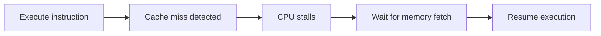
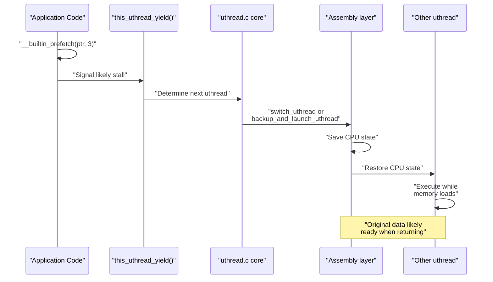
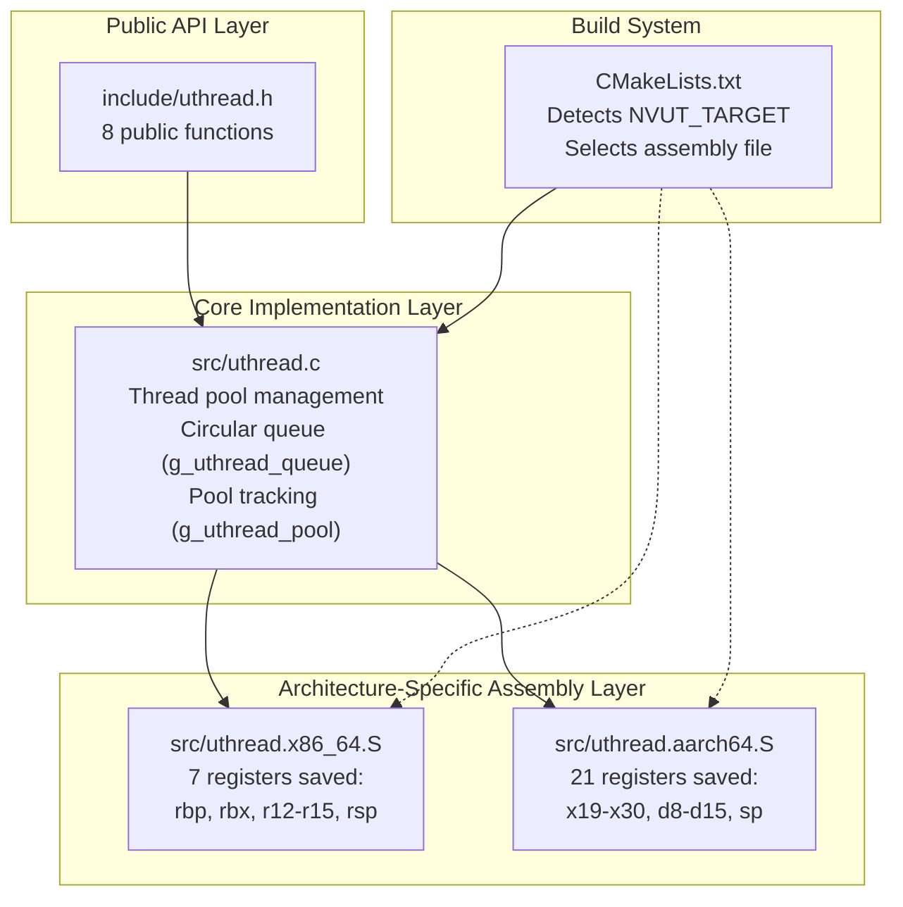
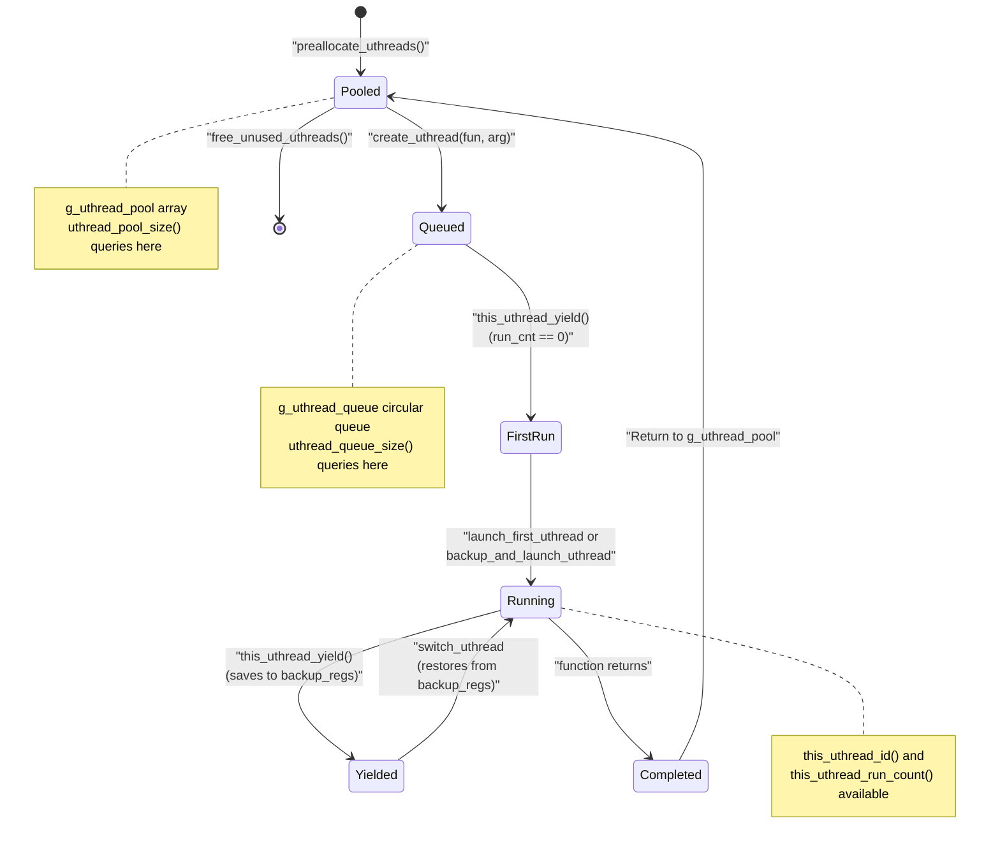
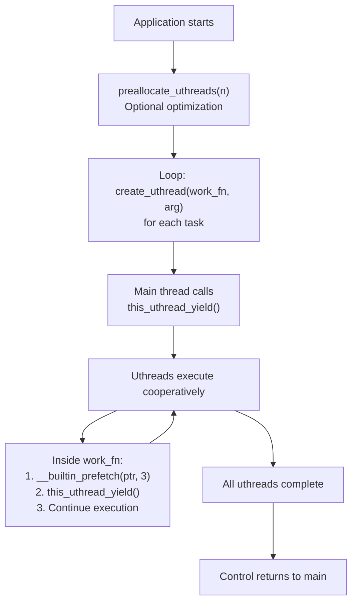

<!-- source: DeepWiki mcp.deepwiki.com · repo NVIDIA/libuthread · page 1 Home · fetched 2026-10-26 -->

# Home

<details>
<summary>Relevant source files</summary>

The following files were used as context for generating this wiki page:

- [NOTICE.md](NOTICE.md)
- [README.md](README.md)

</details>


This page introduces `libuthread`, a minimalist user-level threading library for ARM64 and x86 Linux systems. It explains the fundamental problem the library solves (memory latency hiding), how it accomplishes this through cooperative multitasking, and provides an architectural overview of the system components.

For detailed build instructions, see [Getting Started](#2). For a deep dive into how context switching works, see [Architecture and Implementation](#5). For API documentation, see [API Reference](#4).

## Overview

`libuthread` is a user-level threading library that provides software-controlled thread management and context switching to alleviate low CPU utilization caused by memory access latencies. The library enables individual operating system threads to execute multiple largely independent command sequences in a pseudo-parallel manner, switching between them at points where memory stalls are expected.

The library is implemented in C with architecture-specific assembly code for context switching. It compiles to a static library (`libuthread.a`) and exposes eight public functions through [include/uthread.h:1-100]().

**Key Characteristics:**
- User-level threads managed entirely in user space
- Cooperative scheduling via explicit `this_uthread_yield()` calls
- Minimal context switching overhead (no kernel involvement)
- Architecture-specific implementations for x86_64 and aarch64
- Thread pool and circular queue for efficient memory management

**Sources:** [README.md:1-91]()

## Problem Statement: Memory Latency

Modern processors experience significant performance degradation when accessing data not present in cache. When a cache miss occurs, the CPU stalls while waiting for data to be fetched from main memory—a delay that can span hundreds of CPU cycles. Traditional approaches leave the CPU idle during these stalls, resulting in poor utilization.



The problem is particularly acute for memory-intensive workloads where:
- Data access patterns are irregular
- Working sets exceed cache capacity
- Memory bandwidth is the bottleneck

`libuthread` addresses this by enabling productive work during these memory fetch periods rather than leaving the CPU idle.

**Sources:** [README.md:20-26]()

## Solution Overview: User-Level Threading

`libuthread` solves the memory latency problem by allowing a single OS thread to manage multiple execution contexts (user-level threads or "uthreads"). When a uthread anticipates a cache miss, it issues a prefetch operation and immediately yields control via `this_uthread_yield()`. The library then switches to another uthread, effectively hiding the memory latency behind useful computation.



This approach differs from OS-level threading because:
- **No kernel involvement:** Context switches happen entirely in user space via assembly code
- **Cooperative scheduling:** Threads explicitly yield rather than being preempted
- **Low overhead:** Only essential CPU registers are saved/restored
- **Single OS thread:** All uthreads execute within one OS thread context

The cooperative model means applications must explicitly place yield points, typically after prefetch operations. This gives the application fine-grained control over when context switches occur.

**Sources:** [README.md:22-26]()

## Core Components

The library consists of four main layers that work together to provide user-level threading:



### Public API Layer

[include/uthread.h:1-100]() defines the public interface with eight functions organized into three categories:

| Function | Purpose | Category |
|----------|---------|----------|
| `preallocate_uthreads()` | Pre-allocate thread pool | Resource Management |
| `free_unused_uthreads()` | Release unused threads | Resource Management |
| `uthread_pool_size()` | Query pool capacity | Resource Management |
| `create_uthread()` | Enqueue new thread | Thread Lifecycle |
| `uthread_queue_size()` | Query active threads | Thread Lifecycle |
| `this_uthread_yield()` | Cooperative yield | Execution Control |
| `this_uthread_id()` | Get current thread ID | Execution Control |
| `this_uthread_run_count()` | Get execution count | Execution Control |

### Core Implementation

[src/uthread.c:1-500]() implements thread management using two primary data structures:

- **Thread Pool (`g_uthread_pool`)**: Array of pre-allocated `struct uthread_info` structures for reuse
- **Thread Queue (`g_uthread_queue`)**: Circular queue of active uthreads waiting to execute

The core manages thread state transitions, queue operations, and delegates context switching to the assembly layer.

### Assembly Layer

Architecture-specific assembly files implement low-level context switching:

- **x86_64 ([src/uthread.x86_64.S:1-200]())**: Saves 7 callee-saved registers (rbp, rbx, r12-r15, rsp)
- **aarch64 ([src/uthread.aarch64.S:1-300]())**: Saves 21 registers including floating-point (x19-x30, d8-d15, sp)

Both implementations provide functions like `launch_first_uthread`, `backup_and_launch_uthread`, `switch_uthread`, and `restore_main_thread`.

**Sources:** [README.md:1-91](), Diagram 1 from high-level systems overview

## Execution Model

The library operates through a cooperative scheduling model with explicit yield points:



### Thread States

1. **Pooled**: Thread structure exists in `g_uthread_pool` but is not assigned work
2. **Queued**: Thread assigned a function and arguments, waiting in `g_uthread_queue`
3. **FirstRun**: Special state for threads that have never executed (`run_cnt == 0`)
4. **Running**: Thread actively executing its assigned function
5. **Yielded**: Thread suspended with CPU state saved in `backup_regs`
6. **Completed**: Thread function returned, structure returns to pool

### Context Switch Functions

The assembly layer provides four main context switch primitives:

- **`launch_first_uthread`**: Initial transition from main thread to first uthread
- **`backup_and_launch_uthread`**: Launch a new uthread for the first time (saves current state to `backup_regs`)
- **`switch_uthread`**: Switch between already-running uthreads (swap `backup_regs`)
- **`restore_main_thread`**: Return control to main application thread

These functions are called from [src/uthread.c:1-500]() based on thread state and queue conditions.

**Sources:** [README.md:22-26](), Diagram 2 and Diagram 4 from high-level systems overview

## Typical Usage Pattern

A typical application using `libuthread` follows this pattern:



The key insight is that memory prefetch operations (`__builtin_prefetch(ptr, 3)`) followed immediately by `this_uthread_yield()` allow other uthreads to execute while the prefetched data loads into cache. By the time control returns to the original uthread, the data is typically ready, effectively hiding the memory latency.

**Sources:** [README.md:22-24]()

## Supported Platforms

`libuthread` supports two processor architectures on Linux systems:

| Architecture | Assembly File | Saved Registers | Notes |
|--------------|---------------|-----------------|-------|
| x86_64 | [src/uthread.x86_64.S:1-200]() | 7 (rbp, rbx, r12-r15, rsp) | Callee-saved per System V ABI |
| aarch64 (ARM64) | [src/uthread.aarch64.S:1-300]() | 21 (x19-x30, d8-d15, sp) | Includes floating-point registers |

The build system automatically detects the target architecture through [CMakeLists.txt:1-100]() by querying the compiler with flags like `-print-target-triple` (Clang) or `-print-multiarch` (GCC). The detected architecture is stored in the `NVUT_TARGET` variable and used to select the appropriate assembly file: `uthread.${NVUT_TARGET}.S`.

**Supported Compilers:**
- GCC
- Clang

**Operating Systems:**
- Linux (Ubuntu, Debian, and compatible distributions)

**Sources:** [README.md:29-66](), Diagram 3 from high-level systems overview

## Build Artifacts

The library compiles to a static library:

```
build/libuthread.a
```

This static library can be linked into any application requiring user-level threading capabilities. When tests are enabled (`-DNVUT_BUILD_TESTS=ON`), an additional test executable is built:

```
build/test/basic_tests
```

The test suite uses the Unity testing framework from [third_party/unity:1-100](), linked as a git submodule.

**Sources:** [README.md:46-66]()

## Project Status

The project is **actively maintained** by NVIDIA. It is distributed under the Apache License 2.0, with the Unity testing framework (if used) distributed under the MIT License.

**Sources:** [README.md:69-90](), [NOTICE.md:1-55]()

## Next Steps

To get started with `libuthread`:

- **Building the library:** See [Getting Started](#2) for compilation instructions with different compilers
- **Understanding concepts:** See [Core Concepts](#3) for detailed explanations of memory latency hiding and the threading model
- **Using the API:** See [API Reference](#4) for complete function documentation
- **Understanding implementation:** See [Architecture and Implementation](#5) for deep dives into context switching and assembly code
- **Contributing:** See [Development Guide](#7) for contribution guidelines and code style requirements

---

**Sources:** [README.md:1-91](), [NOTICE.md:1-55]()

---

