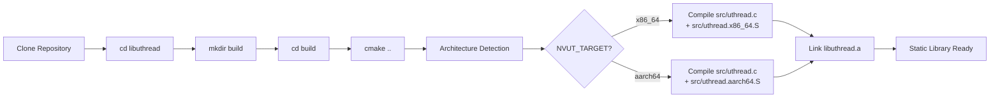
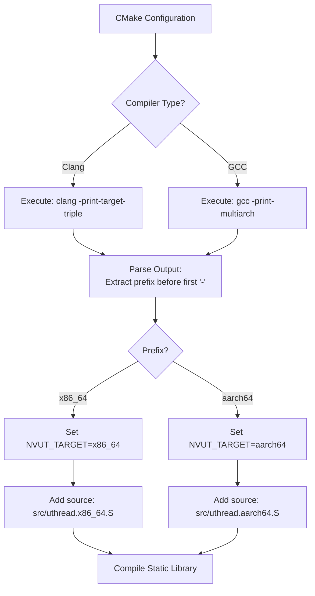
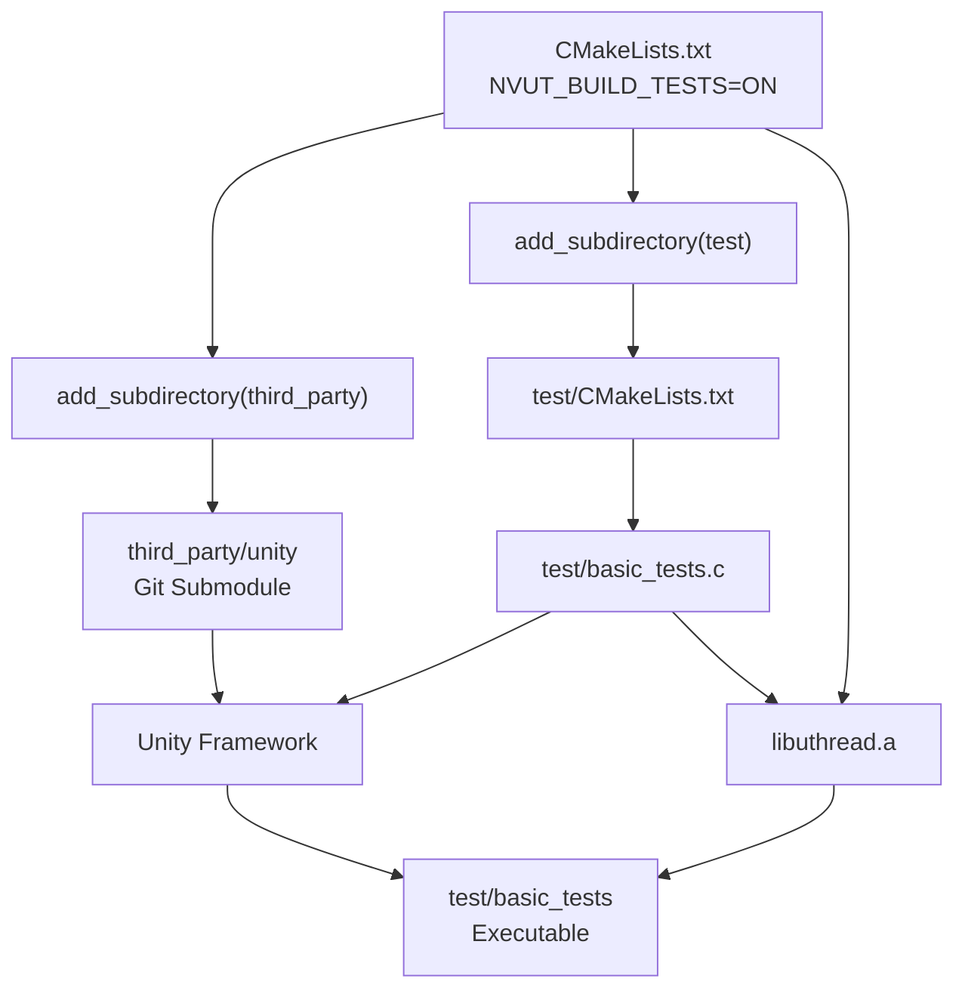

<!-- source: DeepWiki mcp.deepwiki.com · repo NVIDIA/libuthread · page 2 Getting Started · fetched 2026-10-26 -->

# Getting Started

<details>
<summary>Relevant source files</summary>

The following files were used as context for generating this wiki page:

- [CMakeLists.txt](CMakeLists.txt)
- [README.md](README.md)

</details>


This guide provides instructions for building `libuthread` and running your first example. It covers system requirements, building the static library, and verifying the installation. For detailed build configuration options and platform-specific considerations, see [Building the Library](#2.1). For usage patterns and code examples, see [Basic Usage Example](#2.2).

## Overview

The `libuthread` library is distributed as source code and must be compiled on the target platform. The build process uses CMake to automatically detect the target architecture (x86_64 or aarch64) and compile the appropriate assembly implementation. The output is a static library file `libuthread.a` that can be linked into applications.

**Build Requirements:**
- Linux operating system (ARM64 or x86_64)
- CMake 3.13 or later
- C compiler (GCC or Clang)
- Git (for cloning the repository)
- Make

Sources: [README.md:29-66]()

## Quick Start

### Step 1: Install Build Dependencies

For Debian/Ubuntu systems with GCC:

```bash
sudo apt-get update
sudo apt-get install -y make cmake gcc
export CC="gcc"
```

For Debian/Ubuntu systems with Clang:

```bash
sudo apt-get update
sudo apt-get install -y make cmake clang
export CC="clang"
```

The `CC` environment variable specifies which compiler CMake will use. The choice between GCC and Clang does not affect functionality; both compilers are supported.

Sources: [README.md:32-44]()

### Step 2: Clone the Repository

```bash
git clone https://github.com/NVIDIA/libuthread.git
cd libuthread
```

If you plan to build and run tests, initialize the Unity test framework submodule:

```bash
git submodule update --init --recursive
```

The Unity framework is located in `third_party/unity` and is only required if `NVUT_BUILD_TESTS=ON`.

Sources: [README.md:48-59]()

### Step 3: Build the Library

Create a build directory and invoke CMake:

```bash
mkdir -p build
cd build
cmake -DCMAKE_BUILD_TYPE=Release -DNVUT_BUILD_TESTS=OFF ..
make -j
```

This produces `libuthread.a` in the build directory. The `-DNVUT_BUILD_TESTS=OFF` flag disables test compilation for faster builds.

**Build Process Diagram:**



Sources: [README.md:46-54](), [CMakeLists.txt:16-43]()

## Architecture Detection

CMake automatically detects the target architecture by querying the compiler. The detection logic differs based on compiler type:

| Compiler | Detection Command | Output Format |
|----------|------------------|---------------|
| Clang | `clang -print-target-triple` | `x86_64-pc-linux-gnu` or `aarch64-unknown-linux-gnu` |
| GCC | `gcc -print-multiarch` | `x86_64-linux-gnu` or `aarch64-linux-gnu` |

The CMake script extracts the architecture prefix from this output and stores it in the `NVUT_TARGET` variable, which determines which assembly file to compile.

**Architecture Selection Logic:**



Sources: [CMakeLists.txt:22-34]()

## Build Output Structure

After a successful build, the directory structure looks like this:

```
libuthread/
├── build/
│   ├── libuthread.a              # Static library output
│   ├── CMakeCache.txt            # CMake configuration cache
│   └── CMakeFiles/               # Build system internals
├── include/
│   └── uthread.h                 # Public API header
├── src/
│   ├── uthread.c                 # Core implementation
│   ├── uthread.x86_64.S          # x86_64 assembly
│   └── uthread.aarch64.S         # ARM64 assembly
└── CMakeLists.txt                # Build configuration
```

The key output file is `build/libuthread.a`, which contains compiled code from:
- [src/uthread.c]() - Thread pool management and queue logic
- [src/uthread.x86_64.S]() or [src/uthread.aarch64.S]() - Context switching routines

Sources: [CMakeLists.txt:39-43]()

## Verification

### Option 1: Build and Run Tests

To verify the build with included unit tests:

```bash
cd libuthread
mkdir -p build
cd build
cmake -DCMAKE_BUILD_TYPE=Release -DNVUT_BUILD_TESTS=ON ..
make -j
test/basic_tests
```

The test executable runs validation tests for thread creation, yielding, and context switching. Successful output indicates the library is functioning correctly.

**Test Build Dependencies:**



Sources: [README.md:56-66](), [CMakeLists.txt:45-48]()

### Option 2: Integrate into Application

To use `libuthread` in your own application:

1. Include the header: `#include <uthread.h>`
2. Link against the static library: `gcc myapp.c -Ilibuthread/include -Llibuthread/build -luthread -o myapp`
3. Call `create_uthread()` to enqueue work and `this_uthread_yield()` to enable context switching

A minimal integration looks like:

```c
#include <uthread.h>

void worker(void* arg) {
    // Your work here
    this_uthread_yield();
}

int main() {
    preallocate_uthreads(10);
    create_uthread(worker, NULL);
    this_uthread_yield();  // Start execution
    return 0;
}
```

For complete examples with memory latency hiding patterns, see [Basic Usage Example](#2.2).

Sources: [README.md:18-27]()

## Configuration Options

The build system provides the following CMake options:

| Option | Default | Description |
|--------|---------|-------------|
| `NVUT_BUILD_TESTS` | `ON` | Enable compilation of test suite |
| `CMAKE_BUILD_TYPE` | Debug | Build configuration (Debug/Release/RelWithDebInfo) |

Additional compiler flags are set in [CMakeLists.txt:20]():
- `-Wall` - Enable all warnings
- `-Wextra` - Enable extra warnings
- `-Wconversion` - Warn on implicit type conversions

To customize the build:

```bash
cmake -DCMAKE_BUILD_TYPE=Debug \
      -DNVUT_BUILD_TESTS=OFF \
      -DCMAKE_C_FLAGS="-O3" \
      ..
```

Sources: [CMakeLists.txt:16-37]()

## Next Steps

After successfully building `libuthread`, proceed to:

- **[Building the Library](#2.1)** - Detailed platform-specific build instructions and troubleshooting
- **[Basic Usage Example](#2.2)** - Complete code examples demonstrating latency hiding patterns
- **[Core Concepts](#3)** - Understand the threading model and design principles
- **[API Reference](#4)** - Comprehensive documentation of all public functions

For contribution guidelines and development workflows, see [Development Guide](#7).

Sources: [README.md:1-91]()

---

