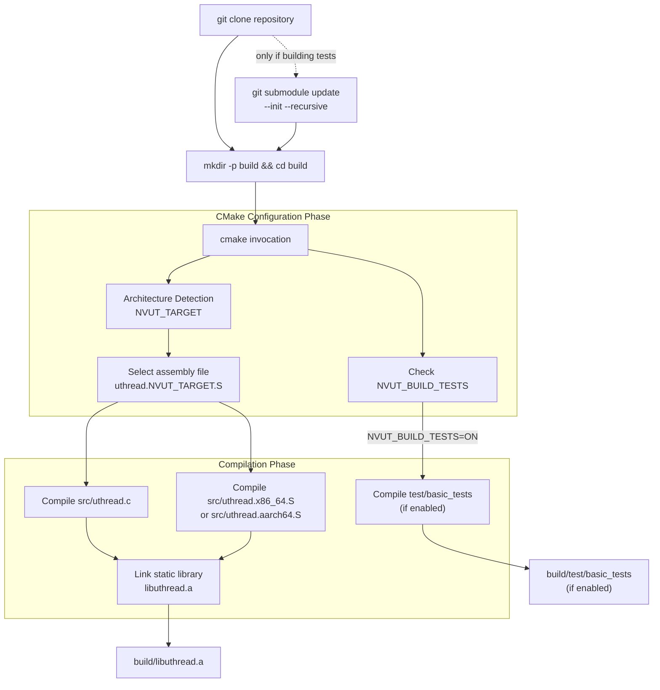
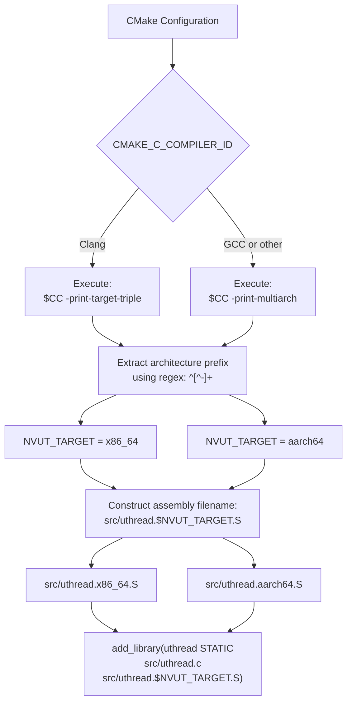

<!-- source: DeepWiki mcp.deepwiki.com · repo NVIDIA/libuthread · page 2.1 Building the Library · fetched 2026-10-26 -->

# Building the Library

<details>
<summary>Relevant source files</summary>

The following files were used as context for generating this wiki page:

- [CMakeLists.txt](CMakeLists.txt)
- [README.md](README.md)

</details>


## Purpose and Scope

This page provides detailed instructions for compiling libuthread from source on Linux systems (ARM64 and x86_64). It covers prerequisite installation, build configurations, and the CMake-based build process. For information about the internal build system architecture and how CMake selects platform-specific assembly files, see [Build System Architecture](#6.1). For instructions on running tests after building, see [Unit Tests](#6.2).

## Prerequisites

libuthread requires a C compiler (GCC or Clang), CMake, and Make. The library supports both x86_64 and aarch64 architectures and automatically detects the target platform during configuration.

### Debian/Ubuntu Systems

| Compiler | Required Packages | Environment Setup |
|----------|------------------|-------------------|
| GCC | `make`, `cmake`, `gcc` | `export CC="gcc"` |
| Clang | `make`, `cmake`, `clang` | `export CC="clang"` |

**Installation Commands:**

For GCC:
```bash
sudo apt-get update
sudo apt-get install -y make cmake gcc
export CC="gcc"
```

For Clang:
```bash
sudo apt-get update
sudo apt-get install -y make cmake clang
export CC="clang"
```

**Sources:** [README.md:32-44]()

## Build Process Overview

The following diagram illustrates the complete build workflow from repository cloning to library compilation:



**Sources:** [README.md:29-66](), [CMakeLists.txt:16-48]()

## Building Without Tests

This configuration produces only the static library `libuthread.a` without compiling the test suite. This is the minimal build suitable for integration into other projects.

### Build Commands

```bash
git clone https://github.com/NVIDIA/libuthread
cd libuthread
mkdir -p build
cd build
cmake -DCMAKE_BUILD_TYPE=Release -DNVUT_BUILD_TESTS=OFF ..
make -j
```

### Configuration Options

| CMake Variable | Value | Effect |
|----------------|-------|--------|
| `CMAKE_BUILD_TYPE` | `Release` | Enables compiler optimizations |
| `NVUT_BUILD_TESTS` | `OFF` | Excludes test compilation |

The resulting library will be located at `build/libuthread.a`.

**Sources:** [README.md:46-54]()

## Building With Tests

This configuration compiles both the library and the unit test suite. It requires the Unity testing framework, which is included as a git submodule.

### Build Commands

```bash
git clone https://github.com/NVIDIA/libuthread
cd libuthread
git submodule update --init --recursive
mkdir -p build
cd build
cmake -DCMAKE_BUILD_TYPE=Release -DNVUT_BUILD_TESTS=ON ..
make -j
test/basic_tests
```

### Important Notes

1. **Submodule Initialization**: The `git submodule update --init --recursive` command is **required** when building with tests, as it fetches the Unity framework from [third_party/unity]().

2. **Test Execution**: After building, run `test/basic_tests` from the build directory to execute the unit test suite.

### Configuration Options

| CMake Variable | Value | Effect |
|----------------|-------|--------|
| `CMAKE_BUILD_TYPE` | `Release` | Enables compiler optimizations |
| `NVUT_BUILD_TESTS` | `ON` | Includes test compilation |

**Sources:** [README.md:56-66](), [CMakeLists.txt:36-48]()

## Architecture Detection Mechanism

CMake automatically detects the target architecture by querying the C compiler. This detection determines which assembly implementation file is compiled into the library.



### Detection Logic

The detection mechanism is implemented in [CMakeLists.txt:22-34]():

1. **Compiler Type Check**: CMake checks if the compiler is Clang or assumes GCC otherwise
2. **Query Execution**: 
   - Clang: Uses `-print-target-triple` flag
   - GCC: Uses `-print-multiarch` flag
3. **Output Parsing**: Extracts the architecture prefix using regex pattern `^[^-]+`
4. **Variable Assignment**: Sets `NVUT_TARGET` to either `x86_64` or `aarch64`

### Target-Specific Assembly Files

| Architecture | NVUT_TARGET | Assembly File | Register Count |
|-------------|-------------|---------------|----------------|
| x86_64 | `x86_64` | [src/uthread.x86_64.S]() | 7 registers saved |
| ARM64 | `aarch64` | [src/uthread.aarch64.S]() | 21 registers saved (including FP) |

The selected assembly file is then passed to `add_library()` at [CMakeLists.txt:43]().

**Sources:** [CMakeLists.txt:22-43]()

## Compiler Flags and Build Configuration

The build system applies strict warning flags to ensure code quality:

```cmake
set(CMAKE_C_FLAGS "${CMAKE_C_FLAGS} -Wall -Wextra -Wconversion")
```

| Flag | Purpose |
|------|---------|
| `-Wall` | Enable all common warnings |
| `-Wextra` | Enable additional warnings beyond `-Wall` |
| `-Wconversion` | Warn about implicit type conversions that may alter values |

These flags are set at [CMakeLists.txt:20]() and apply to all C source files.

**Sources:** [CMakeLists.txt:20]()

## Build Outputs

After successful compilation, the following artifacts are generated:

### Library Build (NVUT_BUILD_TESTS=OFF)

```
build/
└── libuthread.a          # Static library
```

### Library + Tests Build (NVUT_BUILD_TESTS=ON)

```
build/
├── libuthread.a          # Static library
└── test/
    └── basic_tests       # Test executable
```

### Integration with Other Projects

To use `libuthread.a` in another CMake project:

```cmake
# In your CMakeLists.txt
add_library(uthread STATIC IMPORTED)
set_target_properties(uthread PROPERTIES
    IMPORTED_LOCATION "/path/to/libuthread/build/libuthread.a"
)
target_include_directories(your_target PRIVATE /path/to/libuthread/include)
target_link_libraries(your_target PRIVATE uthread)
```

The public API is exposed through [include/uthread.h](), which should be added to your project's include path.

**Sources:** [CMakeLists.txt:39-48](), [README.md:46-66]()

## Troubleshooting Common Build Issues

### Issue: "Architecture not detected"

**Symptom**: CMake fails during configuration with an error about `NVUT_TARGET`.

**Cause**: The compiler does not support `-print-target-triple` (Clang) or `-print-multiarch` (GCC).

**Solution**: Verify your compiler installation:
```bash
$CC --version
$CC -print-target-triple  # For Clang
$CC -print-multiarch      # For GCC
```

### Issue: "git submodule is empty"

**Symptom**: Build fails when `NVUT_BUILD_TESTS=ON` with missing Unity framework files.

**Cause**: Submodules were not initialized.

**Solution**: Run `git submodule update --init --recursive` before building.

### Issue: "No such file or directory: src/uthread.<arch>.S"

**Symptom**: Compilation fails because the assembly file is not found.

**Cause**: Either the architecture is not supported, or the file naming doesn't match.

**Solution**: Verify that [src/uthread.x86_64.S]() or [src/uthread.aarch64.S]() exists for your target architecture. Currently, only x86_64 and aarch64 are supported.

**Sources:** [README.md:29-66](), [CMakeLists.txt:22-43]()

---

