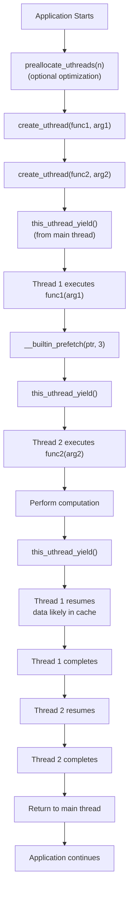
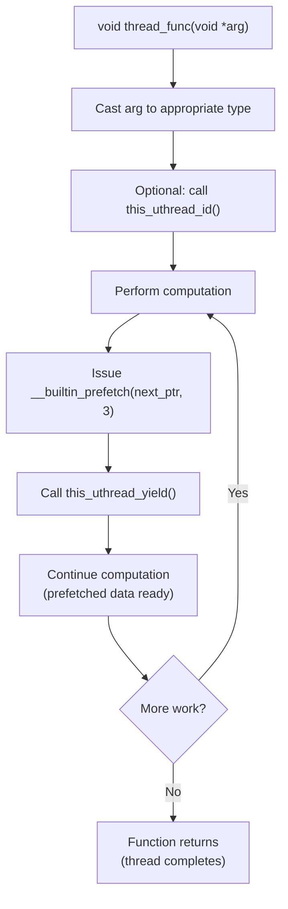
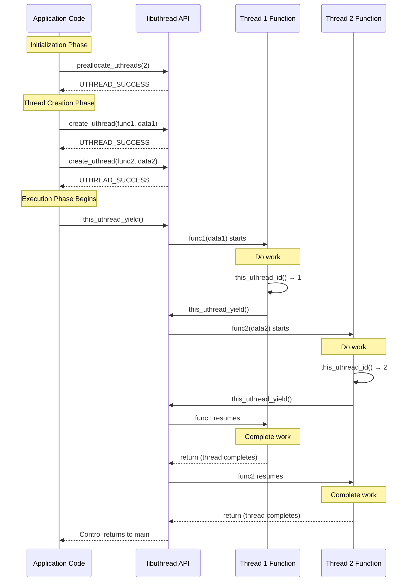
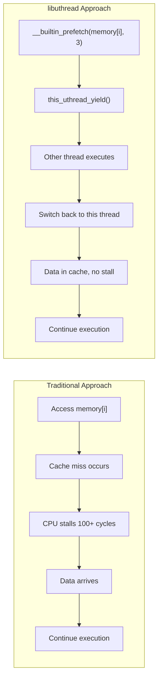
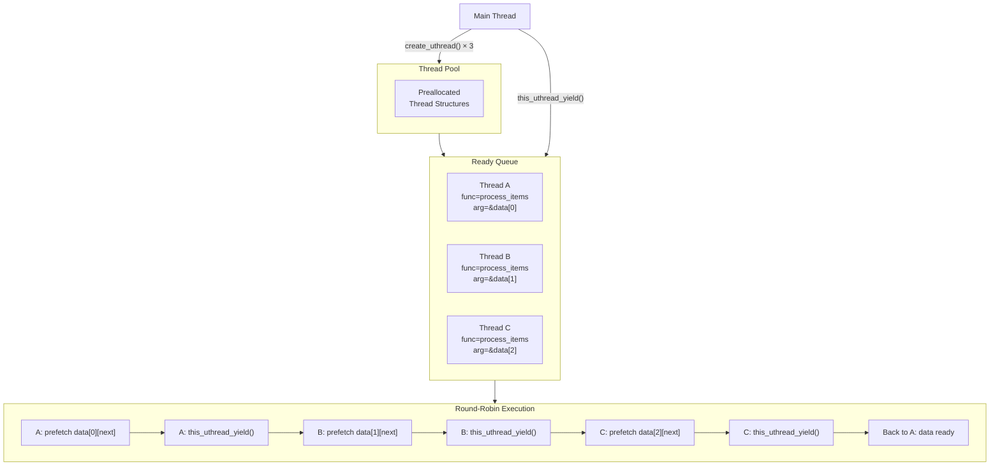
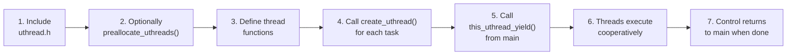

<!-- source: DeepWiki mcp.deepwiki.com · repo NVIDIA/libuthread · page 2.2 Basic Usage Example · fetched 2026-10-26 -->

# Basic Usage Example

<details>
<summary>Relevant source files</summary>

The following files were used as context for generating this wiki page:

- [README.md](README.md)
- [include/uthread.h](include/uthread.h)

</details>


## Purpose and Scope

This page demonstrates the minimal code patterns required to use libuthread for hiding memory latencies through cooperative multitasking. It shows how to create user-level threads, yield control between them, and leverage prefetch operations to hide cache miss latencies. For detailed explanations of the underlying concepts, see [Memory Latency Hiding](#3.1) and [User-Level Threading Model](#3.2). For comprehensive API documentation, see [API Reference](#4).

---

## Core API Functions

The following functions from [include/uthread.h:27-48]() form the minimal API surface needed for basic usage:

| Function | Purpose | Return Type |
|----------|---------|-------------|
| `create_uthread(fun, arg)` | Enqueue a new thread with function and argument | `uthread_status_t` |
| `this_uthread_yield()` | Yield control to another thread | `void` |
| `preallocate_uthreads(n)` | Pre-allocate thread pool structures | `uthread_status_t` |
| `this_uthread_id()` | Query current thread's unique identifier | `size_t` |
| `this_uthread_run_count()` | Query how many times current thread has executed | `size_t` |

The return type `uthread_status_t` [include/uthread.h:29-32]() indicates success (`UTHREAD_SUCCESS`) or allocation failure (`UTHREAD_ERROR_ALLOC`).

**Sources:** [include/uthread.h:27-48](), [README.md:20-26]()

---

## Basic Execution Flow

The following diagram illustrates the minimal execution pattern for using libuthread:



**Sources:** [README.md:22-26](), [include/uthread.h:40-48]()

---

## Thread Function Structure

Each user-level thread executes a function with the signature defined by `uthread_fun_t` [include/uthread.h:27](). The typical pattern for a thread function is:



Key characteristics of thread functions:
- Accept a single `void *` argument [include/uthread.h:27]()
- Can call `this_uthread_yield()` at any point to cooperatively yield [include/uthread.h:48]()
- Should issue prefetch operations before yielding to hide latencies
- Automatically return to the pool when the function returns
- Can query their own ID via `this_uthread_id()` [include/uthread.h:44]()

**Sources:** [include/uthread.h:27](), [include/uthread.h:44-48](), [README.md:24]()

---

## Thread Creation and Execution Pattern

The following sequence diagram shows the interaction between application code and the libuthread API:



**Critical points:**
1. **Thread creation** via `create_uthread()` [include/uthread.h:40]() enqueues threads but does not execute them immediately
2. **First yield from main** triggers the context switch into user-level thread execution
3. **Subsequent yields** rotate between active threads in the queue
4. **Thread completion** (function return) automatically removes the thread from the queue and returns it to the pool

**Sources:** [include/uthread.h:36-48](), [README.md:22-24]()

---

## Memory Latency Hiding Pattern

The primary use case for libuthread is hiding memory access latencies. The recommended pattern is:



**Implementation pattern:**
1. Identify a memory access that may cause a cache miss
2. Issue a prefetch operation using compiler intrinsics (e.g., `__builtin_prefetch(ptr, 3)` for write-intent prefetch)
3. Immediately call `this_uthread_yield()` [include/uthread.h:48]()
4. The library switches to another thread, allowing productive work during the memory fetch
5. When control returns, the prefetched data is typically available in cache

This pattern transforms idle stall cycles into productive computation, increasing overall throughput without creating additional OS threads.

**Sources:** [README.md:23-26](), [include/uthread.h:48]()

---

## Multiple Thread Coordination Example

The following diagram shows how three threads coordinate through the yield mechanism:



In this pattern:
- Each thread processes different data segments
- Each thread prefetches the next item in its segment
- Yields happen immediately after prefetch
- By the time control returns, the prefetched data is likely in cache
- The queue size can be monitored via `uthread_queue_size()` [include/uthread.h:42]()

**Sources:** [include/uthread.h:40-42](), [README.md:22-24]()

---

## Error Handling

All functions that can fail return `uthread_status_t` [include/uthread.h:29-32]():

| Status Code | Value | Meaning |
|-------------|-------|---------|
| `UTHREAD_SUCCESS` | 0 | Operation completed successfully |
| `UTHREAD_ERROR_ALLOC` | 1 | Memory allocation failed |

**Functions requiring error checks:**
- `preallocate_uthreads(n)` [include/uthread.h:36]() - may fail if malloc fails
- `create_uthread(fun, arg)` [include/uthread.h:40]() - may fail if no pool threads exist and malloc fails
- `free_unused_uthreads()` [include/uthread.h:38]() - returns status for consistency

**Pattern for error handling:**
```
uthread_status_t status = preallocate_uthreads(10);
if (status != UTHREAD_SUCCESS) {
    // Handle allocation failure
}

status = create_uthread(my_function, my_arg);
if (status != UTHREAD_SUCCESS) {
    // Handle thread creation failure
}
```

Functions that cannot fail:
- `this_uthread_yield()` [include/uthread.h:48]() - returns `void`
- `this_uthread_id()` [include/uthread.h:44]() - always returns valid ID
- `this_uthread_run_count()` [include/uthread.h:46]() - always returns valid count
- `uthread_pool_size()` [include/uthread.h:34]() - query function
- `uthread_queue_size()` [include/uthread.h:42]() - query function

**Sources:** [include/uthread.h:29-48]()

---

## Summary of Basic Usage Steps



This minimal pattern enables latency hiding on both x86_64 and ARM64 Linux systems. For advanced patterns and optimization techniques, see [Thread State Machine](#5.4) and [Context Switching Mechanism](#5.1).

**Sources:** [include/uthread.h:18-54](), [README.md:18-26]()

---

