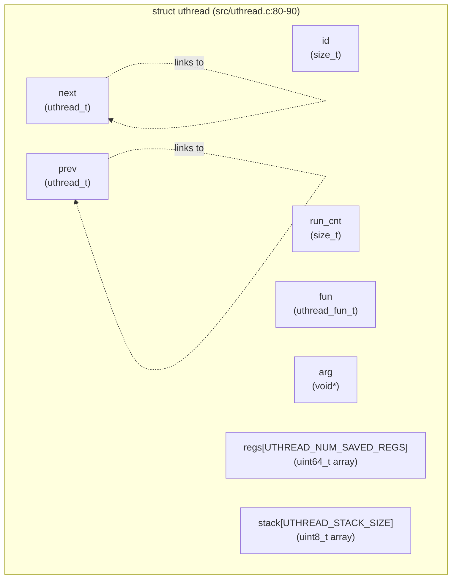
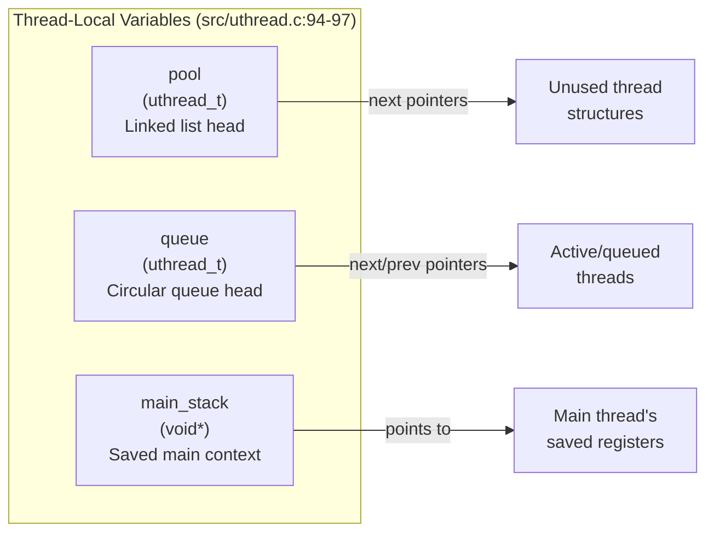
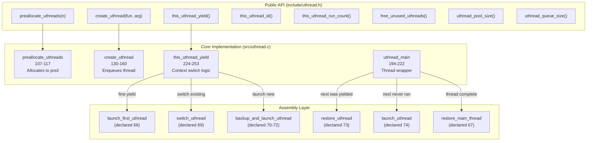
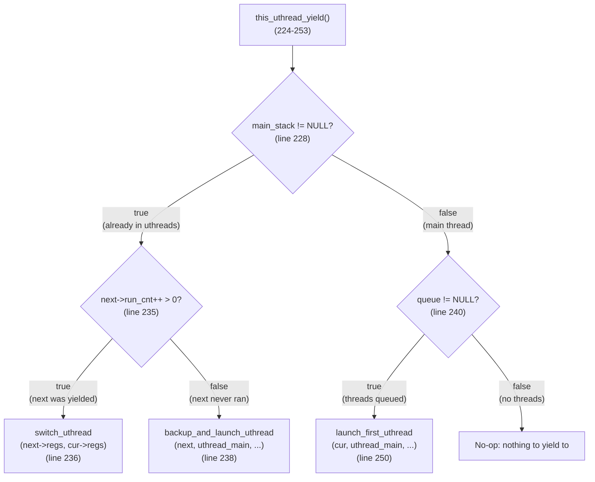
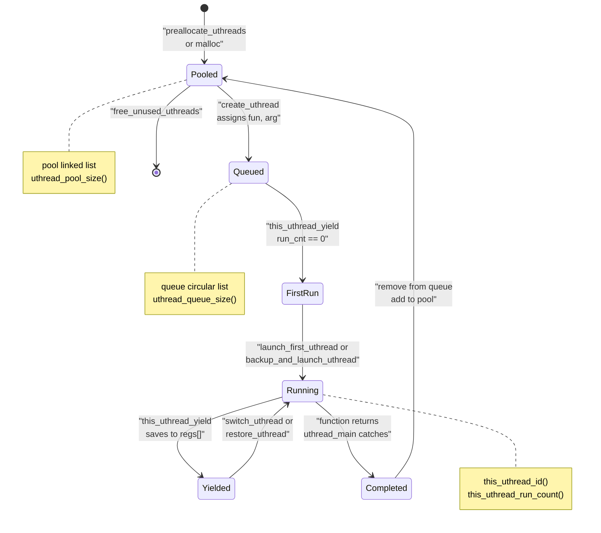
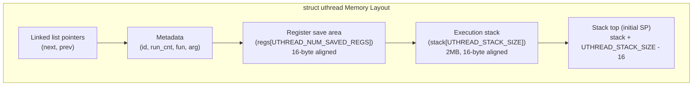

<!-- source: DeepWiki mcp.deepwiki.com · repo NVIDIA/libuthread · page 3 Core Concepts · fetched 2026-10-26 -->

# Core Concepts

Relevant source files

The following files were used as context for generating this wiki page:

- [README.md](README.md)
- [src/uthread.c](src/uthread.c)

This page provides an overview of the fundamental design principles and mechanisms that enable libuthread to hide memory latencies through user-level cooperative multitasking. It introduces the key data structures, execution flow, and architectural decisions that underpin the library's operation.

For detailed explanations of specific mechanisms, see:
- [Memory Latency Hiding](#3.1) for the latency hiding strategy
- [User-Level Threading Model](#3.2) for cooperative scheduling details
- [Thread Pool and Queue Management](#3.3) for internal data structure management

---

## Overview

libuthread implements a **cooperative user-level threading system** that operates entirely in userspace without kernel involvement. The library enables a single OS thread to manage multiple execution contexts (uthreads) and switch between them at explicit yield points. This design serves one primary purpose: **hiding memory access latencies** by switching to productive work while waiting for cache misses to resolve.

The system consists of three main components:

| Component | Implementation | Purpose |
|-----------|---------------|---------|
| **Thread Contexts** | `struct uthread` in [src/uthread.c:80-90]() | Storage for saved registers, stack, and metadata |
| **Thread Management** | Pool and queue via thread-local variables in [src/uthread.c:94-97]() | Lifecycle management and scheduling |
| **Context Switching** | Assembly routines in `src/uthread.x86_64.S` and `src/uthread.aarch64.S` | Low-level register save/restore operations |

Sources: [src/uthread.c:80-90](), [src/uthread.c:94-97](), [README.md:18-26]()

---

## Key Data Structures

### Thread Context: `struct uthread`

The `struct uthread` type encapsulates all state needed to suspend and resume a uthread's execution:

**Architecture-Specific Register Counts**

| Architecture | Macro | Value | Registers Saved |
|--------------|-------|-------|-----------------|
| x86_64 | `UTHREAD_NUM_SAVED_REGS` ([src/uthread.c:40]()) | 7 | rbx, rsp, rbp, r12, r13, r14, r15 |
| aarch64 | `UTHREAD_NUM_SAVED_REGS` ([src/uthread.c:51]()) | 21 | d8-d15 (FP), sp, x19-x30 (GP) |

The `run_cnt` field tracks whether a thread has ever executed (`run_cnt == 0` means first run), which determines the context switch mechanism used. The `regs` array stores callee-saved registers according to the platform ABI.

Sources: [src/uthread.c:80-90](), [src/uthread.c:35-54]()

---

## Thread-Local State Management

libuthread maintains three critical thread-local variables that coordinate all uthread operations:

| Variable | Type | Scope | Purpose |
|----------|------|-------|---------|
| `pool` | `uthread_t` | `__thread` static | Head of singly-linked list of unused threads |
| `queue` | `uthread_t` | `__thread` static | Head of circular doubly-linked list of active threads |
| `main_stack` | `void*` | `__thread` static | Pointer to main thread's saved register state |
| `next_uthread_id` | `size_t` | `__thread` static | Monotonic ID generator for new threads |

The `__thread` storage class ensures each OS thread has its own independent set of uthreads, enabling thread-safe operation in multi-threaded programs.

Sources: [src/uthread.c:94-97]()

---

## Execution Flow and Function Dispatch

### Main API Functions

The following diagram maps user-visible API functions to their internal implementations:

Sources: [src/uthread.c:66-78](), [src/uthread.c:107-253]()

### Context Switch Decision Tree

The `this_uthread_yield()` function implements a decision tree that selects the appropriate context switch mechanism:

**Key Invariants:**
- `main_stack == NULL` indicates execution is in the main thread context
- `run_cnt == 0` indicates a thread has never executed, requiring initial stack setup
- `run_cnt > 0` indicates saved register state exists in `regs[]` array

Sources: [src/uthread.c:224-253]()

---

## Context Switch Mechanics

### Register Preservation Requirements

Each architecture defines which registers must be preserved across context switches according to its calling convention:

**x86_64 Callee-Saved Registers** ([src/uthread.c:36-40]()):
- General-purpose: `rbx`, `rbp`, `r12`, `r13`, `r14`, `r15`
- Stack pointer: `rsp`

**aarch64 Callee-Saved Registers** ([src/uthread.c:42-51]()):
- Floating-point: `d8`-`d15` (8 registers)
- General-purpose: `x19`-`x30` (12 registers)
- Stack pointer: `sp`

The assembly routines manipulate these registers directly to perform context switches without OS kernel involvement.

Sources: [src/uthread.c:35-54]()

### Assembly Function Roles

| Function | Declared | Purpose |
|----------|----------|---------|
| `launch_first_uthread` | [src/uthread.c:66]() | First entry into uthread context, saves main thread state |
| `switch_uthread` | [src/uthread.c:69]() | Switch between two yielded threads with saved state |
| `backup_and_launch_uthread` | [src/uthread.c:70-72]() | Save current thread, launch a new thread for first time |
| `restore_uthread` | [src/uthread.c:73]() | Restore a yielded thread's registers and resume |
| `launch_uthread` | [src/uthread.c:74]() | Launch a new thread without saving current state |
| `restore_main_thread` | [src/uthread.c:67]() | Return to main thread context when all uthreads complete |

These functions are implemented in architecture-specific assembly files (`src/uthread.x86_64.S` and `src/uthread.aarch64.S`) but declared as external C functions for type safety.

Sources: [src/uthread.c:66-78]()

---

## Cooperative Scheduling Model

libuthread uses **explicit cooperative scheduling**: threads only switch at `this_uthread_yield()` call sites. This has several implications:

| Aspect | Behavior |
|--------|----------|
| **Preemption** | None - threads run until they explicitly yield |
| **Fairness** | Round-robin when all threads yield regularly |
| **Starvation** | Possible if a thread never yields |
| **Performance** | Minimal overhead - no timer interrupts or kernel scheduling |
| **Debugging** | Deterministic execution order simplifies reasoning |

The typical usage pattern is:

1. Issue memory prefetch: `__builtin_prefetch(ptr, 3)`
2. Immediately yield: `this_uthread_yield()`
3. Other threads execute while memory loads
4. Eventually return when data is ready

This pattern is most effective when:
- Memory access patterns are predictable enough for prefetching
- Multiple independent work items exist to switch between
- Cache miss latencies dominate execution time

Sources: [README.md:18-26]()

---

## Thread Lifecycle Summary

The complete lifecycle of a uthread involves transitions through these conceptual states:

**State Transitions:**
- **Pooled → Queued**: [src/uthread.c:130-160]() - `create_uthread()` retrieves from pool or allocates
- **Queued → Running**: [src/uthread.c:224-253]() - `this_uthread_yield()` initiates execution
- **Running → Yielded**: [src/uthread.c:224-253]() - `this_uthread_yield()` saves state
- **Running → Completed**: [src/uthread.c:194-222]() - `uthread_main()` wrapper catches return
- **Completed → Pooled**: [src/uthread.c:203-208]() - Thread removed from queue, added to pool

The pool and queue structures enable efficient memory reuse without frequent allocation/deallocation.

Sources: [src/uthread.c:130-160](), [src/uthread.c:194-253]()

---

## Memory Layout

Each `struct uthread` contains a fixed-size stack allocated inline within the structure:

**Constants** ([src/uthread.c:55]()):
- `UTHREAD_STACK_SIZE = 1 << 21` (2,097,152 bytes = 2 MB)
- Stack pointer initialized via `stack_of()` helper ([src/uthread.c:92]()): returns `&thr->stack[UTHREAD_STACK_SIZE - 16]`

The 16-byte alignment ensures compatibility with SIMD instructions and ABI requirements. The stack grows downward from the high address returned by `stack_of()`.

Sources: [src/uthread.c:55](), [src/uthread.c:80-92]()

---

## Design Principles

libuthread's architecture embodies several key design decisions:

| Principle | Rationale | Trade-off |
|-----------|-----------|-----------|
| **User-level only** | Avoid kernel context switch overhead | No preemption or time-slicing |
| **Cooperative scheduling** | Predictable switching points | Application must place yields correctly |
| **Fixed-size stacks** | Simple allocation, no overflow detection | 2MB per thread may waste memory |
| **Thread-local storage** | Each OS thread has independent uthreads | No cross-thread uthread migration |
| **Inline stacks** | Better cache locality | Large structure size (2MB+) |
| **Circular queue** | Constant-time round-robin | More complex pointer management |
| **Pool recycling** | Minimize malloc/free calls | Memory held for process lifetime |

These choices optimize for the target use case: hiding memory latencies in compute-intensive workloads where explicit yield points can be strategically placed after prefetch operations.

Sources: [src/uthread.c:80-90](), [README.md:18-26]()

---

