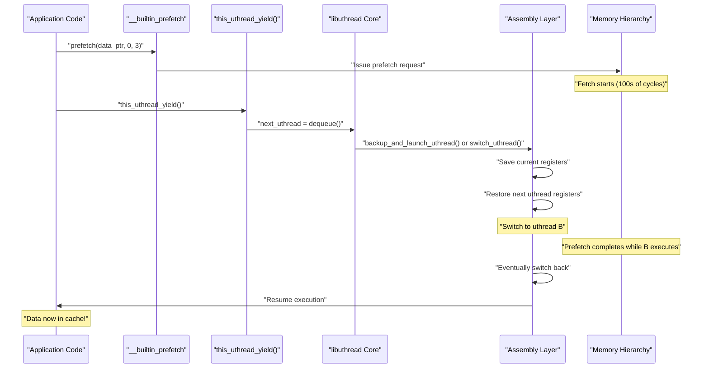
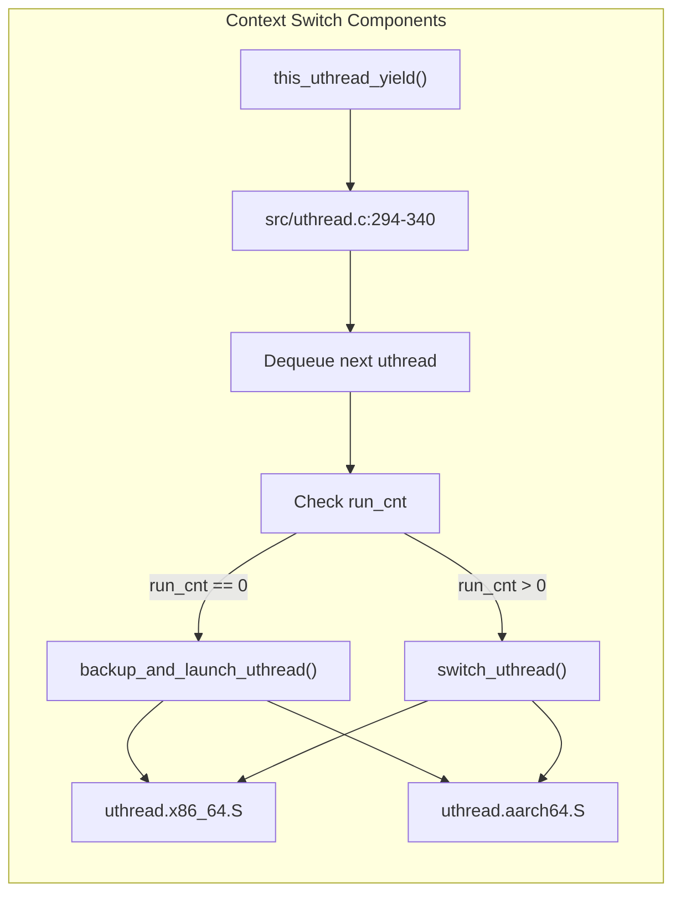

<!-- source: DeepWiki mcp.deepwiki.com · repo NVIDIA/libuthread · page 3.1 Memory Latency Hiding · fetched 2026-10-26 -->

# Memory Latency Hiding

<details>
<summary>Relevant source files</summary>

The following files were used as context for generating this wiki page:

- [README.md](README.md)

</details>


## Purpose and Scope

This document explains how libuthread hides memory access latencies through cooperative multitasking and context switching. It covers the fundamental problem of CPU idle time during cache misses, the prefetch-and-yield pattern that applications use to signal potential stalls, and the internal mechanisms that enable switching execution to other work while waiting for memory operations to complete.

For information about the broader user-level threading model and cooperative scheduling principles, see [User-Level Threading Model](#3.2). For implementation details about how context switching is performed at the assembly level, see [Context Switching Mechanism](#5.1).

---

## The Memory Latency Problem

Modern CPUs execute instructions significantly faster than memory systems can supply data. When a CPU needs data that is not in cache (a cache miss), it must fetch the data from main memory, which can take hundreds of CPU cycles. During this time, the CPU remains idle waiting for the memory operation to complete, resulting in poor utilization.

| Memory Level | Typical Latency | Relative Speed |
|--------------|----------------|----------------|
| L1 Cache | ~4 cycles | 1x |
| L2 Cache | ~12 cycles | 3x |
| L3 Cache | ~40 cycles | 10x |
| Main Memory (DRAM) | ~200-300 cycles | 50-75x |

This problem is particularly acute in memory-intensive workloads such as:
- Large data structure traversal (linked lists, trees, graphs)
- Random memory access patterns
- Data streaming and processing pipelines
- Hash table lookups with poor locality

The traditional single-threaded execution model leaves the CPU completely idle during these memory stalls, wasting cycles that could be spent on productive work.

**Sources:** [README.md:20-26]()

---

## Traditional Latency Hiding Approaches

### Software Prefetching

Compilers and programmers can use prefetch instructions to request data before it is actually needed:

```c
__builtin_prefetch(ptr, 0, 3);  // Read prefetch with high temporal locality
__builtin_prefetch(ptr, 1, 3);  // Write prefetch with high temporal locality
```

However, this approach has limitations:
- The CPU still stalls when it reaches the actual memory access if the prefetch hasn't completed
- Prefetching too early wastes cache capacity on data that won't be used immediately
- Prefetching too late doesn't hide the full latency

### OS-Level Multithreading

Operating systems can schedule multiple threads to share CPU time, switching to another thread when one blocks on I/O or memory. However, OS thread switching has significant overheads:
- Context switch requires kernel mode transition (~1000s of cycles)
- Thread metadata management (scheduler, TLB flushes)
- Limited control over when switches occur

**Sources:** [README.md:20-26]()

---

## The libuthread Solution

libuthread enables applications to explicitly indicate potential memory stalls and immediately switch to other work within the same OS thread. This eliminates OS scheduling overhead while providing fine-grained control over when context switches occur.

The key insight is that applications often know when cache misses are likely to occur. By combining software prefetch operations with an explicit yield primitive, applications can:

1. Issue a prefetch for data that will be needed soon
2. Immediately yield control to other work
3. Let other command sequences execute while the memory fetch completes
4. Resume execution when scheduled again, with data likely already in cache

This approach achieves the throughput benefits of multithreading without the overhead of OS thread management.

```mermaid
graph TB
    subgraph Traditional["Traditional: CPU Idle During Miss"]
        T1["Execute instruction"]
        T2["Cache miss detected"]
        T3["CPU waits for memory"]
        T4["Data arrives"]
        T5["Continue execution"]
        T1 --> T2
        T2 --> T3
        T3 --> T4
        T4 --> T5
    end
    
    subgraph Uthread["libuthread: Switch to Other Work"]
        U1["Execute instruction"]
        U2["Detect likely miss"]
        U3["__builtin_prefetch()"]
        U4["this_uthread_yield()"]
        U5["Switch to uthread B"]
        U6["Uthread B executes"]
        U7["Switch back to uthread A"]
        U8["Data ready in cache"]
        U9["Continue execution"]
        U1 --> U2
        U2 --> U3
        U3 --> U4
        U4 --> U5
        U5 --> U6
        U6 --> U7
        U7 --> U8
        U8 --> U9
    end
```



**Diagram: Comparison of Traditional vs libuthread Latency Hiding**

**Sources:** [README.md:20-26]()

---

## Prefetch and Yield Pattern

The fundamental pattern for hiding memory latencies with libuthread involves three steps:

### Step 1: Issue Prefetch Operations

Applications use compiler intrinsics to request data that will be needed soon:

```c
// Prefetch for read access with high temporal locality
__builtin_prefetch(ptr, 0, 3);

// Prefetch the next element in a traversal
__builtin_prefetch(node->next, 0, 3);
```

The prefetch operation is non-blocking—it initiates the memory fetch but doesn't wait for completion.

### Step 2: Yield Execution

Immediately after issuing prefetches, the application calls the yield primitive:

```c
this_uthread_yield();
```

This function is defined in [include/uthread.h:97-102]() and implemented in [src/uthread.c:294-340](). When called, it signals to libuthread that this is a good opportunity to switch to another command sequence.

### Step 3: Resume When Ready

libuthread switches to another enqueued uthread. When control eventually returns to the original uthread (after one or more round-robin passes through the queue), the prefetched data is typically already available in cache, eliminating or significantly reducing the memory stall.



**Diagram: Prefetch and Yield Execution Flow**

**Sources:** [README.md:22-24](), [include/uthread.h:97-102](), [src/uthread.c:294-340]()

---

## Context Switching Mechanics

When `this_uthread_yield()` is called, libuthread performs a lightweight context switch entirely in user space. This involves:

### Register State Management

The current CPU register state is saved to the current uthread's context structure, and the next uthread's register state is restored. The number of registers saved depends on the architecture:

| Architecture | Registers Saved | Files |
|--------------|----------------|-------|
| x86_64 | 7 registers (RBX, RBP, R12-R15, RSP) | [src/uthread.x86_64.S]() |
| ARM64 | 21 registers (X19-X30, SP, D8-D15) | [src/uthread.aarch64.S]() |

### Stack Switching

Each uthread maintains its own execution stack. During a context switch, the stack pointer is saved and the new uthread's stack pointer is restored, allowing execution to continue from where the uthread previously yielded.

### First-Run vs Resume

libuthread distinguishes between two types of context switches:

1. **First-run**: When a uthread executes for the first time (`run_cnt == 0`), special assembly functions like `launch_first_uthread` or `backup_and_launch_uthread` are used to initialize its stack and begin execution at the function pointer provided to `create_uthread()`.

2. **Resume**: When switching between already-running uthreads, `switch_uthread` is used to simply save/restore register state and continue from the previous yield point.



**Diagram: Context Switch Code Path**

The core implementation in [src/uthread.c:294-340]() determines which assembly function to invoke:

- `launch_first_uthread` for the first yield from the main thread
- `backup_and_launch_uthread` for launching a new uthread from another uthread
- `switch_uthread` for switching between executing uthreads

**Sources:** [src/uthread.c:294-340](), [src/uthread.x86_64.S](), [src/uthread.aarch64.S]()

---

## Performance Characteristics

### Latency Hiding Efficiency

The effectiveness of memory latency hiding depends on several factors:

1. **Memory access patterns**: Random access patterns with poor spatial locality benefit most
2. **Number of uthreads**: More uthreads provide more opportunities to hide individual latencies
3. **Work between yields**: Sufficient computation must occur in other uthreads to cover the memory latency
4. **Context switch overhead**: libuthread's user-space switching (~10-50 cycles) is negligible compared to memory latency (~200-300 cycles)

### Optimal Usage Pattern

Best results are achieved when:
- Each uthread performs substantial work between yield points (avoiding excessive switching overhead)
- Prefetch operations target data that will be used after other uthreads complete their work
- Multiple uthreads are enqueued to maximize latency hiding opportunities
- Yield points are placed immediately after prefetch operations

### Comparison to Alternatives

| Approach | Context Switch Cost | Latency Hiding | Control Granularity |
|----------|-------------------|----------------|---------------------|
| Single-threaded | None | None | N/A |
| OS threads | ~1000s of cycles | Good | Coarse (kernel scheduler) |
| libuthread | ~10-50 cycles | Good | Fine (explicit yields) |

The low overhead of user-space context switching makes it feasible to switch much more frequently than with OS threads, enabling fine-grained latency hiding.

**Sources:** [README.md:20-26]()

---

## Integration with Application Code

Applications integrate latency hiding by restructuring memory-intensive operations to use the prefetch-and-yield pattern:

### Before: Traditional Sequential Access

```c
// Without libuthread: CPU idles during cache misses
for (Node *n = head; n != NULL; n = n->next) {
    process(n->data);  // Potential cache miss causes stall
}
```

### After: Latency Hiding with libuthread

```c
// With libuthread: overlap computation with memory fetches
void traverse_with_prefetch(void *arg) {
    Node *n = (Node *)arg;
    while (n != NULL) {
        // Prefetch next node before accessing current
        if (n->next) {
            __builtin_prefetch(n->next, 0, 3);
            __builtin_prefetch(&n->next->data, 0, 3);
        }
        
        // Yield to allow other work while prefetch completes
        this_uthread_yield();
        
        // By now, data is likely in cache
        process(n->data);
        
        n = n->next;
    }
}

// Create uthreads for different traversal starting points
for (int i = 0; i < num_lists; i++) {
    create_uthread(traverse_with_prefetch, list_heads[i]);
}
```

The application explicitly indicates where memory stalls are likely and cooperatively yields control, allowing libuthread to efficiently overlap computation with memory operations.

**Sources:** [README.md:22-24](), [include/uthread.h:97-102]()

---

