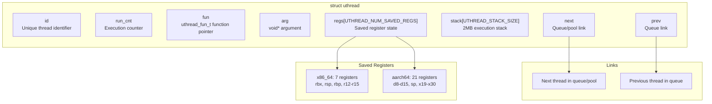
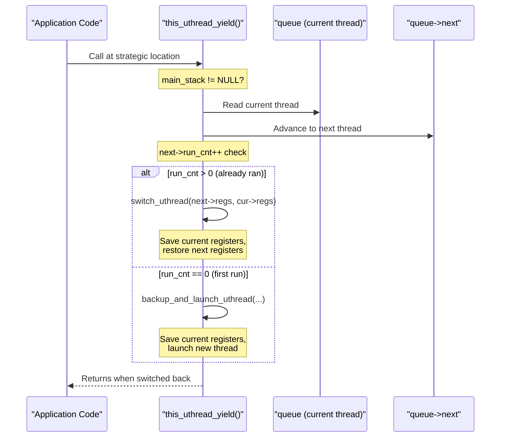
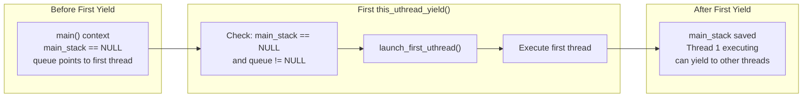
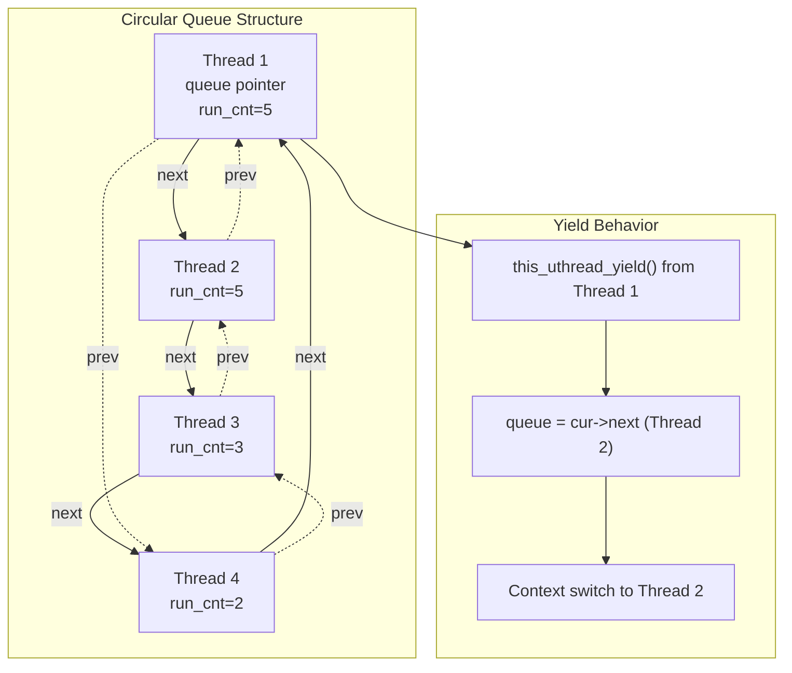
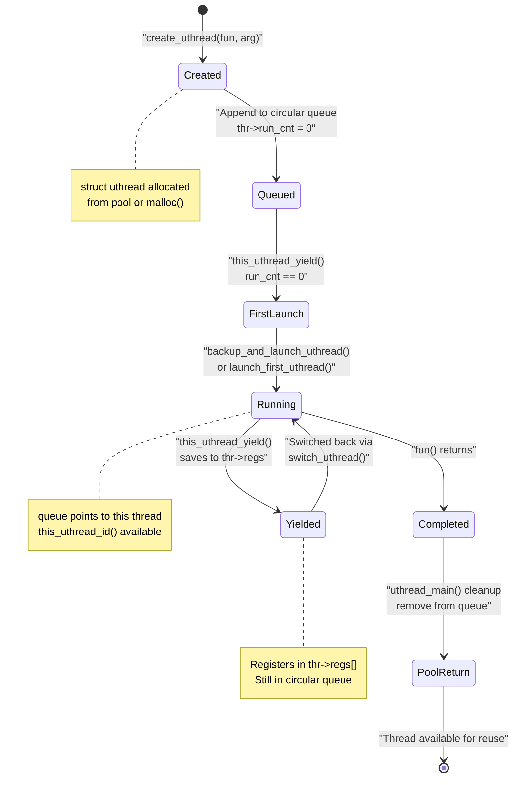
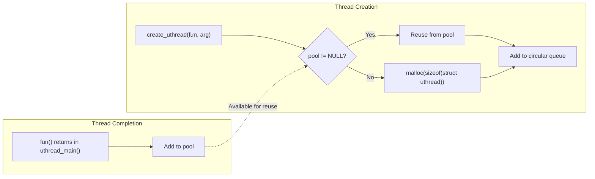
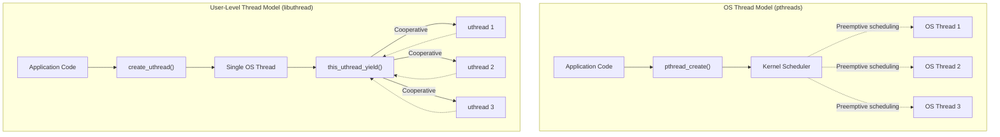

<!-- source: DeepWiki mcp.deepwiki.com · repo NVIDIA/libuthread · page 3.2 User-Level Threading Model · fetched 2026-10-26 -->

# User-Level Threading Model

Relevant source files

The following files were used as context for generating this wiki page:

- [README.md](README.md)
- [src/uthread.c](src/uthread.c)

## Purpose and Scope

This page describes the user-level threading model employed by libuthread, explaining how it differs from traditional operating system threads and why cooperative scheduling is used. For information about how threads hide memory latencies, see [Memory Latency Hiding](#3.1). For details on the internal thread pool and queue data structures, see [Thread Pool and Queue Management](#3.3). For implementation details of context switching, see [Context Switching Mechanism](#5.1).

---

## User-Level vs Kernel-Level Threading

User-level threads (uthreads) are managed entirely in user space without kernel involvement, contrasting with traditional OS threads that require kernel scheduling.

### Comparison Table

| Aspect | Kernel Threads (pthreads) | User-Level Threads (uthreads) |
|--------|---------------------------|-------------------------------|
| **Scheduling** | Preemptive (kernel scheduler) | Cooperative (explicit `this_uthread_yield()`) |
| **Context Switch** | Kernel mode transition (expensive) | User-space register save/restore (cheap) |
| **State Storage** | Kernel thread control block | `struct uthread` in user memory |
| **Stack Management** | Kernel-allocated stack | `uint8_t stack[UTHREAD_STACK_SIZE]` per thread |
| **Creation Overhead** | System call (`clone()`) | Memory allocation or pool reuse |
| **Visibility** | OS scheduler sees threads | Single OS thread executes all uthreads |

### The `struct uthread` Data Structure

Each user-level thread is represented by a `struct uthread` [src/uthread.c:80-90]() which contains all state necessary to suspend and resume execution:

**Sources:** [src/uthread.c:80-90](), [src/uthread.c:35-54]()

---

## Cooperative Scheduling Model

Unlike preemptive kernel threads that can be interrupted at any time, uthreads use **cooperative scheduling** where threads explicitly yield control by calling `this_uthread_yield()`.

### Yield Points

The application programmer must explicitly insert yield points at locations where context switching is beneficial:

**Sources:** [src/uthread.c:224-253](), [src/uthread.c:66-74]()

### First Yield: Entering uthread Processing

The first call to `this_uthread_yield()` from the main application context transitions from normal execution into uthread processing [src/uthread.c:240-251]():

The `main_stack` variable [src/uthread.c:97]() is a critical sentinel value that distinguishes between "not yet entered uthread processing" (`main_stack == NULL`) and "inside uthread processing" (`main_stack != NULL`).

**Sources:** [src/uthread.c:224-253](), [src/uthread.c:97](), [src/uthread.c:66]()

---

## Round-Robin Execution Model

Uthreads execute in a circular queue pattern, where each yield advances to the next thread:

### Queue Management Implementation

The `queue` variable [src/uthread.c:96]() is a thread-local pointer that always points to the currently executing uthread. When `this_uthread_yield()` is called:

1. `cur = queue` — get current thread
2. `next = cur->next` — get next thread in circular list
3. `queue = next` — update to new current thread
4. Perform context switch (either `switch_uthread()` or `backup_and_launch_uthread()`)

**Sources:** [src/uthread.c:224-239](), [src/uthread.c:96]()

---

## Thread Lifecycle in the User-Level Model

Each uthread transitions through states entirely in user space:

### The `uthread_main()` Wrapper

Every uthread executes inside the `uthread_main()` wrapper function [src/uthread.c:194-222]() which:

1. Calls the user-provided function: `self->fun(self->arg)`
2. Removes the thread from the queue upon completion
3. Returns the thread to the pool for reuse
4. Either launches the next thread or returns to the main application context

**Sources:** [src/uthread.c:194-222](), [src/uthread.c:130-160]()

---

## Benefits of User-Level Threading

### Performance Advantages

| Benefit | Explanation | Code Evidence |
|---------|-------------|---------------|
| **Fast Context Switching** | No kernel involvement; only register save/restore | Assembly functions in [src/uthread.x86_64.S](), [src/uthread.aarch64.S]() |
| **No Syscall Overhead** | Thread creation via `malloc()` or pool reuse | [src/uthread.c:107-117](), [src/uthread.c:130-160]() |
| **Memory Efficiency** | All threads share OS thread's resources | Single OS thread executes all uthreads |
| **Predictable Scheduling** | Explicit yield points prevent race conditions | Deterministic round-robin via [src/uthread.c:234]() |

### Thread Pool Optimization

The thread pool [src/uthread.c:95]() enables thread structure reuse, avoiding repeated allocations:

**Sources:** [src/uthread.c:130-160](), [src/uthread.c:95](), [src/uthread.c:203-208]()

---

## Programming Model Constraints

### Explicit Yield Requirement

Developers must manually insert `this_uthread_yield()` calls at appropriate locations. The library provides no automatic yielding or time-slicing:

- **Latency Hiding**: Call after issuing prefetch operations [README.md:24]()
- **Fairness**: Ensure all threads get execution time periodically
- **Deadlock Prevention**: Avoid infinite loops without yield points

### Thread-Local Storage

Critical state variables use `__thread` storage class [src/uthread.c:94-97]():

- `next_uthread_id` — monotonically increasing ID counter
- `pool` — head of free thread pool
- `queue` — current executing uthread
- `main_stack` — saved main application context

This ensures each OS thread has independent uthread management, preventing conflicts in multi-threaded applications.

**Sources:** [src/uthread.c:94-97]()

---

## Comparison with OS Thread Model

### Key Architectural Differences

1. **Scheduling Authority**: Kernel decides in pthread model; application decides in uthread model
2. **Isolation**: OS threads have separate kernel structures; uthreads share a single OS thread
3. **Synchronization**: OS threads need mutexes/locks; uthreads have deterministic execution order
4. **Debugging**: OS threads visible in debuggers; uthreads appear as single thread with custom stack

**Sources:** [README.md:18-26](), [src/uthread.c:80-90]()

---

## Integration with Application Code

### Introspection Functions

The user-level model exposes thread identity and state through functions that query the `queue` pointer:

- `this_uthread_id()` [src/uthread.c:174-182]() — returns `queue->id`
- `this_uthread_run_count()` [src/uthread.c:184-192]() — returns `queue->run_cnt`
- `uthread_queue_size()` [src/uthread.c:162-172]() — counts threads in circular queue

These functions return zero or fail if called outside uthread context (when `queue == NULL`).

### State Query Example

| Function | Returns When | Code Reference |
|----------|--------------|----------------|
| `this_uthread_id()` | Inside uthread | [src/uthread.c:174-182]() |
| `this_uthread_id()` | Outside uthread | Returns `0` with debug message |
| `this_uthread_run_count()` | Inside uthread | [src/uthread.c:184-192]() |
| `uthread_queue_size()` | Anytime | [src/uthread.c:162-172]() |
| `uthread_pool_size()` | Anytime | [src/uthread.c:99-105]() |

**Sources:** [src/uthread.c:174-192](), [src/uthread.c:162-172](), [src/uthread.c:99-105]()

---

## Summary

The user-level threading model in libuthread provides:

- **Cooperative scheduling** via explicit `this_uthread_yield()` calls
- **Fast context switches** performed entirely in user space without kernel involvement
- **Memory efficiency** through thread pool reuse and single OS thread execution
- **Predictable execution** with deterministic round-robin scheduling
- **Simple programming model** requiring only yield point insertion

This design enables efficient memory latency hiding by allowing rapid switching between independent command sequences within a single OS thread, avoiding the overhead of kernel thread management.

**Sources:** [README.md:18-26](), [src/uthread.c:80-253]()

---

