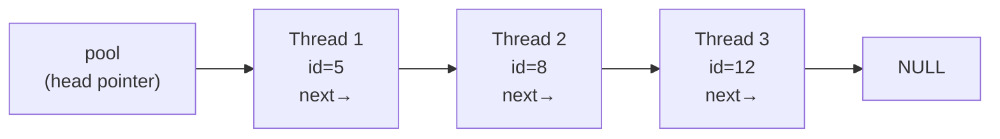
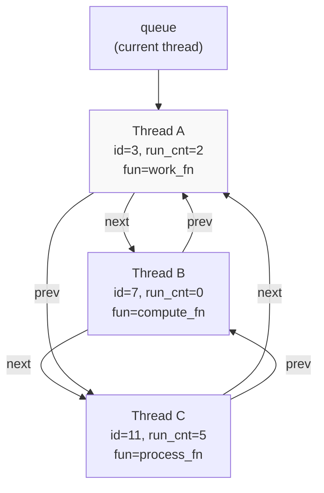
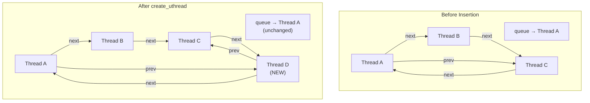
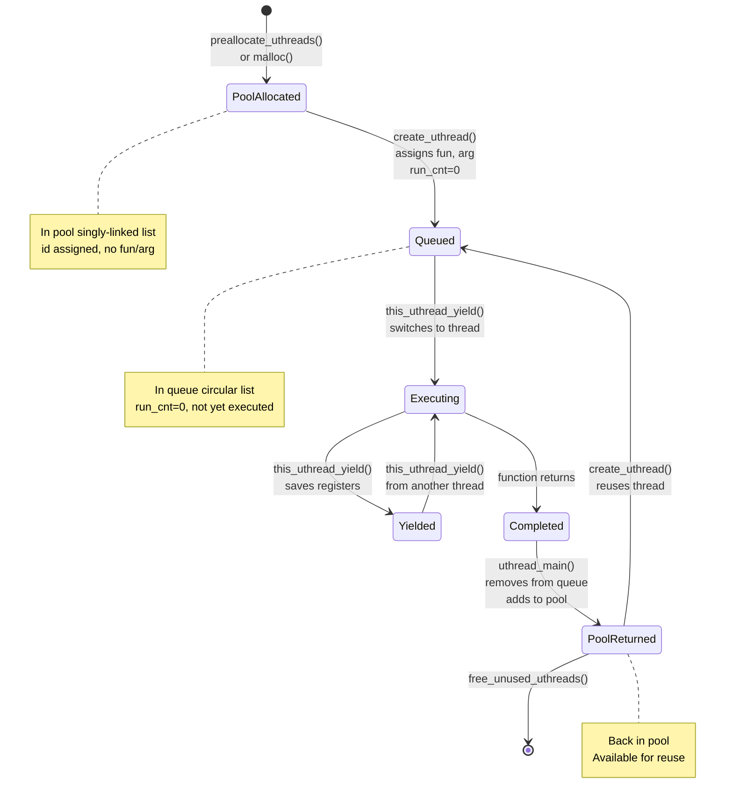
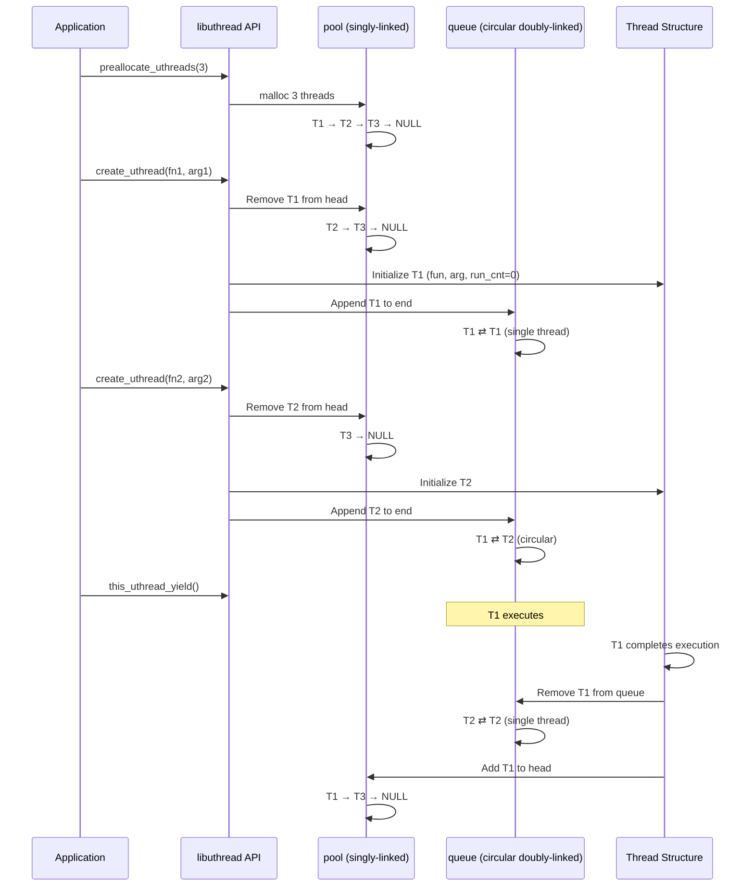

<!-- source: DeepWiki mcp.deepwiki.com · repo NVIDIA/libuthread · page 3.3 Thread Pool and Queue Management · fetched 2026-10-26 -->

# Thread Pool and Queue Management

<details>
<summary>Relevant source files</summary>

The following files were used as context for generating this wiki page:

- [include/uthread.h](include/uthread.h)
- [src/uthread.c](src/uthread.c)

</details>


## Purpose and Scope

This document explains the internal data structures used by libuthread to manage thread contexts efficiently. It covers the **thread pool** (a cache of unused thread structures) and the **ready queue** (a circular doubly-linked list of threads waiting to execute). This page focuses on the memory management and data structure aspects of thread management.

For information about how threads transition between execution states, see [Thread State Machine](#5.4). For details on context switching mechanisms, see [Context Switching Mechanism](#5.1). For the public API functions that interact with these structures, see [Resource Management Functions](#4.1) and [Thread Lifecycle Functions](#4.2).

---

## Data Structures Overview

### Thread Context Structure

The `struct uthread` defined in [src/uthread.c:80-90]() contains all state necessary to represent a user-level thread:

```c
struct uthread {
  uthread_t next, prev;           // List pointers
  size_t id;                      // Unique thread identifier
  size_t run_cnt;                 // Execution count
  uthread_fun_t fun;              // Thread function
  void *arg;                      // Function argument
  uint64_t regs[UTHREAD_NUM_SAVED_REGS];  // Saved register state
  uint8_t stack[UTHREAD_STACK_SIZE];      // Thread stack
};
```

| Field | Purpose | Size |
|-------|---------|------|
| `next`, `prev` | Pointers for linked list structures | 16 bytes |
| `id` | Unique identifier assigned at allocation | 8 bytes |
| `run_cnt` | Number of times thread has executed (0 = never run) | 8 bytes |
| `fun`, `arg` | Function pointer and argument for thread entry point | 16 bytes |
| `regs` | Saved register state (7 regs on x86_64, 21 on ARM64) | 56-168 bytes |
| `stack` | Thread's execution stack (2 MB by default) | 2,097,152 bytes |

**Sources:** [src/uthread.c:80-90]()

### Thread-Local State Variables

The implementation maintains four thread-local static variables in [src/uthread.c:94-97]():

| Variable | Type | Purpose |
|----------|------|---------|
| `next_uthread_id` | `size_t` | Counter for assigning unique thread IDs |
| `pool` | `uthread_t` | Head pointer to singly-linked list of unused threads |
| `queue` | `uthread_t` | Head pointer to circular doubly-linked list of active threads |
| `main_stack` | `void*` | Saved stack pointer for the main application thread |

**Sources:** [src/uthread.c:94-97]()

---

## Thread Pool Architecture

The thread pool is a **singly-linked list** of unused thread structures maintained to avoid repeated allocation overhead. Threads in the pool have their `id` assigned but are not configured with function pointers or execution state.

### Pool Structure Diagram



**Diagram: Singly-linked list structure of the thread pool**

**Sources:** [src/uthread.c:94-97](), [src/uthread.c:99-105]()

### Preallocation

The `preallocate_uthreads(size_t n)` function in [src/uthread.c:107-117]() creates `n` thread structures and adds them to the pool:

```c
for (size_t i = 0; i < n; ++i) {
  uthread_t thr = (uthread_t)malloc(sizeof(*thr));
  if (!thr) return UTHREAD_ERROR_ALLOC;
  thr->id = next_uthread_id++;
  thr->next = pool;
  pool = thr;
}
```

Threads are prepended to the pool (constant-time insertion). Each thread receives a unique `id` from the `next_uthread_id` counter.

**Sources:** [src/uthread.c:107-117]()

### Allocation on Demand

When `create_uthread()` is called in [src/uthread.c:130-160](), it first attempts to reuse a thread from the pool:

```c
if (pool) {
  thr = pool;
  pool = thr->next;
} else {
  thr = (uthread_t)malloc(sizeof(*thr));
  if (!thr) return UTHREAD_ERROR_ALLOC;
  thr->id = next_uthread_id++;
}
```

This two-tier approach optimizes for the common case where threads can be recycled, while falling back to dynamic allocation when the pool is empty.

**Sources:** [src/uthread.c:130-160]()

### Pool Size Query

The `uthread_pool_size()` function in [src/uthread.c:99-105]() traverses the singly-linked list to count available threads:

```c
size_t n = 0;
for (uthread_t thr = pool; thr; thr = thr->next) {
  ++n;
}
return n;
```

**Time Complexity:** O(n) where n is the number of threads in the pool.

**Sources:** [src/uthread.c:99-105]()

### Freeing the Pool

The `free_unused_uthreads()` function in [src/uthread.c:119-128]() deallocates all threads in the pool:

```c
uthread_t thr = pool;
while (thr) {
  uthread_t next = thr->next;
  free(thr);
  thr = next;
}
pool = NULL;
```

This releases memory for threads that are no longer needed. It does **not** affect threads currently in the queue.

**Sources:** [src/uthread.c:119-128]()

---

## Ready Queue Architecture

The ready queue is a **circular doubly-linked list** of threads waiting to execute. The `queue` pointer always points to the currently executing thread (or the next thread to execute).

### Queue Structure Diagram



**Diagram: Circular doubly-linked list structure of the ready queue. The queue pointer always references the current thread.**

**Sources:** [src/uthread.c:94-97](), [src/uthread.c:162-172]()

### Adding Threads to Queue

When `create_uthread(uthread_fun_t fun, void *arg)` is called in [src/uthread.c:130-160](), it appends the thread to the **end** of the queue:

```c
// Get thread from pool or allocate
uthread_t thr = /* ... */;

// Append to end of circular list
uthread_t beg = queue, end;
if (beg) {
  end = beg->prev;      // End is the previous of head
  end->next = thr;      // Link end to new thread
  beg->prev = thr;      // Update head's prev to new thread
} else {
  beg = thr;            // First thread in queue
  end = thr;
  queue = thr;
}
thr->next = beg;        // New thread's next points to head
thr->prev = end;        // New thread's prev points to old end
```

This maintains a circular structure where:
- `queue->prev` always points to the **last** thread
- `queue->next` points to the **second** thread (or itself if only one thread)

**Sources:** [src/uthread.c:130-160]()

### Queue Insertion Flow Diagram



**Diagram: Thread insertion flow - new threads are appended to the end of the circular list**

**Sources:** [src/uthread.c:130-160]()

### Queue Size Query

The `uthread_queue_size()` function in [src/uthread.c:162-172]() traverses the circular list to count active threads:

```c
uthread_t beg = queue;
if (!beg) return 0;

uthread_t end = beg->prev;
size_t n = 1;
for (uthread_t thr = beg; thr != end; thr = thr->next) {
  ++n;
}
return n;
```

The traversal starts at `queue` and continues until it reaches `queue->prev` (the last thread), counting all threads in between.

**Time Complexity:** O(n) where n is the number of threads in the queue.

**Sources:** [src/uthread.c:162-172]()

### Removing Threads from Queue

When a thread completes execution in `uthread_main()` in [src/uthread.c:194-222](), it removes itself from the queue and returns to the pool:

```c
void uthread_main(uthread_t self) {
  assert(self && self == queue);
  self->fun(self->arg);           // Execute thread function
  
  uthread_t prev = self->prev;
  uthread_t next = self->next;
  
  // Remove from circular list
  prev->next = next;
  next->prev = prev;
  
  // Add to pool
  self->next = pool;
  pool = self;
  
  // Update queue pointer
  if (next != self) {             // Not the last thread
    queue = next;
    // Continue execution with next thread
  } else {                        // Last thread
    queue = NULL;
    restore_main_thread(&main_stack);
  }
}
```

**Sources:** [src/uthread.c:194-222]()

---

## Thread Lifecycle Through Pool and Queue

The following diagram illustrates how threads move between the pool and queue throughout their lifecycle:



**Diagram: Thread lifecycle showing transitions between pool and queue**

**Sources:** [src/uthread.c:107-117](), [src/uthread.c:130-160](), [src/uthread.c:194-222]()

---

## Pool and Queue Interaction Flow



**Diagram: Interaction between pool and queue during thread creation and completion**

**Sources:** [src/uthread.c:107-117](), [src/uthread.c:130-160](), [src/uthread.c:194-222]()

---

## Implementation Details

### Thread ID Assignment

Thread IDs are assigned sequentially from the thread-local `next_uthread_id` counter in [src/uthread.c:94]():

- IDs start at 1 (initialized at line 94)
- IDs are assigned when a thread is allocated (either in `preallocate_uthreads()` or `create_uthread()`)
- IDs persist even when threads are recycled through the pool
- Each thread keeps its original ID throughout all reuses

**Sources:** [src/uthread.c:94](), [src/uthread.c:107-117](), [src/uthread.c:130-160]()

### Run Count Tracking

The `run_cnt` field in [src/uthread.c:84]() tracks how many times a thread has been executed:

- Initialized to 0 when a thread is added to the queue in [src/uthread.c:156]()
- Incremented before each context switch in [src/uthread.c:213](), [src/uthread.c:235](), and [src/uthread.c:242]()
- Used to determine whether to call `launch_uthread()` (first execution) or `restore_uthread()` (subsequent executions)

**Sources:** [src/uthread.c:84](), [src/uthread.c:156](), [src/uthread.c:213-217](), [src/uthread.c:235-239]()

### Queue Head Management

The `queue` pointer always references the **currently executing thread** or the **next thread to execute**:

- Set during thread creation in [src/uthread.c:150]() (when queue was empty)
- Updated during thread switching in [src/uthread.c:234]() (`queue = next`)
- Updated when a thread completes in [src/uthread.c:212]() (`queue = next`) or set to NULL in [src/uthread.c:219]() (last thread)

This invariant ensures that `this_uthread_id()` and `this_uthread_run_count()` can always dereference `queue` to get the current thread's information.

**Sources:** [src/uthread.c:150](), [src/uthread.c:212](), [src/uthread.c:219](), [src/uthread.c:234](), [src/uthread.c:174-182](), [src/uthread.c:184-192]()

### Memory Layout

Each `struct uthread` is aligned to 16-byte boundaries as specified in [src/uthread.c:88-89]():

```c
uint64_t regs[UTHREAD_NUM_SAVED_REGS] __attribute__((aligned(16)));
uint8_t stack[UTHREAD_STACK_SIZE] __attribute__((aligned(16)));
```

This alignment ensures compatibility with SIMD instructions and platform ABI requirements. The stack size is 2 MB (2²¹ bytes) as defined by `UTHREAD_STACK_SIZE` in [src/uthread.c:55]().

**Sources:** [src/uthread.c:55](), [src/uthread.c:88-89]()

### Thread Stack Pointer Calculation

The `stack_of()` helper function in [src/uthread.c:92]() calculates the top of a thread's stack:

```c
static void *stack_of(uthread_t thr) {
  return &thr->stack[UTHREAD_STACK_SIZE - 16];
}
```

The stack grows downward from this address. The 16-byte offset maintains stack alignment for the initial frame.

**Sources:** [src/uthread.c:92]()

---

