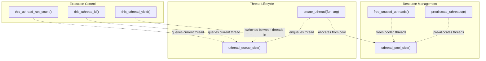
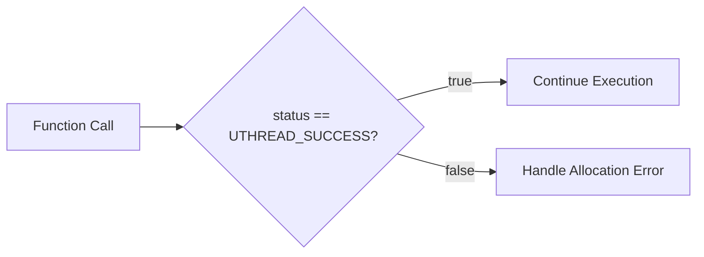
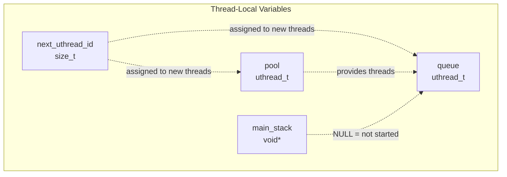
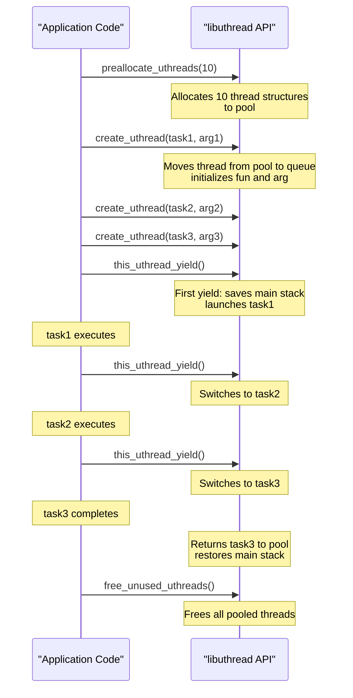
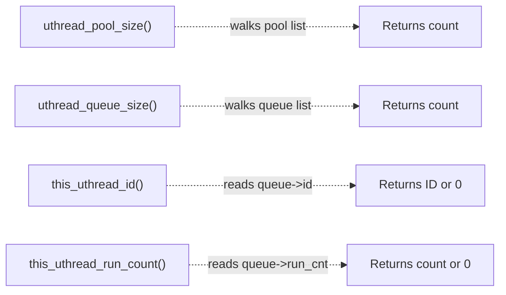
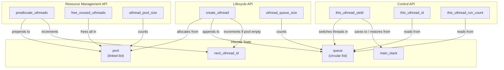
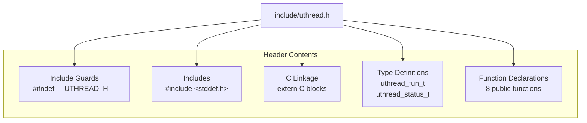

<!-- source: DeepWiki mcp.deepwiki.com · repo NVIDIA/libuthread · page 4 API Reference · fetched 2026-10-26 -->

# API Reference

<details>
<summary>Relevant source files</summary>

The following files were used as context for generating this wiki page:

- [include/uthread.h](include/uthread.h)
- [src/uthread.c](src/uthread.c)

</details>


This document provides a comprehensive reference for all public functions, types, and constants exposed by the libuthread library through [include/uthread.h](). The API consists of 8 functions organized into three functional categories: resource management, thread lifecycle management, and execution control. For detailed explanations of the underlying concepts, see [Core Concepts](#3). For implementation details of how these functions work internally, see [Architecture and Implementation](#5).

---

## API Overview

The libuthread API provides a minimal yet complete interface for user-level cooperative threading. All functions are declared in [include/uthread.h:1-54]() and implemented in [src/uthread.c:1-254]().



**Sources:** [include/uthread.h:1-54](), Diagram 7 from high-level overview

---

## Type Definitions

### Function Pointer Type

```c
typedef void (*uthread_fun_t)(void *);
```

Defined at [include/uthread.h:27](). Represents a thread entry point function that accepts a single `void *` argument and returns `void`. This function will be executed when the thread is scheduled via `this_uthread_yield()`.

### Status Return Type

```c
typedef enum {
  UTHREAD_SUCCESS = 0,
  UTHREAD_ERROR_ALLOC = 1
} uthread_status_t;
```

Defined at [include/uthread.h:29-32](). Returned by functions that can fail due to memory allocation errors.

| Value | Description |
|-------|-------------|
| `UTHREAD_SUCCESS` | Operation completed successfully |
| `UTHREAD_ERROR_ALLOC` | Memory allocation failed (`malloc` returned `NULL`) |

**Sources:** [include/uthread.h:27-32]()

---

## Function Reference Summary

The following table summarizes all 8 public API functions:

| Function | Return Type | Category | Primary Purpose |
|----------|-------------|----------|-----------------|
| `preallocate_uthreads` | `uthread_status_t` | Resource Management | Pre-allocate thread structures to avoid runtime allocation overhead |
| `free_unused_uthreads` | `uthread_status_t` | Resource Management | Free all threads currently in the pool |
| `uthread_pool_size` | `size_t` | Resource Management | Query number of threads available in the pool |
| `create_uthread` | `uthread_status_t` | Thread Lifecycle | Create and enqueue a new thread with specified function and argument |
| `uthread_queue_size` | `size_t` | Thread Lifecycle | Query number of threads currently in the ready queue |
| `this_uthread_yield` | `void` | Execution Control | Cooperatively yield CPU to the next thread in the queue |
| `this_uthread_id` | `size_t` | Execution Control | Get the unique identifier of the currently executing thread |
| `this_uthread_run_count` | `size_t` | Execution Control | Get the number of times the current thread has been scheduled |

For detailed documentation of each function, including parameters, return values, and usage examples, see:
- [Resource Management Functions](#4.1)
- [Thread Lifecycle Functions](#4.2)
- [Execution Control Functions](#4.3)

**Sources:** [include/uthread.h:34-48]()

---

## Return Value Handling

Functions that allocate memory return `uthread_status_t` to indicate success or failure. The following diagram shows the error handling flow:



The two functions that can fail with `UTHREAD_ERROR_ALLOC` are:
- `preallocate_uthreads(n)` - fails if any of the `n` allocations fail at [src/uthread.c:109-110]()
- `create_uthread(fun, arg)` - fails if pool is empty and `malloc` fails at [src/uthread.c:136-137]()

All other functions either return informational values (`size_t`) or have no return value (`void`).

**Sources:** [src/uthread.c:107-117](), [src/uthread.c:130-159]()

---

## Thread-Local State

All libuthread state is thread-local (using `__thread` storage class). Each OS thread maintains independent thread pools and queues. The following diagram shows the thread-local variables:



Defined at [src/uthread.c:94-97]():
- `next_uthread_id` - monotonically increasing ID counter starting at 1
- `pool` - linked list head of unused thread structures
- `queue` - circular doubly-linked list head of active threads
- `main_stack` - saved stack pointer of the main thread, `NULL` before first yield

This means multiple OS threads can safely use libuthread without coordination, as each maintains separate state.

**Sources:** [src/uthread.c:94-97]()

---

## Typical Call Sequences

### Initialization and Execution Pattern



**Sources:** [src/uthread.c:224-253]()

### Query Functions Pattern



Query functions that access the current thread (`this_uthread_id` and `this_uthread_run_count`) return `0` if called outside of a uthread context (i.e., when `queue` is `NULL`). In debug builds, they print an error message via `UTHREAD_DEBUG_PRINT_` at [src/uthread.c:177]() and [src/uthread.c:187]().

**Sources:** [src/uthread.c:99-105](), [src/uthread.c:162-172](), [src/uthread.c:174-182](), [src/uthread.c:184-192]()

---

## Function Categories and Dependencies

The following diagram shows how the three API categories depend on internal state and interact with each other:



Key dependency rules:
1. `create_uthread` first attempts to reuse threads from `pool`, only allocating if pool is empty
2. `this_uthread_yield` requires at least one thread in `queue` to perform a context switch
3. Introspection functions (`this_uthread_id`, `this_uthread_run_count`) return meaningful values only when called from within a uthread context

**Sources:** [src/uthread.c:94-97](), [src/uthread.c:107-117](), [src/uthread.c:119-128](), [src/uthread.c:130-160]()

---

## Architecture-Specific Considerations

While the C API in [include/uthread.h]() is platform-independent, the implementation relies on architecture-specific assembly functions declared as external symbols in [src/uthread.c:66-74]():

| Assembly Function | x86_64 | aarch64 | Purpose |
|-------------------|--------|---------|---------|
| `launch_first_uthread` | ✓ | ✓ | Initial entry into uthread execution from main thread |
| `restore_main_thread` | ✓ | ✓ | Return from uthread execution back to main thread |
| `switch_uthread` | ✓ | ✓ | Switch between two running uthreads |
| `backup_and_launch_uthread` | ✓ | ✓ | Save current uthread and launch a new one |
| `restore_uthread` | ✓ | ✓ | Resume a previously-saved uthread |
| `launch_uthread` | ✓ | ✓ | Start a new uthread (never-before-run) |

For details on how these functions save and restore registers, see:
- [x86_64 Implementation](#5.2)
- [ARM64 (aarch64) Implementation](#5.3)

**Sources:** [src/uthread.c:66-74](), [src/uthread.c:35-54]()

---

## Header File Structure

The complete public API surface is defined in a single header file with the following structure:



The header is self-contained, requiring only `<stddef.h>` for the `size_t` type at [include/uthread.h:21](). It uses standard include guards at [include/uthread.h:18-19]() and provides C++ compatibility via `extern "C"` blocks at [include/uthread.h:23-25]() and [include/uthread.h:50-52]().

**Sources:** [include/uthread.h:1-54]()

---

