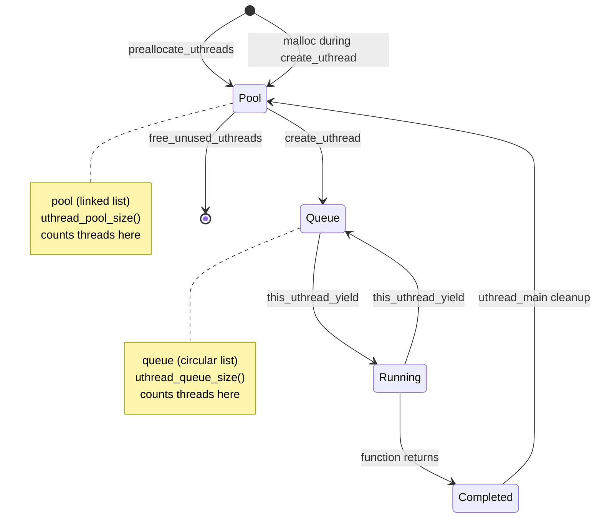
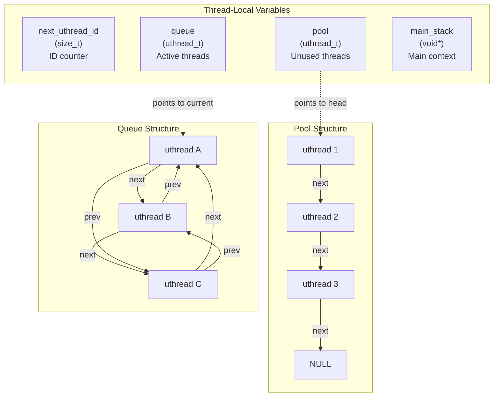
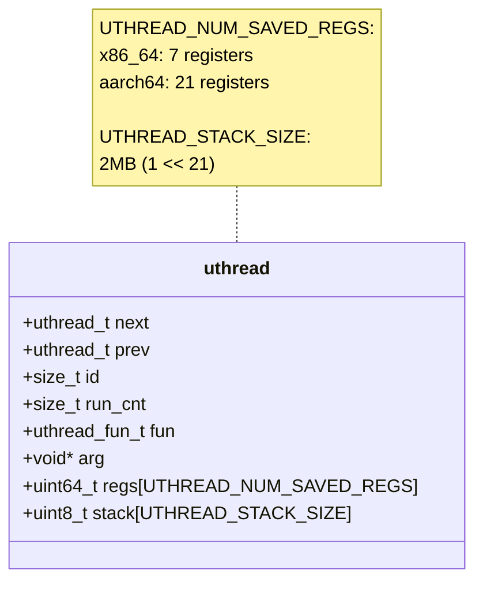
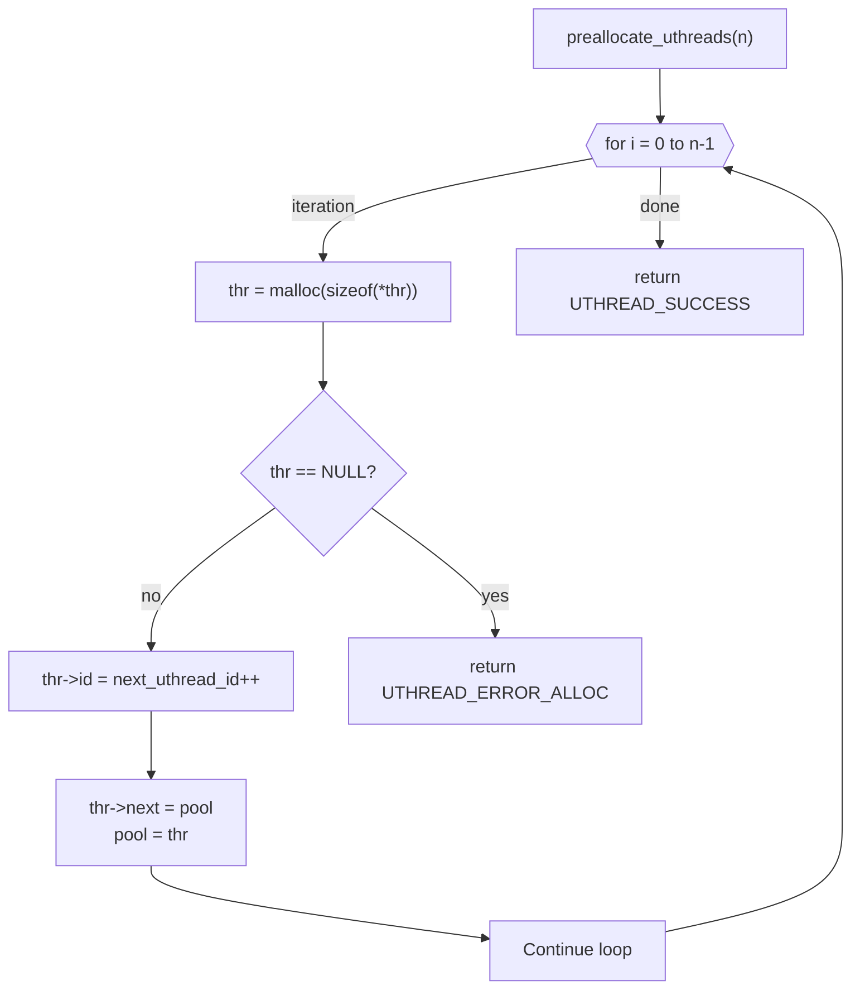
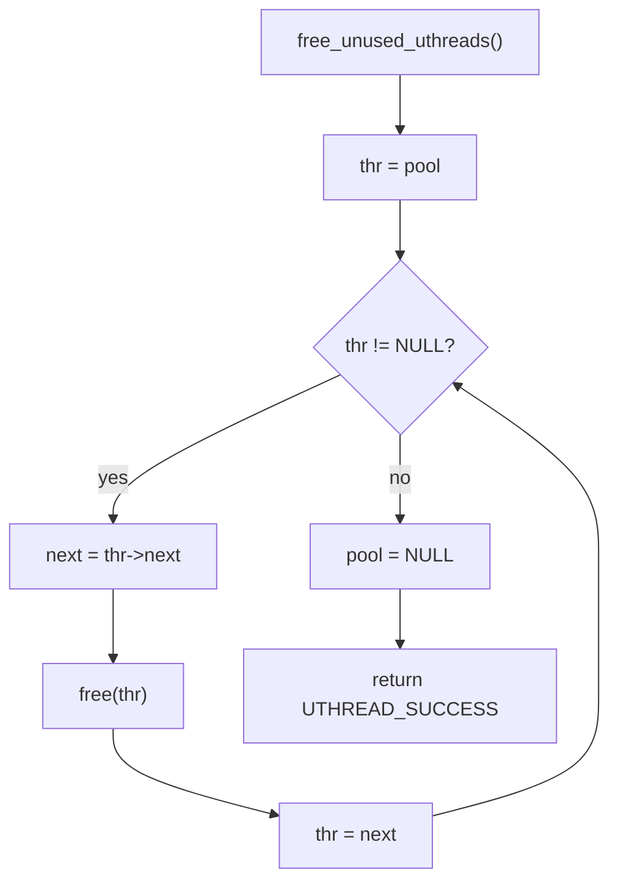
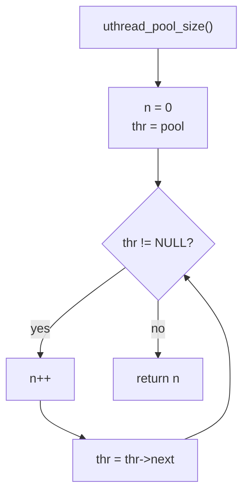
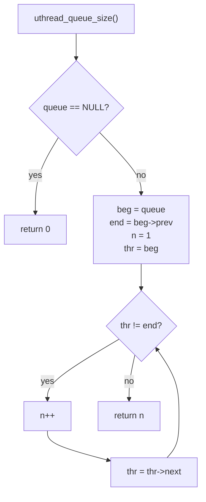
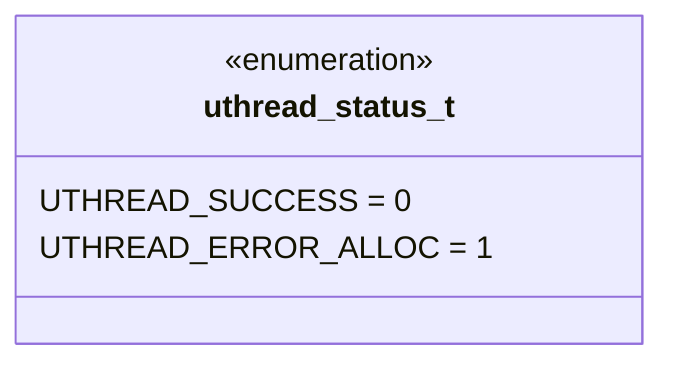

<!-- source: DeepWiki mcp.deepwiki.com · repo NVIDIA/libuthread · page 4.1 Resource Management Functions · fetched 2026-10-26 -->

# Resource Management Functions

<details>
<summary>Relevant source files</summary>

The following files were used as context for generating this wiki page:

- [include/uthread.h](include/uthread.h)
- [src/uthread.c](src/uthread.c)

</details>


## Purpose and Scope

This document covers the resource management functions in libuthread that control thread pool allocation, deallocation, and monitoring. These functions allow applications to optimize memory usage by preallocating thread structures and querying system capacity.

For information about creating and scheduling threads, see [Thread Lifecycle Functions](#4.2). For execution control and introspection during thread execution, see [Execution Control Functions](#4.3). For details on the internal pool and queue data structures, see [Thread Pool and Queue Management](#3.3).

**Sources**: [include/uthread.h:1-54](), [src/uthread.c:1-254]()

---

## Overview

libuthread manages two distinct collections of thread structures:

| Collection | Purpose | Location | Implementation |
|------------|---------|----------|----------------|
| **Pool** | Unused threads available for reuse | `pool` variable | Singly-linked list |
| **Queue** | Active/scheduled threads | `queue` variable | Circular doubly-linked list |

The resource management API provides functions to:
- Pre-allocate thread structures to avoid runtime allocation overhead
- Free unused threads to reclaim memory
- Query the size of both pool and queue for monitoring

All state is stored in thread-local storage, making libuthread safe for use in multi-threaded applications where each OS thread maintains its own independent pool and queue.

**Sources**: [src/uthread.c:94-97]()

---

## Memory Lifecycle



**Diagram**: Thread structure memory lifecycle showing transitions between pool, queue, and freed states

Thread structures follow this lifecycle:
1. **Allocation**: Threads enter the pool via `preallocate_uthreads()` or are allocated on-demand by `create_uthread()`
2. **Activation**: `create_uthread()` moves a thread from pool to queue
3. **Execution**: Threads in the queue execute when scheduled
4. **Recycling**: After completion, `uthread_main()` returns threads to the pool
5. **Deallocation**: `free_unused_uthreads()` releases pool memory

**Sources**: [src/uthread.c:107-160](), [src/uthread.c:194-222]()

---

## Data Structures

### Thread-Local Storage



**Diagram**: Thread-local storage variables and data structure topology

The key thread-local variables are:

- **`next_uthread_id`** [src/uthread.c:94](): Monotonically increasing counter for unique thread IDs
- **`pool`** [src/uthread.c:95](): Head pointer to singly-linked list of unused threads
- **`queue`** [src/uthread.c:96](): Current thread pointer in circular doubly-linked list
- **`main_stack`** [src/uthread.c:97](): Saved main thread context for return

**Sources**: [src/uthread.c:94-97]()

### struct uthread



**Diagram**: Structure definition of `struct uthread` showing memory layout

Each thread structure [src/uthread.c:80-90]() contains:

| Field | Type | Purpose |
|-------|------|---------|
| `next`, `prev` | `uthread_t` | Linked list/circular queue pointers |
| `id` | `size_t` | Unique identifier assigned from `next_uthread_id` |
| `run_cnt` | `size_t` | Number of times thread has been scheduled |
| `fun` | `uthread_fun_t` | User function to execute |
| `arg` | `void*` | Argument passed to user function |
| `regs` | `uint64_t[]` | Saved register state (7 for x86_64, 21 for aarch64) |
| `stack` | `uint8_t[]` | 2MB execution stack, 16-byte aligned |

**Sources**: [src/uthread.c:80-90](), [src/uthread.c:35-54]()

---

## Function Reference

### preallocate_uthreads

```c
uthread_status_t preallocate_uthreads(size_t n);
```

Pre-allocates `n` thread structures and adds them to the pool.

**Parameters**:
- `n`: Number of thread structures to allocate

**Returns**:
- `UTHREAD_SUCCESS` (0) if all allocations succeeded
- `UTHREAD_ERROR_ALLOC` (1) if any allocation failed

**Implementation Details**:

The function [src/uthread.c:107-117]() performs these operations:



**Diagram**: Control flow for `preallocate_uthreads()` function

Key behaviors:
1. Allocates threads one at a time using `malloc()`
2. Assigns monotonically increasing IDs from `next_uthread_id`
3. Prepends each thread to the `pool` linked list
4. Returns immediately on first allocation failure
5. Partial allocations before failure are not rolled back

**Usage Pattern**:
```c
// Pre-allocate 100 threads to avoid runtime allocation overhead
if (preallocate_uthreads(100) != UTHREAD_SUCCESS) {
    // Handle allocation failure
}
```

**Sources**: [src/uthread.c:107-117](), [include/uthread.h:36]()

---

### free_unused_uthreads

```c
uthread_status_t free_unused_uthreads(void);
```

Frees all thread structures currently in the pool.

**Returns**:
- `UTHREAD_SUCCESS` (0) - always succeeds

**Implementation Details**:

The function [src/uthread.c:119-128]() walks the pool linked list and frees each node:



**Diagram**: Control flow for `free_unused_uthreads()` function

Key behaviors:
1. Only frees threads in the `pool`, not active threads in the `queue`
2. Resets `pool` to `NULL` after freeing all threads
3. Always returns `UTHREAD_SUCCESS`
4. Does not affect `next_uthread_id` counter

**Usage Pattern**:
```c
// Clean up all unused threads when done
free_unused_uthreads();
```

**Warning**: This function does not free threads in the queue. Calling it while threads are still active leaves those threads allocated. They will be returned to the pool after completion, but won't be freed until `free_unused_uthreads()` is called again.

**Sources**: [src/uthread.c:119-128](), [include/uthread.h:38]()

---

### uthread_pool_size

```c
size_t uthread_pool_size(void);
```

Returns the number of thread structures currently in the pool.

**Returns**:
- Count of threads available for reuse (unused threads)

**Implementation Details**:

The function [src/uthread.c:99-105]() walks the `pool` linked list and counts nodes:



**Diagram**: Control flow for `uthread_pool_size()` function

**Complexity**: O(n) where n is the number of pooled threads

**Usage Pattern**:
```c
// Check how many pre-allocated threads are available
size_t available = uthread_pool_size();
printf("Pool has %zu threads\n", available);
```

**Sources**: [src/uthread.c:99-105](), [include/uthread.h:34]()

---

### uthread_queue_size

```c
size_t uthread_queue_size(void);
```

Returns the number of thread structures currently in the queue (active or scheduled threads).

**Returns**:
- Count of threads in the circular queue
- 0 if queue is empty

**Implementation Details**:

The function [src/uthread.c:162-172]() traverses the circular doubly-linked list:



**Diagram**: Control flow for `uthread_queue_size()` function

Key behaviors:
1. Returns 0 immediately if `queue` is `NULL`
2. Handles single-thread circular queue (where `beg == end`)
3. Walks forward from `queue` to `queue->prev` to count all threads
4. Includes both running and yielded threads

**Complexity**: O(n) where n is the number of queued threads

**Usage Pattern**:
```c
// Monitor active thread count
size_t active = uthread_queue_size();
printf("%zu threads in queue\n", active);

// Check if any threads are scheduled
if (uthread_queue_size() == 0) {
    printf("No threads to execute\n");
}
```

**Sources**: [src/uthread.c:162-172](), [include/uthread.h:42]()

---

## Return Status Codes



**Diagram**: Return status enumeration for resource management functions

The `uthread_status_t` enum [include/uthread.h:29-32]() defines:

| Code | Value | Meaning |
|------|-------|---------|
| `UTHREAD_SUCCESS` | 0 | Operation completed successfully |
| `UTHREAD_ERROR_ALLOC` | 1 | Memory allocation failed |

Functions returning `uthread_status_t`:
- `preallocate_uthreads()` - may fail if malloc fails
- `free_unused_uthreads()` - always returns `UTHREAD_SUCCESS`
- `create_uthread()` (see [Thread Lifecycle Functions](#4.2)) - may fail if malloc fails

**Sources**: [include/uthread.h:29-32]()

---

## Usage Patterns

### Pattern 1: Pre-allocation for Predictable Performance

```c
// Pre-allocate threads to avoid malloc overhead during execution
if (preallocate_uthreads(1000) != UTHREAD_SUCCESS) {
    fprintf(stderr, "Failed to preallocate threads\n");
    exit(1);
}

// Create threads without allocation overhead
for (int i = 0; i < 1000; i++) {
    create_uthread(worker_func, &tasks[i]);
}

// Execute all threads
this_uthread_yield();

// Clean up
free_unused_uthreads();
```

This pattern ensures deterministic performance by eliminating malloc calls during the critical execution phase.

**Sources**: [src/uthread.c:107-117](), [src/uthread.c:119-128]()

---

### Pattern 2: Dynamic Monitoring

```c
// Monitor system capacity
printf("Pool: %zu threads, Queue: %zu threads\n",
       uthread_pool_size(), uthread_queue_size());

// Dynamically adjust pre-allocation
size_t pool_size = uthread_pool_size();
if (pool_size < MIN_POOL_SIZE) {
    preallocate_uthreads(MIN_POOL_SIZE - pool_size);
}
```

This pattern uses size queries to implement adaptive resource management policies.

**Sources**: [src/uthread.c:99-105](), [src/uthread.c:162-172]()

---

### Pattern 3: Gradual Cleanup

```c
// Process work in batches
for (int batch = 0; batch < NUM_BATCHES; batch++) {
    // Create threads for this batch
    for (int i = 0; i < BATCH_SIZE; i++) {
        create_uthread(worker_func, &data[batch * BATCH_SIZE + i]);
    }
    
    // Execute batch
    this_uthread_yield();
    
    // Threads auto-return to pool after completion
    // Pool now has BATCH_SIZE threads for next iteration
}

// Final cleanup
free_unused_uthreads();
```

This pattern leverages automatic thread recycling to reuse allocations across multiple batches.

**Sources**: [src/uthread.c:194-222]()

---

## Relationship to Thread Lifecycle

```mermaid
sequenceDiagram
    participant App as "Application"
    participant Pre as "preallocate_uthreads"
    participant Create as "create_uthread"
    participant Pool as "pool"
    participant Queue as "queue"
    participant Main as "uthread_main"
    participant Free as "free_unused_uthreads"
    
    App->>Pre: preallocate_uthreads(10)
    Pre->>Pool: Add 10 threads
    
    App->>Create: create_uthread(fun, arg)
    Pool->>Create: Provide thread
    Create->>Queue: Enqueue thread
    
    Note over Queue: Thread executes...
    
    Queue->>Main: Function returns
    Main->>Pool: Return thread to pool
    
    App->>Free: free_unused_uthreads()
    Free->>Pool: Free all threads
```

**Diagram**: Interaction between resource management and thread lifecycle functions

The resource management functions interact with other libuthread APIs:

1. **`preallocate_uthreads()`** populates the pool before any threads are created
2. **`create_uthread()`** (see [Thread Lifecycle Functions](#4.2)) consumes from pool or allocates
3. **`uthread_main()`** [src/uthread.c:194-222]() returns completed threads to pool
4. **`free_unused_uthreads()`** reclaims pool memory

This design allows threads to be efficiently recycled across multiple execution cycles without repeated allocation/deallocation overhead.

**Sources**: [src/uthread.c:107-117](), [src/uthread.c:130-160](), [src/uthread.c:194-222](), [src/uthread.c:119-128]()

---

## Thread-Local Behavior

All resource management state is stored in thread-local storage (using the `__thread` qualifier [src/uthread.c:94-97]()). This means:

| Aspect | Behavior |
|--------|----------|
| **Isolation** | Each OS thread has independent pool and queue |
| **Safety** | No synchronization needed between OS threads |
| **Independence** | `preallocate_uthreads()` in thread A doesn't affect thread B |
| **Cleanup** | Each OS thread must call `free_unused_uthreads()` separately |

**Example**:
```c
void* thread_func(void* arg) {
    // This thread has its own pool and queue
    preallocate_uthreads(100);  // Separate from main thread
    
    // Create and execute uthreads
    create_uthread(worker, data);
    this_uthread_yield();
    
    // Clean up this thread's pool
    free_unused_uthreads();
    return NULL;
}

int main() {
    preallocate_uthreads(100);  // Main thread's pool
    
    pthread_t pt;
    pthread_create(&pt, NULL, thread_func, NULL);
    pthread_join(pt, NULL);
    
    // Main thread still has its 100 threads
    printf("Main pool: %zu\n", uthread_pool_size());  // Prints 100
    
    free_unused_uthreads();
    return 0;
}
```

**Sources**: [src/uthread.c:94-97]()

---

## Performance Considerations

### Memory Overhead

Each `struct uthread` [src/uthread.c:80-90]() consumes:
- **x86_64**: ~2 MB + 56 bytes + (7 × 8 bytes) = ~2,097,208 bytes
- **aarch64**: ~2 MB + 56 bytes + (21 × 8 bytes) = ~2,097,224 bytes

The stack accounts for most of the memory (`UTHREAD_STACK_SIZE = 1 << 21` = 2 MB).

**Pre-allocation Trade-off**:
- **Benefit**: Eliminates malloc/free overhead during execution
- **Cost**: Memory usage of `preallocate_uthreads(n)` = n × ~2 MB

### Allocation Performance

Measured behaviors:

| Operation | Complexity | Notes |
|-----------|------------|-------|
| `preallocate_uthreads(n)` | O(n) | n malloc calls |
| `free_unused_uthreads()` | O(p) | p = pool size |
| `uthread_pool_size()` | O(p) | Linked list traversal |
| `uthread_queue_size()` | O(q) | q = queue size |
| Pool reuse in `create_uthread()` | O(1) | Single pointer manipulation |

**Recommendation**: Pre-allocate threads when predictable performance is required, especially in latency-sensitive code paths.

**Sources**: [src/uthread.c:80-90](), [src/uthread.c:55](), [src/uthread.c:107-117](), [src/uthread.c:119-128]()

---

