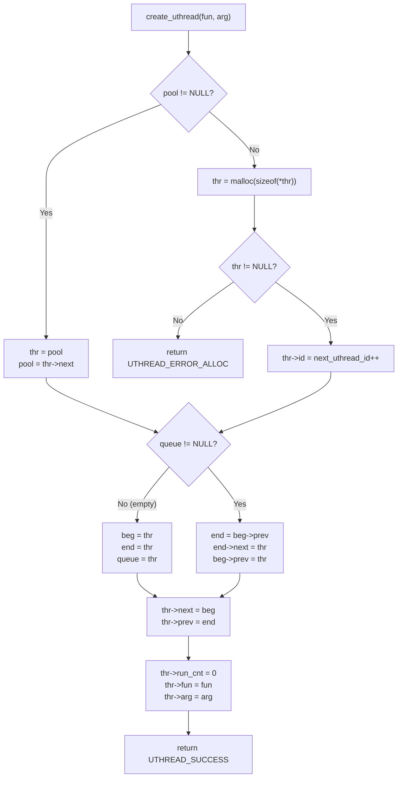
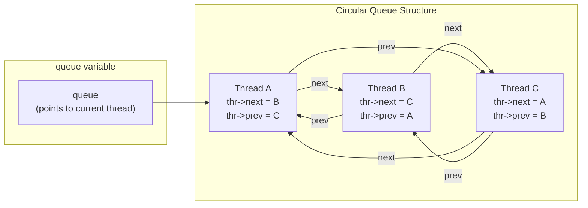
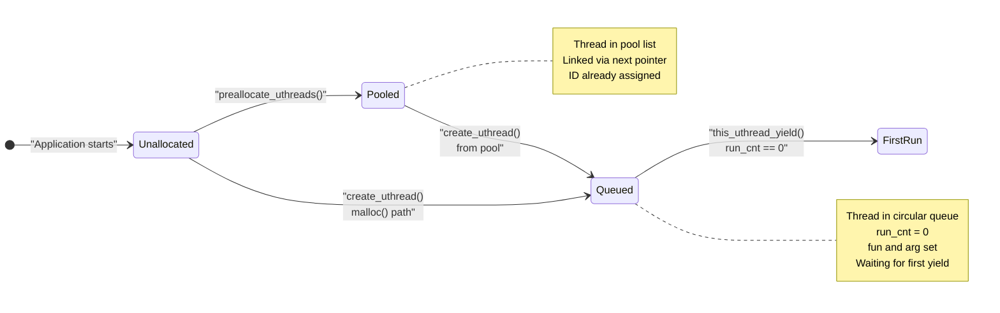

<!-- source: DeepWiki mcp.deepwiki.com · repo NVIDIA/libuthread · page 4.2 Thread Lifecycle Functions · fetched 2026-10-26 -->

# Thread Lifecycle Functions

<details>
<summary>Relevant source files</summary>

The following files were used as context for generating this wiki page:

- [include/uthread.h](include/uthread.h)
- [src/uthread.c](src/uthread.c)

</details>


## Purpose and Scope

This page documents the `create_uthread()` function, which is responsible for initializing user-level threads and adding them to the execution queue. This function handles memory allocation (either from the thread pool or via `malloc()`), assigns unique thread IDs, and prepares threads for execution.

For information about executing threads and cooperative scheduling, see [Execution Control Functions](#4.3). For information about preallocating and freeing thread pool memory, see [Resource Management Functions](#4.1). For details on the complete thread state machine, see [Thread State Machine](#5.4).

---

## Function Signature

```c
uthread_status_t create_uthread(uthread_fun_t fun, void *arg);
```

The `create_uthread()` function is declared at [include/uthread.h:40]() and implemented at [src/uthread.c:130-160]().

**Parameters:**
- `fun` - Function pointer of type `uthread_fun_t` (defined as `typedef void (*uthread_fun_t)(void *)` at [include/uthread.h:27]()). This is the entry point for the thread's execution.
- `arg` - Opaque pointer passed to the thread function when it executes. Can be `NULL` if no context is needed.

**Return Value:**
- `UTHREAD_SUCCESS` (0) - Thread successfully created and enqueued
- `UTHREAD_ERROR_ALLOC` (1) - Memory allocation failed (only occurs when pool is empty and `malloc()` fails)

Sources: [include/uthread.h:27-40](), [src/uthread.c:130-160]()

---

## Thread Creation Workflow

The following diagram illustrates the complete flow of `create_uthread()`, showing the actual code constructs and variables involved:



Sources: [src/uthread.c:130-160]()

---

## Memory Allocation Strategy

The `create_uthread()` function implements a two-tier memory allocation strategy to minimize dynamic allocation overhead:

### Pool-First Allocation

The function first attempts to retrieve a thread structure from the thread-local `pool` variable at [src/uthread.c:132-134]():

```c
if (pool) {
    thr = pool;
    pool = thr->next;
}
```

The `pool` is a singly-linked list of unused `struct uthread` instances. When a thread completes execution, it is returned to this pool (see `uthread_main()` at [src/uthread.c:207-208]()). This approach reuses existing memory allocations and avoids repeated `malloc()/free()` cycles.

### Fallback to malloc()

If the pool is empty, the function allocates memory dynamically at [src/uthread.c:136-138]():

```c
thr = (uthread_t)malloc(sizeof(*thr));
if (!thr) return UTHREAD_ERROR_ALLOC;
thr->id = next_uthread_id++;
```

This is the only point in the function that can fail. The `UTHREAD_ERROR_ALLOC` error is returned only when `malloc()` returns `NULL`.

### Memory Layout

Each `struct uthread` instance is defined at [src/uthread.c:80-90]() and contains:

| Field | Type | Size | Purpose |
|-------|------|------|---------|
| `next`, `prev` | `uthread_t` | 16 bytes | Circular queue pointers |
| `id` | `size_t` | 8 bytes | Unique thread identifier |
| `run_cnt` | `size_t` | 8 bytes | Number of times thread has executed |
| `fun` | `uthread_fun_t` | 8 bytes | Entry point function pointer |
| `arg` | `void *` | 8 bytes | Opaque argument for function |
| `regs` | `uint64_t[7 or 21]` | 56-168 bytes | Saved register state (architecture-dependent) |
| `stack` | `uint8_t[2MB]` | 2097152 bytes | Thread execution stack |

The `stack` array size is defined by `UTHREAD_STACK_SIZE` (1 << 21 = 2MB) at [src/uthread.c:55]().

Sources: [src/uthread.c:80-90](), [src/uthread.c:132-139](), [src/uthread.c:55]()

---

## Queue Management

### Circular Doubly-Linked Queue Structure

The `queue` variable at [src/uthread.c:96]() is a thread-local pointer to the currently active thread. All enqueued threads form a circular doubly-linked list, where each thread's `next` pointer eventually leads back to the first thread.

The following diagram shows the queue structure with actual field names:



### Append Operation

When `create_uthread()` is called, the new thread is always appended to the end of the queue. The code at [src/uthread.c:141-153]() implements this:

**Case 1: Empty Queue**
```c
if (!beg) {
    beg = thr;
    end = thr;
    queue = thr;
}
```
The new thread becomes both the beginning and end, and points to itself.

**Case 2: Non-Empty Queue**
```c
uthread_t beg = queue, end;
if (beg) {
    end = beg->prev;      // End is the node before beginning
    end->next = thr;      // Old end now points to new thread
    beg->prev = thr;      // Beginning's prev points to new end
}
```

**Final Circular Linkage** (applies to both cases):
```c
thr->next = beg;
thr->prev = end;
```

This maintains the circular property where the last thread's `next` points back to the first thread, and the first thread's `prev` points to the last thread.

Sources: [src/uthread.c:141-153](), [src/uthread.c:96]()

---

## Thread Initialization

After memory allocation and queue insertion, the thread is initialized at [src/uthread.c:156-158]():

```c
thr->run_cnt = 0;
thr->fun = fun;
thr->arg = arg;
```

### Field Initialization Details

| Field | Initialized Value | Purpose |
|-------|------------------|---------|
| `run_cnt` | `0` | Indicates the thread has never executed. This triggers special "first run" logic in `this_uthread_yield()` at [src/uthread.c:242]() and `uthread_main()` at [src/uthread.c:213-217](). |
| `fun` | Caller-provided function pointer | Entry point that will be invoked when the thread first executes via `uthread_main()` at [src/uthread.c:196](). |
| `arg` | Caller-provided context pointer | Opaque data passed to the entry point function. |

### Fields NOT Initialized

The following fields are **not** initialized by `create_uthread()` because they are managed by other parts of the system:

- `next`, `prev` - Set during queue insertion (lines 141-153)
- `id` - Set during allocation (line 111 or 138)
- `regs` - Saved/restored by assembly context switch functions (see [Context Switching Mechanism](#5.1))
- `stack` - Used as raw memory by assembly functions; never explicitly initialized

Sources: [src/uthread.c:156-158](), [src/uthread.c:196](), [src/uthread.c:213-217](), [src/uthread.c:242]()

---

## Thread ID Assignment

Each thread receives a unique identifier stored in the `id` field. The ID is assigned from the thread-local variable `next_uthread_id` at [src/uthread.c:94]():

```c
static __thread size_t next_uthread_id = 1;
```

### ID Assignment Locations

IDs are assigned in two places, depending on the memory allocation path:

1. **Pool allocation** - ID is assigned when thread is first created via `preallocate_uthreads()` at [src/uthread.c:111]()
2. **Dynamic allocation** - ID is assigned when `malloc()` succeeds at [src/uthread.c:138]()

### ID Properties

- **Monotonically increasing** - Each ID is larger than the previous one
- **Thread-local** - Different OS threads have independent ID sequences starting at 1
- **Never zero** - IDs start at 1, so zero can indicate "no thread" or error conditions
- **Never reused** - Once assigned, an ID is never reassigned, even after the thread completes and returns to the pool
- **Persistent across runs** - A thread retrieved from the pool retains its original ID

The ID can be queried by a running thread using `this_uthread_id()` documented in [Execution Control Functions](#4.3).

Sources: [src/uthread.c:94](), [src/uthread.c:111](), [src/uthread.c:138]()

---

## State Transitions

The `create_uthread()` function moves a thread through the following state transitions:



After `create_uthread()` returns `UTHREAD_SUCCESS`, the thread is in the **Queued** state with `run_cnt == 0`. It will remain in this state until `this_uthread_yield()` is called (see [Execution Control Functions](#4.3)).

The `run_cnt == 0` condition is checked at multiple points:
- [src/uthread.c:242]() - First yield from main thread
- [src/uthread.c:235]() - Switching between threads
- [src/uthread.c:213]() - After a thread completes

When `run_cnt == 0`, special assembly functions are called to set up the thread's initial stack and register state:
- `launch_first_uthread()` - Called from main thread ([src/uthread.c:250]())
- `backup_and_launch_uthread()` - Called when switching from another thread ([src/uthread.c:238]())
- `launch_uthread()` - Called when previous thread completes ([src/uthread.c:216]())

Sources: [src/uthread.c:156](), [src/uthread.c:213](), [src/uthread.c:235](), [src/uthread.c:238](), [src/uthread.c:242](), [src/uthread.c:250]()

---

## Usage Patterns

### Basic Thread Creation

```c
void my_task(void *arg) {
    int *data = (int *)arg;
    // Perform work...
}

int main() {
    int context = 42;
    uthread_status_t status = create_uthread(my_task, &context);
    if (status != UTHREAD_SUCCESS) {
        // Handle allocation failure
        return -1;
    }
    
    // Thread is now queued and ready to execute
    this_uthread_yield();  // Begin execution
}
```

### Multiple Thread Creation

```c
for (size_t i = 0; i < 100; i++) {
    uthread_status_t status = create_uthread(worker_function, contexts[i]);
    if (status != UTHREAD_SUCCESS) {
        // Handle error - some threads may have been created
        break;
    }
}

// All threads are queued in the order created
// First yield will execute the first thread created
this_uthread_yield();
```

### Thread Creation with Preallocation

```c
// Preallocate pool to avoid malloc() during execution
preallocate_uthreads(1000);

for (size_t i = 0; i < 1000; i++) {
    // Guaranteed to succeed (no malloc failures)
    create_uthread(task_function, &tasks[i]);
}

this_uthread_yield();
```

This pattern is recommended for performance-critical code where deterministic allocation behavior is required.

Sources: [src/uthread.c:130-160](), [include/uthread.h:40]()

---

## Thread-Local Storage

All thread management data structures are stored in thread-local variables at [src/uthread.c:94-97]():

```c
static __thread size_t next_uthread_id = 1;
static __thread uthread_t pool = NULL;
static __thread uthread_t queue = NULL;
static __thread void *main_stack = NULL;
```

This means:
- Each **OS thread** maintains its own independent set of user-level threads
- Thread IDs are scoped to the OS thread that created them
- The pool and queue are not shared between OS threads
- No synchronization primitives are needed within libuthread
- Applications can use libuthread from multiple OS threads simultaneously without conflicts

**Important:** User-level threads created in one OS thread cannot be accessed or yielded from a different OS thread. They are completely isolated.

Sources: [src/uthread.c:94-97]()

---

## Error Handling

The `create_uthread()` function has only one failure mode:

### UTHREAD_ERROR_ALLOC

This error is returned when:
1. The thread pool is empty (`pool == NULL`)
2. Dynamic memory allocation fails (`malloc()` returns `NULL`)

This can occur when:
- The system has exhausted available memory
- Memory allocation limits have been reached (e.g., `ulimit -v`)
- Large numbers of threads are created without preallocation

### Recovery Strategies

When `create_uthread()` returns `UTHREAD_ERROR_ALLOC`:

1. **Stop creating threads** - Do not continue creating threads, as subsequent calls will likely fail too
2. **Free unused threads** - Call `free_unused_uthreads()` to release pool memory (see [Resource Management Functions](#4.1))
3. **Wait for completion** - Allow currently queued threads to execute and complete, which will return them to the pool
4. **Preallocate in advance** - Use `preallocate_uthreads()` before entering critical sections to guarantee allocation success

### No Other Error Conditions

The function does not validate:
- Whether `fun` is NULL (undefined behavior if NULL)
- Whether `arg` is valid (caller's responsibility)
- Whether the queue is full (no queue size limit exists)

Sources: [src/uthread.c:136-139](), [include/uthread.h:29-32]()

---

## Relationship to Other APIs

The following table shows how `create_uthread()` interacts with other libuthread functions:

| Function | Relationship | Description |
|----------|--------------|-------------|
| `preallocate_uthreads()` | Produces pool entries | Pre-populates the `pool` to make `create_uthread()` allocation-failure-proof |
| `free_unused_uthreads()` | Consumes pool entries | Releases memory held by the `pool`, making future `create_uthread()` calls depend on `malloc()` |
| `uthread_pool_size()` | Query pool state | Returns the number of threads available in the pool for reuse |
| `uthread_queue_size()` | Query queue state | Returns the number of threads created but not yet completed, including those created by `create_uthread()` |
| `this_uthread_yield()` | Executes created threads | Transfers control to threads in the queue, causing their `fun` function to execute |
| `this_uthread_id()` | Accesses thread ID | Returns the `id` field assigned by `create_uthread()` (callable from within the thread's `fun` function) |

See the respective sections for detailed documentation:
- [Resource Management Functions](#4.1) - Pool and queue management APIs
- [Execution Control Functions](#4.3) - Thread execution and introspection APIs

Sources: [include/uthread.h:34-48](), [src/uthread.c:107-117](), [src/uthread.c:119-128](), [src/uthread.c:130-160](), [src/uthread.c:162-172]()

---

