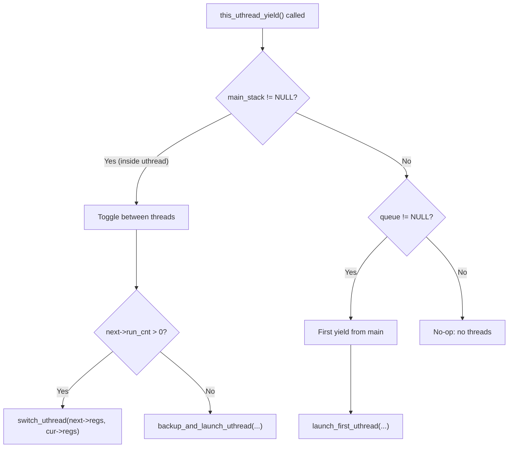
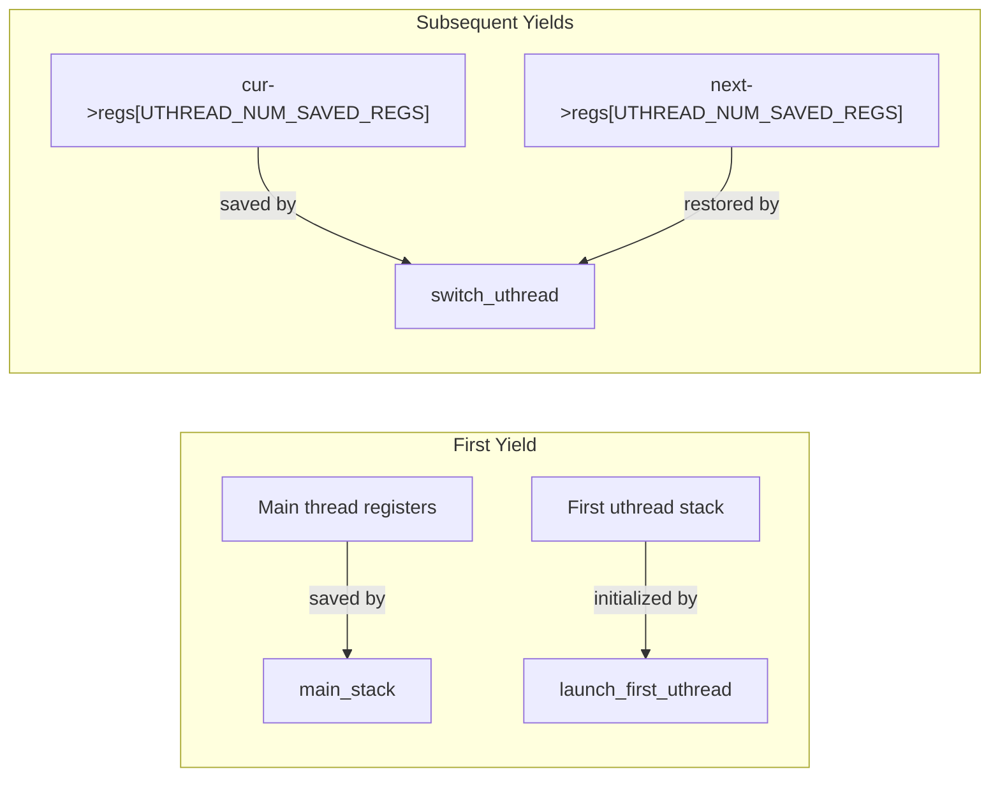
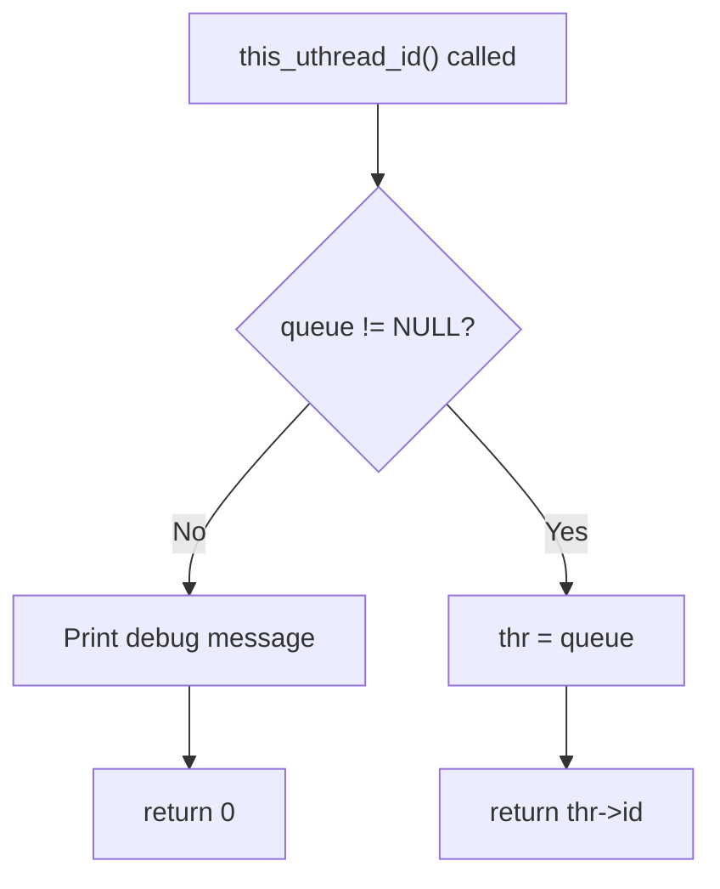
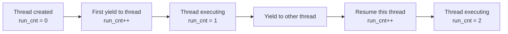
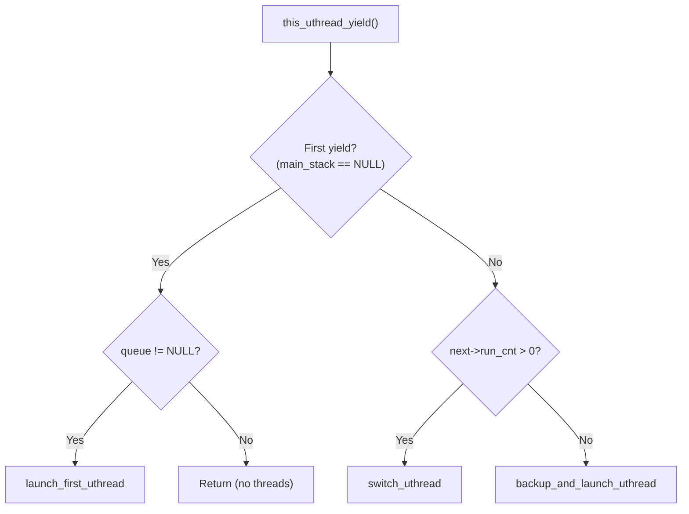
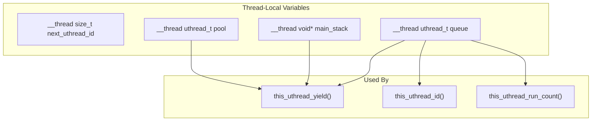

<!-- source: DeepWiki mcp.deepwiki.com · repo NVIDIA/libuthread · page 4.3 Execution Control Functions · fetched 2026-10-26 -->

# Execution Control Functions

<details>
<summary>Relevant source files</summary>

The following files were used as context for generating this wiki page:

- [include/uthread.h](include/uthread.h)
- [src/uthread.c](src/uthread.c)

</details>


## Purpose and Scope

This page documents the three execution control functions that enable cooperative scheduling and runtime introspection within uthreads. These functions provide the core mechanism for yielding control between threads and querying the current thread's state.

For information about creating and managing thread lifecycles, see [Thread Lifecycle Functions](#4.2). For resource management operations, see [Resource Management Functions](#4.1). For details on the underlying context switching mechanisms, see [Context Switching Mechanism](#5.1).

---

## Overview

The execution control API consists of three functions defined in [include/uthread.h:44-48]():

| Function | Purpose | Return Type |
|----------|---------|-------------|
| `this_uthread_yield()` | Yield control to the next thread in the queue | `void` |
| `this_uthread_id()` | Retrieve the unique identifier of the current thread | `size_t` |
| `this_uthread_run_count()` | Query how many times the current thread has executed | `size_t` |

These functions operate on thread-local state and must be called from within a uthread context (except for the first call to `this_uthread_yield()` from the main thread).

Sources: [include/uthread.h:44-48]()

---

## Function: this_uthread_yield()

```c
void this_uthread_yield(void);
```

### Function Behavior

The `this_uthread_yield()` function implements cooperative multitasking by voluntarily relinquishing control to the next thread in the circular ready queue. This is the primary synchronization primitive in libuthread.

**Signature:** [include/uthread.h:48]()  
**Implementation:** [src/uthread.c:224-253]()

### Internal State Transitions

The function behaves differently depending on the execution context:



**Sources:** [src/uthread.c:224-253]()

### Execution Scenarios

#### Scenario 1: First Yield from Main Thread

When called for the first time from the main application thread:

- Precondition: `main_stack == NULL` and `queue != NULL` [src/uthread.c:240]()
- Action: Calls `launch_first_uthread()` to save main thread state and launch first uthread [src/uthread.c:250]()
- Effect: Control transfers to the first thread in queue; `main_stack` is set to preserve main context
- Thread-local variable `main_stack` is updated to store the main thread's register state

**Code Path:** [src/uthread.c:240-252]()

#### Scenario 2: Yield Within Uthread Context

When called from within a running uthread:

- Precondition: `main_stack != NULL` [src/uthread.c:228]()
- Action: Advances `queue` pointer to `next` thread [src/uthread.c:234]()
- Sub-case A: If `next->run_cnt > 0` (thread has run before), calls `switch_uthread()` [src/uthread.c:236]()
- Sub-case B: If `next->run_cnt == 0` (first execution), calls `backup_and_launch_uthread()` [src/uthread.c:238]()

**Code Path:** [src/uthread.c:224-239]()

#### Scenario 3: No Threads Enqueued

When called with an empty queue:

- Precondition: `main_stack == NULL` and `queue == NULL`
- Action: Function returns immediately without side effects [src/uthread.c:252]()

**Code Path:** [src/uthread.c:240-252]()

### Register State Management



**Sources:** [src/uthread.c:224-253](), [src/uthread.c:88](), [src/uthread.c:66-74]()

### Critical Implementation Details

1. **Thread-Local Storage**: All state variables (`next_uthread_id`, `pool`, `queue`, `main_stack`) use `__thread` storage class [src/uthread.c:94-97]()

2. **Circular Queue**: The ready queue is implemented as a circular doubly-linked list. Advancing from the last thread wraps to the first [src/uthread.c:231-234]()

3. **Run Count Increment**: The `run_cnt` field is incremented before context switch, using the post-increment operator in the conditional [src/uthread.c:235-238]()

4. **Architecture-Specific Registers**: The number of saved registers varies by architecture:
   - x86_64: 7 registers [src/uthread.c:40]()
   - aarch64: 21 registers [src/uthread.c:51]()

**Sources:** [src/uthread.c:224-253](), [src/uthread.c:35-54](), [src/uthread.c:94-97]()

---

## Function: this_uthread_id()

```c
size_t this_uthread_id(void);
```

### Function Behavior

Returns the unique identifier of the currently executing uthread. Each thread receives a monotonically increasing ID when allocated.

**Signature:** [include/uthread.h:44]()  
**Implementation:** [src/uthread.c:174-182]()

### Return Values

| Condition | Return Value | Meaning |
|-----------|--------------|---------|
| Called from within a uthread | Non-zero `size_t` | Unique thread ID [src/uthread.c:181]() |
| Called outside uthread context | `0` | Error: not inside a uthread [src/uthread.c:178]() |

### Implementation Details



**Sources:** [src/uthread.c:174-182]()

The function retrieves the ID from the current thread by reading `queue->id` [src/uthread.c:175-181](). The `id` field is set during allocation:
- From pool: ID was assigned when originally allocated [src/uthread.c:111]()
- Fresh allocation: ID comes from `next_uthread_id++` [src/uthread.c:138]()

Thread IDs start at 1 and increment for each allocated thread structure [src/uthread.c:94](). The ID is persistent across multiple executions of the same thread structure (when recycled from the pool).

**Sources:** [src/uthread.c:174-182](), [src/uthread.c:80-90](), [src/uthread.c:94]()

### Debug Mode Behavior

In debug builds (`NDEBUG` not defined), calling this function outside a uthread context prints an error message via `UTHREAD_DEBUG_PRINT_` [src/uthread.c:177](). The macro is defined at [src/uthread.c:23-30]().

**Sources:** [src/uthread.c:23-30](), [src/uthread.c:174-182]()

---

## Function: this_uthread_run_count()

```c
size_t this_uthread_run_count(void);
```

### Function Behavior

Returns the number of times the current uthread has been scheduled for execution. This counter increments each time control transfers to the thread.

**Signature:** [include/uthread.h:46]()  
**Implementation:** [src/uthread.c:184-192]()

### Return Values

| Condition | Return Value | Meaning |
|-----------|--------------|---------|
| Called from within a uthread | Non-zero `size_t` | Execution count (≥1) [src/uthread.c:191]() |
| Called outside uthread context | `0` | Error: not inside a uthread [src/uthread.c:188]() |

### Run Count Semantics



**Sources:** [src/uthread.c:156](), [src/uthread.c:235](), [src/uthread.c:242]()

### Increment Locations

The `run_cnt` field is incremented in three code paths:

1. **First yield from main** [src/uthread.c:242](): Increments before `launch_first_uthread()`
2. **Yield within uthread to existing thread** [src/uthread.c:235](): Pre-increment in conditional `if (next->run_cnt++)`
3. **Thread completion** [src/uthread.c:213](): Increments before launching next thread

The increment always occurs before transferring control, so `this_uthread_run_count()` returns the current execution number (starting from 1).

**Sources:** [src/uthread.c:184-192](), [src/uthread.c:213](), [src/uthread.c:235](), [src/uthread.c:242]()

### Usage Pattern for First-Time Detection

```c
// Inside a uthread function
if (this_uthread_run_count() == 1) {
    // First-time initialization
}
```

This pattern is reliable because the count is always at least 1 when the thread is executing [src/uthread.c:242]().

**Sources:** [src/uthread.c:184-192]()

---

## Interaction with Assembly Layer

The execution control functions delegate low-level context switching to architecture-specific assembly routines. The following table maps high-level operations to assembly functions:

| Scenario | C Function Called | Assembly Function | Purpose |
|----------|-------------------|-------------------|---------|
| First yield from main | `this_uthread_yield()` | `launch_first_uthread()` [src/uthread.c:66]() | Save main context, start first uthread |
| Yield to previously-run thread | `this_uthread_yield()` | `switch_uthread()` [src/uthread.c:69]() | Save current regs, restore next regs |
| Yield to never-run thread | `this_uthread_yield()` | `backup_and_launch_uthread()` [src/uthread.c:70-72]() | Save current regs, initialize new stack |
| Thread function returns | `uthread_main()` | `restore_uthread()` or `launch_uthread()` [src/uthread.c:73-74]() | Continue next thread |
| Last thread completes | `uthread_main()` | `restore_main_thread()` [src/uthread.c:67]() | Return to main application |

**Sources:** [src/uthread.c:66-74](), [src/uthread.c:224-253](), [src/uthread.c:194-222]()

### Context Switch Decision Tree



**Sources:** [src/uthread.c:224-253]()

---

## Thread-Local State Variables

All execution control functions operate on thread-local storage to support multi-threaded applications where each OS thread has its own independent set of uthreads.



**Sources:** [src/uthread.c:94-97]()

| Variable | Type | Purpose | Modified By |
|----------|------|---------|-------------|
| `next_uthread_id` | `size_t` | Next ID to assign [src/uthread.c:94]() | `preallocate_uthreads()`, `create_uthread()` |
| `pool` | `uthread_t` | Linked list of unused threads [src/uthread.c:95]() | `preallocate_uthreads()`, `create_uthread()`, `uthread_main()` |
| `queue` | `uthread_t` | Head of circular ready queue [src/uthread.c:96]() | `create_uthread()`, `this_uthread_yield()`, `uthread_main()` |
| `main_stack` | `void*` | Saved main thread context [src/uthread.c:97]() | `launch_first_uthread()`, `restore_main_thread()` |

**Sources:** [src/uthread.c:94-97]()

---

## Error Handling and Edge Cases

### Calling from Invalid Context

Both `this_uthread_id()` and `this_uthread_run_count()` check whether they are being called from within a uthread by testing `queue != NULL` [src/uthread.c:176](), [src/uthread.c:186](). If called from an invalid context:

- **Debug builds**: Print error message "ERROR: Not inside a uthread.\n" [src/uthread.c:177]()
- **All builds**: Return `0` [src/uthread.c:178]()

**Sources:** [src/uthread.c:174-192]()

### Empty Queue Behavior

Calling `this_uthread_yield()` with no threads in the queue is safe but has no effect [src/uthread.c:240-252](). The function checks both conditions:
1. `main_stack == NULL` (not yet inside uthread processing)
2. `queue == NULL` (no threads to run)

When both are true, the function returns immediately without state changes.

**Sources:** [src/uthread.c:224-253]()

### Last Thread Completion

When a thread function returns and it is the last thread in the queue, `uthread_main()` detects this condition by comparing `next != self` [src/uthread.c:211](). If this is the last thread:
- Sets `queue = NULL` [src/uthread.c:219]()
- Calls `restore_main_thread(&main_stack)` to return to application [src/uthread.c:220]()

**Sources:** [src/uthread.c:194-222]()

---

## Usage Patterns

### Pattern 1: Prefetch and Yield

The primary use case for `this_uthread_yield()` is hiding memory latency:

```c
void process_data(void *arg) {
    struct my_data *data = (struct my_data *)arg;
    
    // Issue prefetch for next memory location
    __builtin_prefetch(data->next_ptr, 0, 3);
    
    // Immediately yield to allow other work during cache miss
    this_uthread_yield();
    
    // When control returns, data is likely in cache
    process(data->next_ptr);
}
```

**Sources:** Documentation reference to [Memory Latency Hiding](#3.1)

### Pattern 2: Round-Robin Scheduling

Calling `this_uthread_yield()` periodically implements cooperative round-robin scheduling:

```c
void long_computation(void *arg) {
    for (size_t i = 0; i < LARGE_N; i++) {
        compute_step(i);
        
        // Yield every 1000 iterations to share CPU
        if (i % 1000 == 0) {
            this_uthread_yield();
        }
    }
}
```

This prevents any single thread from monopolizing execution time.

**Sources:** [src/uthread.c:224-253]()

### Pattern 3: Thread Identification for Logging

Using `this_uthread_id()` for per-thread state tracking:

```c
void worker(void *arg) {
    size_t tid = this_uthread_id();
    printf("Thread %zu starting\n", tid);
    
    // Use tid for thread-specific logging or data structures
    perform_work(tid);
    
    printf("Thread %zu completed\n", tid);
}
```

**Sources:** [src/uthread.c:174-182]()

### Pattern 4: First-Run Initialization

Using `this_uthread_run_count()` to detect first execution:

```c
void stateful_worker(void *arg) {
    static __thread int initialized = 0;
    
    if (this_uthread_run_count() == 1 && !initialized) {
        // Perform one-time initialization
        setup_thread_resources();
        initialized = 1;
    }
    
    // Regular work
    do_work(arg);
}
```

**Sources:** [src/uthread.c:184-192]()

---

## Performance Considerations

### Context Switch Overhead

The cost of `this_uthread_yield()` depends on the code path taken:

1. **First yield from main**: Highest cost, requires saving main thread state [src/uthread.c:250]()
2. **Yield to existing thread**: Medium cost, saves and restores callee-saved registers [src/uthread.c:236]()
3. **Yield to new thread**: Higher cost, initializes new stack and saves current registers [src/uthread.c:238]()

The number of registers saved impacts overhead:
- x86_64: 7 registers × 8 bytes = 56 bytes [src/uthread.c:40]()
- aarch64: 21 registers × 8 bytes = 168 bytes [src/uthread.c:51]()

**Sources:** [src/uthread.c:35-54](), [src/uthread.c:224-253]()

### Introspection Function Overhead

Both `this_uthread_id()` and `this_uthread_run_count()` are trivial pointer dereferences:
- Load `queue` from thread-local storage
- Dereference `queue->id` or `queue->run_cnt`

These operations are extremely fast (1-2 CPU cycles) and suitable for hot paths.

**Sources:** [src/uthread.c:174-192]()

### Optimization Hints

The implementation uses compiler hints for branch prediction:
- `UTHREAD_LIKELY_` macro for common paths [src/uthread.c:32]()
- `UTHREAD_UNLIKELY_` macro for error paths [src/uthread.c:33]()

These expand to `__builtin_expect()` and help the compiler optimize instruction layout.

**Sources:** [src/uthread.c:32-33](), [src/uthread.c:211](), [src/uthread.c:228]()

---

## See Also

- [Thread Lifecycle Functions](#4.2) - Creating and managing uthreads
- [Resource Management Functions](#4.1) - Memory pool management
- [Context Switching Mechanism](#5.1) - Low-level implementation details
- [Thread State Machine](#5.4) - Complete lifecycle state transitions
- [Memory Latency Hiding](#3.1) - Core use case and optimization strategy

---

