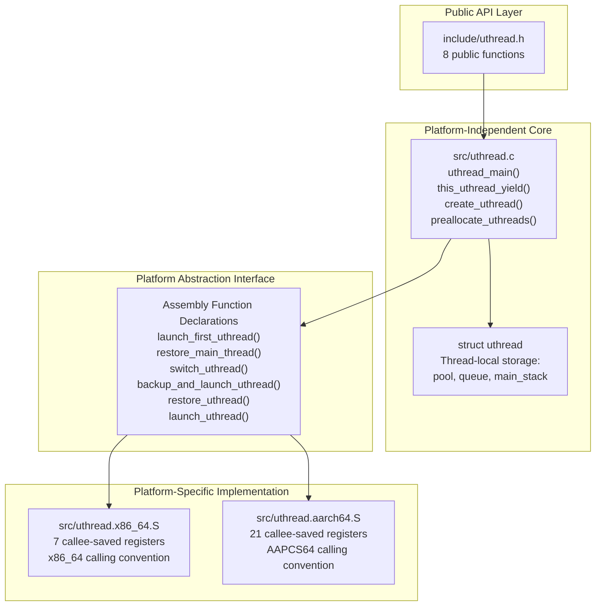
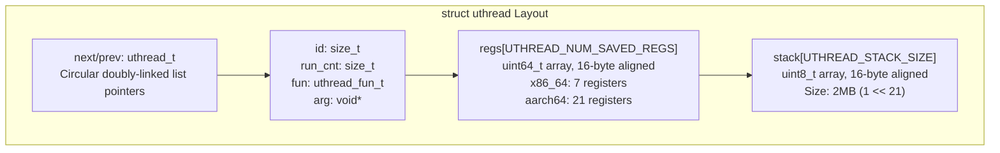
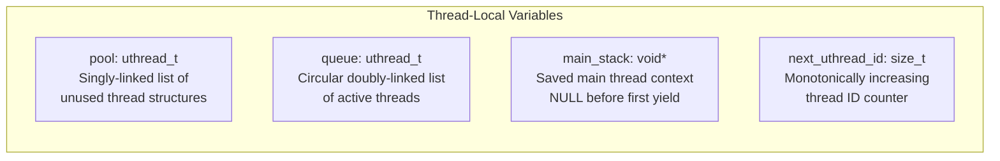
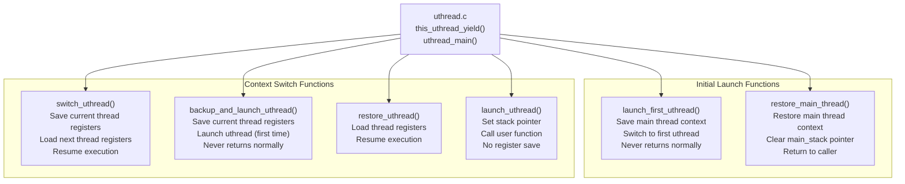
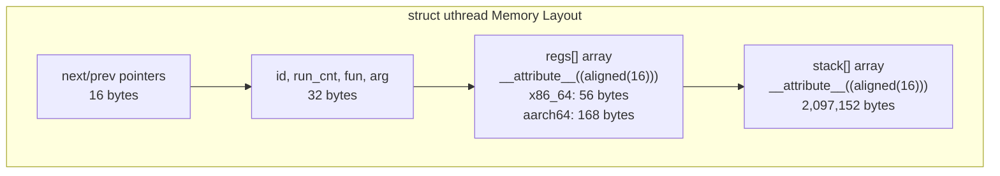
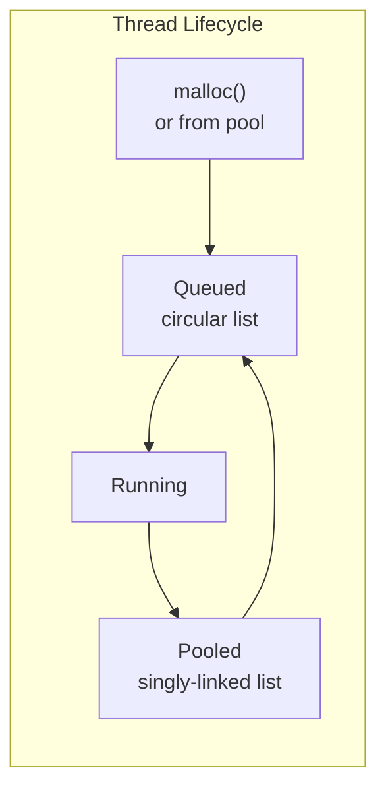
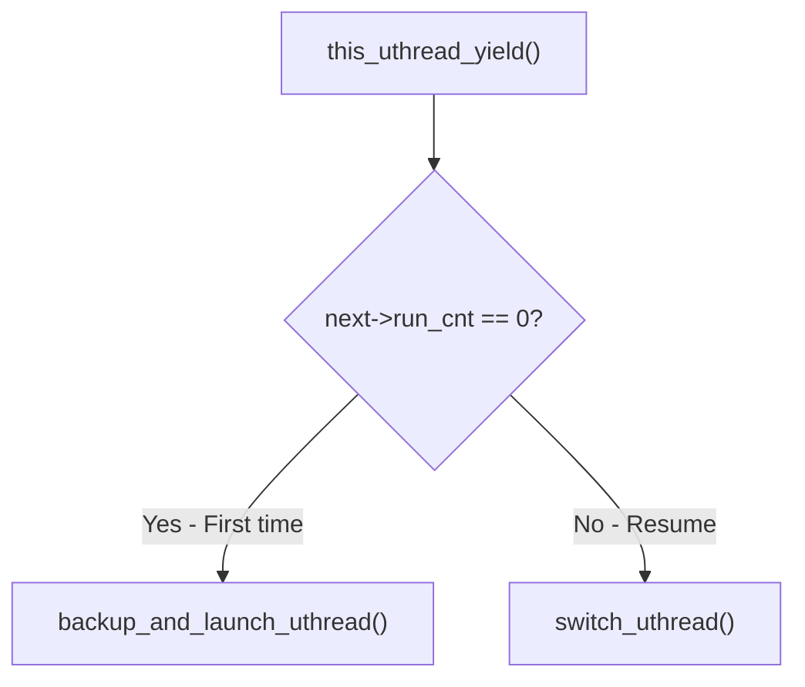

<!-- source: DeepWiki mcp.deepwiki.com · repo NVIDIA/libuthread · page 5 Architecture and Implementation · fetched 2026-10-26 -->

# Architecture and Implementation

<details>
<summary>Relevant source files</summary>

The following files were used as context for generating this wiki page:

- [src/uthread.aarch64.S](src/uthread.aarch64.S)
- [src/uthread.c](src/uthread.c)
- [src/uthread.x86_64.S](src/uthread.x86_64.S)

</details>


## Purpose and Scope

This page provides a comprehensive technical overview of libuthread's internal architecture and implementation. It covers the core data structures, the separation between platform-independent and platform-specific code, the assembly function interface, and key implementation decisions regarding memory management and register conventions.

For detailed information on specific topics, refer to:
- Context switching mechanics and register save/restore operations: [5.1](#5.1)
- x86_64-specific assembly implementation: [5.2](#5.2)
- ARM64 (aarch64)-specific assembly implementation: [5.3](#5.3)
- Complete thread lifecycle and state transitions: [5.4](#5.4)

---

## Overall Architecture

libuthread employs a clean layered architecture that separates platform-independent thread management logic from platform-specific context switching implementations.

### Architecture Layering



**Sources:** [src/uthread.c:1-254](), [src/uthread.x86_64.S:1-115](), [src/uthread.aarch64.S:1-136]()

The C implementation in `uthread.c` handles all thread lifecycle management, queue manipulation, and pool management. It invokes six assembly functions to perform low-level context switching. The build system selects either the x86_64 or aarch64 assembly file based on the target architecture (see [6.1](#6.1) for build system details).

---

## Core Data Structures

### The `uthread` Struct

The `struct uthread` is the central data structure representing a user-level thread. It contains all state necessary for thread execution and management.



**Sources:** [src/uthread.c:80-90]()

| Field | Type | Purpose |
|-------|------|---------|
| `next`, `prev` | `uthread_t` | Doubly-linked list pointers for circular queue/pool |
| `id` | `size_t` | Unique thread identifier, assigned monotonically |
| `run_cnt` | `size_t` | Execution count, used to distinguish first launch from resume |
| `fun` | `uthread_fun_t` | User function to execute |
| `arg` | `void*` | Argument passed to user function |
| `regs` | `uint64_t[]` | Platform-specific saved register state |
| `stack` | `uint8_t[]` | Thread's private stack (2MB) |

**Sources:** [src/uthread.c:80-90]()

The `regs` array size varies by architecture:
- **x86_64**: 7 registers (rbx, rsp, rbp, r12-r15)
- **aarch64**: 21 registers (d8-d15, sp, x19-x30)

**Sources:** [src/uthread.c:35-54]()

### Thread-Local Storage

libuthread uses thread-local storage (TLS) to maintain per-OS-thread state without requiring explicit context passing:



**Sources:** [src/uthread.c:94-97]()

| Variable | Type | Purpose |
|----------|------|---------|
| `next_uthread_id` | `size_t` | Next available thread ID |
| `pool` | `uthread_t` | Head of unused thread pool (singly-linked) |
| `queue` | `uthread_t` | Current thread in active queue (circular doubly-linked) |
| `main_stack` | `void*` | Pointer to saved main thread register state |

**Sources:** [src/uthread.c:94-97]()

The `main_stack` variable serves a dual purpose:
1. When `NULL`, indicates that uthread processing has not started
2. When non-NULL, points to saved register state for the main OS thread

**Sources:** [src/uthread.c:228-252]()

---

## Assembly Function Interface

The platform-independent C code communicates with platform-specific assembly through six well-defined functions. These functions form a stable ABI that both implementations must provide.

### Assembly Function Contracts



**Sources:** [src/uthread.c:66-74](), [src/uthread.x86_64.S:1-115](), [src/uthread.aarch64.S:1-136]()

| Function | Purpose | When Used |
|----------|---------|-----------|
| `launch_first_uthread()` | Save main context, launch first thread | First `this_uthread_yield()` call |
| `restore_main_thread()` | Return to main thread after all uthreads complete | Last thread in `uthread_main()` |
| `switch_uthread()` | Switch between two previously-run threads | `this_uthread_yield()` when both threads have `run_cnt > 0` |
| `backup_and_launch_uthread()` | Save current thread, launch new thread | `this_uthread_yield()` when next thread has `run_cnt == 0` |
| `restore_uthread()` | Resume previously-yielded thread | `uthread_main()` when launching next thread with `run_cnt > 0` |
| `launch_uthread()` | Launch thread without saving current state | `uthread_main()` when current thread completed |

**Sources:** [src/uthread.c:224-253](), [src/uthread.c:194-222]()

### Function Signatures

The assembly functions are declared in C with the following signatures:

```c
// Initial launch/restore
void launch_first_uthread(void *arg, uthread_main_fun_t fun, void *stack, void **main_stack);
void restore_main_thread(void **main_stack);

// Context switching
void switch_uthread(uint64_t *next_regs, uint64_t *this_regs);
void backup_and_launch_uthread(void *arg, uthread_main_fun_t fun, void *stack, uint64_t *this_regs);
void restore_uthread(uint64_t *next_regs);
void launch_uthread(void *arg, uthread_main_fun_t fun, void *stack);
```

**Sources:** [src/uthread.c:66-74]()

---

## Platform-Specific Register Conventions

Each architecture has different calling conventions and callee-saved register sets. libuthread must save exactly the registers that the ABI requires callees to preserve.

### Register Count Comparison

| Architecture | Callee-Saved Registers | Storage Size (bytes) |
|--------------|------------------------|----------------------|
| x86_64 | 7 | 56 (7 × 8) |
| aarch64 | 21 | 168 (21 × 8) |

**Sources:** [src/uthread.c:35-54]()

### x86_64 Register Set

The x86_64 System V ABI specifies seven callee-saved registers:

- **Integer registers**: `rbx`, `rbp`, `r12`, `r13`, `r14`, `r15`
- **Stack pointer**: `rsp`

**Sources:** [src/uthread.c:35-40](), [src/uthread.x86_64.S:62-80]()

### aarch64 Register Set

The ARM Architecture Procedure Call Standard (AAPCS64) requires saving 21 registers:

- **Floating-point registers**: `d8`-`d15` (8 registers)
- **Integer registers**: `x19`-`x30` (12 registers)
- **Stack pointer**: `sp` (1 register)

**Sources:** [src/uthread.c:41-51](), [src/uthread.aarch64.S:74-102]()

The aarch64 implementation saves significantly more registers because:
1. AAPCS64 designates more integer registers as callee-saved (x19-x30 vs x86_64's limited set)
2. Vector/floating-point registers d8-d15 must be preserved
3. The register file is larger overall in the ARM architecture

---

## Memory Layout and Alignment

### Stack Configuration

Each `uthread` allocates a 2MB stack:

```c
#define UTHREAD_STACK_SIZE (1 << 21)  // 2,097,152 bytes
```

**Sources:** [src/uthread.c:55]()

The stack size is deliberately large to accommodate deep call chains and local variables without risk of overflow. The stack is part of the `struct uthread` allocation, ensuring contiguous memory layout.

Stack initialization uses the helper function `stack_of()` which returns the top of the stack (growth direction is downward on both x86_64 and aarch64):

```c
static void *stack_of(uthread_t thr) { 
    return &thr->stack[UTHREAD_STACK_SIZE - 16]; 
}
```

**Sources:** [src/uthread.c:92]()

The `-16` offset ensures 16-byte stack alignment, which is required by both x86_64 and aarch64 ABIs for proper function call alignment.

### Alignment Requirements



**Sources:** [src/uthread.c:80-90]()

Both `regs` and `stack` arrays have explicit 16-byte alignment attributes:

```c
uint64_t regs[UTHREAD_NUM_SAVED_REGS] __attribute__((aligned(16)));
uint8_t stack[UTHREAD_STACK_SIZE] __attribute__((aligned(16)));
```

**Sources:** [src/uthread.c:88-89]()

This alignment is critical for:
1. **SIMD operations**: Many architectures require 16-byte alignment for vector/floating-point operations
2. **Performance**: Aligned memory accesses are faster on most architectures
3. **ABI compliance**: Stack pointers must maintain alignment for function calls

---

## Key Implementation Decisions

### Cooperative Scheduling

libuthread uses **cooperative multitasking** rather than preemptive scheduling. Threads explicitly yield control via `this_uthread_yield()`. This design choice:

- Eliminates need for signal handlers or timer interrupts
- Simplifies synchronization (no race conditions between uthreads)
- Provides deterministic behavior
- Requires explicit yield points in user code

**Sources:** [src/uthread.c:224-253]()

### Thread Pool Recycling

The library maintains a pool of unused thread structures to minimize allocation overhead:



**Sources:** [src/uthread.c:130-160](), [src/uthread.c:194-222]()

When `create_uthread()` is called:
1. If `pool` is non-empty, reuse a thread structure from the pool
2. Otherwise, allocate a new thread via `malloc()`

When a thread completes in `uthread_main()`:
1. Remove thread from the circular queue
2. Add thread to the pool for reuse

**Sources:** [src/uthread.c:130-160](), [src/uthread.c:203-208]()

### Run Count Dispatch

The `run_cnt` field serves as a discriminator for which assembly function to call:



**Sources:** [src/uthread.c:235-239]()

When `run_cnt == 0`, the thread has never executed, so:
- Use `backup_and_launch_uthread()` or `launch_first_uthread()`
- Initialize stack pointer to top of thread's stack
- Call `uthread_main()` to begin execution

When `run_cnt > 0`, the thread has yielded previously, so:
- Use `switch_uthread()` to restore saved registers
- Resume execution at the point where the thread yielded

This dispatch mechanism is critical for correctness, as launching an already-started thread would corrupt its stack and register state.

**Sources:** [src/uthread.c:235-239](), [src/uthread.c:211-217]()

### Main Thread Context Management

The `main_stack` variable serves a dual purpose for detecting initialization state:

```c
if (UTHREAD_LIKELY_(main_stack != NULL)) {
    // Uthread processing active - switch between threads
} else if (cur) {
    // First yield - save main thread and launch first uthread
}
```

**Sources:** [src/uthread.c:228-252]()

This pattern enables `this_uthread_yield()` to be called from both:
1. **Main thread context**: First call saves main thread state
2. **Uthread context**: Subsequent calls switch between uthreads

When all uthreads complete, `restore_main_thread()` clears `main_stack` back to `NULL` and returns control to the original OS thread.

**Sources:** [src/uthread.c:220](), [src/uthread.x86_64.S:48-60](), [src/uthread.aarch64.S:54-72]()

---

## Introspection APIs

The library provides introspection functions that query the current thread state:

```c
size_t this_uthread_id(void);
size_t this_uthread_run_count(void);
```

**Sources:** [src/uthread.c:174-192]()

These functions rely on the invariant that `queue` points to the currently executing thread:

```c
uthread_t thr = queue;
if (!thr) {
    UTHREAD_DEBUG_PRINT_("ERROR: Not inside a uthread.\n");
    return 0;
}
return thr->id;  // or thr->run_cnt
```

**Sources:** [src/uthread.c:174-192]()

This works because:
1. `queue` is updated before context switch: `queue = next;`
2. The assembly functions preserve this invariant across switches
3. When not inside a uthread (before first yield or after all complete), `queue` is `NULL`

**Sources:** [src/uthread.c:234](), [src/uthread.c:219]()

---

## Debugging Support

The implementation includes conditional debug logging controlled by the `NDEBUG` macro:

```c
#ifndef NDEBUG
#include <stdio.h>
#define UTHREAD_DEBUG_PRINT_(...) printf(__VA_ARGS__)
#else
#define UTHREAD_DEBUG_PRINT_(...) do { } while (0)
#endif
```

**Sources:** [src/uthread.c:23-30]()

Debug builds emit trace messages for key operations like `launch_first_uthread()`, while release builds compile to no-ops with zero overhead.

**Sources:** [src/uthread.c:249-251]()

---

## Summary

The architecture of libuthread demonstrates a clean separation of concerns:

1. **Platform-independent C layer** handles thread lifecycle, queue management, and dispatch logic
2. **Platform-specific assembly layer** performs low-level context switching with architecture-appropriate register conventions
3. **Stable ABI** between layers enables adding new architectures by implementing six assembly functions
4. **Cooperative scheduling** simplifies implementation and provides deterministic behavior
5. **Thread pool recycling** minimizes allocation overhead for repeated thread creation
6. **Run count dispatch** correctly handles first launch vs. resume operations

This design enables efficient user-level threading with minimal overhead, making it suitable for hiding memory latencies in high-performance applications.

**Sources:** [src/uthread.c:1-254](), [src/uthread.x86_64.S:1-115](), [src/uthread.aarch64.S:1-136]()

---

