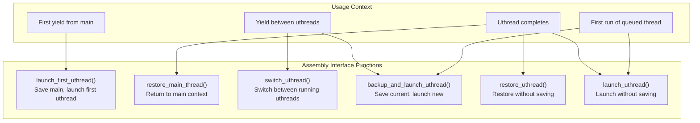
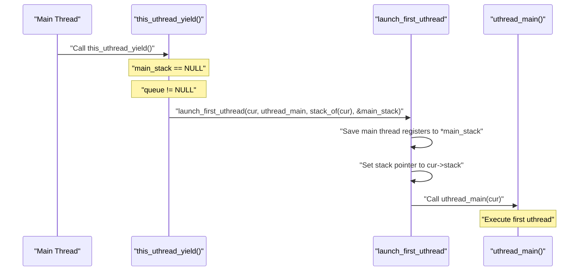
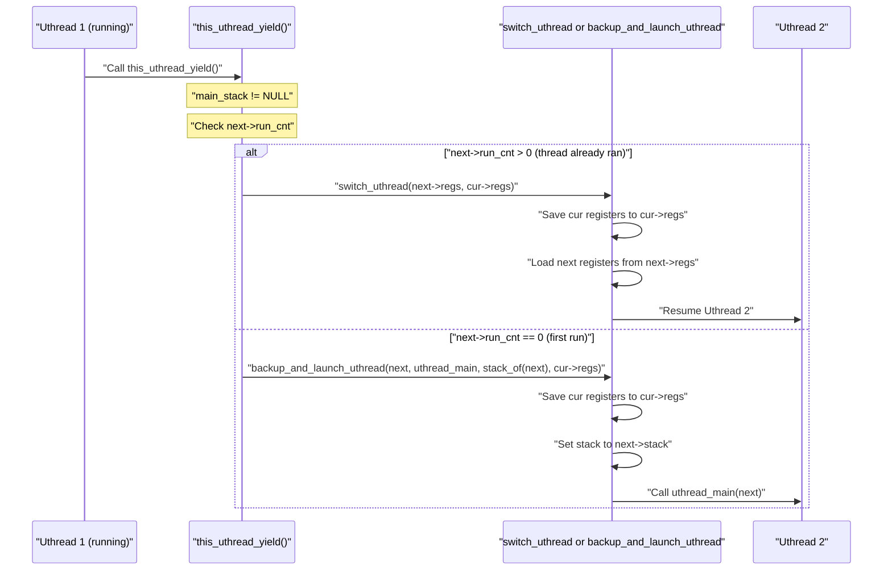
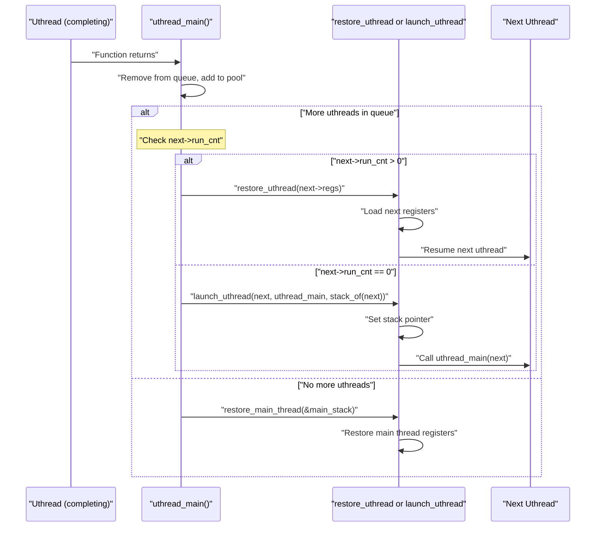
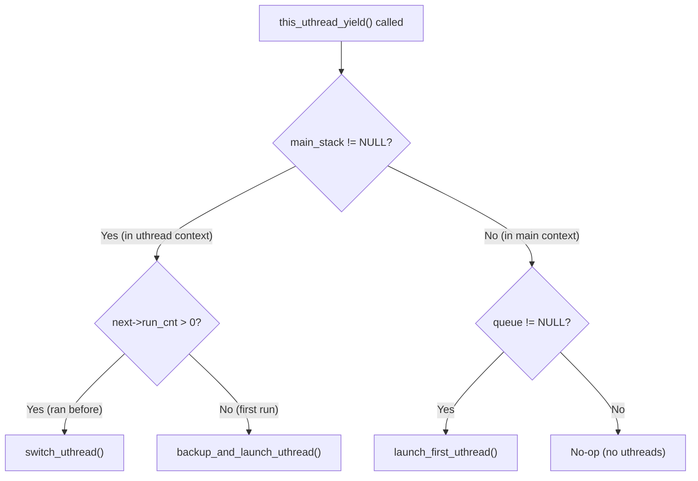
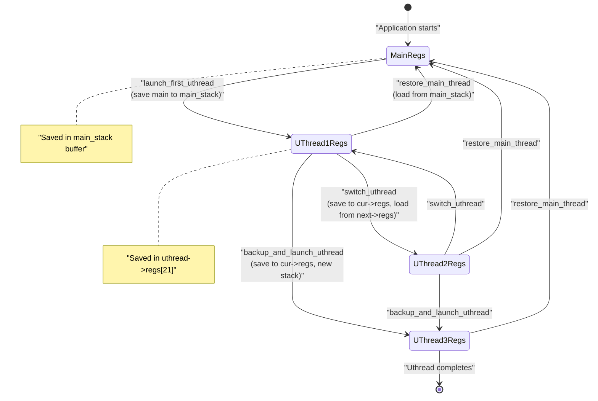

<!-- source: DeepWiki mcp.deepwiki.com · repo NVIDIA/libuthread · page 5.1 Context Switching Mechanism · fetched 2026-10-26 -->

# Context Switching Mechanism

<details>
<summary>Relevant source files</summary>

The following files were used as context for generating this wiki page:

- [src/uthread.aarch64.S](src/uthread.aarch64.S)
- [src/uthread.c](src/uthread.c)
- [src/uthread.x86_64.S](src/uthread.x86_64.S)

</details>


## Purpose and Scope

This page explains the core context switching mechanism that enables libuthread to perform cooperative multitasking. It covers the register state management, the assembly-level operations for saving and restoring execution contexts, and the coordination between C code and architecture-specific assembly routines. For architecture-specific implementation details, see [x86_64 Implementation](#5.2) and [ARM64 Implementation](#5.3).

## Overview of Context Switching

Context switching in libuthread involves saving the current thread's execution state (registers and stack pointer) and restoring a different thread's previously-saved state. Unlike OS-level context switches that involve kernel mode transitions, libuthread performs user-level context switches entirely in user space using inline assembly functions.

The context switch mechanism operates on **callee-saved registers** as defined by the System V ABI (x86_64) and AAPCS64 (ARM64). These registers must be preserved across function calls, making them the minimal set needed to resume execution correctly.

| Architecture | Callee-Saved Registers | Count |
|--------------|------------------------|-------|
| x86_64 | rbx, rsp, rbp, r12-r15 | 7 |
| aarch64 | sp, x19-x30, d8-d15 | 21 |

Sources: [src/uthread.c:35-54]()

## Register State Storage

Each `uthread` structure contains a `regs` array that stores the callee-saved register values for suspended threads. The array size is determined at compile time based on the target architecture.

```
struct uthread {
  uthread_t next, prev;
  size_t id;
  size_t run_cnt;
  uthread_fun_t fun;
  void *arg;
  uint64_t regs[UTHREAD_NUM_SAVED_REGS] __attribute__((aligned(16)));
  uint8_t stack[UTHREAD_STACK_SIZE] __attribute__((aligned(16)));
};
```

The `regs` array is 16-byte aligned to satisfy SIMD instruction requirements on both architectures. On x86_64, this array holds 7 registers (56 bytes). On aarch64, it holds 21 registers (168 bytes), including 8 floating-point registers (d8-d15) to support the full AAPCS64 calling convention.

Sources: [src/uthread.c:80-90]()

## Assembly Interface Functions

The C code in `uthread.c` delegates all register manipulation to architecture-specific assembly functions. Six assembly functions handle different context switch scenarios:



Sources: [src/uthread.c:66-74](), [src/uthread.x86_64.S:33-114](), [src/uthread.aarch64.S:33-136]()

### Function Signatures

The assembly functions are declared as external C functions:

| Function | Parameters | Purpose |
|----------|-----------|---------|
| `launch_first_uthread` | `void *arg, uthread_main_fun_t fun, void *stack, void **main_stack` | First transition from main thread to uthread execution |
| `restore_main_thread` | `void **main_stack` | Return from uthread execution to main thread |
| `switch_uthread` | `uint64_t *next_regs, uint64_t *this_regs` | Switch between two running uthreads |
| `backup_and_launch_uthread` | `void *arg, uthread_main_fun_t fun, void *stack, uint64_t *this_regs` | Save current thread, launch new thread for first time |
| `restore_uthread` | `uint64_t *next_regs` | Restore a thread without saving current state |
| `launch_uthread` | `void *arg, uthread_main_fun_t fun, void *stack` | Launch a new thread without saving current state |

Sources: [src/uthread.c:66-74]()

## Context Switch Scenarios

The context switching mechanism handles four distinct scenarios, each using different combinations of assembly functions:

### Scenario 1: First Yield from Main Thread



This scenario occurs when `main_stack` is `NULL` and `queue` is non-empty, indicating the application is transitioning into uthread execution for the first time. The `launch_first_uthread` function saves the main thread's callee-saved registers to a stack-allocated buffer (pointed to by `main_stack`) and jumps to `uthread_main` with the first uthread's stack.

Sources: [src/uthread.c:240-251]()

### Scenario 2: Switching Between Running Uthreads



When yielding between uthreads (after the main thread context has been saved), the code checks whether the next thread has previously executed using `next->run_cnt`:
- If `run_cnt > 0`, use `switch_uthread` to save current registers and restore the next thread's saved registers
- If `run_cnt == 0`, use `backup_and_launch_uthread` to save current registers and launch the thread for the first time

Sources: [src/uthread.c:224-239]()

### Scenario 3: Uthread Completion



When a uthread completes execution (its function returns), `uthread_main` removes it from the queue and returns it to the pool. It then determines the next action:
- If more uthreads exist, use `restore_uthread` (if already executed) or `launch_uthread` (if first run)
- If no more uthreads, use `restore_main_thread` to return to the application's main thread

Note that these functions do not save the completing thread's state because it has finished execution.

Sources: [src/uthread.c:194-222]()

### Scenario 4: Returning to Main Thread

When the last uthread completes, `restore_main_thread` is called to return control to the application's main thread. This function restores the callee-saved registers that were saved during the first `launch_first_uthread` call and clears the `main_stack` pointer.

Sources: [src/uthread.c:218-221]()

## Save and Restore Macros

Both architecture implementations use assembly macros to save and restore registers efficiently. These macros encapsulate the architecture-specific register layouts:

### x86_64 Macros

The x86_64 implementation uses simple `movq` instructions to save 7 registers to memory:

```
.macro save_regs  dst
  movq      %rbx, 0 (\dst)
  movq      %rsp, 8 (\dst)
  movq      %rbp, 16(\dst)
  movq      %r12, 24(\dst)
  movq      %r13, 32(\dst)
  movq      %r14, 40(\dst)
  movq      %r15, 48(\dst)
.endm
```

Sources: [src/uthread.x86_64.S:62-80]()

### aarch64 Macros

The aarch64 implementation saves 21 registers (8 FP + 13 general-purpose) using `stp` (store pair) instructions for efficiency:

```
.macro save_regs  dst
  mov     x10, sp
  stp     d8,  d9,  [\dst,   #0]
  stp     d10, d11, [\dst,  #16]
  stp     d12, d13, [\dst,  #32]
  stp     d14, d15, [\dst,  #48]
  stp     x10, x19, [\dst,  #64]
  stp     x20, x21, [\dst,  #80]
  stp     x22, x23, [\dst,  #96]
  stp     x24, x25, [\dst, #112]
  stp     x26, x27, [\dst, #128]
  stp     x28, x29, [\dst, #144]
  str     x30,      [\dst, #160]
.endm
```

Sources: [src/uthread.aarch64.S:74-102]()

## C Code Coordination

The C code in `this_uthread_yield` acts as the coordinator, determining which assembly function to call based on the current execution state:



The decision tree uses two key pieces of state:
- `main_stack`: NULL before first yield, non-NULL afterward
- `run_cnt`: 0 for threads that have never executed, >0 for threads that have yielded at least once

Sources: [src/uthread.c:224-253]()

## Stack Management

Each uthread has its own stack allocated as part of the `uthread` structure. The stack is 2MB (`UTHREAD_STACK_SIZE = 1 << 21`) and 16-byte aligned. The `stack_of` helper function returns a pointer to the top of the stack (high address) minus 16 bytes for alignment.

```
static void *stack_of(uthread_t thr) { 
  return &thr->stack[UTHREAD_STACK_SIZE - 16]; 
}
```

When launching a new thread, the assembly functions set the stack pointer (`rsp` on x86_64, `sp` on aarch64) to this address. The stack grows downward from this point as the thread executes. When switching back to a thread, the saved stack pointer is restored from the `regs` array.

The main thread's stack is managed differently: its stack pointer is saved to a thread-local variable `main_stack` during the first `launch_first_uthread` call, and restored when all uthreads complete.

Sources: [src/uthread.c:55](), [src/uthread.c:92](), [src/uthread.c:97]()

## Register State Transitions

The following diagram shows how register state flows through the various assembly functions:



Sources: [src/uthread.c:224-253](), [src/uthread.c:194-222]()

## Performance Considerations

The context switch mechanism is designed for minimal overhead:

1. **Callee-saved registers only**: By saving only callee-saved registers (not caller-saved), the context switch avoids saving registers that the C compiler already manages.

2. **Aligned memory access**: The 16-byte alignment of the `regs` array enables efficient SIMD loads/stores on both architectures.

3. **Macro-based saves/restores**: Assembly macros reduce code duplication and enable compiler optimizations.

4. **Conditional switching**: The `run_cnt` check avoids unnecessary saves when launching new threads or restoring completed threads.

5. **No system calls**: All context switches occur entirely in user space without kernel involvement.

The actual overhead of a context switch is approximately:
- x86_64: 7 register saves + 7 register loads = ~14 memory operations
- aarch64: 21 register saves + 21 register loads = ~42 memory operations (using paired instructions)

Sources: [src/uthread.c:35-54](), [src/uthread.x86_64.S:62-80](), [src/uthread.aarch64.S:74-102]()

---

