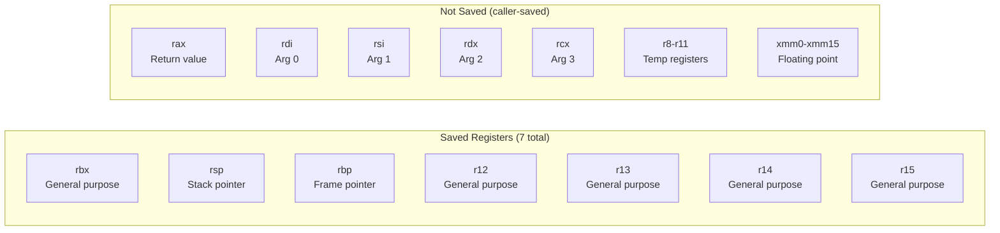
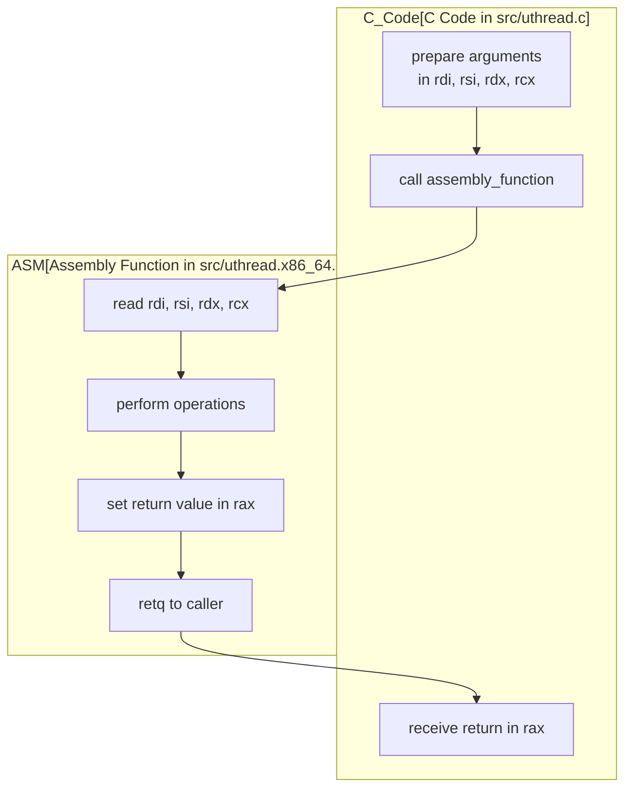
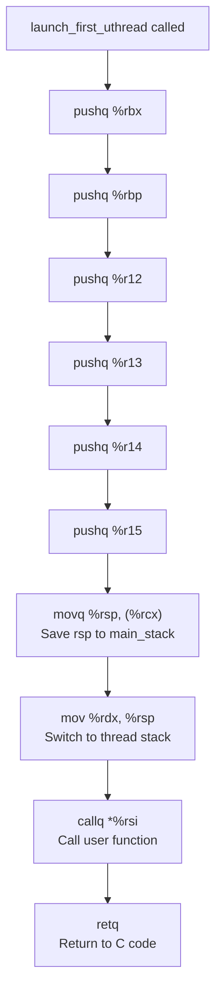
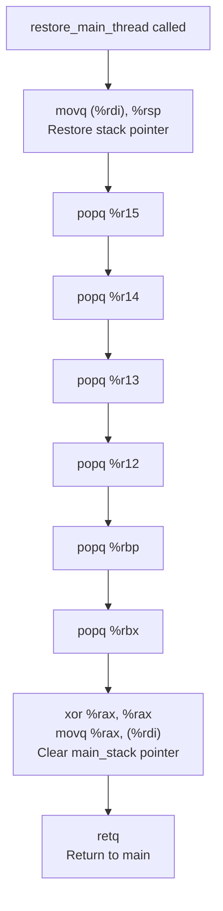
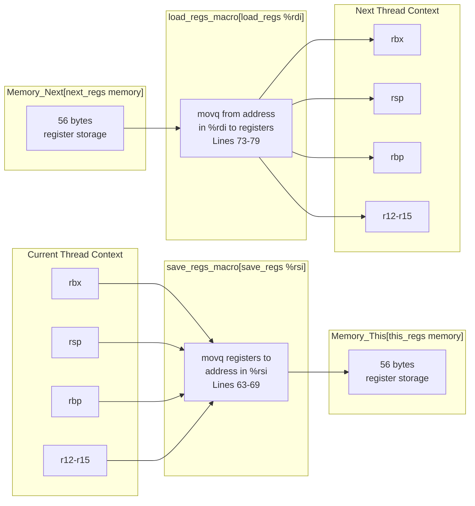
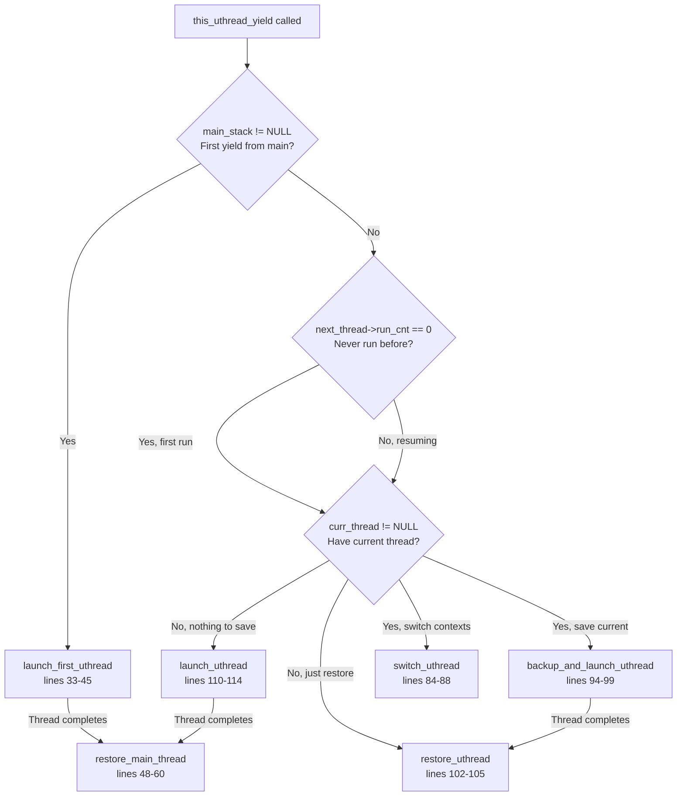

<!-- source: DeepWiki mcp.deepwiki.com · repo NVIDIA/libuthread · page 5.2 x86_64 Implementation · fetched 2026-10-26 -->

# x86_64 Implementation

<details>
<summary>Relevant source files</summary>

The following files were used as context for generating this wiki page:

- [CMakeLists.txt](CMakeLists.txt)
- [src/uthread.x86_64.S](src/uthread.x86_64.S)

</details>


This document details the x86_64-specific assembly implementation of libuthread's context switching mechanism. The implementation is contained in [src/uthread.x86_64.S]() and provides six assembly functions for managing thread state transitions on x86_64 Linux systems. This page covers the register preservation strategy (7 callee-saved registers), the System V AMD64 ABI calling conventions used, and the specific assembly routines that enable cooperative multitasking.

For general context switching concepts, see [Context Switching Mechanism](#5.1). For the ARM64 implementation, see [ARM64 (aarch64) Implementation](#5.3).

## Architecture Overview

The x86_64 implementation provides a minimal context switch by preserving only the callee-saved registers defined by the System V AMD64 ABI. This approach minimizes overhead while maintaining ABI compliance, allowing user-level threads to cooperatively yield execution to one another.

The implementation consists of six assembly functions called from the C code in [src/uthread.c]():

| Function | Purpose | Key Operation |
|----------|---------|---------------|
| `launch_first_uthread` | Save main thread state and launch first user thread | Saves 6 registers + rsp to main stack, switches to thread stack |
| `restore_main_thread` | Return control to main thread | Restores 6 registers + rsp from main stack |
| `switch_uthread` | Switch between two running threads | Saves 7 registers, loads 7 registers |
| `backup_and_launch_uthread` | Save current thread and launch new thread | Saves 7 registers, switches to new thread stack |
| `restore_uthread` | Resume a yielded thread | Loads 7 registers and returns |
| `launch_uthread` | Start a new thread without saving state | Sets stack pointer and calls function |

Sources: [src/uthread.x86_64.S:1-115]()

## Register Preservation Strategy

The x86_64 implementation saves exactly 7 registers per thread context, minimizing the size of each thread's saved state to 56 bytes (7 × 8 bytes).

### Callee-Saved Registers

According to the System V AMD64 ABI, the following registers must be preserved across function calls:



The implementation preserves only callee-saved registers because:
- Caller-saved registers (rax, rdi, rsi, rdx, rcx, r8-r11) are managed by the calling code
- Floating-point registers (xmm0-xmm15) are caller-saved in the System V AMD64 ABI
- This minimizes context switch overhead

Sources: [src/uthread.x86_64.S:62-80]()

### Register Storage Layout

Each thread's register state is stored as a 56-byte array with this layout:

| Offset | Register | Size |
|--------|----------|------|
| 0 | rbx | 8 bytes |
| 8 | rsp | 8 bytes |
| 16 | rbp | 8 bytes |
| 24 | r12 | 8 bytes |
| 32 | r13 | 8 bytes |
| 40 | r14 | 8 bytes |
| 48 | r15 | 8 bytes |

This layout is implemented via the `save_regs` and `load_regs` macros defined in [src/uthread.x86_64.S:62-80]().

Sources: [src/uthread.x86_64.S:62-80]()

## Function Calling Conventions

All assembly functions follow the System V AMD64 ABI calling convention:

**Argument Registers:**
- First argument: `rdi`
- Second argument: `rsi`
- Third argument: `rdx`
- Fourth argument: `rcx`

**Return Value:**
- Return value in `rax`

**Stack Alignment:**
- Stack must be 16-byte aligned before `call` instructions



Sources: [src/uthread.x86_64.S:29-114]()

## Assembly Function Reference

### launch_first_uthread

**Purpose:** Save the main thread's state and transfer control to the first user thread.

**Signature:**
```
void launch_first_uthread(void *arg0, void (*func)(void*), void *stack_begin, void **main_stack)
```

**Parameters:**
- `rdi`: `arg0` - Argument to pass to the user thread function
- `rsi`: `func` - Function pointer to execute
- `rdx`: `stack_begin` - Top of the new thread's stack
- `rcx`: `main_stack` - Pointer to main thread's stack storage

**Implementation Flow:**



**Key Operations:**
1. Pushes 6 callee-saved registers (rbx, rbp, r12-r15) onto the main stack [src/uthread.x86_64.S:34-39]()
2. Saves the current stack pointer to the location pointed to by `main_stack` [src/uthread.x86_64.S:40]()
3. Switches to the new thread's stack [src/uthread.x86_64.S:42]()
4. Calls the user thread function with `arg0` already in `rdi` [src/uthread.x86_64.S:43]()

Sources: [src/uthread.x86_64.S:33-45]()

### restore_main_thread

**Purpose:** Restore the main thread's state and return control to it.

**Signature:**
```
void restore_main_thread(void **main_stack)
```

**Parameters:**
- `rdi`: `main_stack` - Pointer to main thread's saved stack

**Implementation:**



**Key Operations:**
1. Restores stack pointer from saved location [src/uthread.x86_64.S:49]()
2. Pops 6 callee-saved registers in reverse order [src/uthread.x86_64.S:50-55]()
3. Clears the main_stack pointer as a safety measure [src/uthread.x86_64.S:57-58]()
4. Returns to the point where `launch_first_uthread` was called

Sources: [src/uthread.x86_64.S:48-60]()

### switch_uthread

**Purpose:** Switch execution between two user threads that have both been initialized and yielded at least once.

**Signature:**
```
void switch_uthread(void *next_regs, void *this_regs)
```

**Parameters:**
- `rdi`: `next_regs` - Register state of thread to switch to
- `rsi`: `this_regs` - Register state of current thread

**Implementation:**
Uses the `save_regs` and `load_regs` macros defined in [src/uthread.x86_64.S:62-80]().



**Macro Definitions:**

The `save_regs` macro [src/uthread.x86_64.S:62-70]():
```
.macro save_regs dst
  movq %rbx, 0 (\dst)
  movq %rsp, 8 (\dst)
  movq %rbp, 16(\dst)
  movq %r12, 24(\dst)
  movq %r13, 32(\dst)
  movq %r14, 40(\dst)
  movq %r15, 48(\dst)
.endm
```

The `load_regs` macro [src/uthread.x86_64.S:72-80]():
```
.macro load_regs src
  movq 0 (\src), %rbx
  movq 8 (\src), %rsp
  movq 16(\src), %rbp
  movq 24(\src), %r12
  movq 32(\src), %r13
  movq 40(\src), %r14
  movq 48(\src), %r15
.endm
```

Sources: [src/uthread.x86_64.S:62-88]()

### backup_and_launch_uthread

**Purpose:** Save the current thread's state and launch a new thread that has never run before (run_cnt == 0).

**Signature:**
```
void backup_and_launch_uthread(void *arg0, void (*func)(void*), void *stack_begin, void *this_regs)
```

**Parameters:**
- `rdi`: `arg0` - Argument to pass to the new thread
- `rsi`: `func` - Function pointer to execute
- `rdx`: `stack_begin` - Top of the new thread's stack
- `rcx`: `this_regs` - Register state storage for current thread

**Implementation Flow:**
1. Uses `save_regs` macro to save current thread's 7 registers [src/uthread.x86_64.S:95]()
2. Switches to the new thread's stack [src/uthread.x86_64.S:96]()
3. Calls the user function [src/uthread.x86_64.S:97]()

Sources: [src/uthread.x86_64.S:94-99]()

### restore_uthread

**Purpose:** Resume execution of a previously yielded thread.

**Signature:**
```
void restore_uthread(void *regs)
```

**Parameters:**
- `rdi`: `regs` - Register state to restore

**Implementation:**
Simply uses the `load_regs` macro to restore all 7 registers and returns [src/uthread.x86_64.S:102-105]().

Sources: [src/uthread.x86_64.S:102-105]()

### launch_uthread

**Purpose:** Launch a new thread without saving any state (used when no current thread needs preservation).

**Signature:**
```
void launch_uthread(void *arg0, void (*func)(void*), void *stack_begin)
```

**Parameters:**
- `rdi`: `arg0` - Argument to pass to the thread
- `rsi`: `func` - Function pointer to execute
- `rdx`: `stack_begin` - Top of the thread's stack

**Implementation:**
Switches to the new stack and calls the function without saving any registers [src/uthread.x86_64.S:110-114]().

Sources: [src/uthread.x86_64.S:110-114]()

## Function Selection Logic

The C code in [src/uthread.c]() selects the appropriate assembly function based on thread state:



Sources: [src/uthread.x86_64.S:1-115](), [src/uthread.c]()

## Build Integration

The x86_64 assembly file is selected at build time by CMake's architecture detection:

1. CMake determines the target architecture using compiler flags [CMakeLists.txt:22-34]()
2. For x86_64 systems, `NVUT_TARGET` is set to `x86_64`
3. The build system compiles `src/uthread.${NVUT_TARGET}.S` [CMakeLists.txt:43]()
4. The resulting static library contains the appropriate architecture-specific functions

Sources: [CMakeLists.txt:22-43]()

## Assembly Syntax and Macros

### Function Declaration Macro

The file uses a custom macro for function declarations [src/uthread.x86_64.S:18-27]():

```
.macro function name
  .macro end_function
    .size \name, . -\name
    .purgem end_function
  .endm
  .global \name
  .type \name, %function
  .align 16
  \name:
.endm
```

This macro:
- Declares the function as global (`.global`)
- Sets function type for the linker (`.type`)
- Aligns the function on 16-byte boundaries (`.align 16`)
- Defines a nested `end_function` macro for setting the function size

Sources: [src/uthread.x86_64.S:18-27]()

## Performance Characteristics

### Context Switch Cost

The minimal register set results in fast context switches:

- **save_regs**: 7 memory writes (7 × 8 bytes = 56 bytes)
- **load_regs**: 7 memory reads (7 × 8 bytes = 56 bytes)
- Total: 14 memory operations per full context switch

### Comparison to aarch64

The x86_64 implementation is more efficient than the aarch64 implementation in terms of state size:

| Architecture | Registers Saved | State Size | File |
|--------------|-----------------|------------|------|
| x86_64 | 7 | 56 bytes | [src/uthread.x86_64.S]() |
| aarch64 | 21 | 168 bytes | [src/uthread.aarch64.S]() |

The aarch64 implementation must save additional floating-point registers to maintain ABI compliance.

Sources: [src/uthread.x86_64.S:62-80]()

## Stack Management

### Stack Pointer Handling

The stack pointer (`rsp`) management is critical for correct operation:

1. **During save_regs**: Current `rsp` is saved at offset 8 in the register state [src/uthread.x86_64.S:64]()
2. **During load_regs**: Saved `rsp` is restored, switching stacks [src/uthread.x86_64.S:74]()
3. **Stack alignment**: Functions assume 16-byte aligned stacks per ABI requirements

### Stack Direction

x86_64 stacks grow downward (toward lower addresses). When setting up a new thread:
- `stack_begin` points to the top of the stack (highest address)
- The `mov %rdx, %rsp` instruction sets the stack pointer to this location
- Subsequent function calls push data downward

Sources: [src/uthread.x86_64.S:42,96,111]()

---

