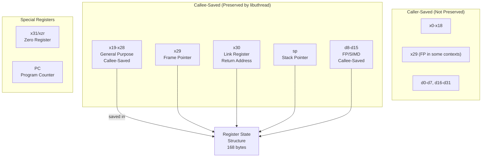
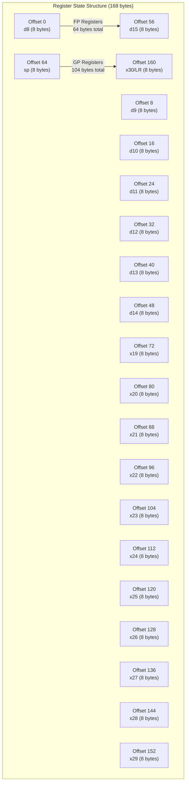
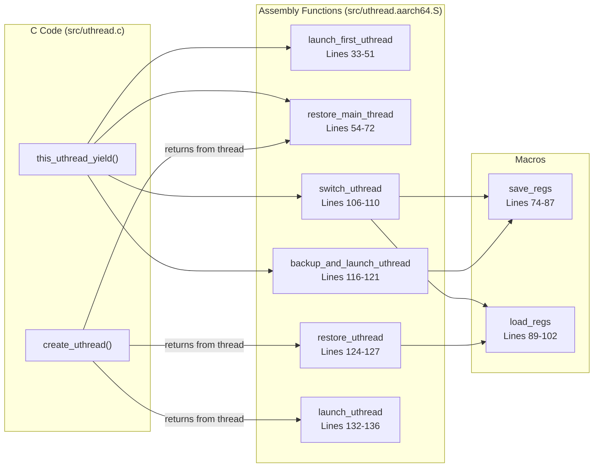
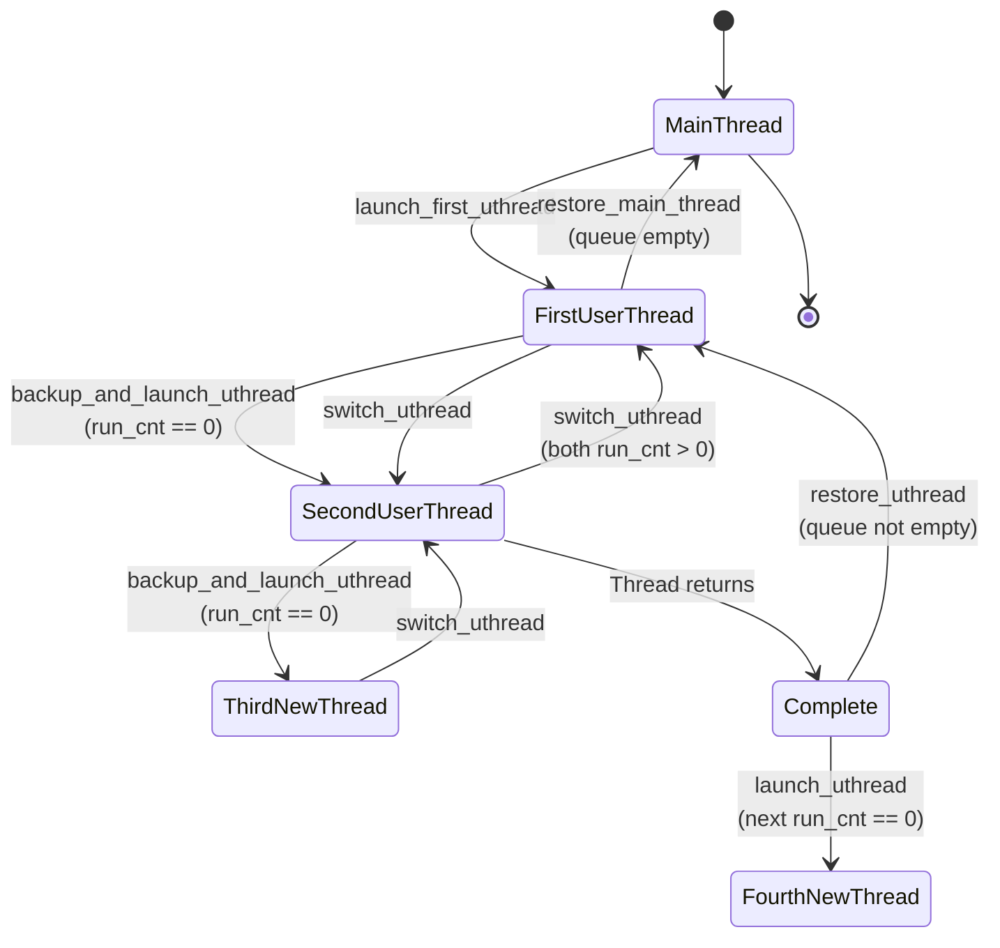

<!-- source: DeepWiki mcp.deepwiki.com · repo NVIDIA/libuthread · page 5.3 ARM64 (aarch64) Implementation · fetched 2026-10-26 -->

# ARM64 (aarch64) Implementation

<details>
<summary>Relevant source files</summary>

The following files were used as context for generating this wiki page:

- [CMakeLists.txt](CMakeLists.txt)
- [src/uthread.aarch64.S](src/uthread.aarch64.S)

</details>


## Purpose and Scope

This page details the ARM64 (AArch64) specific assembly implementation of libuthread's context switching mechanisms. It covers the register preservation strategy, memory layout of saved thread state, and the six assembly functions that enable cooperative multitasking on ARM64 Linux systems.

For the general context switching mechanism applicable to both architectures, see [Context Switching Mechanism](#5.1). For the x86_64-specific implementation, see [x86_64 Implementation](#5.2).

---

## Register Conventions

ARM64 follows the ARM Architecture Procedure Call Standard (AAPCS64), which defines register usage conventions. The libuthread implementation preserves all callee-saved registers to ensure correct execution when switching between thread contexts.

### Preserved Registers

The ARM64 implementation saves 21 registers totaling 168 bytes per thread:

| Register Type | Registers | Count | Purpose |
|---------------|-----------|-------|---------|
| **Floating-Point** | `d8`-`d15` | 8 | Callee-saved FP/SIMD registers (lower 64 bits of v8-v15) |
| **General Purpose** | `x19`-`x29` | 11 | Callee-saved general purpose registers |
| **Link Register** | `x30` (LR) | 1 | Return address |
| **Stack Pointer** | `sp` | 1 | Current stack position |

This contrasts with the x86_64 implementation which saves only 7 registers, as ARM64 has more callee-saved registers and includes floating-point state preservation by default.

### Register Roles



**Sources:**
- [src/uthread.aarch64.S:74-102]()

---

## Register State Structure

The ARM64 implementation uses a 168-byte structure to store thread state. This structure is allocated as part of each thread's context and is referenced by the `reg_state` field in the `uthread` structure.

### Memory Layout



### Structure Details

| Offset | Size | Register | Description |
|--------|------|----------|-------------|
| 0-7 | 8 | `d8` | Floating-point register 8 |
| 8-15 | 8 | `d9` | Floating-point register 9 |
| 16-23 | 8 | `d10` | Floating-point register 10 |
| 24-31 | 8 | `d11` | Floating-point register 11 |
| 32-39 | 8 | `d12` | Floating-point register 12 |
| 40-47 | 8 | `d13` | Floating-point register 13 |
| 48-55 | 8 | `d14` | Floating-point register 14 |
| 56-63 | 8 | `d15` | Floating-point register 15 |
| 64-71 | 8 | `sp` | Stack pointer |
| 72-79 | 8 | `x19` | General purpose register 19 |
| 80-87 | 8 | `x20` | General purpose register 20 |
| 88-95 | 8 | `x21` | General purpose register 21 |
| 96-103 | 8 | `x22` | General purpose register 22 |
| 104-111 | 8 | `x23` | General purpose register 23 |
| 112-119 | 8 | `x24` | General purpose register 24 |
| 120-127 | 8 | `x25` | General purpose register 25 |
| 128-135 | 8 | `x26` | General purpose register 26 |
| 136-143 | 8 | `x27` | General purpose register 27 |
| 144-151 | 8 | `x28` | General purpose register 28 |
| 152-159 | 8 | `x29` | Frame pointer register |
| 160-167 | 8 | `x30` | Link register (return address) |

The floating-point registers are stored first (offsets 0-63), followed by the stack pointer and general-purpose registers (offsets 64-167). This layout is used consistently by the `save_regs` and `load_regs` macros.

**Sources:**
- [src/uthread.aarch64.S:74-102]()
- [src/uthread.aarch64.S:33-51]()

---

## Assembly Functions Overview

The ARM64 implementation provides six assembly functions that are called from the C code in `src/uthread.c`:



### Function Summary

| Function | Purpose | When Called |
|----------|---------|-------------|
| `launch_first_uthread` | Save main thread state and start first user thread | First `this_uthread_yield()` call from main |
| `restore_main_thread` | Restore main thread state when all threads complete | Last thread completes execution |
| `switch_uthread` | Switch between two already-running threads | Yielding from one active thread to another |
| `backup_and_launch_uthread` | Save current thread and launch a new thread for first time | Yielding to a thread with `run_cnt == 0` |
| `restore_uthread` | Restore a previously-yielded thread | Thread function returns, restoring previous thread |
| `launch_uthread` | Launch a new thread without saving current state | Thread function returns, launching next new thread |

**Sources:**
- [src/uthread.aarch64.S:1-136]()
- [CMakeLists.txt:43]()

---

## Assembly Function Details

### launch_first_uthread

```
void launch_first_uthread(void *arg0, void (*func)(void*), void *stack_begin, void **main_stack)
```

This function is called on the first `this_uthread_yield()` from the main thread. It saves the main thread's register state for later restoration and launches the first user thread.

**Parameters:**
- `x0`: Argument to pass to the thread function
- `x1`: Pointer to the thread function
- `x2`: Beginning of the thread's stack
- `x3`: Pointer to `main_stack` variable (to store main thread state)

**Operation:**
1. Allocate 160 bytes below current stack pointer (`sub x4, sp, #160`)
2. Store this address in `main_stack` (`str x4, [x3]`)
3. Save all callee-saved registers to this location using `stp` (store pair) instructions
4. Switch to the new thread's stack (`mov sp, x2`)
5. Branch to the thread function (`br x1`)

The function saves registers in pairs using `stp` for efficiency, as shown in [src/uthread.aarch64.S:37-46]().

**Sources:**
- [src/uthread.aarch64.S:33-51]()

---

### restore_main_thread

```
void restore_main_thread(void **main_stack)
```

This function restores the main thread's register state when all user threads have completed. It is the inverse of `launch_first_uthread`.

**Parameters:**
- `x0`: Pointer to `main_stack` variable (containing saved main thread state)

**Operation:**
1. Load the saved state address from `main_stack` (`ldr x1, [x0]`)
2. Restore all callee-saved registers using `ldp` (load pair) instructions
3. Clear the `main_stack` pointer (`str xzr, [x0]`)
4. Restore stack pointer with 160-byte offset (`add sp, x1, #160`)
5. Return to the main thread (`ret`)

The clearing of `main_stack` in [src/uthread.aarch64.S:68]() serves as a safety mechanism to detect invalid restoration attempts.

**Sources:**
- [src/uthread.aarch64.S:54-72]()

---

### save_regs and load_regs Macros

These macros provide reusable code for saving and restoring thread state, used by multiple assembly functions.

#### save_regs Macro

```assembly
.macro save_regs dst
```

**Parameters:**
- `dst`: Destination address to save registers

**Operation:**
1. Save current stack pointer to temporary register (`mov x10, sp`)
2. Store floating-point registers d8-d15 (4 pairs)
3. Store stack pointer and x19 as a pair
4. Store remaining general-purpose registers x20-x29 (5 pairs)
5. Store link register x30 separately

The macro uses `x10` as a temporary to preserve the stack pointer before saving it.

#### load_regs Macro

```assembly
.macro load_regs src
```

**Parameters:**
- `src`: Source address to load registers from

**Operation:**
1. Load floating-point registers d8-d15 (4 pairs)
2. Load stack pointer to x10 and x19 as a pair
3. Load remaining general-purpose registers x20-x29 (5 pairs)
4. Load link register x30 separately
5. Restore stack pointer from x10 (`mov sp, x10`)

These macros ensure consistent register ordering across all context switch operations.

**Sources:**
- [src/uthread.aarch64.S:74-87]()
- [src/uthread.aarch64.S:89-102]()

---

### switch_uthread

```
void switch_uthread(void *next_reg_state, void *curr_reg_state)
```

This function switches between two already-running threads by saving the current thread's state and restoring the next thread's state.

**Parameters:**
- `x0`: Pointer to the next thread's register state structure
- `x1`: Pointer to the current thread's register state structure

**Operation:**
1. Call `save_regs x1` to save current thread state
2. Call `load_regs x0` to restore next thread state
3. Return to the restored thread's saved return address

This is the most frequently called context switch function during normal execution, used whenever two threads are yielding back and forth.

**Sources:**
- [src/uthread.aarch64.S:106-110]()

---

### backup_and_launch_uthread

```
void backup_and_launch_uthread(void *arg0, void (*func)(void*), void *stack_begin, void *curr_reg_state)
```

This function saves the current thread's state and launches a new thread that has never been executed before (`run_cnt == 0`).

**Parameters:**
- `x0`: Argument to pass to the new thread function
- `x1`: Pointer to the new thread function
- `x2`: Beginning of the new thread's stack
- `x3`: Pointer to current thread's register state structure

**Operation:**
1. Call `save_regs x3` to save current thread state
2. Switch to the new thread's stack (`mov sp, x2`)
3. Branch to the new thread function (`br x1`)

Unlike `switch_uthread`, this function does not restore any state—it directly launches a fresh thread with a new stack.

**Sources:**
- [src/uthread.aarch64.S:116-121]()

---

### restore_uthread

```
void restore_uthread(void *reg_state)
```

This function restores a previously-yielded thread without saving current state. It is used when a thread function returns and needs to resume a previous thread.

**Parameters:**
- `x0`: Pointer to the thread's register state structure

**Operation:**
1. Call `load_regs x0` to restore thread state
2. Return to the restored thread's saved return address

This is called from thread completion paths where the current execution context is being discarded.

**Sources:**
- [src/uthread.aarch64.S:124-127]()

---

### launch_uthread

```
void launch_uthread(void *arg0, void (*func)(void*), void *stack_begin)
```

This function launches a new thread without saving any current state. It is used when a thread completes and the next thread in the queue has never run before.

**Parameters:**
- `x0`: Argument to pass to the new thread function
- `x1`: Pointer to the new thread function
- `x2`: Beginning of the new thread's stack

**Operation:**
1. Switch to the new thread's stack (`mov sp, x2`)
2. Branch to the new thread function (`br x1`)

This is the simplest launch function, used when transitioning from a completing thread to a fresh thread.

**Sources:**
- [src/uthread.aarch64.S:132-136]()

---

## Context Switch Flow Patterns

The following diagram shows the typical execution patterns and which assembly functions are invoked:



### Key Decision Points

The C code in `src/uthread.c` selects the appropriate assembly function based on runtime conditions:

| Condition | Function Called | Reason |
|-----------|----------------|---------|
| First yield from main | `launch_first_uthread` | Must save main thread state |
| Yield to new thread (`run_cnt == 0`) | `backup_and_launch_uthread` | Must initialize new thread stack |
| Yield between running threads | `switch_uthread` | Both have saved state |
| Thread returns, queue has running thread | `restore_uthread` | Resume previous thread |
| Thread returns, queue has new thread | `launch_uthread` | Start fresh thread |
| Thread returns, queue empty | `restore_main_thread` | Return to application |

**Sources:**
- [src/uthread.aarch64.S:1-136]()

---

## Function Declaration Macro

The assembly file uses a macro to standardize function declarations with proper attributes for the GNU assembler:

```assembly
.macro function name
  .macro end_function
    .size \name, . -\name
    .purgem end_function
  .endm
  .global \name
  .type \name, %function
  .align 16
  \name:
.endm
```

This macro:
- Marks functions as global symbols (`.global`)
- Sets the symbol type to function (`.type \name, %function`)
- Aligns functions to 16-byte boundaries (`.align 16`)
- Defines a nested `end_function` macro to set the function size (`.size`)
- Purges the `end_function` macro after use to prevent conflicts

Each function definition uses this pattern: `function name` followed by assembly code and `end_function`.

**Sources:**
- [src/uthread.aarch64.S:18-27]()

---

## Comparison with x86_64

| Aspect | ARM64 | x86_64 |
|--------|-------|--------|
| **Saved Registers** | 21 (8 FP + 13 GP) | 7 (GP only) |
| **Register State Size** | 168 bytes | 56 bytes |
| **Floating-Point** | Preserved (d8-d15) | Not preserved |
| **Stack Pointer** | Explicitly saved | Implicitly managed |
| **Calling Convention** | AAPCS64 | System V AMD64 ABI |
| **Assembly Syntax** | ARM UAL syntax | AT&T or Intel syntax |
| **Register Names** | x0-x30, d0-d31 | rax, rbx, etc. |

The ARM64 implementation is more comprehensive in its state preservation, particularly for floating-point operations, which is important for applications that use SIMD instructions or floating-point arithmetic across yield points.

For details on the x86_64 implementation, see [x86_64 Implementation](#5.2).

**Sources:**
- [src/uthread.aarch64.S:1-136]()
- [CMakeLists.txt:43]()

---

