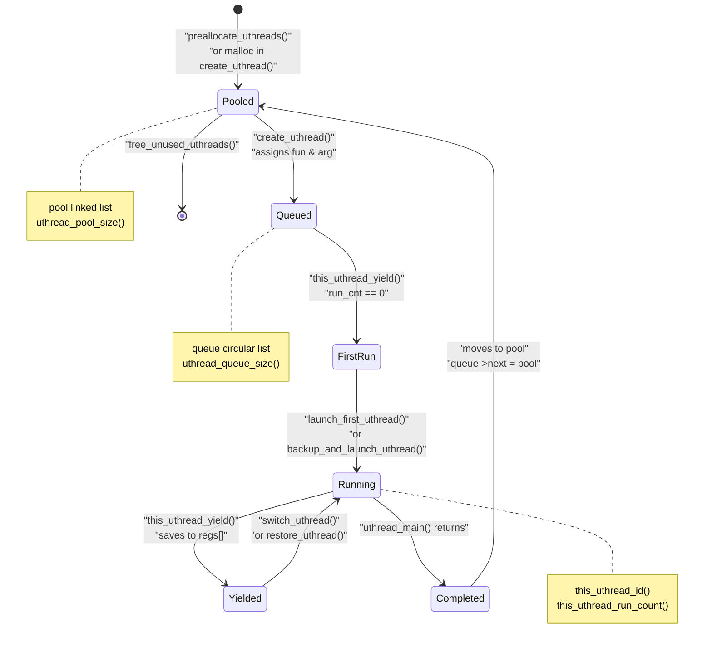
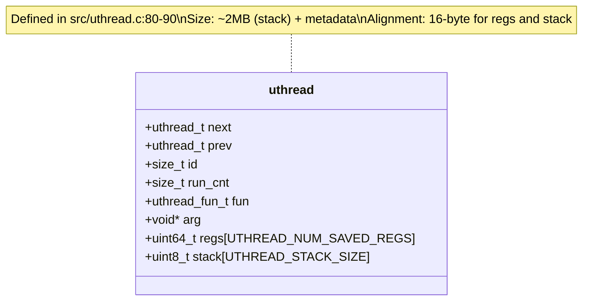
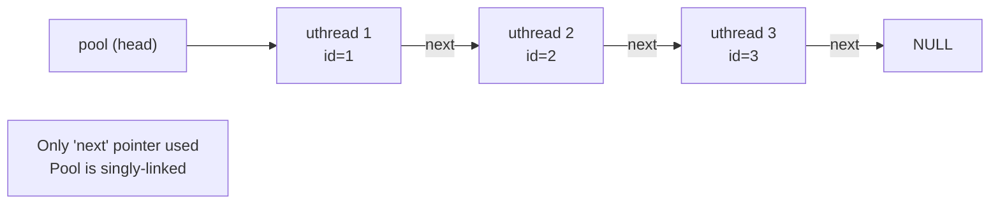
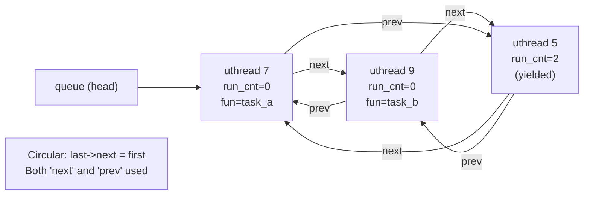
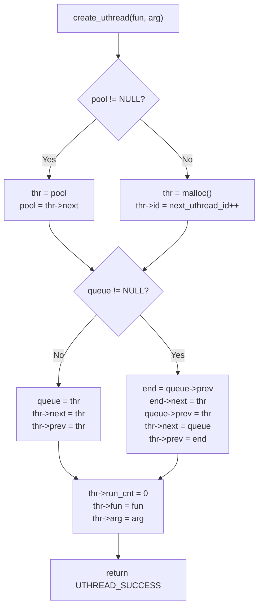
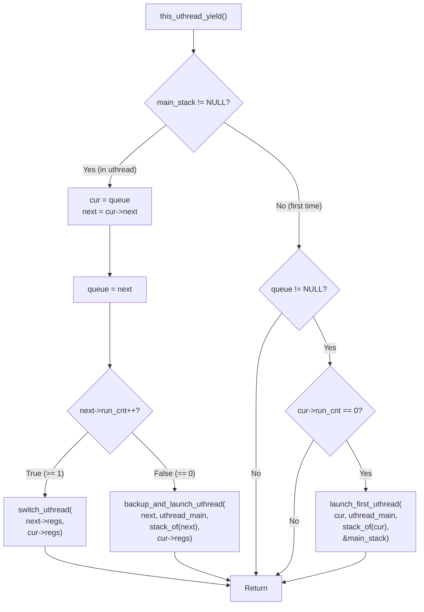
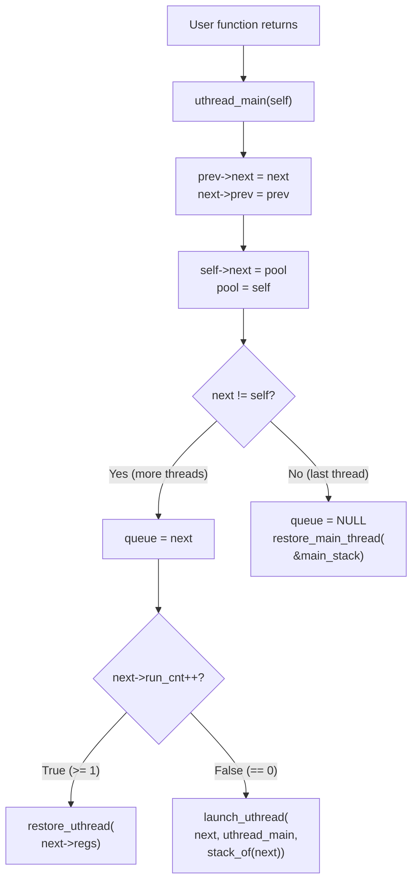

<!-- source: DeepWiki mcp.deepwiki.com · repo NVIDIA/libuthread · page 5.4 Thread State Machine · fetched 2026-10-26 -->

# Thread State Machine

<details>
<summary>Relevant source files</summary>

The following files were used as context for generating this wiki page:

- [include/uthread.h](include/uthread.h)
- [src/uthread.c](src/uthread.c)

</details>


## Purpose and Scope

This document describes the complete lifecycle of a `uthread` from allocation to deallocation, including all intermediate states and the transitions between them. The state machine governs how threads move through the pool, queue, and execution phases. For details on the low-level context switching operations that enable these transitions, see [Context Switching Mechanism](#5.1). For architecture-specific register conventions, see [x86_64 Implementation](#5.2) and [ARM64 Implementation](#5.3).

**Sources:** Diagram 4 from high-level architecture

---

## State Machine Overview

The libuthread system manages threads through five distinct states, organized around two primary data structures: the `pool` (a singly-linked list of unused threads) and the `queue` (a circular doubly-linked list of active threads). Each thread transitions through these states based on API calls and execution progress.



**Sources:** [src/uthread.c:80-254](), [include/uthread.h:27-48]()

---

## Thread Data Structure

The `struct uthread` contains all state required to manage a thread's lifecycle:



| Field | Type | Purpose |
|-------|------|---------|
| `next` | `uthread_t` | Forward pointer in pool or queue |
| `prev` | `uthread_t` | Backward pointer in queue (circular) |
| `id` | `size_t` | Unique thread identifier, assigned sequentially |
| `run_cnt` | `size_t` | Execution counter; 0 indicates first run |
| `fun` | `uthread_fun_t` | User-provided function pointer |
| `arg` | `void*` | Argument passed to `fun` |
| `regs[]` | `uint64_t[7 or 21]` | Saved register state (7 for x86_64, 21 for aarch64) |
| `stack[]` | `uint8_t[2MB]` | Private stack space for thread execution |

**Sources:** [src/uthread.c:80-90](), [src/uthread.c:35-54]()

---

## State Descriptions

### Pooled State

Threads in the **Pooled** state reside in the `pool` singly-linked list and are available for reuse. This state optimizes allocation performance by maintaining a free list of thread structures.

**Data Structure:** `static __thread uthread_t pool`

**Characteristics:**
- Linked via `next` pointer only (not `prev`)
- Fields `fun`, `arg`, `run_cnt` are undefined
- Field `id` is already assigned and persists across reuse
- Memory allocated but not in active use

**Entry Points:**
- `preallocate_uthreads(n)`: Creates `n` new threads and adds to pool [src/uthread.c:107-117]()
- Completion of thread execution returns thread to pool [src/uthread.c:203-208]()

**Exit Point:**
- `create_uthread(fun, arg)`: Pops from pool (or allocates if empty) [src/uthread.c:132-134]()



**Sources:** [src/uthread.c:95](), [src/uthread.c:107-117](), [src/uthread.c:119-128](), [src/uthread.c:203-208]()

---

### Queued State

Threads in the **Queued** state are in the circular `queue` doubly-linked list, ready to execute but not yet started (`run_cnt == 0`) or currently yielded.

**Data Structure:** `static __thread uthread_t queue`

**Characteristics:**
- Circular doubly-linked structure: `queue->prev` points to last thread
- Fields `fun` and `arg` are initialized with user-provided values
- Field `run_cnt` is set to `0` [src/uthread.c:156]()
- Thread has never executed or is in yielded state (if `run_cnt > 0`)

**Entry Point:**
- `create_uthread(fun, arg)`: Appends to end of queue [src/uthread.c:141-159]()

**Exit Point:**
- `this_uthread_yield()`: Transitions to FirstRun or Running state [src/uthread.c:224-253]()



**Sources:** [src/uthread.c:96](), [src/uthread.c:130-160](), [src/uthread.c:162-172]()

---

### FirstRun State

**FirstRun** is a transient state occurring when a thread transitions from Queued to Running for the first time. It is distinguished by `run_cnt == 0` and triggers special initialization logic.

**Detection:** `if (next->run_cnt++)` evaluates to `false` [src/uthread.c:235](), [src/uthread.c:213]()

**Special Handling:**
- Increments `run_cnt` from 0 to 1
- Calls architecture-specific assembly functions that do **not** restore registers:
  - `launch_first_uthread()` for first yield from main [src/uthread.c:250]()
  - `backup_and_launch_uthread()` for subsequent first runs [src/uthread.c:238]()
  - `launch_uthread()` after thread completion [src/uthread.c:216]()
- These functions initialize the new stack pointer and jump to `uthread_main`

**Contrast with Resume:** Threads with `run_cnt > 0` use `switch_uthread()` or `restore_uthread()`, which restore saved register state.

**Sources:** [src/uthread.c:213-217](), [src/uthread.c:235-239](), [src/uthread.c:242-250]()

---

### Running State

The **Running** state represents active execution of the user-provided function. The thread's context is loaded into CPU registers, and its private stack is in use.

**Identification:** `queue` points to the currently running thread [src/uthread.c:96]()

**Characteristics:**
- CPU is executing instructions on this thread's stack
- `run_cnt >= 1` (incremented before entry)
- Introspection APIs work: `this_uthread_id()` and `this_uthread_run_count()` return valid values [src/uthread.c:174-192]()

**Entry Points:**
- From FirstRun: Assembly functions set stack pointer to `stack_of(thr)` [src/uthread.c:92]()
- From Yielded: `switch_uthread()` or `restore_uthread()` restore `regs[]`

**Exit Points:**
- `this_uthread_yield()`: Transitions to Yielded
- Function return: Transitions to Completed [src/uthread.c:194-222]()

**Sources:** [src/uthread.c:174-192](), [src/uthread.c:194-196]()

---

### Yielded State

The **Yielded** state represents a paused thread whose register context is saved in `regs[]`. The thread remains in the `queue` but is not actively executing.

**Characteristics:**
- `run_cnt > 0` indicates the thread has executed at least once
- Register state saved in `regs[UTHREAD_NUM_SAVED_REGS]` array
- Stack contents preserved but not in active use
- Thread remains in circular queue at its current position

**Entry Point:**
- `this_uthread_yield()` calls `switch_uthread(next->regs, cur->regs)` [src/uthread.c:236]()
- Assembly code saves callee-saved registers to `cur->regs`

**Exit Point:**
- Next invocation of `this_uthread_yield()` (from another thread) calls:
  - `switch_uthread(next->regs, cur->regs)` for mid-execution resume [src/uthread.c:236]()
  - `restore_uthread(next->regs)` after thread completion [src/uthread.c:214]()

**Sources:** [src/uthread.c:224-239](), [src/uthread.c:69]()

---

### Completed State

The **Completed** state is a brief transition when a thread's user function returns. The thread is removed from `queue` and returned to `pool`.

**Trigger:** Return from user function causes `uthread_main()` to regain control [src/uthread.c:194-222]()

**Actions:**
1. Remove thread from queue: `prev->next = next; next->prev = prev` [src/uthread.c:204-205]()
2. Add thread to pool: `self->next = pool; pool = self` [src/uthread.c:207-208]()
3. Determine next action:
   - If queue not empty: Resume or launch next thread [src/uthread.c:211-217]()
   - If queue empty: Call `restore_main_thread(&main_stack)` [src/uthread.c:219-220]()

**Sources:** [src/uthread.c:194-222]()

---

## State Transitions and Control Flow

### Thread Creation Path



**Sources:** [src/uthread.c:130-160]()

---

### Yield and Context Switch Path



**Sources:** [src/uthread.c:224-253]()

---

### Thread Completion Path



**Sources:** [src/uthread.c:194-222]()

---

## Thread-Local Storage

All state machine data structures are declared with `__thread` storage class, making them thread-local in the context of OS threads. This allows multiple OS threads to independently manage their own user-level thread pools and queues.

| Variable | Type | Purpose |
|----------|------|---------|
| `next_uthread_id` | `size_t` | Monotonic ID generator, starts at 1 |
| `pool` | `uthread_t` | Head of singly-linked free list |
| `queue` | `uthread_t` | Head of circular doubly-linked active list |
| `main_stack` | `void*` | Saved main context for return |

**Initialization:** All thread-local variables initialize to `0` / `NULL` [src/uthread.c:94-97]()

**Implications:**
- Each OS thread has independent state machine instances
- `this_uthread_id()` returns IDs unique within an OS thread
- Cross-OS-thread thread management is not supported

**Sources:** [src/uthread.c:94-97]()

---

## State Inspection Functions

The public API provides three functions for inspecting thread state, all of which operate on the currently running thread (the head of `queue`):

### `uthread_pool_size()`

Returns the count of threads in the Pooled state by iterating the `pool` linked list.

**Implementation:** [src/uthread.c:99-105]()

```c
size_t uthread_pool_size(void) {
  size_t n = 0;
  for (uthread_t thr = pool; thr; thr = thr->next) {
    ++n;
  }
  return n;
}
```

**Sources:** [src/uthread.c:99-105]()

---

### `uthread_queue_size()`

Returns the count of threads in Queued, Running, or Yielded states by traversing the circular `queue` list.

**Implementation:** [src/uthread.c:162-172]()

```c
size_t uthread_queue_size(void) {
  uthread_t beg = queue;
  if (!beg) return 0;

  uthread_t end = beg->prev;
  size_t n = 1;
  for (uthread_t thr = beg; thr != end; thr = thr->next) {
    ++n;
  }
  return n;
}
```

**Sources:** [src/uthread.c:162-172]()

---

### `this_uthread_id()` and `this_uthread_run_count()`

Return the `id` and `run_cnt` fields of the currently running thread (`queue`). These functions return `0` if called from main context (before first yield or after all threads complete).

**Implementation:** [src/uthread.c:174-192]()

**Error Handling:** In debug builds, prints error message if not inside a uthread [src/uthread.c:177](), [src/uthread.c:187]()

**Sources:** [src/uthread.c:174-192](), [include/uthread.h:44-46]()

---

## State Machine Invariants

The following invariants are maintained throughout the state machine lifecycle:

| Invariant | Description |
|-----------|-------------|
| **Pool is singly-linked** | Threads in `pool` have undefined `prev` pointers |
| **Queue is circular** | `queue->prev` always points to last thread; `last->next == queue` |
| **Unique IDs** | `next_uthread_id` is monotonically increasing per OS thread |
| **run_cnt tracks execution** | `0` = never executed, `>= 1` = executed at least once |
| **Active thread is queue head** | `queue` always points to the currently running thread (or NULL) |
| **main_stack semantics** | `NULL` before first yield, non-NULL during uthread execution |

**Assertion Checks:** [src/uthread.c:195](), [src/uthread.c:200-201](), [src/uthread.c:230](), [src/uthread.c:232](), [src/uthread.c:244]()

**Sources:** [src/uthread.c:80-254]()

---

