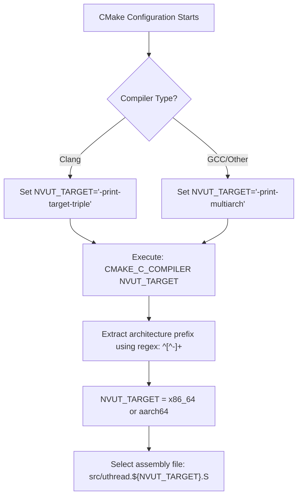
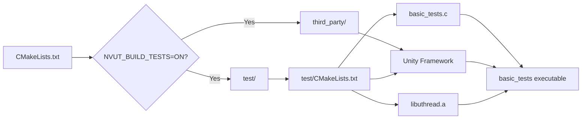
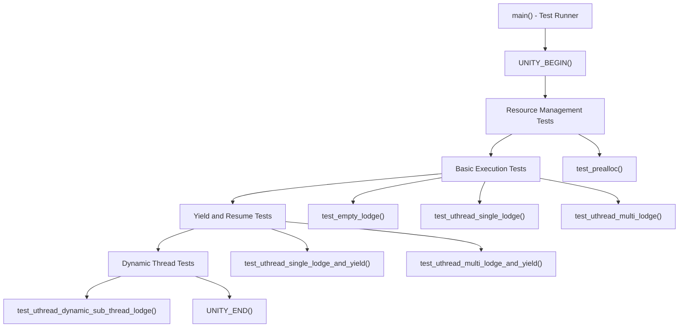
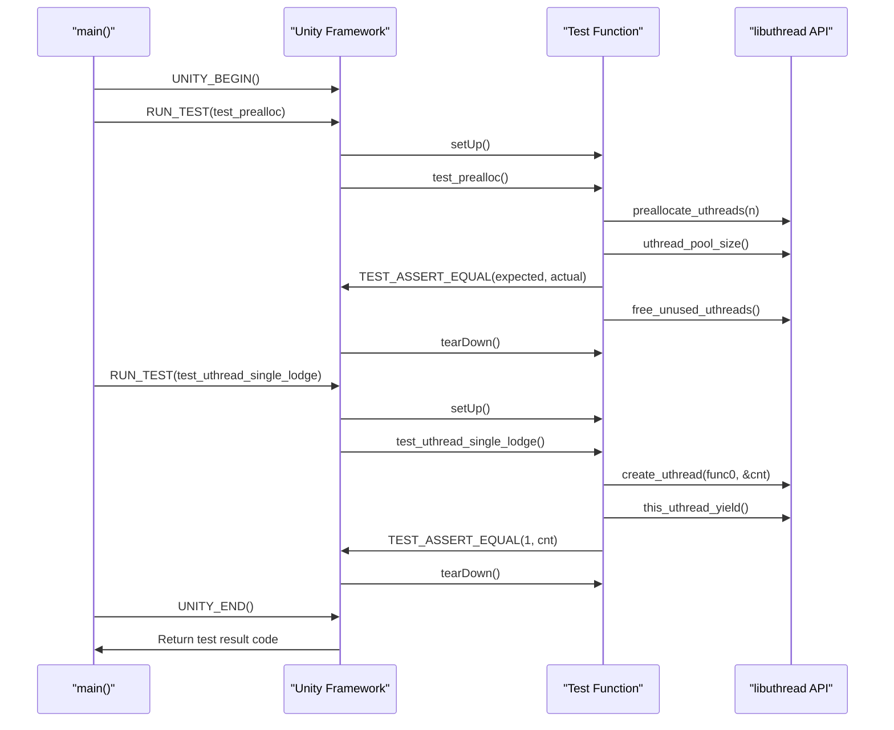

<!-- source: DeepWiki mcp.deepwiki.com · repo NVIDIA/libuthread · page 6 Building and Testing · fetched 2026-10-26 -->

# Building and Testing

<details>
<summary>Relevant source files</summary>

The following files were used as context for generating this wiki page:

- [CMakeLists.txt](CMakeLists.txt)
- [test/CMakeLists.txt](test/CMakeLists.txt)
- [test/basic_tests.c](test/basic_tests.c)

</details>


## Purpose and Scope

This page provides a comprehensive guide to building the libuthread library and running its test suite. It covers the CMake-based build system, automatic architecture detection, and the Unity-based testing infrastructure. For detailed information about the build system's architecture detection logic, see [Build System Architecture](#6.1). For information about the test suite structure and individual test cases, see [Unit Tests](#6.2).

---

## Build System Overview

The libuthread project uses CMake as its build system to produce a static library (`libuthread.a`) that can be linked into applications. The build system automatically detects the target architecture and selects the appropriate assembly implementation.

### Build Requirements

| Requirement | Version | Purpose |
|------------|---------|---------|
| CMake | ≥ 3.13 | Build system generator |
| C Compiler | GCC or Clang | Compiling C source files |
| ASM Support | Built into compiler | Assembling platform-specific context switching code |

The project is configured with strict compiler warnings enabled via `-Wall -Wextra -Wconversion` flags [CMakeLists.txt:20]().

### Basic Build Commands

To build the library on any supported platform:

```bash
mkdir build
cd build
cmake ..
make
```

This produces `libuthread.a` in the build directory, which can be linked into applications using `-luthread`.

---

## Architecture Detection Mechanism

The build system automatically detects the target architecture to select the correct assembly implementation. This detection occurs during the CMake configuration phase.

### Detection Flow



**Architecture Detection Process**: The build system queries the C compiler to determine the target architecture. For Clang, it uses `-print-target-triple`, while for GCC it uses `-print-multiarch`. The output is parsed with regex `^[^-]+` to extract the architecture prefix, which becomes the `NVUT_TARGET` variable. This variable is then used to construct the assembly file name.

**Sources:** [CMakeLists.txt:22-34]()

---

## Build Targets and Options

The build system defines several targets and configuration options:

### Primary Target: `uthread`

The main library target is defined at [CMakeLists.txt:43]():

```cmake
add_library(uthread STATIC src/uthread.c "src/uthread.${NVUT_TARGET}.S")
```

This creates a static library containing:
- `src/uthread.c` - Core thread management implementation
- `src/uthread.${NVUT_TARGET}.S` - Architecture-specific assembly code

### Build Option: `NVUT_BUILD_TESTS`

The `NVUT_BUILD_TESTS` CMake option controls whether the test suite is built. It defaults to `ON` [CMakeLists.txt:36]().

| Option Value | Effect |
|-------------|--------|
| `ON` (default) | Builds test executable `basic_tests` |
| `OFF` | Skips test compilation and third-party dependencies |

To build without tests:

```bash
cmake -DNVUT_BUILD_TESTS=OFF ..
make
```

---

## Testing Infrastructure

The test suite uses the Unity test framework, a lightweight C unit testing framework maintained as a git submodule in `third_party/unity`.

### Test Build System



**Test Build Dependencies**: When `NVUT_BUILD_TESTS` is enabled, the root CMakeLists.txt adds the `third_party` and `test` subdirectories. The test CMakeLists.txt creates the `basic_tests` executable by linking `basic_tests.c` with both the `uthread` library and the Unity test framework.

**Sources:** [CMakeLists.txt:45-48](), [test/CMakeLists.txt:16-18]()

### Test Executable Configuration

The `basic_tests` target is configured with specific dependencies [test/CMakeLists.txt:16-18]():

```cmake
add_executable(basic_tests basic_tests.c)
target_include_directories(basic_tests PRIVATE ${CMAKE_SOURCE_DIR}/third_party/unity/src)
target_link_libraries(basic_tests uthread unity)
```

This configuration:
1. Creates executable from `basic_tests.c`
2. Adds Unity header include path
3. Links against both `uthread` and `unity` libraries

---

## Test Suite Structure

The test suite in `test/basic_tests.c` validates core libuthread functionality using the Unity framework's assertion macros.

### Test Organization



**Test Suite Structure**: The main function uses Unity's `UNITY_BEGIN()` and `UNITY_END()` macros to initialize and finalize the test framework. Tests are organized into four groups: resource management (`test_prealloc`), basic execution without yields, execution with yields, and dynamic thread creation during execution.

**Sources:** [test/basic_tests.c:135-157]()

### Key Test Functions

The test suite defines several helper functions that exercise different aspects of the library:

| Function | Purpose | Thread Behavior |
|----------|---------|----------------|
| `func0` | Simple counter increment | Executes once, no yields |
| `func1` | Multiple yield test | Yields twice, resumes twice |
| `func2` | Dynamic thread creation | Conditionally creates sub-threads and yields |

**Function Implementations:**
- `func0`: Increments a counter and prints thread ID [test/basic_tests.c:50]()
- `func1`: Increments counter three times across three execution runs with two yields [test/basic_tests.c:72-87]()
- `func2`: Randomly creates sub-threads during execution to test dynamic thread creation [test/basic_tests.c:107-123]()

---

## Running Tests

### Standard Test Execution

After building with tests enabled, run the test suite:

```bash
./build/test/basic_tests
```

The test executable runs all test cases and produces output showing pass/fail status for each test.

### Test Execution Flow



**Test Execution Sequence**: Each test follows the Unity framework pattern: `setUp()` is called before each test, the test function executes and makes assertions, then `tearDown()` is called. Tests interact with libuthread APIs and use Unity's `TEST_ASSERT_*` macros to verify expected behavior.

**Sources:** [test/basic_tests.c:22-24](), [test/basic_tests.c:136-156]()

---

## Test Coverage

The test suite validates the following functionality:

### Resource Management Coverage

**Test:** `test_prealloc` [test/basic_tests.c:26-40]()

Validates:
- `preallocate_uthreads()` correctly allocates threads to the pool
- `uthread_pool_size()` returns accurate pool size
- `uthread_queue_size()` correctly reports zero when no threads are queued
- `free_unused_uthreads()` properly deallocates pool memory

### Execution Model Coverage

| Test Function | Threads Created | Yields Per Thread | Assertions |
|--------------|-----------------|-------------------|------------|
| `test_empty_lodge` | 0 | 0 | Queue remains empty after yield |
| `test_uthread_single_lodge` | 1 | 0 | Single thread executes completely |
| `test_uthread_multi_lodge` | 13 | 0 | All threads execute in round-robin |
| `test_uthread_single_lodge_and_yield` | 1 | 2 | Thread resumes after yields |
| `test_uthread_multi_lodge_and_yield` | 13 | 2 per thread | All threads resume correctly |
| `test_uthread_dynamic_sub_thread_lodge` | 13 + dynamic | Variable | Threads can create sub-threads |

### Assertion Patterns

The tests use Unity's assertion macros to validate behavior:

```c
TEST_ASSERT_EQUAL(expected_value, actual_value)  // Equality check
TEST_ASSERT_EQUAL(UTHREAD_SUCCESS, return_code)  // Success verification
```

Example from `test_uthread_single_lodge` [test/basic_tests.c:52-59]():
- Verifies queue size is 1 after `create_uthread()`
- Verifies queue size is 0 after `this_uthread_yield()`
- Verifies counter was incremented exactly once

---

## Integration with CI/CD

While the project structure supports automated testing, the build system is designed to work both locally and in continuous integration environments. The `NVUT_BUILD_TESTS` option allows flexibility:

- **Local Development:** Tests enabled by default for development workflow
- **Production Builds:** Tests can be disabled to reduce build dependencies
- **CI/CD Pipelines:** Tests always enabled to validate functionality

For information about the GitHub Actions workflow that runs these tests on multiple architectures, see [CI/CD Pipeline](#7.3).

**Sources:** [CMakeLists.txt:36-48]()

---

