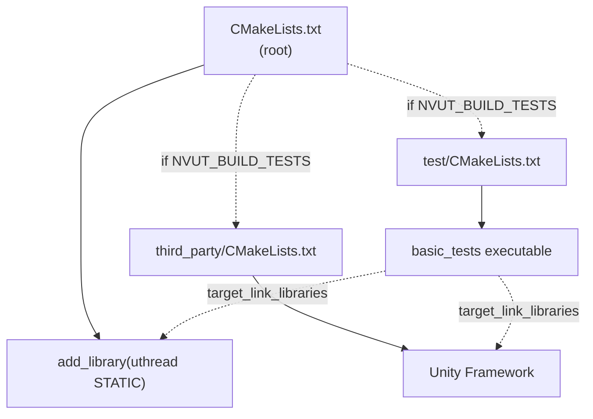
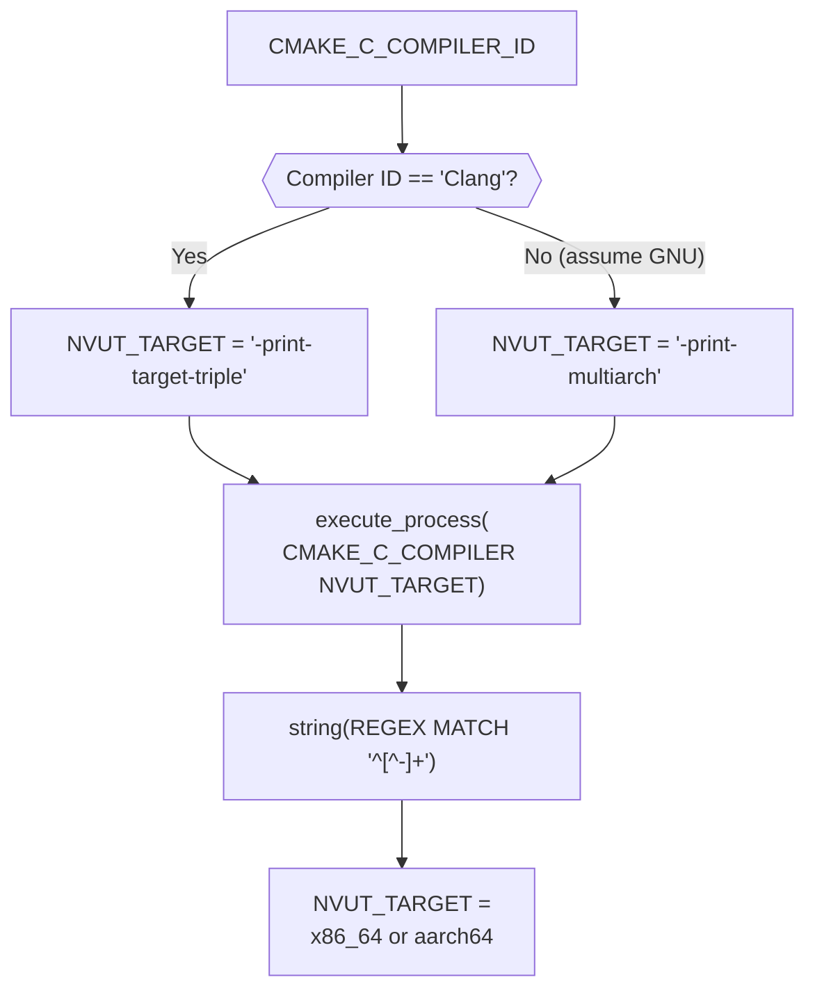
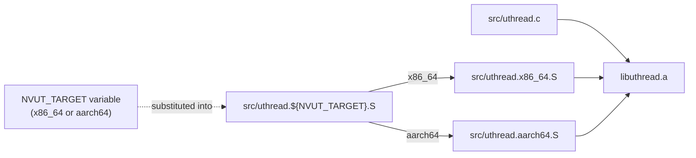
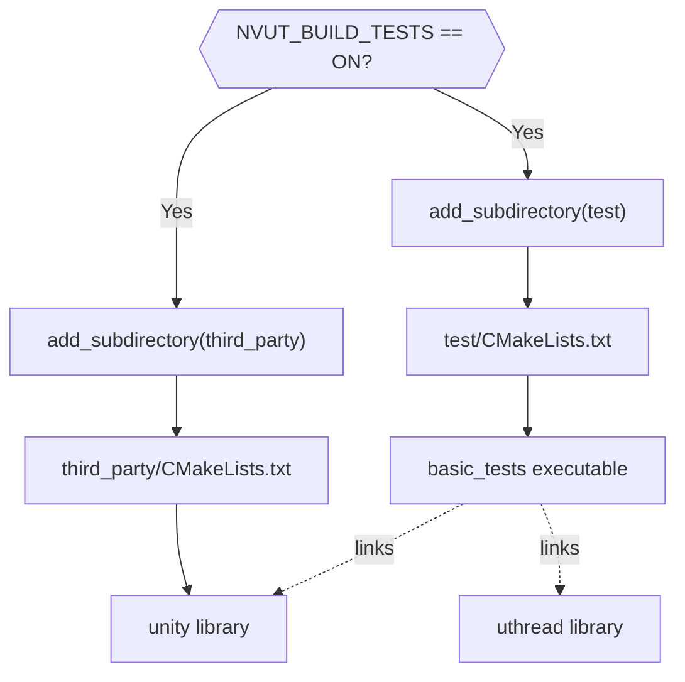
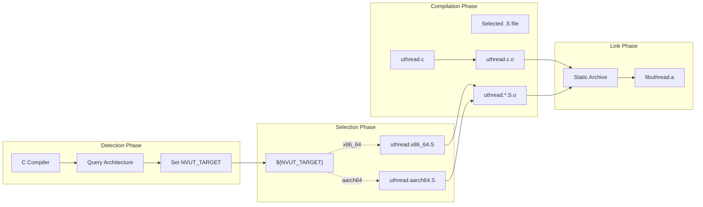

<!-- source: DeepWiki mcp.deepwiki.com · repo NVIDIA/libuthread · page 6.1 Build System Architecture · fetched 2026-10-26 -->

# Build System Architecture

<details>
<summary>Relevant source files</summary>

The following files were used as context for generating this wiki page:

- [CMakeLists.txt](CMakeLists.txt)
- [test/CMakeLists.txt](test/CMakeLists.txt)
- [third_party/CMakeLists.txt](third_party/CMakeLists.txt)

</details>


## Purpose and Scope

This document describes the CMake-based build system used to compile libuthread. The build system handles automatic architecture detection, selection of appropriate assembly implementations, compiler flag configuration, and optional test suite integration. For information about running tests, see [Unit Tests](#6.2). For details about the CI/CD pipeline that uses this build system, see [CI/CD Pipeline](#7.3).

---

## CMake Project Overview

The build system is structured as a multi-level CMake configuration with the root [CMakeLists.txt:16-48]() defining the main library target and two subdirectories for third-party dependencies and tests.

**Project Configuration**

| Property | Value | Location |
|----------|-------|----------|
| Minimum CMake Version | 3.13 | [CMakeLists.txt:16]() |
| Project Name | `uthread` | [CMakeLists.txt:18]() |
| Languages | C, ASM | [CMakeLists.txt:18]() |
| Library Type | Static | [CMakeLists.txt:43]() |
| Output Artifact | `libuthread.a` | N/A (CMake default) |

The project declares both C and ASM languages because the library consists of C source files ([src/uthread.c]()) and architecture-specific assembly files ([src/uthread.x86_64.S]() or [src/uthread.aarch64.S]()).



**Diagram: CMake Configuration Hierarchy**

Sources: [CMakeLists.txt:1-49]()

---

## Architecture Detection Mechanism

The build system automatically detects the target architecture by querying the C compiler. This detection determines which assembly file is compiled into the library. The mechanism differs between Clang and GCC compilers.

**Detection Flow**



**Diagram: Architecture Detection Algorithm**

The detection logic is implemented in [CMakeLists.txt:22-34]():

1. **Compiler Identification** [CMakeLists.txt:22-27](): Checks if `CMAKE_C_COMPILER_ID` is "Clang". If true, sets `NVUT_TARGET` to `-print-target-triple`. Otherwise, assumes GNU compiler and sets it to `-print-multiarch`.

2. **Compiler Query** [CMakeLists.txt:28-32](): Executes the compiler with the detection flag using `execute_process()`. The flag `COMMAND_ERROR_IS_FATAL ANY` ensures the build fails if the compiler doesn't support the flag.

3. **Architecture Extraction** [CMakeLists.txt:33](): Applies regex pattern `^[^-]+` to extract the architecture prefix from the compiler output. For example:
   - Clang output `x86_64-pc-linux-gnu` → extracts `x86_64`
   - GCC output `x86_64-linux-gnu` → extracts `x86_64`
   - Clang output `aarch64-unknown-linux-gnu` → extracts `aarch64`

4. **Status Message** [CMakeLists.txt:34](): Displays the detected architecture to the user during configuration.

**Compiler-Specific Behavior**

| Compiler | Detection Flag | Example Output | Extracted Value |
|----------|---------------|----------------|-----------------|
| Clang | `-print-target-triple` | `x86_64-pc-linux-gnu` | `x86_64` |
| GCC | `-print-multiarch` | `x86_64-linux-gnu` | `x86_64` |
| Clang | `-print-target-triple` | `aarch64-unknown-linux-gnu` | `aarch64` |
| GCC | `-print-multiarch` | `aarch64-linux-gnu` | `aarch64` |

Sources: [CMakeLists.txt:22-34]()

---

## Source File Selection

The detected architecture value stored in `NVUT_TARGET` is used to construct the assembly file name at compile time. This enables architecture-specific context switching implementations without preprocessor conditionals.



**Diagram: Source File Selection Pipeline**

The library target is defined in [CMakeLists.txt:43]():

```
add_library(uthread STATIC src/uthread.c "src/uthread.${NVUT_TARGET}.S")
```

The CMake variable substitution `${NVUT_TARGET}` expands to either `x86_64` or `aarch64`, resulting in one of:
- `src/uthread.x86_64.S` for x86-64 systems
- `src/uthread.aarch64.S` for ARM64 systems

The non-selected assembly file is ignored by the build system, ensuring only the correct implementation is compiled.

**Include Directories**

The build system configures the include path in [CMakeLists.txt:39-41]() to expose the public API:

```
include_directories(
  ${PROJECT_SOURCE_DIR}/include
)
```

This allows both internal compilation and downstream consumers to include `<uthread.h>`.

Sources: [CMakeLists.txt:39-43]()

---

## Compiler Flags and Options

The build system configures strict compiler warnings to catch potential issues during development.

**Warning Flags**

[CMakeLists.txt:20]() sets the following flags for all C compilation:

```
set(CMAKE_C_FLAGS "${CMAKE_C_FLAGS} -Wall -Wextra -Wconversion")
```

| Flag | Purpose |
|------|---------|
| `-Wall` | Enable all standard warnings |
| `-Wextra` | Enable extra warnings not covered by `-Wall` |
| `-Wconversion` | Warn about implicit type conversions that may alter values |

These flags apply to the compilation of [src/uthread.c]() but not to assembly files, which use ASM language rules.

**Build Options**

The build system provides a CMake option to control test compilation:

```
option(NVUT_BUILD_TESTS "Build tests" ON)
```

This option is defined in [CMakeLists.txt:36-37]() with a default value of `ON`. Users can disable tests by passing `-DNVUT_BUILD_TESTS=OFF` to CMake during configuration.

Sources: [CMakeLists.txt:20](), [CMakeLists.txt:36-37]()

---

## Test Build Configuration

When `NVUT_BUILD_TESTS` is enabled, the build system includes two subdirectories containing test infrastructure.



**Diagram: Test Build Integration**

**Third-Party Dependencies**

[third_party/CMakeLists.txt:16]() adds the Unity test framework:

```
add_subdirectory(unity)
```

The Unity framework is included as a git submodule and provides the test assertion and runner infrastructure. See [Unit Tests](#6.2) for details about the Unity framework.

**Test Executable**

[test/CMakeLists.txt:16-18]() defines the test executable:

```
add_executable(basic_tests basic_tests.c)
target_include_directories(basic_tests PRIVATE ${CMAKE_SOURCE_DIR}/third_party/unity/src)
target_link_libraries(basic_tests uthread unity)
```

The `basic_tests` executable:
- Compiles [test/basic_tests.c]()
- Includes Unity headers from the third-party directory
- Links against both `uthread` and `unity` libraries

This creates a self-contained test binary that can be executed to verify library functionality.

Sources: [CMakeLists.txt:45-48](), [test/CMakeLists.txt:16-18](), [third_party/CMakeLists.txt:16]()

---

## Build Invocation

The standard CMake workflow applies to this project:

**Configuration Phase**

```bash
mkdir build
cd build
cmake ..
```

During configuration, the architecture detection runs and displays:
```
-- NVUT_TARGET = x86_64
-- NVUT_BUILD_TESTS = ON
```

**Compilation Phase**

```bash
cmake --build .
```

This produces:
- `libuthread.a` - Static library in the build directory
- `basic_tests` - Test executable (if tests are enabled)

**Disabling Tests**

To build without tests:

```bash
cmake -DNVUT_BUILD_TESTS=OFF ..
cmake --build .
```

Sources: [CMakeLists.txt:1-49]()

---

## Architecture-Specific Compilation Details

The build system's architecture detection enables the following compilation pipeline:



**Diagram: Complete Build Pipeline from Detection to Artifact**

The CMake `ASM` language configuration ensures that `.S` files are processed with appropriate assembly rules. The C compiler is used to preprocess assembly files (handling any `#include` directives), and then the assembler produces object files.

Both object files (`uthread.c.o` and `uthread.{x86_64|aarch64}.S.o`) are archived into the static library `libuthread.a` using the system archiver (`ar`).

Sources: [CMakeLists.txt:18](), [CMakeLists.txt:43]()

---

## Cross-Compilation Support

While not explicitly configured, the architecture detection mechanism supports cross-compilation scenarios. When cross-compiling, CMake's `CMAKE_C_COMPILER` variable points to the target-architecture compiler, ensuring `NVUT_TARGET` correctly identifies the target architecture rather than the host architecture.

For example, when cross-compiling from x86_64 to aarch64:
- `CMAKE_C_COMPILER` = `aarch64-linux-gnu-gcc`
- Detection query returns `aarch64-linux-gnu`
- Regex extracts `aarch64`
- Build uses `src/uthread.aarch64.S`

This design eliminates the need for manual architecture specification or platform-specific CMake options.

Sources: [CMakeLists.txt:22-34]()

---

## Build System Limitations

The current build system has the following constraints:

1. **Architecture Support**: Only `x86_64` and `aarch64` are supported. Other architectures (e.g., `arm`, `i386`, `riscv64`) will cause build failures because the corresponding assembly files do not exist.

2. **Compiler Requirements**: The detection assumes Clang or GCC. Other compilers may not support `-print-target-triple` or `-print-multiarch`, causing the `execute_process()` step to fail.

3. **Platform Support**: The assembly implementations are Linux-specific (they use Linux calling conventions and do not include platform-specific guards). Building on non-Linux systems may succeed but produce non-functional code.

4. **Static Library Only**: The build system produces only a static library. Shared library builds are not supported.

These limitations align with the project's stated scope: "ARM64 and x86 (Linux only)."

Sources: [CMakeLists.txt:22-32]()

---

