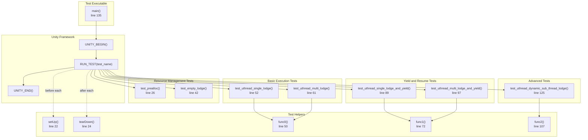
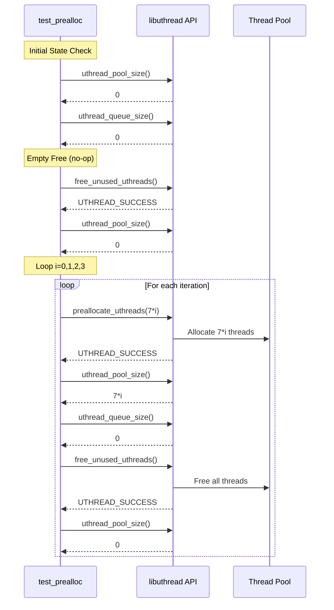
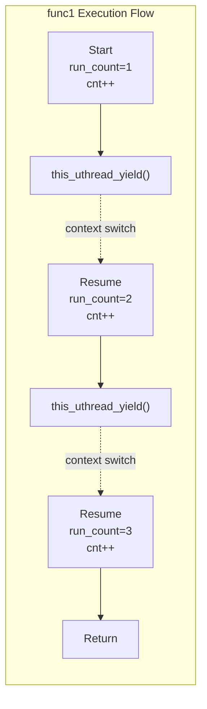
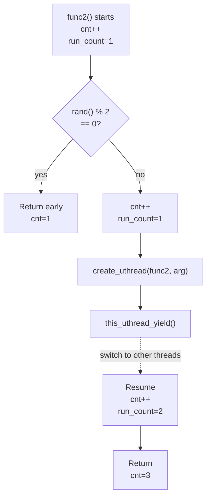
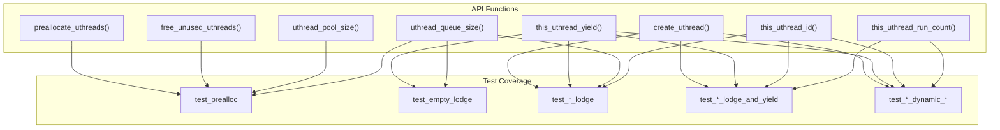
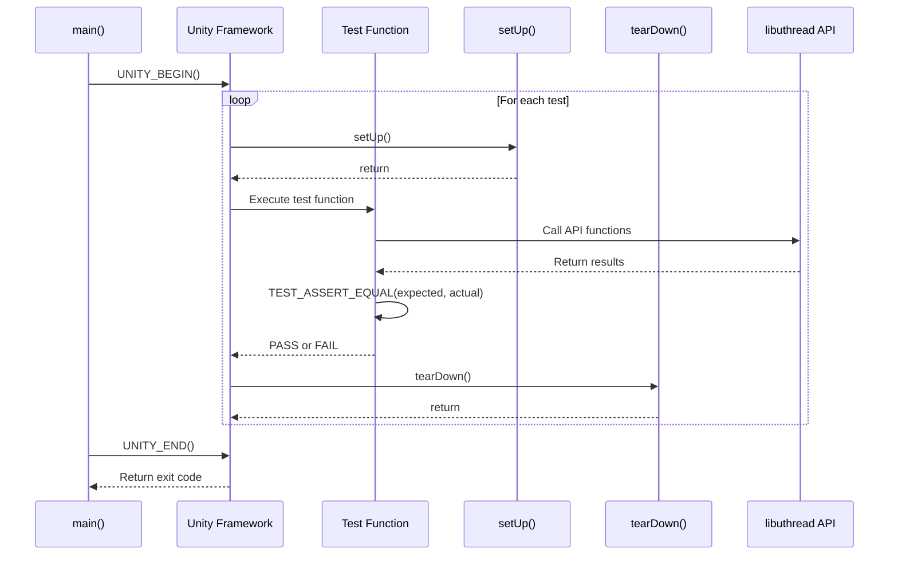

<!-- source: DeepWiki mcp.deepwiki.com · repo NVIDIA/libuthread · page 6.2 Unit Tests · fetched 2026-10-26 -->

# Unit Tests

<details>
<summary>Relevant source files</summary>

The following files were used as context for generating this wiki page:

- [.gitmodules](.gitmodules)
- [test/CMakeLists.txt](test/CMakeLists.txt)
- [test/basic_tests.c](test/basic_tests.c)
- [third_party/CMakeLists.txt](third_party/CMakeLists.txt)

</details>


## Purpose and Scope

This document describes the unit test suite for libuthread, including the testing framework integration, test structure, individual test cases, and execution instructions. The test suite validates core functionality including thread pool management, thread creation, cooperative scheduling, and context switching.

For information about building the library itself, see [Building the Library](#2.1). For details about the CI/CD pipeline that runs these tests automatically, see [CI/CD Pipeline](#7.3).

---

## Unity Framework Integration

The libuthread test suite uses the **Unity** testing framework, a lightweight C unit testing framework maintained by ThrowTheSwitch. Unity is included as a git submodule located at `third_party/unity/`.

### Submodule Configuration

The Unity framework is declared in [.gitmodules:1-3]():

```
[submodule "third_party/unity"]
	path = third_party/unity
	url = https://github.com/ThrowTheSwitch/Unity.git
```

To initialize the submodule after cloning the repository:

```bash
git submodule update --init --recursive
```

### Build Integration

The test executable is configured in [test/CMakeLists.txt:16-18]():

| Build Component | Configuration |
|----------------|---------------|
| Executable Name | `basic_tests` |
| Source File | `basic_tests.c` |
| Include Directories | `${CMAKE_SOURCE_DIR}/third_party/unity/src` |
| Link Libraries | `uthread`, `unity` |

The Unity framework is built through [third_party/CMakeLists.txt:16](), which includes the Unity subdirectory containing its own build configuration.

**Sources:** `.gitmodules`, `test/CMakeLists.txt`, `third_party/CMakeLists.txt`

---

## Test Suite Structure

The test suite is organized into a single executable that validates different aspects of libuthread functionality. The main test file is [test/basic_tests.c]().



### Test Organization

The test suite follows Unity conventions with [test/basic_tests.c:22-24]() implementing the required `setUp()` and `tearDown()` functions (currently empty), and [test/basic_tests.c:135-157]() implementing `main()` which orchestrates test execution.

**Sources:** `test/basic_tests.c`

---

## Test Cases Overview

The test suite contains seven distinct test cases that exercise different aspects of libuthread functionality:

| Test Function | Line Range | Purpose | Iterations |
|--------------|------------|---------|------------|
| `test_prealloc` | 26-40 | Validates thread pool preallocation and deallocation | 1 |
| `test_empty_lodge` | 42-48 | Tests yielding when no threads are queued | 3 |
| `test_uthread_single_lodge` | 52-59 | Tests single thread creation and execution | 3 |
| `test_uthread_multi_lodge` | 61-70 | Tests multiple thread creation and execution | 3 |
| `test_uthread_single_lodge_and_yield` | 89-95 | Tests single thread with yield/resume cycles | 3 |
| `test_uthread_multi_lodge_and_yield` | 97-105 | Tests multiple threads with yield/resume cycles | 3 |
| `test_uthread_dynamic_sub_thread_lodge` | 125-133 | Tests dynamic thread creation during execution | 3 |

Note that several tests are executed multiple times within the test suite (see iterations column) to validate consistent behavior across repeated executions.

**Sources:** `test/basic_tests.c`

---

## Detailed Test Case Analysis

### test_prealloc



This test validates resource management functions. It tests [test/basic_tests.c:26-40]():

- Initial state verification (empty pool and queue)
- Preallocation with varying sizes (0, 7, 14, 21 threads)
- Pool size reporting accuracy
- Deallocation correctness
- State consistency after cleanup

**API Functions Tested:** `preallocate_uthreads()`, `free_unused_uthreads()`, `uthread_pool_size()`, `uthread_queue_size()`

**Sources:** `test/basic_tests.c`

---

### test_empty_lodge and Basic Execution Tests

The `test_empty_lodge()` function [test/basic_tests.c:42-48]() validates that yielding with an empty queue is safe and returns control immediately:

```c
void test_empty_lodge(void) {
  size_t cnt = 0;
  TEST_ASSERT_EQUAL(0, uthread_queue_size());
  this_uthread_yield();              // No threads to switch to
  TEST_ASSERT_EQUAL(0, uthread_queue_size());
  TEST_ASSERT_EQUAL(0, cnt);         // Counter unchanged
}
```

The basic execution tests use the helper function `func0()` [test/basic_tests.c:50]():

```c
void func0(void *arg) { 
  printf("uThread %lu, cnt = %lu\n", this_uthread_id(), ++(*(size_t *)arg)); 
}
```

**test_uthread_single_lodge** [test/basic_tests.c:52-59]():
- Creates one thread with `create_uthread(func0, &cnt)`
- Verifies queue size increases to 1
- Yields to execute the thread
- Verifies thread completes and queue becomes empty
- Validates counter incremented exactly once

**test_uthread_multi_lodge** [test/basic_tests.c:61-70]():
- Creates 13 threads in a loop
- Verifies queue size equals 13
- Yields to execute all threads
- Validates all threads complete and counter reaches 13

**API Functions Tested:** `create_uthread()`, `this_uthread_yield()`, `uthread_queue_size()`, `this_uthread_id()`

**Sources:** `test/basic_tests.c`

---

### Yield and Resume Tests

These tests validate cooperative multitasking by using threads that yield control and later resume execution. The helper function `func1()` [test/basic_tests.c:72-87]() demonstrates this pattern:



Each execution of `func1()` increments the counter three times:
1. Initial execution before first yield
2. First resume after context switch
3. Second resume after second context switch

**test_uthread_single_lodge_and_yield** [test/basic_tests.c:89-95]():
- Creates one thread executing `func1()`
- Yields to start execution
- Validates counter reaches 3 (thread executed three increments)

**test_uthread_multi_lodge_and_yield** [test/basic_tests.c:97-105]():
- Creates 13 threads each executing `func1()`
- Yields to execute all threads cooperatively
- Validates counter reaches 39 (13 threads × 3 increments each)

This test verifies that context switching correctly preserves register state across yields and resumes, allowing threads to maintain execution state.

**API Functions Tested:** `this_uthread_yield()`, `this_uthread_run_count()`, `this_uthread_id()`

**Sources:** `test/basic_tests.c`

---

### Dynamic Sub-Thread Creation Test

The most complex test case validates dynamic thread creation during execution. The helper function `func2()` [test/basic_tests.c:107-123]() implements a recursive pattern:



The test [test/basic_tests.c:125-133]():
- Creates 13 initial threads executing `func2()`
- Each thread randomly decides whether to create a new sub-thread
- Uses a seeded random number generator (`srand(4711 + i)`) for reproducibility
- Runs three iterations with different seeds
- Total counter value depends on random outcomes

This test validates:
- Dynamic thread creation from within executing threads
- Queue management when threads add new work
- Context switching with varying queue depths
- Correct handling of thread lifecycle transitions

**Note:** The test includes a `TODO` comment at [test/basic_tests.c:132]() indicating that validation of final state is incomplete.

**API Functions Tested:** `create_uthread()` (from within thread context), `this_uthread_yield()`, `this_uthread_run_count()`, `this_uthread_id()`

**Sources:** `test/basic_tests.c`

---

## Building and Running Tests

### Build Configuration

Tests are built when the `NVUT_BUILD_TESTS` CMake option is enabled. From the repository root:

```bash
mkdir build
cd build
cmake -DNVUT_BUILD_TESTS=ON ..
make
```

This produces the `build/test/basic_tests` executable.

### Test Execution

Run the test suite:

```bash
./test/basic_tests
```

Expected output includes:
- Unity framework header
- Console output from test threads (via `printf()` statements)
- Test result summary showing passed/failed tests
- Final test statistics

### Test Output Format

The Unity framework provides structured output:

```
test/basic_tests.c:26:test_prealloc:PASS
test/basic_tests.c:42:test_empty_lodge:PASS
test/basic_tests.c:52:test_uthread_single_lodge:PASS
...
-----------------------
XX Tests 0 Failures 0 Ignored
OK
```

The return code is 0 for success, non-zero for any test failures.

**Sources:** `test/CMakeLists.txt`, `test/basic_tests.c`

---

## Test Coverage Analysis

The test suite provides coverage across all major API surface areas:



### Coverage Summary

| Category | Functions Tested | Test Cases |
|----------|------------------|------------|
| Resource Management | `preallocate_uthreads()`, `free_unused_uthreads()` | `test_prealloc` |
| Introspection | `uthread_pool_size()`, `uthread_queue_size()` | All tests |
| Thread Creation | `create_uthread()` | All execution tests |
| Cooperative Scheduling | `this_uthread_yield()` | All tests |
| Thread Context | `this_uthread_id()`, `this_uthread_run_count()` | Execution tests with `func0`, `func1`, `func2` |

### Coverage Gaps

The current test suite does not explicitly test:
- Thread pool recycling behavior (threads returning to pool after completion)
- Maximum queue depth or pool size limits
- Error handling for invalid function pointers
- Architecture-specific context switching edge cases
- Performance characteristics or timing-sensitive behavior

These areas may be covered implicitly through test execution but lack explicit validation assertions.

**Sources:** `test/basic_tests.c`, `include/uthread.h` (implied by API references)

---

## Test Execution Flow



The test execution follows Unity's standard pattern [test/basic_tests.c:135-157]():

1. `UNITY_BEGIN()` initializes the framework
2. For each `RUN_TEST()` call:
   - `setUp()` is called (currently empty)
   - Test function executes
   - Assertions validate behavior
   - `tearDown()` is called (currently empty)
3. `UNITY_END()` prints summary and returns exit code

Tests execute sequentially in the order defined in `main()`, with some tests repeated multiple times to verify consistency.

**Sources:** `test/basic_tests.c`

---

